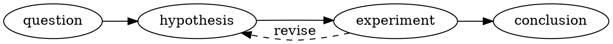

# Graphviz in Markdown

Use `dot` or `graphviz` to author graphs in DOT. Graphviz/WebAssembly generates
SVG locally; resource and capability policy still apply to external references.

The extension retains source and a local diagnostic on failure. Its SVG must be
handled through the managed rendering pipeline rather than inserted as
arbitrary trusted markup by a host.
