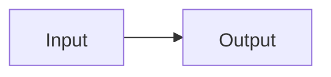

# Mermaid in Markdown

Mermaid diagrams render with the extension's strict security configuration. For
[standalone SVG export](../visual-export.md), author diagrams with SVG labels:

The export captures SVG presentation attributes from the mounted diagram. It
preserves the viewBox, accessible title and local marker references. External
resources, active content and stylesheet rules are removed by the shared
exporter. Fonts are named in the SVG and depend on the viewing environment.
HTML labels and SVG image elements are unsupported for export. In those cases
serialization rejects and the diagram stays visible.
