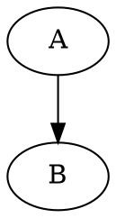

# Renderer size and layout

Visual fences accept presentation attributes on the opening line. Attributes
belong to Markdown, not to the language inside the fence: SDF blank header
lines and XYZ atom counts are preserved exactly.

````markdown
```smiles {width=50%}
CCO
```

```sdf {width=24rem height=18rem}
...complete SDF data...
```


````

| Attribute | Accepted values                                                            | Meaning                                                           |
| --------- | -------------------------------------------------------------------------- | ----------------------------------------------------------------- |
| `width`   | `auto`, positive `px` or `rem`, percentages greater than 0 and at most 100 | Percentage of enclosing content width; limited to available space |
| `height`  | `auto`, positive `px` or `rem`                                             | Graphic or viewport height; percentage heights are unsupported    |
| `display` | `block`, `inline`                                                          | Separate block or inline-level frame                              |

Quoted and unquoted values are equivalent. Unknown attributes, duplicate keys
and invalid values emit `fence-size-invalid` warnings and fall back for that
property without stopping rendering. Arbitrary CSS, expressions, `calc()`,
URLs, negative values and nonfinite dimensions are not accepted.

SVGs retain proportions. Two explicit dimensions define a rectangle in which
the graphic fits without clipping or distortion. Buttons, audio controls and
menus keep their normal size. Interactive renderers resize their buffers and
cameras through their native APIs.

## Chemistry defaults

SMILES drawings use their natural size. Small molecules are not enlarged to
fill the page; wider drawings shrink to fit narrow containers.

PDB, CIF, mmCIF, SDF, MOL2, XYZ and CUBE share a molecular viewer with default
width `24rem`, limited to available space, and automatic height at a 4:3 aspect
ratio. Explicit attributes override this compact viewport. Rotation and zoom
remain available; presentation does not change molecular coordinates.

Other visual renderers preserve existing defaults unless configuration requests
different presentation: Mermaid, Graphviz, WaveDrom, TikZ/CircuiTikZ, geometry,
maps, 3D models, Vega-Lite, ABC, MEI, MusicXML and fenced MathJax. Inline
MathJax remains typographic and unchanged.

## Structures inside a sentence

Fences are block Markdown. `display=inline` allows adjacent fence frames to sit
side by side, but cannot move a fence into an existing paragraph.

With the SMILES extension enabled, use a text directive for a structure inside
a sentence:

```markdown
Ethanol :smiles[CCO]{height=2rem} contains an OH group. The ammonium ion is
:smiles[[NH4+]]{height=2rem}.
```

The directive balances atom brackets, accepts single-line SMILES and the same
presentation attributes, and defaults to inline layout. Code spans and fences
remain literal. Multiline molecular data and interactive 3D models use fences.

## Host API and extension integration

```typescript
const engine = createEducationalMarkdownEngine({
    features: ["smiles", "molecule-3d"],
    renderSizing: {
        defaults: { display: "block" },
        extensions: {
            smiles: { width: "auto", height: "auto" },
            "molecule-3d": { width: "30rem", height: "20rem" },
        },
    },
});
```

`MarkdownRenderSize` contains optional `width`, `height` and `display` fields.
`MarkdownEngineOptions.renderSizing` accepts `defaults` and an `extensions`
record keyed by extension name (`molecule-3d`, rather than `sdf`). Each
property resolves independently: document attributes override extension
configuration, which overrides global configuration, which overrides native
defaults.

Renderers receive a per-block `MarkdownDocumentContext.renderSize`. Existing
numeric `context.width` and `context.height` hints retain their compatibility.
Extension fences opt in with `sizing: 'intrinsic' | 'viewport'` and may specify
`defaultSize`. Layout is established before viewport initialization. Nested
viewports must fill their sized frame and observe its dimensions.

Only opted-in renderers use this mechanism. Ordinary code, Markdown images and
textual MathJSLab output are unchanged. Native DOT, TeX, Vega-Lite and other
language settings continue to control construction; attributes control its
presentation in Markdown.
