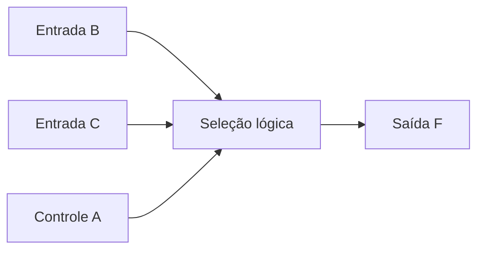

# 3. Álgebra booleana e funções lógicas

A representação binária, desenvolvida no
[Capítulo 2](number-systems-and-information-representation.md), fornece um
alfabeto de dois símbolos. Para especificar **como** circuitos transformam
esses símbolos em resultados, precisamos de uma linguagem matemática. A álgebra
booleana oferece essa linguagem: permite descrever decisões, demonstrar
equivalências e estabelecer relações entre uma especificação funcional e sua
futura implementação eletrônica.

A álgebra booleana não deve ser confundida com a aritmética binária. Na
aritmética, `1 + 1` produz o valor dois, representado por `10` em base dois; na
álgebra booleana, o símbolo $+$ costuma denotar a operação lógica OU e $1+1=1$.
Ao longo deste capítulo, utilizaremos $+$ para OU, a justaposição ou $\cdot$
para E e a barra superior para NÃO. Quando necessário, empregaremos também
$\lor$, $\land$ e $\neg$ para tornar a operação inequívoca.

O estudo é deliberadamente **funcional**: as portas físicas, seus símbolos e
suas características elétricas serão tratados no
[Capítulo 4](logic-gates-and-circuit-representation.md). Aqui, o foco é
estabelecer funções e transformá-las sem alterar seu significado lógico.

## Objetivos de aprendizagem

Ao concluir o capítulo, o leitor deverá ser capaz de definir variáveis e
funções booleanas; construir tabelas-verdade; aplicar as operações E, OU, NÃO,
OU-exclusivo e equivalência; demonstrar identidades e utilizar a dualidade;
aplicar os teoremas de De Morgan; obter expressões canônicas por mintermos e
maxtermos; converter expressões para soma de produtos e produto de somas; e
distinguir funções totalmente especificadas de funções com condições
indiferentes.

## 3.1. Variáveis e funções booleanas {#sec-boolean-variables-and-functions}

Uma **variável booleana** assume valores no conjunto $\mathbb{B}=\{0,1\}$. Uma
função booleana de $n$ variáveis é uma aplicação

$$
f:\mathbb{B}^{n}\longrightarrow\mathbb{B}.\tag{3.1}
$$

Cada vetor de entrada $\mathbf{x}=(x_1,\ldots,x_n)$ é uma **combinação de
entrada**. Há $2^n$ combinações possíveis e, portanto, uma tabela-verdade
completa possui $2^n$ linhas. Como cada linha pode receber independentemente um
valor de saída 0 ou 1, existem $2^{2^n}$ funções booleanas distintas de $n$
variáveis, contando também as funções constantes.

<!-- prettier-ignore -->
::: definition Função booleana {#def-boolean-function}

Uma função booleana associa a cada combinação de valores de suas variáveis de
entrada exatamente um valor lógico de saída. Uma expressão é uma
**representação** da função; expressões sintaticamente diferentes podem
representar a mesma função.

:::

<!-- prettier-ignore -->
Por exemplo, $F(A,B)=A+B$ e $G(A,B)=\overline{\overline A\,\overline B}$ representam a mesma função, como demonstraremos na {@ref sec-demorgan-theorems}. A escolha entre expressões equivalentes pode influenciar a complexidade da implementação, mas não o comportamento especificado.

<!-- prettier-ignore -->
A {@ref fig-boolean-input-mapping} apresenta a correspondência entre as quatro combinações de duas entradas e os resultados de uma função de exemplo. O diagrama ilustra uma função específica, e não todas as 16 funções possíveis.

<!-- prettier-ignore -->
::: figure Correspondência entre combinações de entrada e saídas da função $F(A,B)=A\oplus B$ {#fig-boolean-input-mapping}

```tikz
\begin{tikzpicture}[scale=2.1,transform shape,>=stealth]
\foreach \y/\bits/\v in {3/00/0,2/01/1,1/10/1,0/11/0}{
  \node[draw,rounded corners,minimum width=1.0cm,minimum height=0.48cm] (i\y) at (0,\y*0.65) {\texttt{\bits}};
  \node[draw,rounded corners,minimum width=0.7cm,minimum height=0.48cm] (o\y) at (3.3,\y*0.65) {$\v$};
  \draw[->,thick] (i\y.east)--(o\y.west);
}
\node at (0,2.5) {Entradas $(A,B)$};
\node at (3.3,2.5) {Saída $F$};
\end{tikzpicture}
```

:::

<!-- prettier-ignore -->
::: example Número de funções de duas entradas {#ex-count-boolean-functions}

Com duas variáveis existem $2^2=4$ combinações de entrada. Cada uma admite dois
valores de saída; logo, há $2^4=16$ funções booleanas distintas, incluindo as
constantes, as projeções $A$ e $B$, suas negações e as funções E, OU e
OU-exclusivo.

:::

## 3.2. Operações lógicas fundamentais {#sec-fundamental-logic-operations}

<!-- prettier-ignore -->
As três operações fundamentais são **negação** (NÃO), **conjunção** (E) e **disjunção** (OU). A negação $\overline A$ inverte o valor de $A$; a conjunção $AB$ vale 1 somente quando ambas as entradas valem 1; a disjunção $A+B$ vale 1 quando pelo menos uma entrada vale 1. A {@ref tbl-basic-operations} reúne seus valores.

<!-- prettier-ignore -->
::: table Operações booleanas fundamentais {#tbl-basic-operations .full-width}

| $A$ | $B$ | $\overline A$ | $AB$ (E) | $A+B$ (OU) |
| :-: | :-: | :-----------: | :------: | :--------: |
|  0  |  0  |       1       |    0     |     0      |
|  0  |  1  |       1       |    0     |     1      |
|  1  |  0  |       0       |    0     |     1      |
|  1  |  1  |       0       |    1     |     1      |

:::

Duas operações derivadas aparecem frequentemente: **OU-exclusivo** (XOR),
indicado por $A\oplus B$, que vale 1 quando os operandos são diferentes; e
**equivalência** (XNOR), indicada por $\overline{A\oplus B}$, que vale 1 quando
são iguais.

<!-- prettier-ignore -->
::: table OU-exclusivo e equivalência {#tbl-xor-xnor .full-width}

| $A$ | $B$ | $A\oplus B$ | $\overline{A\oplus B}$ |
| :-: | :-: | :---------: | :--------------------: |
|  0  |  0  |      0      |           1            |
|  0  |  1  |      1      |           0            |
|  1  |  0  |      1      |           0            |
|  1  |  1  |      0      |           1            |

:::

O XOR pode ser expresso pelas operações fundamentais:

$$
A\oplus B=\overline A B+A\overline B.\tag{3.2}
$$

Na ausência de parênteses, adotaremos a precedência **NÃO, E, OU**, nessa
ordem. Assim, $A+BC$ significa $A+(BC)$, não $(A+B)C$. Parênteses devem ser
usados sempre que melhorarem a legibilidade. O símbolo $+$ é idempotente:
$A+A=A$; não se trata de soma aritmética.

<!-- prettier-ignore -->
::: example Condição de habilitação {#ex-logic-enable}

Um sistema aciona uma saída $Y$ quando há solicitação $S$ **e** a habilitação
$H$ está ativa, ou quando o comando de teste $T$ está ativo. A especificação é
$Y=SH+T$. Com $S=1$, $H=0$ e $T=0$, temos $Y=0$; com $T=1$, temos $Y=1$,
independentemente das demais entradas.

:::

## 3.3. Postulados, propriedades e teoremas {#sec-boolean-laws}

<!-- prettier-ignore -->
A álgebra booleana pode ser apresentada por um conjunto de axiomas e pelas identidades deles derivadas. Para análise e síntese de circuitos, interessa sobretudo reconhecer **leis de equivalência**, válidas para todas as combinações das variáveis. A {@ref tbl-boolean-identities} reúne identidades essenciais; o sinal $=$ significa igualdade funcional, não uma instrução de atribuição.

<!-- prettier-ignore -->
::: table Identidades fundamentais da álgebra booleana {#tbl-boolean-identities .full-width}

| Propriedade      | Forma com OU      | Forma com E       |
| ---------------- | ----------------- | ----------------- |
| Identidade       | $A+0=A$           | $A\cdot1=A$       |
| Dominação        | $A+1=1$           | $A\cdot0=0$       |
| Idempotência     | $A+A=A$           | $AA=A$            |
| Complementação   | $A+\overline A=1$ | $A\overline A=0$  |
| Comutatividade   | $A+B=B+A$         | $AB=BA$           |
| Associatividade  | $(A+B)+C=A+(B+C)$ | $(AB)C=A(BC)$     |
| Distributividade | $A(B+C)=AB+AC$    | $A+BC=(A+B)(A+C)$ |
| Absorção         | $A+AB=A$          | $A(A+B)=A$        |

:::

A dupla negação fornece $\overline{\overline A}=A$. A distributividade do OU
sobre o E, $A+BC=(A+B)(A+C)$, é particularmente importante: ao contrário da
álgebra numérica usual, **ambas** as operações booleanas são distributivas uma
em relação à outra.

<!-- prettier-ignore -->
::: example Simplificação por absorção {#ex-absorption}

Considere $F=A+AB$. Pela distributividade, $F=A(1+B)$. Como $1+B=1$, segue que
$F=A$. A entrada $B$ não altera a função e não precisa aparecer em uma
implementação mínima dessa expressão.

:::

Outra identidade útil é a **lei do consenso**:

$$
AB+\overline A C+BC=AB+\overline A C.\tag{3.3}
$$

O termo $BC$ é redundante para a função lógica estática. Entretanto, a remoção
de um termo redundante pode afetar o comportamento transitório de uma
implementação física; os riscos lógicos serão discutidos no
[Capítulo 5](logic-function-simplification-and-minimization.md).

## 3.4. Princípio da dualidade {#sec-principle-of-duality}

O **dual** de uma expressão ou identidade booleana é obtido pela troca
simultânea das operações E e OU e das constantes 0 e 1, preservando as
variáveis e seus complementos. Se uma identidade é válida, sua identidade dual
também é válida.

<!-- prettier-ignore -->
::: example Construção de uma identidade dual {#ex-boolean-duality}

A identidade $A+0=A$ possui como dual $A\cdot1=A$. Do mesmo modo, a absorção
$A+AB=A$ tem como dual $A(A+B)=A$. Não se substitui $A$ por $\overline A$:
**dualizar** não é **complementar** uma expressão.

:::

<!-- prettier-ignore -->
O princípio da dualidade explica a apresentação em pares de muitas leis da {@ref tbl-boolean-identities}. É uma ferramenta para obter novos resultados e verificar se uma manipulação foi aplicada de forma consistente.

## 3.5. Teoremas de De Morgan {#sec-demorgan-theorems}

Os teoremas de De Morgan descrevem a complementação de conjunções e disjunções:

$$
\overline{AB}=\overline A+\overline B,\tag{3.4}
$$

$$
\overline{A+B}=\overline A\,\overline B.\tag{3.5}
$$

Eles generalizam-se a qualquer quantidade finita de variáveis: o complemento de
um produto é a soma dos complementos, e o complemento de uma soma é o produto
dos complementos. É indispensável **trocar a operação** ao distribuir a
negação.

<!-- prettier-ignore -->
::: table Verificação dos teoremas de De Morgan {#tbl-demorgan-verification .full-width}

| $A$ | $B$ | $\overline{AB}$ | $\overline A+\overline B$ | $\overline{A+B}$ | $\overline A\,\overline B$ |
| :-: | :-: | :-------------: | :-----------------------: | :--------------: | :------------------------: |
|  0  |  0  |        1        |             1             |        1         |             1              |
|  0  |  1  |        1        |             1             |        0         |             0              |
|  1  |  0  |        1        |             1             |        0         |             0              |
|  1  |  1  |        0        |             0             |        0         |             0              |

:::

<!-- prettier-ignore -->
A {@ref fig-demorgan-comparison} apresenta os dois lados da primeira identidade de De Morgan como transformações funcionais. As duas expressões produzem a mesma saída para qualquer par de entradas; não se trata de um diagrama de portas físicas.

<!-- prettier-ignore -->
::: figure Duas expressões equivalentes pelo primeiro teorema de De Morgan {#fig-demorgan-comparison}

```tikz
\begin{tikzpicture}[scale=2.0,transform shape,>=stealth]
\node[draw,rounded corners,minimum width=2.3cm,minimum height=0.7cm,align=center] (l) at (0,0) {$\overline{AB}$};
\node[draw,rounded corners,minimum width=2.3cm,minimum height=0.7cm,align=center] (r) at (4.2,0) {$\overline A+\overline B$};
\draw[<->,thick] (l.east)--node[above]{equivalência} (r.west);
\node at (2.1,-0.8) {Mesma tabela-verdade};
\end{tikzpicture}
```

:::

<!-- prettier-ignore -->
::: example Complementação de uma expressão composta {#ex-demorgan-composite}

Para $F=A(B+C)$, aplicamos De Morgan ao produto externo:

$$
\overline F=\overline A+\overline{B+C}=\overline A+\overline B\,\overline C.\tag{3.6}
$$

A expressão obtida é o complemento de $F$; não é, em geral, uma expressão
equivalente a $F$.

:::

Esses teoremas fundamentam transformações entre estruturas lógicas e serão
retomados na implementação com portas NAND e NOR no Capítulo 4.

## 3.6. Tabelas-verdade e expressões lógicas {#sec-truth-tables-and-expressions}

Uma **tabela-verdade** enumera as combinações de entrada e o valor da função em
cada uma delas. É uma especificação completa para funções de poucas variáveis,
independentemente da expressão escolhida. Para construir uma tabela, fixa-se
uma ordem das variáveis e avalia-se a expressão linha por linha.

Considere

$$
F(A,B,C)=\overline A B+AC.\tag{3.7}
$$

<!-- prettier-ignore -->
::: table Tabela-verdade da função $F=\overline A B+AC$ {#tbl-three-variable-truth-table .full-width}

| $A$ | $B$ | $C$ | $\overline A B$ | $AC$ | $F$ |
| :-: | :-: | :-: | :-------------: | :--: | :-: |
|  0  |  0  |  0  |        0        |  0   |  0  |
|  0  |  0  |  1  |        0        |  0   |  0  |
|  0  |  1  |  0  |        1        |  0   |  1  |
|  0  |  1  |  1  |        1        |  0   |  1  |
|  1  |  0  |  0  |        0        |  0   |  0  |
|  1  |  0  |  1  |        0        |  1   |  1  |
|  1  |  1  |  0  |        0        |  0   |  0  |
|  1  |  1  |  1  |        0        |  1   |  1  |

:::

<!-- prettier-ignore -->
A função da {@ref tbl-three-variable-truth-table} seleciona $B$ quando $A=0$ e $C$ quando $A=1$. Essa interpretação será útil ao estudar multiplexadores.

<!-- prettier-ignore -->
::: figure Representação funcional da seleção de dados descrita por $F=\overline A B+AC$ {#fig-boolean-selection}



:::

O diagrama é **funcional**, não um esquema elétrico. Ele explicita as
dependências sem pressupor tecnologia ou topologia de portas. Duas expressões
podem ser comparadas pela construção de tabelas-verdade ou pela aplicação de
identidades. Se todas as saídas coincidirem, as funções são equivalentes.

<!-- prettier-ignore -->
::: example Equivalência por tabela-verdade {#ex-equivalence-by-table}

<!-- prettier-ignore -->
Compare $F=A+AB$ e $G=A$. Para $A=0$, ambos valem 0, qualquer que seja $B$; para $A=1$, ambos valem 1. A tabela completa confirma a identidade de absorção demonstrada na {@ref sec-boolean-laws}.

:::

## 3.7. Formas canônicas: mintermos e maxtermos {#sec-canonical-minterms-maxterms}

Uma forma **canônica** utiliza termos nos quais **todas as variáveis** aparecem
exatamente uma vez, complementadas ou não. Para $n$ variáveis, cada
**mintermo** vale 1 em uma única combinação de entrada; cada **maxtermo** vale
0 em uma única combinação.

Para as variáveis ordenadas $(A,B,C)$, a linha $A=0$, $B=1$, $C=0$ corresponde
ao mintermo $m_2=\overline A B\overline C$ e ao maxtermo $M_2=A+\overline B+C$.
O índice 2 decorre do valor binário $010_2$, interpretado como inteiro não
negativo.

<!-- prettier-ignore -->
A {@ref tbl-canonical-row-correspondence} mostra, para a linha `010`, como se constroem os literais do mintermo e do maxtermo. No mintermo, o literal vale 1 quando coincide com o bit da linha; no maxtermo, cada literal vale 0 nessa mesma linha.

<!-- prettier-ignore -->
::: table Construção do mintermo e do maxtermo associados à combinação `010` {#tbl-canonical-row-correspondence .full-width}

| Variável | Valor na linha | Literal no mintermo | Literal no maxtermo |
| :------: | :------------: | :-----------------: | :-----------------: |
|   $A$    |       0        |    $\overline A$    |         $A$         |
|   $B$    |       1        |         $B$         |    $\overline B$    |
|   $C$    |       0        |    $\overline C$    |         $C$         |

:::

Portanto, $m_2=\overline A B\overline C$ vale 1 apenas na linha `010`, enquanto
$M_2=A+\overline B+C$ vale 0 apenas nessa linha.

<!-- prettier-ignore -->
::: definition Mintermo e maxtermo {#def-minterm-maxterm}

Um **mintermo** é um produto de literais que identifica exclusivamente uma
linha da tabela-verdade com saída 1. Um **maxtermo** é uma soma de literais que
identifica exclusivamente uma linha com saída 0. Um _literal_ é uma variável ou
seu complemento.

:::

<!-- prettier-ignore -->
Da {@ref tbl-three-variable-truth-table}, a função vale 1 nas linhas 2, 3, 5 e 7. Logo,

$$
F(A,B,C)=\sum m(2,3,5,7).\tag{3.8}
$$

Sua forma canônica de soma de mintermos é

$$
F=\overline A B\overline C+\overline A BC+A\overline BC+ABC.\tag{3.9}
$$

Como a saída é 0 nas linhas 0, 1, 4 e 6, também podemos escrever

$$
F(A,B,C)=\prod M(0,1,4,6),\tag{3.10}
$$

ou, explicitamente,

$$
F=(A+B+C)(A+B+\overline C)(\overline A+B+C)(\overline A+\overline B+C).\tag{3.11}
$$

As notações $\sum m$ e $\prod M$ indicam, respectivamente, **OU de mintermos**
e **E de maxtermos**; não são somatório e produtório aritméticos usuais.

<!-- prettier-ignore -->
A {@ref fig-sop-truth-table} representa a construção de uma soma de mintermos: cada linha com saída 1 contribui com um produto de literais, e a operação OU reúne esses produtos. Essa correspondência permite passar da tabela-verdade à expressão canônica sem supor uma topologia de circuito.

<!-- prettier-ignore -->
::: figure Da tabela-verdade à soma canônica de mintermos {#fig-sop-truth-table}

```tikz
\begin{tikzpicture}[scale=2.0,transform shape,>=stealth]
\node[draw,rounded corners,align=center,minimum width=2.1cm,minimum height=1.1cm] (t) at (0,0) {Linhas com $F=1$\\$2,3,5,7$};
\node[draw,rounded corners,align=center,minimum width=2.6cm,minimum height=1.1cm] (m) at (3.8,0) {Mintermos\\$m_2,m_3,m_5,m_7$};
\node[draw,rounded corners,align=center,minimum width=2.2cm,minimum height=1.1cm] (f) at (7.6,0) {$F=m_2+m_3$\\$+m_5+m_7$};
\draw[->,thick] (t.east)--(m.west);
\draw[->,thick] (m.east)--(f.west);
\end{tikzpicture}
```

:::

<!-- prettier-ignore -->
::: example Obtenção da forma canônica {#ex-canonical-construction}

Para $G(A,B)=A\oplus B$, as linhas de saída 1 são `01` e `10`. Portanto,
$G=\sum m(1,2)=\overline AB+A\overline B$. As linhas de saída 0 são `00` e
`11`; assim, $G=\prod M(0,3)=(A+B)(\overline A+\overline B)$.

:::

## 3.8. Soma de produtos e produto de somas {#sec-sop-and-pos}

<!-- prettier-ignore -->
Uma expressão em **soma de produtos** (*sum of products*, SOP) é uma disjunção de termos que são conjunções de literais. Uma expressão em **produto de somas** (*product of sums*, POS) é uma conjunção de termos que são disjunções de literais. As formas canônicas da {@ref sec-canonical-minterms-maxterms} são casos particulares de SOP e POS, mas **nem toda SOP ou POS é canônica**.

Por exemplo, $F=\overline A B+AC$ é uma SOP não canônica, pois cada termo não
contém todas as três variáveis. A mesma função pode ser escrita como POS não
canônica:

$$
F=(A+B)(\overline A+C).\tag{3.12}
$$

Para verificar a equivalência, distribuímos:

$$
(A+B)(\overline A+C)=A\overline A+AC+\overline AB+BC
=AC+\overline AB+BC.
$$

Pela lei do consenso, $BC$ é redundante, resultando em $F=AC+\overline AB$.

<!-- prettier-ignore -->
::: table Comparação das representações da mesma função {#tbl-function-representations .full-width}

| Representação | Expressão                                                              |
| ------------- | ---------------------------------------------------------------------- |
| SOP canônica  | $\overline A B\overline C+\overline A BC+A\overline BC+ABC$            |
| SOP reduzida  | $\overline AB+AC$                                                      |
| POS canônica  | $(A+B+C)(A+B+\overline C)(\overline A+B+C)(\overline A+\overline B+C)$ |
| POS reduzida  | $(A+B)(\overline A+C)$                                                 |

:::

Uma **equivalência funcional** assegura apenas que as saídas coincidam para
todas as entradas. Uma **simplificação algébrica** reduz ou reorganiza a
expressão segundo algum critério simbólico. A **minimização de implementação**
depende também da biblioteca de portas, dos atrasos, do consumo e de outras
restrições físicas; portanto, uma expressão com menos literais não garante, por
si só, o melhor circuito.

A conversão de uma expressão para SOP ou POS não garante sua **minimização**.
Métodos sistemáticos de redução, como mapas de Karnaugh e Quine–McCluskey,
serão apresentados no
[Capítulo 5](logic-function-simplification-and-minimization.md).

## 3.9. Funções completamente e incompletamente especificadas {#sec-complete-incomplete-functions}

Uma função **completamente especificada** atribui 0 ou 1 a cada combinação de
entrada. Em uma especificação **incompletamente especificada**, algumas
combinações podem receber o símbolo $X$ (_don't care_, ou condição
indiferente), indicando que, **para o problema definido**, tanto 0 quanto 1 são
resultados aceitáveis nessas linhas.

<!-- prettier-ignore -->
::: definition Condição indiferente {#def-dont-care}

Uma **condição indiferente** é uma combinação de entrada para a qual a
especificação não exige um valor particular de saída. Durante a síntese, ela
pode ser atribuída a 0 ou a 1 para simplificar a função, desde que as
combinações especificadas sejam preservadas.

:::

Considere um controlador com entradas $A$ e $B$ em que a combinação `11` é
proibida pelo protocolo de operação. A saída deve ser 1 apenas em `10`, 0 em
`00` e `01`, e é indiferente em `11`.

<!-- prettier-ignore -->
::: table Exemplo de função incompletamente especificada {#tbl-incomplete-function .full-width}

| $A$ | $B$ | Saída requerida $Y$ |
| :-: | :-: | :-----------------: |
|  0  |  0  |          0          |
|  0  |  1  |          0          |
|  1  |  0  |          1          |
|  1  |  1  |         $X$         |

:::

Uma implementação possível é $Y=A\overline B$, que escolhe 0 na linha
indiferente. Outra é $Y=A$, que escolhe 1 nessa linha e utiliza uma expressão
mais simples. Ambas satisfazem **a especificação apresentada**.

<!-- prettier-ignore -->
A liberdade oferecida pela condição indiferente fica explícita na {@ref tbl-dont-care-choices}: as duas expressões coincidem nas linhas especificadas, embora produzam saídas diferentes na linha `11`.

<!-- prettier-ignore -->
::: table Duas atribuições válidas para a condição indiferente {#tbl-dont-care-choices .full-width}

| $A$ | $B$ | Requisito | $Y_1=A\overline B$ | $Y_2=A$ |
| :-: | :-: | :-------: | :----------------: | :-----: |
|  0  |  0  |     0     |         0          |    0    |
|  0  |  1  |     0     |         0          |    0    |
|  1  |  0  |     1     |         1          |    1    |
|  1  |  1  |    $X$    |         0          |    1    |

:::

<!-- prettier-ignore -->
::: warning Atenção ao uso de condições indiferentes {#warn-dont-care-assumptions}

Uma combinação só deve ser marcada como indiferente quando sua saída realmente
não for relevante para os requisitos, ou quando a impossibilidade de ocorrência
estiver justificada. Entradas transitórias, falhas, reinicialização ou mudanças
futuras de interface podem tornar alcançáveis combinações antes consideradas
impossíveis. O símbolo $X$ de uma tabela de especificação não deve ser
confundido automaticamente com um estado elétrico desconhecido em uma simulação
HDL.

:::

As condições indiferentes ampliam as alternativas de implementação, mas não
eliminam a necessidade de analisar o comportamento físico e os requisitos de
segurança.

## Síntese do capítulo

A álgebra booleana fornece uma descrição rigorosa das funções lógicas
implementadas por sistemas digitais. Uma função pode ser expressa por
tabela-verdade, expressão algébrica ou representação funcional; sua identidade
depende dos valores produzidos para cada combinação de entrada. As leis
booleanas, a dualidade e os teoremas de De Morgan permitem demonstrar
equivalências. Mintermos e maxtermos conduzem às formas canônicas, enquanto SOP
e POS oferecem representações estruturadas que podem ser simplificadas.
Condições indiferentes ampliam a liberdade de síntese somente quando
sustentadas pela especificação. No próximo capítulo, essas funções serão
relacionadas a portas lógicas e representações de circuitos.

## Exercícios e questões para discussão

<!-- prettier-ignore -->
:::: exercise Questão 1 — contagem de funções {#exercise-count-functions}

Quantas combinações de entrada possui uma função de quatro variáveis? Quantas
funções booleanas distintas podem ser definidas sobre essas entradas?
Justifique.

<!-- prettier-ignore -->
::: solution

Há $2^4=16$ combinações. Cada combinação pode receber 0 ou 1 independentemente;
logo, existem $2^{16}=65\,536$ funções.

:::

::::

<!-- prettier-ignore -->
:::: exercise Questão 2 — tabela-verdade {#exercise-boolean-truth-table}

Construa a tabela-verdade de $F(A,B,C)=A\overline B+BC$. Indique em quais
linhas a função vale 1, usando a ordem de variáveis $(A,B,C)$.

<!-- prettier-ignore -->
::: solution

A função vale 1 nas linhas 3 (`011`), 4 (`100`), 5 (`101`) e 7 (`111`): $F=\sum
m(3,4,5,7)$.

:::

::::

<!-- prettier-ignore -->
:::: exercise Questão 3 — identidades {#exercise-boolean-identities}

Simplifique $G=A(A+B)+\overline A B$ e justifique cada transformação.

<!-- prettier-ignore -->
::: solution

Pela absorção, $A(A+B)=A$. Então $G=A+\overline A B=(A+\overline A)(A+B)=A+B$.

:::

::::

<!-- prettier-ignore -->
:::: exercise Questão 4 — dualidade {#exercise-boolean-duality}

Determine o dual de $A(B+0)=AB$ e verifique a identidade obtida.

<!-- prettier-ignore -->
::: solution

O dual é $A+(B\cdot1)=A+B$. Como $B\cdot1=B$, a identidade é válida.

:::

::::

<!-- prettier-ignore -->
:::: exercise Questão 5 — De Morgan {#exercise-demorgan}

Determine o complemento de $F=(A+B)(\overline C+D)$, deixando a expressão final
com negações apenas sobre variáveis.

<!-- prettier-ignore -->
::: solution

$\overline F=\overline{A+B}+\overline{\overline C+D}=\overline A\,\overline
B+C\overline D$.

:::

::::

<!-- prettier-ignore -->
:::: exercise Questão 6 — formas canônicas {#exercise-canonical-forms}

Para $H(A,B,C)=A\oplus B$, obtenha as listas de mintermos e maxtermos. A
variável $C$ participa da função?

<!-- prettier-ignore -->
::: solution

$H=\sum m(2,3,4,5)=\prod M(0,1,6,7)$. A variável $C$ não altera o resultado,
mas aparece nas formas canônicas de três variáveis.

:::

::::

<!-- prettier-ignore -->
:::: exercise Questão 7 — SOP e POS {#exercise-sop-pos}

Demonstre que $F=AB+AC$ também pode ser representada como $A(B+C)$. Classifique
cada forma como SOP ou POS e explique se alguma delas é canônica.

<!-- prettier-ignore -->
::: solution

A distributividade fornece $AB+AC=A(B+C)$. A primeira é SOP; a segunda é POS na
convenção que admite uma soma constituída por um único literal ($A$). Nenhuma é
canônica para as três variáveis $A,B,C$.

:::

::::

<!-- prettier-ignore -->
:::: exercise Questão 8 — condições indiferentes {#exercise-dont-cares}

Para $F(A,B,C)=\sum m(1,3)+d(5,7)$, em que $d$ indica combinações indiferentes,
encontre uma expressão simples que satisfaça a especificação. Discuta o risco
de usar a expressão caso as condições indiferentes passem a exigir saída 0.

<!-- prettier-ignore -->
::: solution

$F=C$ satisfaz as linhas 1 e 3 e atribui 1 às linhas indiferentes 5 e 7. Se
estas passarem a exigir 0, $F=C$ deixará de satisfazer a especificação.

:::

::::

<!-- prettier-ignore -->
:::: exercise Questão 9 — projeto funcional {#exercise-functional-specification}

Uma saída de alarme deve ativar quando o sensor $S$ indicar anomalia e o
sistema estiver armado ($A=1$), ou quando o botão de emergência $E$ estiver
pressionado. Escreva a função, construa sua tabela-verdade e identifique
condições sob as quais o alarme permanece ativo independentemente de $S$.

<!-- prettier-ignore -->
::: hint

Comece por $Y=AS+E$. A tabela possui oito linhas. Examine separadamente os
casos $E=1$ e $E=0$.

:::

::::

## Referências bibliográficas

1. MANO, M. Morris; CILETTI, Michael D. **Digital Design**. 6. ed.
   Pearson, 2018.
2. FLOYD, Thomas L. **Digital Fundamentals**. 11. ed. Pearson, 2015.
3. TOCCI, Ronald J.; WIDMER, Neal S.; MOSS, Gregory L. **Digital Systems:
   Principles and Applications**. 12. ed. Pearson, 2017.
4. HARRIS, David Money; HARRIS, Sarah L. **Digital Design and Computer
   Architecture**. 2. ed. Morgan Kaufmann, 2012.
5. SHANNON, Claude E. **A Symbolic Analysis of Relay and Switching Circuits**.
   _Transactions of the American Institute of Electrical Engineers_, v. 57, n.
   12, p. 713–723, 1938.
6. BOOLE, George. **An Investigation of the Laws of Thought**. London: Walton
   and Maberly, 1854.
