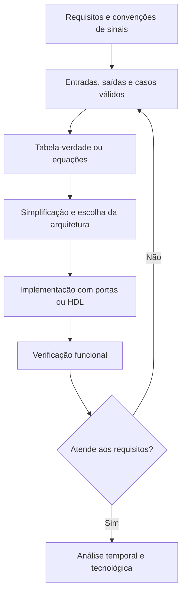
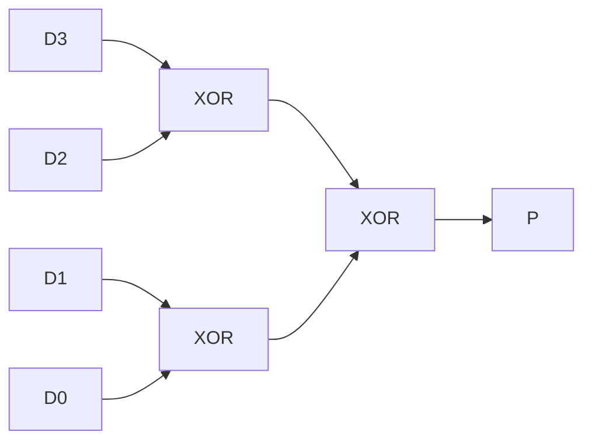

# 6. Projeto de circuitos combinacionais

Nos [Capítulos 3](boolean-algebra-and-logic-functions.md),
[4](logic-gates-and-circuit-representation.md) e
[5](logic-function-simplification-and-minimization.md), estudamos a descrição
matemática de funções booleanas, sua implementação por portas e os métodos de
simplificação. Agora reunimos esses instrumentos em um procedimento de
**projeto de circuitos combinacionais**: interpretar requisitos, definir
entradas e saídas, elaborar modelos, obter uma implementação e verificar sua
conformidade com a especificação.

Um circuito combinacional ideal produz saídas determinadas exclusivamente pelos
valores presentes nas entradas. Não há estado interno que deva ser lembrado
entre avaliações. Em dispositivos físicos, entretanto, a resposta não é
instantânea: atrasos de propagação e diferenças de percurso podem provocar
estados transitórios. Portanto, **correção funcional estática** e
**comportamento temporal** são verificações distintas.

## Objetivos de aprendizagem

Ao concluir o capítulo, o leitor deverá ser capaz de transformar requisitos
verbais em especificações verificáveis; elaborar tabelas-verdade para múltiplas
saídas; analisar circuitos existentes; sintetizar redes combinacionais;
projetar funções de votação, paridade e comparação; distinguir simplificação
lógica de otimização tecnológica; e planejar testes funcionais que cubram casos
normais, limites e situações de transição.

## 6.1. Especificação funcional {#sec-combinational-specification}

O projeto começa pela descrição do comportamento esperado, e não pela escolha
de portas. Uma especificação deve identificar as entradas e saídas, o
significado de cada sinal, sua polaridade ativa, as combinações válidas e as
condições nas quais uma saída deve ser ativada. Se determinadas combinações
nunca puderem ocorrer, essa hipótese deve ser justificada: tratá-las como
condições indiferentes sem fundamento pode comprometer a segurança funcional.

<!-- prettier-ignore -->
::: definition Especificação funcional combinacional {#def-combinational-specification}

Uma **especificação funcional combinacional** associa a cada combinação de
entradas admissível um vetor de saídas esperado. Para $n$ entradas e $m$
saídas, a função é uma aplicação $f:\{0,1\}^n\to\{0,1\}^m$, eventualmente
definida apenas sobre um subconjunto explicitamente delimitado do domínio.

:::

Considere um sistema de habilitação de uma máquina com três entradas: $C$
(comando de partida), $P$ (proteção fechada) e $E$ (permissão externa). A saída
$H$ deve valer 1 somente quando todas as condições forem satisfeitas:

$$
H=CPE.\tag{6.1}
$$

A expressão é uma consequência da especificação, não um substituto para ela.
Antes de implementá-la, é necessário definir o significado elétrico de cada
sinal e a reação exigida diante de falhas. O exemplo ilustra **lógica
funcional**; não constitui, isoladamente, uma arquitetura de segurança de
máquinas.

<!-- prettier-ignore -->
::: note Requisitos funcionais e restrições de implementação {#note-functional-vs-implementation-requirements}

Uma especificação funcional descreve _o que_ deve ser calculado. Restrições
como tensão de alimentação, tempo máximo de resposta, carga de saída, consumo,
área e imunidade a falhas descrevem condições adicionais para _como_ o circuito
será implementado. Uma rede logicamente correta pode não satisfazer essas
restrições.

:::

<!-- prettier-ignore -->
::: figure Etapas de um fluxo de projeto combinacional {#fig-combinational-design-flow}



:::

O fluxo da {@ref fig-combinational-design-flow} é iterativo: uma inconsistência
encontrada nos testes pode exigir revisar a especificação, e não apenas trocar
portas.

## 6.2. Modelagem por tabelas-verdade {#sec-combinational-truth-tables}

Uma tabela-verdade torna explícito o valor de cada saída para todas as
combinações das entradas. Para $n$ entradas binárias independentes, há $2^n$
combinações. Em projetos com múltiplas saídas, todas podem compartilhar a mesma
tabela, desde que cada coluna tenha significado inequívoco.

<!-- prettier-ignore -->
::: example Controle de ventilação e indicação de alarme {#ex-fan-alarm-specification}

Considere $T=1$ quando a temperatura está acima do limite, $M=1$ quando há
solicitação manual e $F=1$ quando um sensor acusa falha. A ventilação $V$ deve
funcionar se houver temperatura elevada ou solicitação manual, **desde que não
haja falha**. A indicação de alarme $L$ deve acender quando houver falha ou
quando a temperatura estiver elevada e não houver solicitação manual. As
equações são

$$
V=(T+M)\overline F,\qquad L=F+T\overline M.\tag{6.2}
$$

A {@ref tbl-fan-alarm-truth-table} especifica conjuntamente as duas saídas.

:::

<!-- prettier-ignore -->
::: table Tabela-verdade do controle de ventilação e alarme {#tbl-fan-alarm-truth-table .full-width}

| $T$ | $M$ | $F$ | Ventilação $V$ | Alarme $L$ |
| :-: | :-: | :-: | :------------: | :--------: |
|  0  |  0  |  0  |       0        |     0      |
|  0  |  0  |  1  |       0        |     1      |
|  0  |  1  |  0  |       1        |     0      |
|  0  |  1  |  1  |       0        |     1      |
|  1  |  0  |  0  |       1        |     1      |
|  1  |  0  |  1  |       0        |     1      |
|  1  |  1  |  0  |       1        |     0      |
|  1  |  1  |  1  |       0        |     1      |

:::

Uma verificação útil consiste em percorrer a tabela por grupos: quando $F=1$, a
ventilação deve permanecer desligada; quando $F=0$, ela segue $T+M$. Para o
alarme, $F=1$ força $L=1$, enquanto $F=0$ deixa $L=T\overline M$. Essa leitura
por propriedades ajuda a identificar erros de transcrição.

<!-- prettier-ignore -->
::: warning Não confundir estado não especificado com valor zero {#warn-unspecified-inputs}

A marcação $X$ (_don't care_) só é admissível quando o comportamento
correspondente realmente não é exigido ou a combinação é comprovadamente
inacessível. Não significa automaticamente saída 0, nem autoriza ignorar uma
condição que possa ocorrer por ruído, defeito ou transição.

:::

## 6.3. Análise de circuitos existentes {#sec-combinational-analysis}

A **análise** parte de uma rede conhecida e determina a função realizada; a
**síntese** parte da função desejada e constrói uma rede. Para analisar um
circuito, atribuímos expressões aos sinais intermediários, respeitando a
topologia das conexões, e propagamos essas expressões até as saídas.

Considere os sinais intermediários $N_1=AB$ e $N_2=\overline A C$, combinados
por uma porta OR:

$$
Y=N_1+N_2=AB+\overline A C.\tag{6.3}
$$

<!-- prettier-ignore -->
::: figure Rede combinacional de dois produtos e uma soma {#fig-combinational-analysis-network}

```tikz
\usetikzlibrary{circuits.logic.US}

\begin{tikzpicture}[
  circuit logic US,
  scale=2.2,
  transform shape
]

% Portas AND ampliadas
\node[and gate US,draw,scale=2.5,transform shape]
  (g1) at (2.3,2.0) {};

\node[and gate US,draw,scale=2.5,transform shape]
  (g2) at (2.3,-2.0) {};

% Porta OR ampliada
\node[or gate US,draw,scale=2.5,transform shape]
  (g3) at (6.0,0) {};

% Entradas da primeira porta AND
\draw (g1.input 1) -- ++(-1.0,0)
  node[left] {$A$};

\draw (g1.input 2) -- ++(-1.0,0)
  node[left] {$B$};

% Entradas da segunda porta AND
\draw (g2.input 1) -- ++(-1.0,0)
  node[left] {$\overline A$};

\draw (g2.input 2) -- ++(-1.0,0)
  node[left] {$C$};

% Interligações com ângulos retos
\draw (g1.output) -- ++(0.9,0) |- (g3.input 1);
\draw (g2.output) -- ++(0.9,0) |- (g3.input 2);

% Saída
\draw (g3.output) -- ++(0.9,0)
  node[right] {$Y$};

\end{tikzpicture}
```

:::

Na {@ref fig-combinational-analysis-network}, a entrada $\overline A$ é
apresentada como sinal disponível para simplificar o desenho. Se apenas $A$
estiver disponível, será necessária uma inversão ou uma implementação
equivalente. O desenho não deve ser interpretado como uma conexão física que
produza simultaneamente $A$ e $\overline A$ sem circuito adicional.

A função pode ser conferida por decomposição segundo $A$: para $A=0$, $Y=C$;
para $A=1$, $Y=B$. Trata-se, portanto, da função de um seletor de dois dados
controlado por $A$:

$$
Y=\overline A C+AB.\tag{6.4}
$$

Essa equivalência mostra como reconhecer estruturas funcionais a partir de
redes de portas, antecipando os multiplexadores do Capítulo 7.

## 6.4. Síntese de circuitos a partir de especificações {#sec-combinational-synthesis}

O procedimento inverso começa por uma tabela-verdade ou por uma descrição
verbal. Uma rota sistemática é: identificar os mintermos de saída 1, construir
uma soma canônica, simplificá-la e mapear a expressão resultante para as portas
disponíveis. Para múltiplas saídas, é importante examinar o **compartilhamento
de termos**, pois duas saídas podem utilizar a mesma expressão intermediária.

::: example Síntese de uma função de três entradas {#ex-three-input-synthesis}

Seja $Y=1$ para as combinações $001$, $011$, $100$, $101$ e $111$ de $(A,B,C)$.
Assim,

$$
Y=\Sigma m(1,3,4,5,7).\tag{6.5}
$$

Os quatro mintermos ímpares ($1,3,5,7$) formam o implicante $C$. O mintermo $4$
pode ser agrupado com $5$, formando $A\overline B$. Portanto,

$$
Y=C+A\overline B.\tag{6.6}
$$

A implementação direta utiliza uma inversão de $B$, uma AND e uma OR. Outras
implementações são possíveis se a biblioteca oferecer portas compostas ou se
houver restrições específicas de custo e atraso.

:::

<!-- prettier-ignore -->
::: table Conferência da função sintetizada {#tbl-three-input-synthesis .full-width}

| $A$ | $B$ | $C$ | $C+A\overline B$ |
| :-: | :-: | :-: | :--------------: |
|  0  |  0  |  0  |        0         |
|  0  |  0  |  1  |        1         |
|  0  |  1  |  0  |        0         |
|  0  |  1  |  1  |        1         |
|  1  |  0  |  0  |        1         |
|  1  |  0  |  1  |        1         |
|  1  |  1  |  0  |        0         |
|  1  |  1  |  1  |        1         |

:::

A escolha entre formas SOP, POS e redes multiníveis não deve se basear apenas
no número de literais. Uma implementação real depende da biblioteca
tecnológica, do fan-out, da carga, da profundidade lógica e das restrições
temporais discutidas no Capítulo 5.

### Descrição funcional em HDL

A mesma função pode ser expressa em Verilog de maneira combinacional:

```verilog
module combinational_example (
    input  wire a,
    input  wire b,
    input  wire c,
    output wire y
);
    assign y = c | (a & ~b);
endmodule
```

O operador `|` representa OR bit a bit, `&` representa AND bit a bit e `~`
representa inversão bit a bit. Para entradas de um bit, essa descrição
corresponde diretamente à equação (6.6). Em HDL, é necessário distinguir os
operadores lógicos dos operadores bit a bit quando os operandos possuem mais de
um bit.

## 6.5. Circuitos de votação e decisão {#sec-voting-decision-circuits}

Em uma função de **maioria de três entradas**, a saída vale 1 quando pelo menos
duas entradas são 1. Para $A$, $B$ e $C$, a função é

$$
M=AB+AC+BC.\tag{6.7}
$$

<!-- prettier-ignore -->
::: table Tabela-verdade de um circuito de maioria de três entradas {#tbl-majority-three .full-width}

| $A$ | $B$ | $C$ | Quantidade de entradas em 1 | Maioria $M$ |
| :-: | :-: | :-: | :-------------------------: | :---------: |
|  0  |  0  |  0  |              0              |      0      |
|  0  |  0  |  1  |              1              |      0      |
|  0  |  1  |  0  |              1              |      0      |
|  0  |  1  |  1  |              2              |      1      |
|  1  |  0  |  0  |              1              |      0      |
|  1  |  0  |  1  |              2              |      1      |
|  1  |  1  |  0  |              2              |      1      |
|  1  |  1  |  1  |              3              |      1      |

:::

A função também pode ser fatorada como $M=AB+C(A+B)$. A forma fatorada
compartilha parte da lógica, mas sua vantagem física depende das portas
disponíveis.

::: example Decisão por quórum {#ex-voting-quorum}

Três sensores independentes emitem indicações binárias de uma condição. Se a
decisão é tomada quando ao menos dois concordam em 1, a função de maioria é um
modelo lógico apropriado. Isso **não garante tolerância a falhas** por si só: a
independência real dos sensores, falhas de causa comum e a possibilidade de uma
leitura incorreta precisam ser avaliadas separadamente.

:::

Para $n$ entradas, a regra “pelo menos $k$ entradas em 1” define uma função
limiar. A realização pode empregar somadores, comparadores ou estruturas
específicas, dependendo de $n$, $k$ e das restrições do projeto.

## 6.6. Detectores e geradores de paridade {#sec-parity-circuits}

A operação XOR permite construir circuitos de paridade. Para uma palavra
$D=(D_3,D_2,D_1,D_0)$, a paridade dos quatro bits é

$$
P=D_3\oplus D_2\oplus D_1\oplus D_0.\tag{6.8}
$$

Se acrescentarmos $P$ à palavra, o número total de bits em 1 será par. Assim,
$P$ é o **bit de paridade par**. Para paridade ímpar, utiliza-se
$P_{\mathrm{ímpar}}=\overline P$.

<!-- prettier-ignore -->
::: table Exemplos de geração de paridade par {#tbl-even-parity-examples .full-width}

| Dados $D_3D_2D_1D_0$ | Quantidade de bits 1 | Bit de paridade $P$ | Palavra transmitida $D_3D_2D_1D_0P$ |
| :------------------: | :------------------: | :-----------------: | :---------------------------------: |
|         0000         |          0           |          0          |                00000                |
|         0101         |          2           |          0          |                01010                |
|         0111         |          3           |          1          |                01111                |
|         1111         |          4           |          0          |                11110                |

:::

No receptor, o **síndrome de paridade** é calculado por XOR de todos os bits
recebidos:

$$
S=D_3\oplus D_2\oplus D_1\oplus D_0\oplus P.\tag{6.9}
$$

Para transmissão sem erro, $S=0$. Uma alteração em número ímpar de bits produz
$S=1$, mas uma alteração em número par de bits pode não ser detectada. A
paridade simples não identifica a posição do erro e, isoladamente, não o
corrige.

<!-- prettier-ignore -->
::: figure Associação em árvore de operações XOR para gerar paridade {#fig-parity-xor-tree}



:::

A estrutura em árvore da {@ref fig-parity-xor-tree} possui dois níveis de XOR,
em vez de uma cadeia linear de três operações. A diferença de profundidade pode
ser relevante para o atraso de propagação.

## 6.7. Circuitos de comparação {#sec-comparison-circuits}

Comparadores verificam relações entre palavras binárias. Para um único bit, a
igualdade é dada por XNOR:

$$
E_1=\overline{A\oplus B}.\tag{6.10}
$$

Para duas palavras de $n$ bits, $A=(A_{n-1},\ldots,A_0)$ e
$B=(B_{n-1},\ldots,B_0)$, a igualdade exige igualdade em todas as posições:

$$
E=\prod_{i=0}^{n-1}\overline{A_i\oplus B_i}.\tag{6.11}
$$

A comparação de magnitude entre inteiros **sem sinal** começa pelo bit mais
significativo: na primeira posição em que os operandos diferem, o operando com
bit 1 é maior. Para dois bits, uma forma para $A>B$ é

$$
G=A_1\overline{B_1}+\overline{A_1\oplus B_1}\,A_0\overline{B_0}.\tag{6.12}
$$

O primeiro termo decide quando $A_1=1$ e $B_1=0$; o segundo decide pelo bit
menos significativo somente se os bits mais significativos forem iguais.

<!-- prettier-ignore -->
::: table Exemplos de comparação de palavras de dois bits sem sinal {#tbl-two-bit-comparison .full-width}

| $A$ | $B$ | $A=B$ | $A>B$ | $A<B$ |
| :-: | :-: | :---: | :---: | :---: |
| 00  | 00  |   1   |   0   |   0   |
| 01  | 10  |   0   |   0   |   1   |
| 10  | 01  |   0   |   1   |   0   |
| 11  | 10  |   0   |   1   |   0   |
| 11  | 11  |   1   |   0   |   0   |

:::

<!-- prettier-ignore -->
::: note A interpretação com sinal altera a comparação {#note-signed-comparison}

Uma mesma sequência de bits pode representar valores diferentes em codificação
sem sinal e em complemento de dois. Por exemplo, `11` representa 3 sem sinal e
$-1$ em complemento de dois de dois bits. A relação de ordem só pode ser
definida depois de fixar a representação numérica.

:::

## 6.8. Validação e testes funcionais {#sec-combinational-validation}

Validar um circuito significa confrontar o comportamento implementado com uma
especificação independente. Para poucas entradas, o teste exaustivo das $2^n$
combinações é simples e recomendável. Para funções maiores, podem ser
necessários testes dirigidos, geração automatizada de vetores, simulação e
métodos formais de equivalência.

O conjunto de testes deve incluir combinações normais, casos de fronteira e
situações nas quais uma única entrada muda. Para funções de comparação, são
especialmente importantes igualdade, diferença no bit mais significativo e
diferença apenas no bit menos significativo. Para paridade, é útil injetar
alterações de um e de dois bits, verificando tanto a detecção quanto sua
limitação.

<!-- prettier-ignore -->
::: table Plano resumido de verificação para os circuitos estudados {#tbl-combinational-test-plan .full-width}

| Circuito           | Propriedade a verificar                           | Caso de teste ilustrativo         |
| ------------------ | ------------------------------------------------- | --------------------------------- |
| Habilitação        | Bloqueio quando uma condição obrigatória é 0      | $C=1$, $P=0$, $E=1$ implica $H=0$ |
| Maioria            | Saída 1 para duas ou três entradas em 1           | $A=1$, $B=0$, $C=1$ implica $M=1$ |
| Paridade par       | XOR de todos os bits recebidos igual a 0 sem erro | Dados `0111`, bit $P=1$           |
| Comparação         | A primeira diferença mais significativa decide    | $A=10$, $B=01$ implica $A>B$      |
| Função sintetizada | Correspondência com a tabela-verdade              | $A=1$, $B=1$, $C=0$ implica $Y=0$ |

:::

### Teste automatizado em Verilog

O módulo combinacional da seção 6.4 pode ser verificado por um banco de testes
que percorre as oito combinações e compara a saída com uma expressão de
referência:

```verilog
module tb_combinational_example;
    reg a, b, c;
    wire y;
    reg expected;
    integer i;

    combinational_example dut (.a(a), .b(b), .c(c), .y(y));

    initial begin
        for (i = 0; i < 8; i = i + 1) begin
            {a, b, c} = i;
            expected = c | (a & ~b);
            #1;
            if (y !== expected)
                $display("FALHA: abc=%b%b%b y=%b esperado=%b",
                         a, b, c, y, expected);
        end
        $finish;
    end
endmodule
```

Esse teste é didático: a referência utiliza a mesma expressão lógica da
implementação e, portanto, pode reproduzir um erro de especificação. Em um
projeto real, os resultados esperados devem ser derivados **independentemente**
dos requisitos ou de uma tabela de referência revisada. A simulação funcional
também não substitui a análise de atrasos e riscos lógicos.

<!-- prettier-ignore -->
::: example Revisão de uma função antes da implementação {#ex-independent-functional-check}

Suponha que o circuito de maioria tenha sido implementado como $M=AB+AC+BC$.
Antes de simular, registre os casos obrigatórios: saída 0 para zero ou uma
entrada ativa; saída 1 para duas ou três entradas ativas. Em seguida, gere os
vetores da {@ref tbl-majority-three} e compare com o circuito. A tabela
funciona como **oráculo de teste** independente da estrutura de portas.

:::

## Síntese do capítulo

O projeto combinacional é um percurso verificável da **especificação** à
**implementação**. Tabelas-verdade tornam explícitas as condições de operação;
análise e síntese relacionam funções a redes; funções de votação, paridade e
comparação exemplificam aplicações recorrentes; e os testes verificam a
conformidade com os requisitos. A correção lógica deve ser acompanhada, nas
etapas posteriores, de avaliação temporal, elétrica e tecnológica.

## Exercícios propostos {#sec-combinational-exercises}

:::: exercise Especificação de habilitação {#exr-combinational-enable}

Uma saída $Y$ deve valer 1 quando o comando $C$ estiver ativo, a proteção $P$
estiver satisfeita e não houver falha $F$. Escreva a expressão booleana e
identifique a combinação $C=1$, $P=1$, $F=1$.

::: solution

$Y=CP\overline F$. Para $C=1$, $P=1$ e $F=1$, temos $Y=0$.

:::

::::

:::: exercise Tabela-verdade de duas saídas {#exr-combinational-two-outputs}

Para as saídas $U=A+B$ e $V=AB$, construa uma tabela-verdade completa com as
quatro combinações de $A$ e $B$.

::: solution

Para $AB=00,01,10,11$, os pares $(U,V)$ são, respectivamente, $(0,0)$, $(1,0)$,
$(1,0)$ e $(1,1)$.

:::

::::

<!-- prettier-ignore -->
:::: exercise Análise por sinais intermediários {#exr-combinational-intermediate}

Um circuito possui $N_1=\overline A B$ e $N_2=AC$, com $Y=N_1+N_2$. Determine
$Y$ quando $(A,B,C)=(0,1,0)$ e quando $(1,1,0)$.

::: solution

No primeiro caso, $N_1=1$, $N_2=0$ e $Y=1$. No segundo, $N_1=0$, $N_2=0$ e
$Y=0$.

:::

::::

:::: exercise Síntese a partir de mintermos {#exr-combinational-minterms}

Simplifique $F(A,B,C)=\Sigma m(1,3,5,7)$ e descreva uma implementação mínima
com portas fundamentais.

::: solution

Todos os mintermos têm $C=1$, logo $F=C$. Nenhuma porta adicional é necessária
se o sinal $C$ já estiver disponível e satisfizer as condições de acionamento.

:::

::::

:::: exercise Votação por maioria {#exr-combinational-majority}

Verifique a saída do circuito de maioria de três entradas para $101$, $110$ e
$001$. Explique por que a expressão $AB+AC+BC$ representa a regra.

::: solution

As saídas são 1, 1 e 0. Cada produto corresponde a um par de entradas ativas; a
soma lógica é 1 quando ao menos um desses pares existe.

:::

::::

:::: exercise Gerador de paridade {#exr-combinational-parity}

Determine o bit de paridade par para os dados `1011`. Se o receptor receber a
palavra `10110`, qual será a síndrome?

::: solution

Os dados contêm três bits em 1, portanto o bit de paridade par é 1 e a palavra
correta seria `10111`. A palavra recebida `10110` contém três bits em 1, logo a
síndrome é 1 e a verificação acusa erro.

:::

::::

:::: exercise Limitação da paridade {#exr-combinational-parity-limit}

Uma palavra com paridade par sofre duas inversões de bits durante a
transmissão. A verificação de paridade necessariamente detectará esse erro?
Justifique.

::: solution

Não. Duas inversões preservam a paridade do número total de bits em 1. O XOR de
todos os bits recebidos continua 0, embora a palavra possa estar incorreta.

:::

::::

:::: exercise Comparação de dois bits {#exr-combinational-compare}

Compare $A=10$ e $B=01$ como inteiros sem sinal e como inteiros de dois bits em
complemento de dois.

::: solution

Sem sinal, $A=2$ e $B=1$, então $A>B$. Em complemento de dois, $A=-2$ e $B=1$,
então $A<B$.

:::

::::

:::: exercise Estratégia de validação {#exr-combinational-validation}

Para um circuito combinacional com quatro entradas, quantos vetores são
necessários para um teste exaustivo? Cite duas verificações adicionais
importantes antes da implementação física.

::: solution

São $2^4=16$ vetores. Além da comparação funcional, convém verificar requisitos
de temporização e compatibilidade elétrica (níveis lógicos, capacidade de
acionamento, cargas e alimentação). Também pode ser necessária análise de
riscos transitórios.

:::

::::

## Referências bibliográficas

1. MANO, M. Morris; CILETTI, Michael D. **Digital Design**. 5. ed.
   Pearson, 2013.
2. HARRIS, David Money; HARRIS, Sarah L. **Digital Design and Computer
   Architecture**. 2. ed. Morgan Kaufmann, 2012.
3. WAKERLY, John F. **Digital Design: Principles and Practices**. 4. ed.
   Pearson, 2005.
4. FLOYD, Thomas L. **Digital Fundamentals**. 11. ed. Pearson, 2015.
5. TOCCI, Ronald J.; WIDMER, Neal S.; MOSS, Gregory L. **Digital Systems:
   Principles and Applications**. 12. ed. Pearson, 2017.

---

[Voltar ao sumário](README.md) ·
[Capítulo 5 — Simplificação e minimização de funções lógicas](logic-function-simplification-and-minimization.md)
·
[Capítulo 7 — Codificadores, decodificadores e seleção de dados](encoders-decoders-and-data-selection.md)
