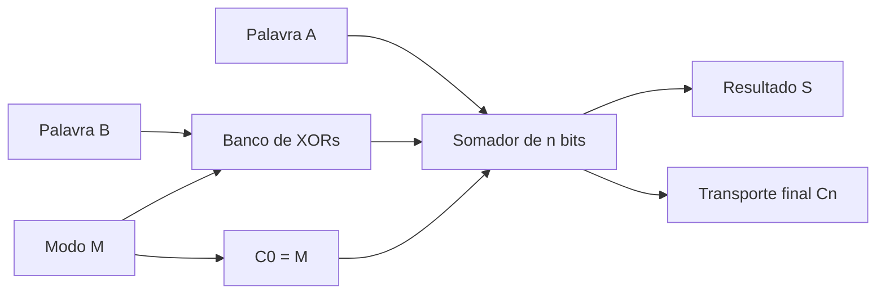
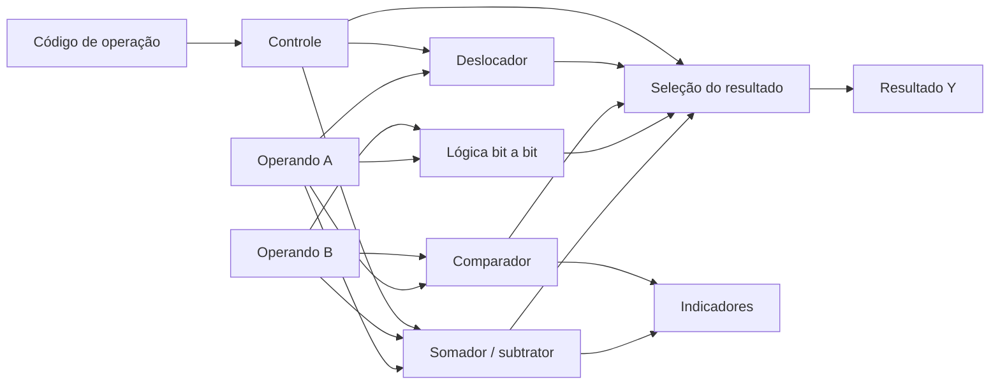

# 8. Circuitos aritméticos digitais

A representação binária estudada no Capítulo 2 permite codificar números, mas
não explica, por si só, como o hardware os processa. Os circuitos aritméticos
realizam operações sobre vetores de bits mediante redes de portas lógicas.
Neste capítulo, passamos das funções combinacionais dos capítulos anteriores a
blocos capazes de somar, subtrair, comparar, multiplicar e deslocar palavras
binárias. A unidade lógica e aritmética (ULA) reúne essas operações sob um
conjunto de sinais de controle.

A interpretação dos operandos — sem sinal, complemento de dois ou ponto fixo —
deve ser distinguida da operação executada sobre seus bits. Por exemplo, um
somador de $n$ bits produz a mesma sequência de bits para dois operandos, quer
estes sejam interpretados como inteiros sem sinal, quer como inteiros em
complemento de dois; o significado do resultado e dos indicadores de erro,
porém, pode mudar.

## Objetivos de aprendizagem

Ao concluir o capítulo, o leitor deverá ser capaz de deduzir e verificar as
equações do meio somador e do somador completo; construir somadores de
múltiplos bits; comparar propagação em cascata e antecipação de transporte;
realizar subtração por complemento de dois; distinguir transporte de saída e
transbordamento com sinal; interpretar comparadores, multiplicadores e
deslocadores; e descrever uma ULA combinacional simples, com verificação por
tabelas e exemplos em HDL.

## 8.1. Meio somador e somador completo {#sec-half-and-full-adder}

A soma de dois bits $A$ e $B$ pode produzir dois bits de resultado: o bit de
**soma** $S$ e o bit de **transporte** $C$ (_carry_). O **meio somador** (_half
adder_) não recebe transporte de uma posição anterior:

$$
S=A\oplus B,\qquad C=AB.\tag{8.1}
$$

<!-- prettier-ignore -->
::: table Tabela-verdade do meio somador {#tbl-half-adder .full-width}

| $A$ | $B$ | $S$ | $C$ |
| :-: | :-: | :-: | :-: |
|  0  |  0  |  0  |  0  |
|  0  |  1  |  1  |  0  |
|  1  |  0  |  1  |  0  |
|  1  |  1  |  0  |  1  |

:::

O **somador completo** (_full adder_) recebe também um transporte de entrada
$C_{in}$. Sua soma e seu transporte de saída $C_{out}$ são:

$$
S=A\oplus B\oplus C_{in},\tag{8.2}
$$

$$
C_{out}=AB+AC_{in}+BC_{in}=AB+(A\oplus B)C_{in}.\tag{8.3}
$$

A segunda igualdade de (8.3) pode ser verificada por álgebra booleana ou pela
tabela-verdade. O transporte é 1 quando pelo menos duas das três entradas
são 1.

<!-- prettier-ignore -->
::: table Tabela-verdade do somador completo {#tbl-full-adder .full-width}

| $A$ | $B$ | $C_{in}$ | $S$ | $C_{out}$ |
| :-: | :-: | :------: | :-: | :-------: |
|  0  |  0  |    0     |  0  |     0     |
|  0  |  0  |    1     |  1  |     0     |
|  0  |  1  |    0     |  1  |     0     |
|  0  |  1  |    1     |  0  |     1     |
|  1  |  0  |    0     |  1  |     0     |
|  1  |  0  |    1     |  0  |     1     |
|  1  |  1  |    0     |  0  |     1     |
|  1  |  1  |    1     |  1  |     1     |

:::

<!-- prettier-ignore -->
::: figure Decomposição de um somador completo em dois meios somadores {#fig-full-adder-blocks}

```tikz
\begin{tikzpicture}[scale=1.8,transform shape]

% Primeiro meio somador
\draw[thick] (1,3) rectangle (3,4.6);
\node at (2,3.8) {HA 1};

% Segundo meio somador, deslocado para a direita
\draw[thick] (7,3) rectangle (9,4.6);
\node at (8,3.8) {HA 2};

% Porta OR, alinhada verticalmente com HA 2
\draw[thick] (7,0.2) rectangle (9,1.6);
\node at (8,0.9) {OR};

% Entradas A e B
\draw (0,4.2) -- (1,4.2);
\node[left] at (0,4.2) {$A$};

\draw (0,3.4) -- (1,3.4);
\node[left] at (0,3.4) {$B$};

% Soma parcial P, de HA 1 para HA 2
\draw (3,4.2) -- (7,4.2);
\node[above] at (5,4.2) {$P$};

% Entrada Cin independente
\draw (5.5,3.4) -- (7,3.4);
\node[left] at (5.5,3.4) {$C_{in}$};

% Saída de soma S
\draw (9,4.2) -- (10.2,4.2);
\node[right] at (10.2,4.2) {$S$};

% Transporte de HA 1 para a primeira entrada da OR
\draw (3,3.25)
  -- (4,3.25)
  -- (4,1.3)
  -- (7,1.3);

% Transporte de HA 2 para a segunda entrada da OR
\draw (9,3.4)
  -- (9.7,3.4)
  -- (9.7,2.2)
  -- (6,2.2)
  -- (6,0.5)
  -- (7,0.5);

% Transporte final Cout
\draw (9,0.9) -- (10.2,0.9);
\node[right] at (10.2,0.9) {$C_{out}$};

\end{tikzpicture}
```

:::

Na {@ref fig-full-adder-blocks}, cada meio somador gera uma soma parcial e um
transporte. A saída da porta OR combina os dois transportes, que não podem ser
1 simultaneamente para a mesma combinação de entradas.

::: example Soma de três bits {#ex-full-adder-one}

Para $A=1$, $B=1$ e $C_{in}=1$, a soma inteira é $1+1+1=3=(11)_2$. Portanto,
$S=1$ e $C_{out}=1$, como na última linha da {@ref tbl-full-adder}.

:::

## 8.2. Somadores de múltiplos bits {#sec-multibit-adders}

Para somar duas palavras de $n$ bits, conectam-se $n$ somadores completos, um
por posição. Em cada estágio $i$, o transporte de saída alimenta o estágio
$i+1$. Essa arquitetura é denominada **somador de transporte em cascata**
(_ripple-carry adder_).

$$
S_i=A_i\oplus B_i\oplus C_i,\qquad
C_{i+1}=A_iB_i+(A_i\oplus B_i)C_i.\tag{8.4}
$$

Em uma soma ordinária sem transporte inicial, $C_0=0$. O vetor $S_{n-1}\ldots
S_0$ contém os $n$ bits menos significativos da soma; $C_n$ é o transporte
final.

<!-- prettier-ignore -->
::: figure Somador de quatro bits com transporte em cascata {#fig-ripple-carry-adder}

```tikz
\begin{tikzpicture}[scale=1.7,transform shape]
\foreach \i in {0,1,2,3}{
  \pgfmathsetmacro{\x}{\i*2.2}
  \draw[thick] (\x,0) rectangle ++(1.5,1.2);
  \node at (\x+0.75,0.6) {FA\i};
  \draw (\x+0.4,1.2)--(\x+0.4,1.75);
  \draw (\x+1.1,1.2)--(\x+1.1,1.75);
  \node[above] at (\x+0.4,1.75) {$A_{\i}$};
  \node[above] at (\x+1.1,1.75) {$B_{\i}$};
  \draw (\x+0.75,0)--(\x+0.75,-0.5);
  \node[below] at (\x+0.75,-0.5) {$S_{\i}$};
}
\foreach \i in {0,1,2}{
  \pgfmathsetmacro{\x}{\i*2.2}
  \draw[->] (\x+1.5,0.6)--(\x+2.2,0.6);
  \pgfmathtruncatemacro{\j}{\i+1}
  \node[above] at (\x+1.85,0.6) {$C_{\j}$};
}
\draw[->] (-0.7,0.6)--(0,0.6) node[midway,above] {$C_0$};
\draw[->] (8.1,0.6)--(8.8,0.6) node[right] {$C_4$};
\end{tikzpicture}
```

:::

::: example Adição de quatro bits {#ex-four-bit-addition}

Considere $A=1011_2=11$ e $B=0110_2=6$. A soma é $10001_2=17$. Em um somador de
quatro bits, a saída é $S=0001$ e o transporte final é $C_4=1$. O resultado de
cinco bits é reconstruído por $C_4S=10001$.

:::

O somador em cascata é simples e regular, mas o transporte de um estágio pode
depender do transporte do anterior. Essa dependência limita o desempenho para
palavras longas.

## 8.3. Propagação de transporte (_carry_) {#sec-carry-propagation}

Definem-se, para cada posição $i$, os sinais de **propagação** $P_i$ e
**geração** $G_i$:

$$
P_i=A_i\oplus B_i,\qquad G_i=A_iB_i.\tag{8.5}
$$

Assim, a recorrência do transporte assume a forma:

$$
C_{i+1}=G_i+P_iC_i.\tag{8.6}
$$

Quando $G_i=1$, o estágio gera transporte independentemente de $C_i$; quando
$P_i=1$, um transporte recebido é propagado. Com essa definição por XOR,
geração e propagação não são simultaneamente 1.

::: definition Caminho crítico de transporte {#def-carry-critical-path}

O **caminho crítico de transporte** é o caminho de maior atraso entre entradas
e saídas relevantes da rede de adição. Em um somador em cascata, pode
atravessar sucessivos estágios de transporte. Seu atraso depende da
implementação das portas e das cargas, e não apenas do número de bits.

:::

Em uma aproximação simplificada, se cada estágio acrescentar atraso $t_c$ à
propagação do transporte, a contribuição dessa cadeia pode crescer
aproximadamente como $n t_c$. Essa expressão é apenas um modelo ilustrativo; a
temporização real requer a análise da rede implementada.

## 8.4. Somadores com antecipação de transporte {#sec-carry-lookahead}

A **antecipação de transporte** (_carry lookahead_) expande a recorrência (8.6)
para calcular transportes a partir dos sinais $P_i$, $G_i$ e $C_0$, reduzindo a
necessidade de esperar pela propagação em série. Para quatro bits:

$$
\begin{aligned}
C_1={}&G_0+P_0C_0,\\
C_2={}&G_1+P_1G_0+P_1P_0C_0,\\
C_3={}&G_2+P_2G_1+P_2P_1G_0+P_2P_1P_0C_0,\\
C_4={}&G_3+P_3G_2+P_3P_2G_1+P_3P_2P_1G_0
       +P_3P_2P_1P_0C_0.
\end{aligned}\tag{8.7}
$$

A implementação paralela dessas expressões troca maior complexidade de portas e
interconexões por menor profundidade de dependência lógica. Em projetos
maiores, usam-se grupos de propagação e geração, estruturas hierárquicas e
arquiteturas de prefixo. O ganho efetivo depende da tecnologia, do tamanho da
palavra e da distribuição das conexões.

<!-- prettier-ignore -->
::: table Comparação conceitual entre arquiteturas de somadores {#tbl-adder-architectures .full-width}

| Arquitetura                     | Organização do transporte                      | Vantagem principal                        | Limitação típica                             |
| ------------------------------- | ---------------------------------------------- | ----------------------------------------- | -------------------------------------------- |
| Cascata (_ripple carry_)        | Dependência sucessiva entre estágios           | Regularidade e simplicidade               | Atraso crescente com o comprimento da cadeia |
| Antecipação (_carry lookahead_) | Expressões combinacionais expandidas           | Redução da dependência serial             | Mais portas e interconexões                  |
| Prefixo paralelo                | Combinação hierárquica de geração e propagação | Boa escalabilidade de profundidade lógica | Maior custo de roteamento e estrutura        |

:::

## 8.5. Subtratores e circuitos somadores-subtratores {#sec-subtractors}

A subtração binária pode ser realizada diretamente por um circuito que manipula
empréstimos (_borrows_), mas a implementação por **complemento de dois**
permite reutilizar o somador:

$$
A-B=A+\overline{B}+1\pmod{2^n}.\tag{8.8}
$$

Em uma palavra de $n$ bits, a inversão $\overline B$ é aplicada bit a bit. Um
circuito somador-subtrator utiliza um sinal de modo $M$:

$$
B_i'=B_i\oplus M,\qquad C_0=M.\tag{8.9}
$$

Para $M=0$, obtém-se $A+B$. Para $M=1$, obtém-se $A+\overline B+1$, isto é,
$A-B$ módulo $2^n$.

<!-- prettier-ignore -->
::: figure Seleção entre adição e subtração por complemento de dois {#fig-adder-subtractor-architecture}



:::

::: example Subtração de quatro bits {#ex-four-bit-subtraction}

Se $A=0101_2=5$ e $B=0011_2=3$, então $\overline B=1100$ e $A+\overline
B+1=0101+1100+1=1\,0010$. O circuito de quatro bits fornece $S=0010$ e $C_4=1$,
correspondendo ao resultado 2. O transporte final é descartado ao interpretar o
resultado modular de quatro bits.

:::

Para subtração **sem sinal** implementada como $A+\overline B+1$, $C_n=1$
indica ausência de empréstimo e $C_n=0$ indica empréstimo. Essa interpretação
não deve ser confundida com a detecção de transbordamento de números com sinal.

## 8.6. Detecção de transbordamento (_overflow_) {#sec-arithmetic-overflow}

Em uma operação com largura fixa, um resultado matemático pode não ser
representável. É necessário distinguir dois indicadores:

- **Transporte final** $C_n$: informa que houve transporte além do bit mais
  significativo na adição sem sinal.
- **Transbordamento com sinal** $V$: indica que o resultado em complemento de
  dois não cabe no intervalo representável.

Para números com sinal de $n$ bits em complemento de dois, o intervalo é
$[-2^{n-1},2^{n-1}-1]$. Na adição, ocorre transbordamento quando os operandos
têm o mesmo sinal e o resultado apresenta sinal diferente. Uma expressão
equivalente é:

$$
V=C_{n-1}\oplus C_n.\tag{8.10}
$$

<!-- prettier-ignore -->
::: table Exemplos de transporte e transbordamento em quatro bits {#tbl-overflow-examples .full-width}

| Operação em 4 bits | Resultado de 4 bits | $C_4$ | $V$ | Interpretação                                      |
| ------------------ | :-----------------: | :---: | :-: | -------------------------------------------------- |
| $0111+0011$        |       $1010$        |   0   |  1  | $7+3=10$ não cabe como inteiro com sinal de 4 bits |
| $1111+0001$        |       $0000$        |   1   |  0  | $-1+1=0$ cabe como inteiro com sinal               |
| $1000+1000$        |       $0000$        |   1   |  1  | $-8+(-8)=-16$ não cabe como inteiro com sinal      |
| $1111+0001$        |       $0000$        |   1   |  0  | Como valores sem sinal, $15+1=16$ excede 4 bits    |

:::

Na última linha, a condição de excesso sem sinal é identificada por $C_4$, não
por $V$. Os bits de entrada são idênticos aos da segunda linha: somente a
interpretação numérica mudou.

Na subtração com sinal, há transbordamento quando os operandos têm sinais
diferentes e o resultado apresenta sinal diferente do minuendo. A expressão
(8.10) também se aplica à subtração implementada pelo somador de complemento de
dois.

## 8.7. Comparadores aritméticos {#sec-arithmetic-comparators}

Comparar duas palavras binárias exige determinar se $A=B$, $A>B$ ou $A<B$. A
igualdade pode ser obtida pela conjunção das equivalências bit a bit:

$$
EQ=\prod_{i=0}^{n-1}\overline{A_i\oplus B_i}.\tag{8.11}
$$

Para palavras **sem sinal**, a comparação de magnitude começa pelo bit mais
significativo: a primeira posição em que os operandos diferem determina qual
palavra é maior. Para palavras **com sinal**, a comparação deve respeitar o
complemento de dois. Se os sinais forem diferentes, o operando com bit de sinal
0 é maior; se forem iguais, a ordem pode ser determinada pela comparação dos
demais bits.

<!-- prettier-ignore -->
::: example Comparação com interpretações distintas {#ex-comparator-signed-unsigned}

Considere $A=1110_2$ e $B=0011_2$. Como números sem sinal, $14>3$; em
complemento de dois com quatro bits, $A=-2$ e $B=3$, portanto $A<B$. A lógica
de comparação precisa conhecer a convenção numérica.

:::

Outra estratégia de comparação sem sinal utiliza a subtração: para $A-B$
implementada por complemento de dois, o transporte final indica ausência de
empréstimo; em conjunto com o teste de igualdade, permite distinguir maior e
menor. Para comparações com sinal, é preciso considerar o indicador de
transbordamento.

## 8.8. Multiplicação binária e circuitos multiplicadores {#sec-binary-multiplication}

A multiplicação binária segue o mesmo princípio da multiplicação posicional:
cada bit 1 do multiplicador produz uma cópia deslocada do multiplicando, e os
produtos parciais são somados. Para operandos sem sinal:

$$
A\cdot B=\sum_{i=0}^{n-1} B_i(A\ll i),\tag{8.12}
$$

em que $A\ll i$ representa um deslocamento de $i$ posições à esquerda,
considerado com largura suficiente para preservar o resultado. O produto
completo de dois operandos sem sinal de $n$ bits pode exigir até $2n$ bits.

::: example Multiplicação binária de três bits {#ex-binary-multiplication}

Se $A=101_2=5$ e $B=011_2=3$, os produtos parciais são $000101_2$ (bit
$B_0=1$), $001010_2$ (bit $B_1=1$) e $000000_2$ (bit $B_2=0$). A soma resulta
em $001111_2=15$.

:::

Um multiplicador combinacional pode formar os produtos parciais com portas AND
e reduzi-los por uma rede de somadores. Arquiteturas em matriz e em árvore
oferecem diferentes compromissos entre área, atraso e roteamento.
Multiplicadores sequenciais reutilizam recursos ao longo de vários ciclos,
reduzindo hardware à custa de latência. Para operandos com sinal, devem-se
empregar extensões e correções apropriadas à representação adotada.

## 8.9. Deslocadores e operações bit a bit {#sec-shifters-and-bitwise}

Operações **bit a bit** aplicam AND, OR, XOR ou NOT independentemente a cada
posição. Um deslocador reorganiza posições, inserindo bits conforme o tipo de
deslocamento.

<!-- prettier-ignore -->
::: table Operações sobre uma palavra de oito bits {#tbl-bitwise-shifts .full-width}

| Operação                               |           Entrada            |   Saída    | Observação                                |
| -------------------------------------- | :--------------------------: | :--------: | ----------------------------------------- |
| AND com máscara                        |   $10110110\ \&\ 00001111$   | $00000110$ | Preserva apenas os quatro bits inferiores |
| OR com máscara                         | $10110110\ \vert\ 00000001$  | $10110111$ | Força o bit menos significativo a 1       |
| XOR com máscara                        | $10110110\ \oplus\ 11111111$ | $01001001$ | Inverte todos os bits                     |
| Deslocamento lógico à esquerda de 1    |          $00110101$          | $01101010$ | Descarta o bit mais significativo         |
| Deslocamento lógico à direita de 1     |          $10110110$          | $01011011$ | Insere zero à esquerda                    |
| Deslocamento aritmético à direita de 1 |          $10110110$          | $11011011$ | Replica o bit de sinal                    |

:::

O **deslocamento lógico** insere zeros nas posições abertas. O **deslocamento
aritmético à direita**, quando aplicado a complemento de dois, replica o bit de
sinal, preservando a interpretação de sinal e correspondendo, em geral, à
divisão inteira por potência de dois com arredondamento para baixo. Rotações
são operações distintas: os bits descartados de uma extremidade reaparecem na
outra.

Um **deslocador de barril** (_barrel shifter_) seleciona combinacionalmente
diferentes quantidades de deslocamento, normalmente por estágios de
multiplexadores que permitem deslocamentos de $1$, $2$, $4$, etc. posições.

## 8.10. Unidade lógica e aritmética (ULA) {#sec-alu}

Uma **unidade lógica e aritmética** (ULA, ou _ALU_) combina operações sobre
palavras binárias e seleciona uma saída conforme um código de operação. Sua
arquitetura pode conter somador-subtrator, comparador, lógica bit a bit e
deslocador, conectados a um multiplexador de resultados.

<!-- prettier-ignore -->
::: figure Organização funcional de uma ULA combinacional {#fig-alu-block-diagram}



:::

A {@ref fig-alu-block-diagram} representa uma organização conceitual. Em uma
implementação real, recursos podem ser compartilhados ou duplicados, e a
geração dos indicadores depende da operação selecionada.

<!-- prettier-ignore -->
::: table Exemplo de conjunto de operações de uma ULA de quatro bits {#tbl-alu-operations .full-width}

| Código $OP$ | Operação                              | Resultado $Y$                           |
| :---------: | ------------------------------------- | --------------------------------------- |
|     000     | Adição                                | $A+B\pmod{16}$                          |
|     001     | Subtração                             | $A-B\pmod{16}$                          |
|     010     | AND                                   | $A\land B$                              |
|     011     | OR                                    | $A\lor B$                               |
|     100     | XOR                                   | $A\oplus B$                             |
|     101     | Deslocamento lógico de $A$ à esquerda | $(A\ll1)\pmod{16}$                      |
|     110     | Deslocamento lógico de $A$ à direita  | $A\gg1$                                 |
|     111     | Comparação de igualdade               | $0001$ se $A=B$; caso contrário, $0000$ |

:::

::: example Implementação comportamental de uma ULA {#ex-alu-verilog}

O exemplo a seguir descreve apenas a saída de dados de uma ULA de quatro bits.
Não implementa indicadores de transporte, transbordamento ou comparação de
magnitude.

```verilog
module alu4 (
    input  wire [3:0] a,
    input  wire [3:0] b,
    input  wire [2:0] op,
    output reg  [3:0] y
);
    always @* begin
        case (op)
            3'b000: y = a + b;
            3'b001: y = a - b;
            3'b010: y = a & b;
            3'b011: y = a | b;
            3'b100: y = a ^ b;
            3'b101: y = a << 1;
            3'b110: y = a >> 1;
            3'b111: y = {3'b000, (a == b)};
            default: y = 4'b0000;
        endcase
    end
endmodule
```

A largura de quatro bits de `y` descarta os bits excedentes das operações
aritméticas. O operador `>>` é lógico neste exemplo porque `a` é declarado sem
sinal. Para verificar indicadores, deve-se construir sinais adicionais com
larguras adequadas e especificar explicitamente a interpretação numérica.

:::

## Síntese do capítulo

Os meios somadores e somadores completos são blocos fundamentais para operações
aritméticas. Sua conexão permite construir somadores de palavras, mas o
transporte em cascata impõe um compromisso entre simplicidade e atraso. A
antecipação de transporte reduz dependências sequenciais. A subtração por
complemento de dois reutiliza a estrutura de soma; transporte e transbordamento
devem ser interpretados de acordo com o formato numérico. Comparadores,
multiplicadores, deslocadores e operadores bit a bit ampliam o repertório
combinacional. A ULA reúne esses blocos sob controle de operação, formando um
componente essencial de sistemas digitais programáveis.

## Exercícios {#sec-ch08-exercises}

1. Construa a tabela-verdade de um meio somador e derive as expressões de soma
   e transporte.
2. Para $A=1101_2$ e $B=0111_2$, determine a soma de quatro bits e o transporte
   final.
3. Calcule $P_i$ e $G_i$ para os bits de $A=1010_2$ e $B=0110_2$. Determine
   $C_1$, $C_2$, $C_3$ e $C_4$ com $C_0=0$.
4. Expanda a recorrência $C_{i+1}=G_i+P_iC_i$ para obter $C_3$ em função de
   $P_0,P_1,P_2,G_0,G_1,G_2,C_0$.
5. Utilize complemento de dois para realizar $0011_2-0101_2$ em quatro bits.
   Interprete o resultado como inteiro com sinal.
6. Em quatro bits, calcule $0110+0101$ e $1110+0011$. Para cada soma, determine
   $C_4$ e o transbordamento com sinal $V$.
7. Compare $A=1001_2$ e $B=0111_2$ como números sem sinal e como inteiros de
   quatro bits em complemento de dois.
8. Calcule $1011_2\times 0110_2$ por produtos parciais, utilizando largura
   suficiente para o resultado.
9. Aplique deslocamentos lógico e aritmético à direita de uma posição à palavra
   de oito bits $11001010_2$.
10. Para a ULA da {@ref tbl-alu-operations}, com $A=0101$, $B=0011$, determine
    $Y$ para os códigos `000`, `001`, `010`, `100` e `111`.

## Respostas e soluções selecionadas {#sec-ch08-solutions}

1. A soma vale 1 quando $A\ne B$, logo $S=A\oplus B$. O transporte vale 1
   somente quando $A=B=1$, logo $C=AB$. A tabela é a {@ref tbl-half-adder}.
2. $1101+0111=1\,0100$: $S=0100$ e $C_4=1$.
3. De $A=1010$ e $B=0110$, obtêm-se $P_3P_2P_1P_0=1100$ e $G_3G_2G_1G_0=0010$.
   Assim, $C_1=0$, $C_2=1$, $C_3=1$ e $C_4=1$.
4. $C_3=G_2+P_2G_1+P_2P_1G_0+P_2P_1P_0C_0$.
5. $0011-0101=0011+1010+1=1110$. Em complemento de dois com quatro bits,
   $1110=-2$.
6. $0110+0101=1011$, com $C_4=0$ e $V=1$ ($6+5=11$ excede $+7$). Já
   $1110+0011=1\,0001$, com $C_4=1$ e $V=0$ ($-2+3=1$).
7. Sem sinal, $9>7$. Com sinal, $1001=-7$ e $0111=7$, portanto $-7<7$.
8. $1011_2=11$ e $0110_2=6$; $11\times6=66=01000010_2$. Os produtos parciais
   não nulos são $00010110$ e $00101100$, cuja soma é $01000010$.
9. Deslocamento lógico: $01100101$. Deslocamento aritmético: $11100101$.
10. `000`: $1000$; `001`: $0010$; `010`: $0001$; `100`: $0110$; `111`: $0000$.

## Referências bibliográficas

1. MANO, M. Morris; CILETTI, Michael D. **Digital Design**. 5. ed.
   Pearson, 2013.
2. FLOYD, Thomas L. **Digital Fundamentals**. 11. ed. Pearson, 2015.
3. HARRIS, David Money; HARRIS, Sarah L. **Digital Design and Computer
   Architecture**. 2. ed. Morgan Kaufmann, 2012.
4. TOCCI, Ronald J.; WIDMER, Neal S.; MOSS, Gregory L. **Digital Systems:
   Principles and Applications**. 12. ed. Pearson, 2017.
5. WAKERLY, John F. **Digital Design: Principles and Practices**. 4. ed.
   Pearson, 2005.

---

[Voltar ao sumário](README.md) ·
[Capítulo 7 — Codificadores, decodificadores e seleção de dados](encoders-decoders-and-data-selection.md)
