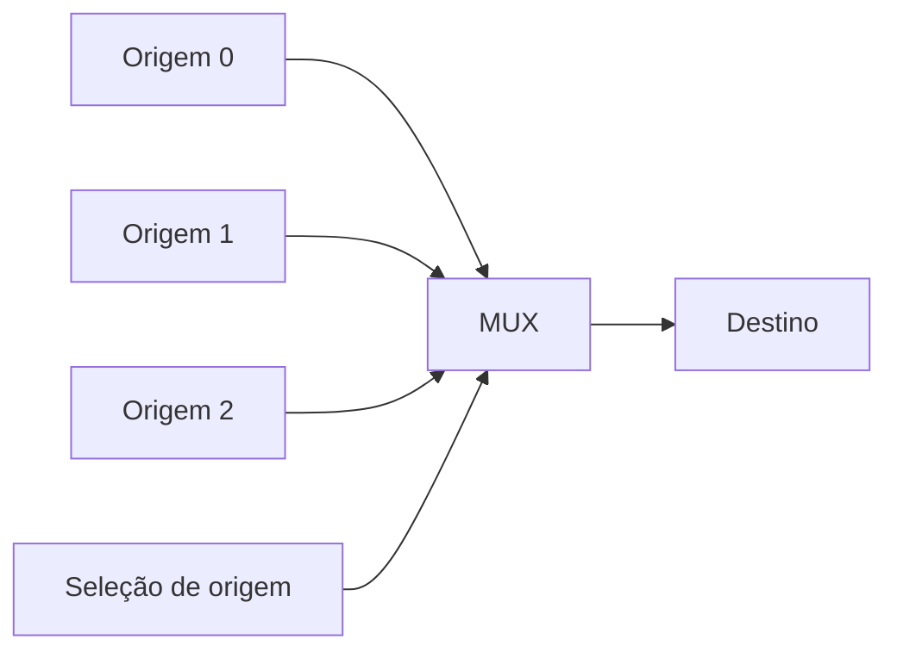

# 7. Codificadores, decodificadores e seleção de dados {#chapter-07}

Os circuitos combinacionais estudados no capítulo anterior podem ser
organizados em blocos reutilizáveis. **Codificadores** transformam a indicação
de uma entre várias entradas em um código; **decodificadores** identificam
combinações codificadas; **multiplexadores** selecionam uma entrada entre
várias; e **demultiplexadores** direcionam um sinal para uma entre várias
saídas. Esses blocos são empregados em sistemas de controle, interfaces,
barramentos, unidades de processamento e circuitos de apresentação de dados.

Ao longo deste capítulo, consideraremos inicialmente sinais **ativos em nível
alto**, salvo indicação contrária. Uma entrada ativa em nível baixo será
identificada explicitamente por uma barra superior ou por uma convenção de
nomenclatura. Também distinguiremos a função lógica ideal do comportamento
temporal e elétrico dos componentes reais.

## Objetivos de aprendizagem

Ao concluir o capítulo, o leitor deverá ser capaz de:

- deduzir as equações e tabelas-verdade de codificadores e decodificadores;
- distinguir codificadores convencionais e codificadores com prioridade;
- projetar conversores de códigos e interfaces lógicas para displays;
- analisar multiplexadores e demultiplexadores de diferentes dimensões;
- implementar funções booleanas por seleção de dados;
- verificar circuitos por tabelas-verdade, simulação e testes funcionais.

## 7.1. Codificadores binários {#sec-binary-encoders}

Um codificador binário convencional com $2^n$ entradas e $n$ saídas associa a
cada entrada ativa um código binário de $n$ bits. No modelo **um-de-$2^n$**
(_one-hot_), exatamente uma entrada está ativa. Essa restrição é essencial:
quando duas entradas estão simultaneamente ativas, as expressões de um
codificador convencional podem produzir um código que não corresponde a nenhuma
delas.

Considere o codificador $4\rightarrow2$, com entradas $D_0,D_1,D_2,D_3$ e
saídas $Y_1,Y_0$.

<!-- prettier-ignore -->
::: table Codificação binária 4 para 2, com exatamente uma entrada ativa {#tbl-encoder-4-to-2 .full-width}

| $D_3$ | $D_2$ | $D_1$ | $D_0$ | $Y_1$ | $Y_0$ | Entrada identificada |
| :---: | :---: | :---: | :---: | :---: | :---: | -------------------- |
|   0   |   0   |   0   |   1   |   0   |   0   | $D_0$                |
|   0   |   0   |   1   |   0   |   0   |   1   | $D_1$                |
|   0   |   1   |   0   |   0   |   1   |   0   | $D_2$                |
|   1   |   0   |   0   |   0   |   1   |   1   | $D_3$                |

:::

Da tabela, seguem as equações:

$$
Y_1=D_2+D_3,\qquad Y_0=D_1+D_3.\tag{7.1}
$$

As equações são corretas **sob a hipótese de uma única entrada ativa**. Para
$D_2=D_1=1$, por exemplo, elas fornecem $Y_1Y_0=11$, embora $D_3=0$. Para
diferenciar ausência de solicitação de $D_0$ ativo, pode-se acrescentar um
sinal de validade:

$$
V=D_0+D_1+D_2+D_3.\tag{7.2}
$$

O sinal $V$ indica que pelo menos uma entrada está ativa, mas não detecta
múltiplas ativações. Um detector de violação da condição _one-hot_ requer
lógica adicional.

<!-- prettier-ignore -->
::: figure Estrutura funcional de um codificador binário quatro para dois {#fig-encoder-block}

```tikz
\begin{tikzpicture}[scale=1.8,transform shape]
\draw[thick] (1,0) rectangle (3.4,2.8);
\node[align=center] at (2.2,1.4) {Codificador\\$4\rightarrow2$};
\foreach \y/\name in {2.3/D_3,1.7/D_2,1.1/D_1,0.5/D_0}{
  \draw (0.2,\y)--(1,\y);
  \node[left] at (0.2,\y) {$\name$};
}
\foreach \y/\name in {1.9/Y_1,0.9/Y_0}{
  \draw (3.4,\y)--(4.3,\y);
  \node[right] at (4.3,\y) {$\name$};
}
\end{tikzpicture}
```

:::

::: example Identificação de uma linha ativa {#ex-encoder-line}

Se $D_2=1$ e todas as demais entradas forem nulas, então $Y_1=1$, $Y_0=0$ e
$V=1$. O código $10_2$ identifica a linha de índice 2. Se todas as entradas
forem nulas, o mesmo par $00$ aparece nas saídas, mas $V=0$ indica ausência de
solicitação.

:::

## 7.2. Codificadores com prioridade {#sec-priority-encoders}

Um codificador com prioridade define o resultado mesmo quando várias entradas
estão ativas. Em um codificador $4\rightarrow2$ com prioridade
$D_3>D_2>D_1>D_0$, a entrada de maior índice prevalece. O símbolo $X$ na tabela
indica que o valor daquela entrada não altera o resultado da linha.

<!-- prettier-ignore -->
::: table Codificador com prioridade 4 para 2 {#tbl-priority-encoder .full-width}

| $D_3$ | $D_2$ | $D_1$ | $D_0$ | $Y_1$ | $Y_0$ | $V$ | Entrada atendida |
| :---: | :---: | :---: | :---: | :---: | :---: | :-: | ---------------- |
|   1   |   X   |   X   |   X   |   1   |   1   |  1  | $D_3$            |
|   0   |   1   |   X   |   X   |   1   |   0   |  1  | $D_2$            |
|   0   |   0   |   1   |   X   |   0   |   1   |  1  | $D_1$            |
|   0   |   0   |   0   |   1   |   0   |   0   |  1  | $D_0$            |
|   0   |   0   |   0   |   0   |   0   |   0   |  0  | Nenhuma          |

:::

Uma realização combinacional é:

$$
\begin{aligned}
Y_1&=D_3+D_2,\\
Y_0&=D_3+\overline{D_2}D_1,\\
V&=D_3+D_2+D_1+D_0.
\end{aligned}\tag{7.3}
$$

Observe que $D_0$ não aparece nas expressões dos bits codificados: sua seleção
corresponde a $00$, distinguível da ausência de solicitação por $V$. Em
aplicações reais, as prioridades podem ser fixas ou programáveis. O princípio
também aparece na seleção de interrupções e na arbitragem de recursos
compartilhados.

::: example Solicitações simultâneas {#ex-priority-simultaneous}

Para $D_3D_2D_1D_0=0111$, as entradas $D_2$, $D_1$ e $D_0$ estão ativas. Como
$D_2$ tem a maior prioridade entre elas, a saída é $Y_1Y_0=10$, com $V=1$.

:::

## 7.3. Decodificadores {#sec-decoders}

Um decodificador binário de $n$ entradas e $2^n$ saídas ativa a linha associada
ao código presente na entrada. Em um decodificador $2\rightarrow4$ com
habilitação $E$, as saídas $Q_0,\ldots,Q_3$ são:

$$
\begin{aligned}
Q_0&=E\overline A\,\overline B, &Q_1&=E\overline A B,\\
Q_2&=EA\overline B, &Q_3&=EAB.
\end{aligned}\tag{7.4}
$$

Aqui $A$ é o bit mais significativo e $B$ o menos significativo.

<!-- prettier-ignore -->
::: table Decodificador 2 para 4, saídas ativas em nível alto {#tbl-decoder-2-to-4 .full-width}

| $E$ | $A$ | $B$ | $Q_0$ | $Q_1$ | $Q_2$ | $Q_3$ |
| :-: | :-: | :-: | :---: | :---: | :---: | :---: |
|  0  |  X  |  X  |   0   |   0   |   0   |   0   |
|  1  |  0  |  0  |   1   |   0   |   0   |   0   |
|  1  |  0  |  1  |   0   |   1   |   0   |   0   |
|  1  |  1  |  0  |   0   |   0   |   1   |   0   |
|  1  |  1  |  1  |   0   |   0   |   0   |   1   |

:::

::: figure Decodificador binário dois para quatro {#fig-decoder-block}

```tikz
\begin{tikzpicture}[scale=1.8,transform shape]
\draw[thick] (1,0) rectangle (3.5,3.1);
\node[align=center] at (2.25,1.55) {Decodificador\\$2\rightarrow4$};
\foreach \y/\name in {2.5/A,1.6/B,0.7/E}{
  \draw (0.15,\y)--(1,\y);
  \node[left] at (0.15,\y) {$\name$};
}
\foreach \y/\name in {2.6/Q_0,1.9/Q_1,1.2/Q_2,0.5/Q_3}{
  \draw (3.5,\y)--(4.3,\y);
  \node[right] at (4.3,\y) {$\name$};
}
\end{tikzpicture}
```

:::

**Convenções elétricas.** Muitos circuitos integrados apresentam saídas ativas
em nível baixo, indicadas por $\overline{Q_i}$ ou por sufixos como `_n`. Nesses
componentes, a linha selecionada assume 0, e as demais permanecem em 1. É
indispensável consultar a tabela funcional do dispositivo, incluindo a
polaridade das entradas de habilitação.

Decodificadores também implementam funções booleanas: cada saída corresponde a
um mintermo, e a combinação por OR de saídas selecionadas produz uma soma de
mintermos. Essa construção conecta diretamente os capítulos 3, 5 e 6.

## 7.4. Conversores de códigos {#sec-code-converters}

Um conversor de códigos recebe uma palavra em determinada representação e
produz outra que descreve a mesma informação segundo uma convenção diferente.
Exemplos incluem binário para Gray, Gray para binário e BCD para sinais de
exibição.

Para uma palavra binária de quatro bits $B_3B_2B_1B_0$, a conversão para Gray
é:

$$
\begin{aligned}
G_3&=B_3,\\
G_2&=B_3\oplus B_2,\\
G_1&=B_2\oplus B_1,\\
G_0&=B_1\oplus B_0.
\end{aligned}\tag{7.5}
$$

A conversão inversa é:

$$
\begin{aligned}
B_3&=G_3,\\
B_2&=G_3\oplus G_2,\\
B_1&=G_3\oplus G_2\oplus G_1,\\
B_0&=G_3\oplus G_2\oplus G_1\oplus G_0.
\end{aligned}\tag{7.6}
$$

::: example Conversão de binário para Gray {#ex-binary-gray}

Para $B_3B_2B_1B_0=1011$, obtém-se $G_3G_2G_1G_0=1110$. Ao aplicar as equações
inversas, recupera-se $1011$. Códigos Gray são úteis em interfaces de posição
porque palavras consecutivas diferem em apenas um bit; isso não elimina,
entretanto, problemas de sincronização e temporização em circuitos reais.

:::

Em conversões envolvendo BCD, somente os códigos de `0000` a `1001` representam
algarismos decimais válidos. Os códigos de `1010` a `1111` devem ter
comportamento especificado: podem produzir um padrão de erro, apagar a saída ou
ser tratados como condições indiferentes **apenas quando a especificação
garantir que não ocorrerão**.

## 7.5. Displays de sete segmentos {#sec-seven-segment-displays}

Um display de sete segmentos possui elementos luminosos identificados por
$a,b,c,d,e,f,g$. A ativação de combinações desses segmentos representa
algarismos e alguns caracteres. O acionamento depende do tipo de dispositivo:
em uma configuração **cátodo comum**, um nível alto pode acender o segmento; em
**ânodo comum**, normalmente é necessário nível baixo. O circuito de interface
deve respeitar os limites de corrente e tensão do componente.

<!-- prettier-ignore -->
::: figure Identificação dos segmentos de um display de sete segmentos {#fig-seven-segment-labels}

```tikz
\begin{tikzpicture}[scale=2,transform shape]
\draw[line width=2.5pt] (0.3,2.5)--(1.3,2.5) node[midway,above] {$a$};
\draw[line width=2.5pt] (1.5,2.3)--(1.5,1.4) node[midway,right] {$b$};
\draw[line width=2.5pt] (1.5,1.1)--(1.5,0.2) node[midway,right] {$c$};
\draw[line width=2.5pt] (0.3,0)--(1.3,0) node[midway,below] {$d$};
\draw[line width=2.5pt] (0.1,1.1)--(0.1,0.2) node[midway,left] {$e$};
\draw[line width=2.5pt] (0.1,2.3)--(0.1,1.4) node[midway,left] {$f$};
\draw[line width=2.5pt] (0.3,1.25)--(1.3,1.25) node[midway,above] {$g$};
\end{tikzpicture}
```

:::

A tabela a seguir adota **saídas ativas em nível alto**, com `1` indicando
segmento aceso. A ordem das saídas é $abcdefg$.

<!-- prettier-ignore -->
::: table Padrões para algarismos decimais em display de sete segmentos {#tbl-seven-segment-patterns .full-width}

| Algarismo | BCD  | $abcdefg$ | Segmentos acesos    |
| :-------: | :--: | :-------: | ------------------- |
|     0     | 0000 |  1111110  | a, b, c, d, e, f    |
|     1     | 0001 |  0110000  | b, c                |
|     2     | 0010 |  1101101  | a, b, d, e, g       |
|     3     | 0011 |  1111001  | a, b, c, d, g       |
|     4     | 0100 |  0110011  | b, c, f, g          |
|     5     | 0101 |  1011011  | a, c, d, f, g       |
|     6     | 0110 |  1011111  | a, c, d, e, f, g    |
|     7     | 0111 |  1110000  | a, b, c             |
|     8     | 1000 |  1111111  | a, b, c, d, e, f, g |
|     9     | 1001 |  1111011  | a, b, c, d, f, g    |

:::

Um conversor BCD–sete segmentos pode ser implementado com sete funções
booleanas independentes ou com um bloco lógico dedicado. Quando vários displays
compartilham as linhas dos segmentos, emprega-se frequentemente varredura
temporal (_multiplexação de displays_), cuja taxa deve ser escolhida de modo a
produzir apresentação visual adequada sem ultrapassar os limites elétricos.

## 7.6. Multiplexadores {#sec-multiplexers}

Um **multiplexador** (MUX) seleciona uma entre várias entradas de dados e a
encaminha para uma saída. Em um MUX $2\rightarrow1$, as entradas são $D_0,D_1$,
o seletor é $S$ e a saída é $Y$:

$$
Y=\overline S D_0+SD_1.\tag{7.7}
$$

::: table Multiplexador 2 para 1 {#tbl-mux-2-to-1 .full-width}

| $S$ | $Y$   |
| :-: | ----- |
|  0  | $D_0$ |
|  1  | $D_1$ |

:::

<!-- prettier-ignore -->
::: figure Seleção de uma entre duas entradas de dados {#fig-mux-2-to-1}

```tikz
\begin{tikzpicture}[scale=2,transform shape]

% Corpo do multiplexador
\draw[thick]
  (1,0) -- (3,0.4) -- (3,2.2) -- (1,2.6) -- cycle;

% Identificação do bloco
\node at (2,1.3) {MUX};

% Entradas de dados: fios terminam na borda esquerda
\draw (0.1,2.1) -- (1,2.1);
\node[left] at (0.1,2.1) {$D_0$};

\draw (0.1,0.5) -- (1,0.5);
\node[left] at (0.1,0.5) {$D_1$};

% Saída
\draw (3,1.3) -- (4,1.3);
\node[right] at (4,1.3) {$Y$};

% Entrada de seleção: borda inferior em x=2, y=0.2
\draw (2,-0.7) -- (2,0.2);
\node[below] at (2,-0.7) {$S$};

\end{tikzpicture}
```

:::

A posição dos terminais no desenho é ilustrativa; a associação lógica entre
seletor e entradas é definida pela equação (7.7). Para um MUX $4\rightarrow1$,
com seletores $S_1,S_0$, temos:

$$
\begin{aligned}
Y={}&\overline{S_1}\,\overline{S_0}D_0
+\overline{S_1}S_0D_1\\
&+S_1\overline{S_0}D_2+S_1S_0D_3.
\end{aligned}\tag{7.8}
$$

<!-- prettier-ignore -->
::: table Seleção de dados em um multiplexador 4 para 1 {#tbl-mux-4-to-1 .full-width}

| $S_1$ | $S_0$ | Saída $Y$ |
| :---: | :---: | --------- |
|   0   |   0   | $D_0$     |
|   0   |   1   | $D_1$     |
|   1   |   0   | $D_2$     |
|   1   |   1   | $D_3$     |

:::

Multiplexadores maiores podem ser construídos em árvore. Dois MUX
$2\rightarrow1$ selecionam pares de entradas e um terceiro seleciona entre os
resultados, formando um MUX $4\rightarrow1$. A organização hierárquica é
funcionalmente equivalente à expressão (7.8), mas a profundidade lógica
influencia o atraso.

## 7.7. Demultiplexadores {#sec-demultiplexers}

Um **demultiplexador** (DEMUX) distribui um sinal de entrada $D$ para uma entre
várias saídas, conforme os seletores. Para um DEMUX $1\rightarrow4$, com
seletores $S_1,S_0$:

$$
\begin{aligned}
Y_0&=D\overline{S_1}\,\overline{S_0}, &
Y_1&=D\overline{S_1}S_0,\\
Y_2&=DS_1\overline{S_0}, &
Y_3&=DS_1S_0.
\end{aligned}\tag{7.9}
$$

<!-- prettier-ignore -->
::: table Demultiplexador 1 para 4, saídas inativas em zero {#tbl-demux-1-to-4 .full-width}

| $S_1$ | $S_0$ | $Y_0$ | $Y_1$ | $Y_2$ | $Y_3$ |
| :---: | :---: | :---: | :---: | :---: | :---: |
|   0   |   0   |  $D$  |   0   |   0   |   0   |
|   0   |   1   |   0   |  $D$  |   0   |   0   |
|   1   |   0   |   0   |   0   |  $D$  |   0   |
|   1   |   1   |   0   |   0   |   0   |  $D$  |

:::

Quando $D=1$, a estrutura se comporta como um decodificador com habilitação. A
diferença principal está na interpretação funcional: o decodificador identifica
um código, enquanto o demultiplexador encaminha um sinal de dados. Na
implementação física, ambas as funções podem compartilhar uma mesma organização
lógica.

## 7.8. Implementação de funções com multiplexadores {#sec-mux-logic-implementation}

Um multiplexador pode implementar funções booleanas arbitrárias. O procedimento
mais direto para uma função de $n$ variáveis consiste em utilizar essas
variáveis como seletores de um MUX com $2^n$ entradas, ligando cada entrada de
dados a 0 ou 1 conforme a linha correspondente da tabela-verdade.

Um procedimento mais econômico usa a **decomposição de Shannon**:

$$
F=\overline S\,F\big|_{S=0}+S\,F\big|_{S=1}.\tag{7.10}
$$

Os dois cofatores são conectados a $D_0$ e $D_1$ de um MUX $2\rightarrow1$.

::: example Implementação de uma função com MUX 2 para 1 {#ex-mux-shannon}

Considere $F(A,B,C)=AB+\overline AC$. Tomando $A$ como seletor:

$$
F\big|_{A=0}=C,\qquad F\big|_{A=1}=B.
$$

Logo, basta ligar $S=A$, $D_0=C$ e $D_1=B$. O resultado é:

$$
Y=\overline A C+AB=F.\tag{7.11}
$$

Trata-se da mesma função analisada na Figura 2 do Capítulo 6. A implementação
por MUX evidencia a seleção entre $B$ e $C$, enquanto a implementação por
portas evidencia os dois produtos booleanos.

:::

Para uma função de três variáveis implementada por MUX $4\rightarrow1$, duas
variáveis podem servir como seletores e a terceira aparece nas entradas de
dados na forma $0$, $1$, $X$ ou $\overline X$. Essa estratégia reduz a
quantidade de seletores, mas pode exigir inversores adicionais.

## 7.9. Estruturas de seleção e roteamento de sinais {#sec-signal-routing}

A associação de multiplexadores, demultiplexadores, decodificadores e sinais de
habilitação permite construir redes de seleção e distribuição. Em um barramento
compartilhado, por exemplo, um multiplexador escolhe qual fonte fornece dados a
um destino. Um decodificador pode selecionar qual periférico deve responder a
um endereço. Um demultiplexador pode encaminhar um sinal de habilitação a uma
unidade específica.

<!-- prettier-ignore -->
::: figure Organização conceitual de uma rede de seleção de dados {#fig-selection-routing}



:::

A seleção lógica não deve ser confundida com o isolamento elétrico. A saída de
um MUX não equivale necessariamente a uma chave analógica bidirecional;
tampouco um DEMUX convencional fornece, por si só, saídas de alta impedância.
Em circuitos reais, devem ser avaliados o carregamento das saídas, os níveis
lógicos, a fan-out, os atrasos de propagação e as condições de habilitação.

Também é necessário considerar as **transições dos seletores**. Quando vários
bits mudam quase simultaneamente, diferenças de atraso podem produzir pulsos
transitórios ou selecionar brevemente um caminho indesejado. O tratamento
depende da aplicação: sincronização, registros de saída, protocolos de
habilitação e escolha adequada da arquitetura podem ser necessários.

### Exemplo em Verilog {#sec-selection-verilog}

O módulo a seguir descreve um MUX $4\rightarrow1$ com seletores de dois bits:

```verilog
module mux4 (
    input  wire [3:0] d,
    input  wire [1:0] s,
    output wire       y
);
    assign y = d[s];
endmodule
```

O operador de indexação seleciona um dos quatro bits de `d`. Em uma
implementação física, o resultado corresponde a uma rede de seleção
combinacional. A descrição não especifica atrasos elétricos nem garante
ausência de transientes durante mudanças de `s`.

::: example Teste funcional de um MUX 4 para 1 {#ex-mux-test}

Considere $D_3D_2D_1D_0=1010$. Para $S_1S_0=00$, seleciona-se $D_0=0$; para
`01`, $D_1=1$; para `10`, $D_2=0$; e para `11`, $D_3=1$. Percorrer os quatro
códigos de seleção é um teste exaustivo dos seletores para essa palavra de
dados, mas não substitui a verificação de todas as combinações possíveis das
entradas.

:::

## Síntese do capítulo

Codificadores, decodificadores, multiplexadores e demultiplexadores são blocos
combinacionais que organizam a identificação, a conversão e a circulação de
informações digitais. O codificador pressupõe uma política para entradas
simultâneas; o decodificador associa códigos a linhas; o multiplexador escolhe
uma origem; e o demultiplexador escolhe um destino. A decomposição de Shannon
demonstra que a seleção de dados também é um método geral de implementação de
funções booleanas.

## Exercícios {#sec-chapter-07-exercises}

1. **Codificador convencional.** Escreva a tabela-verdade de um codificador
   $8\rightarrow3$ sob a hipótese _one-hot_. Determine as expressões de
   $Y_2,Y_1,Y_0$.
2. **Validade.** Explique por que um codificador $4\rightarrow2$ sem sinal de
   validade não distingue a ausência de entrada ativa da ativação exclusiva de
   $D_0$.
3. **Prioridade.** Para o codificador da {@ref tbl-priority-encoder}, determine
   $Y_1Y_0$ e $V$ quando $D_3D_2D_1D_0=1011$.
4. **Decodificação.** Para o decodificador da {@ref tbl-decoder-2-to-4},
   calcule as quatro saídas quando $E=1$, $A=1$ e $B=0$.
5. **Conversão de códigos.** Converta $1101_2$ para Gray e depois reconverta o
   resultado para binário.
6. **Display.** Usando a {@ref tbl-seven-segment-patterns}, identifique os
   segmentos acesos para os algarismos 2 e 5 e explique como mudam os níveis de
   acionamento para saídas ativas em nível baixo.
7. **Multiplexador.** Determine a saída de um MUX $4\rightarrow1$ com
   $D_3D_2D_1D_0=0110$ e seletores $S_1S_0=01$.
8. **Síntese com MUX.** Implemente $F(A,B,C)=A\oplus B\oplus C$ usando $A$ como
   seletor de um MUX $2\rightarrow1$. Determine as funções necessárias nas
   entradas de dados.
9. **Demultiplexador.** Para um DEMUX $1\rightarrow4$ com $D=1$ e $S_1S_0=11$,
   determine as saídas. Repita para $D=0$.

## Respostas e soluções selecionadas {#sec-chapter-07-solutions}

**1.** As linhas válidas correspondem à ativação exclusiva de $D_0,\ldots,D_7$.
As equações são $Y_2=D_4+D_5+D_6+D_7$, $Y_1=D_2+D_3+D_6+D_7$ e
$Y_0=D_1+D_3+D_5+D_7$.

**2.** Ambos os casos produzem $Y_1Y_0=00$. Um sinal $V=D_0+D_1+D_2+D_3$
distingue os casos: $V=0$ na ausência de solicitação e $V=1$ quando $D_0$ está
ativo.

**3.** Como $D_3=1$, sua prioridade prevalece: $Y_1Y_0=11$ e $V=1$.

**4.** $Q_0Q_1Q_2Q_3=0010$, isto é, apenas $Q_2=1$.

**5.** $1101_2\rightarrow1011_{\mathrm{Gray}}\rightarrow1101_2$.

**6.** Para 2, acendem-se $a,b,d,e,g$; para 5, $a,c,d,f,g$. Com saídas ativas
em nível baixo, os segmentos acesos recebem 0, de acordo com a interface
elétrica adotada.

**7.** Seleciona-se $D_1=1$; portanto, $Y=1$.

**8.** $D_0=B\oplus C$ e $D_1=\overline{B\oplus C}$, pois a função muda de
paridade quando $A$ passa de 0 para 1.

**9.** Para $D=1$ e seletores `11`, $Y_3=1$ e as demais saídas são 0. Para
$D=0$, todas as saídas são 0.

## Referências bibliográficas

1. MANO, M. Morris; CILETTI, Michael D. **Digital Design**. 5. ed.
   Pearson, 2013.
2. FLOYD, Thomas L. **Digital Fundamentals**. 11. ed. Pearson, 2015.
3. TOCCI, Ronald J.; WIDMER, Neal S.; MOSS, Gregory L. **Digital Systems:
   Principles and Applications**. 12. ed. Pearson, 2017.
4. HARRIS, David Money; HARRIS, Sarah L. **Digital Design and Computer
   Architecture**. 2. ed. Morgan Kaufmann, 2012.
5. WAKERLY, John F. **Digital Design: Principles and Practices**. 4. ed.
   Pearson, 2005.

---

[Voltar ao sumário](README.md) ·
[Capítulo 6 — Projeto de circuitos combinacionais](combinational-circuit-design.md)
· [Capítulo 8 — Circuitos aritméticos digitais](digital-arithmetic-circuits.md)
