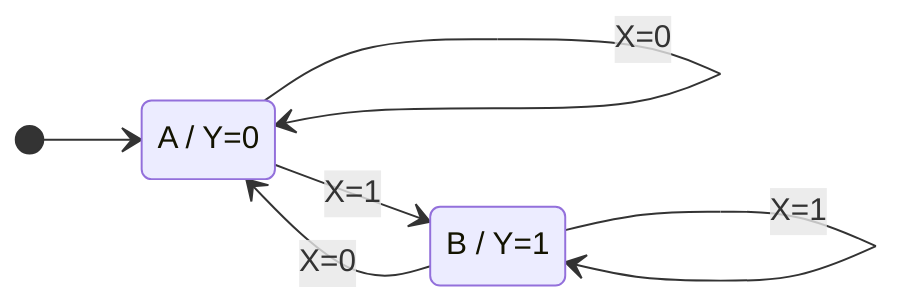
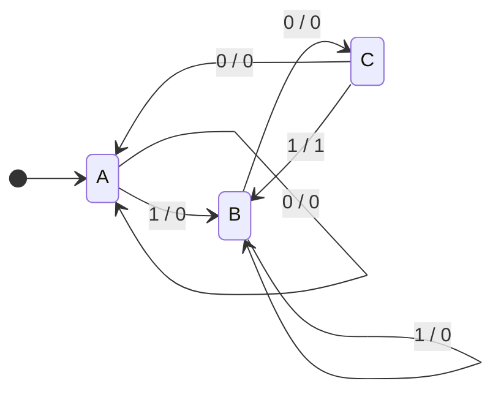

# 12. Máquinas de estados finitos {#chapter-12}

Os registradores e contadores do Capítulo 11 armazenam estados e os atualizam segundo regras bem definidas. Uma **máquina de estados finitos** (*finite-state machine*, FSM) generaliza essa ideia: seu comportamento é descrito por um conjunto finito de estados, condições de transição e saídas associadas aos estados ou às transições. A FSM constitui uma ferramenta central para projetar controladores digitais, protocolos de comunicação, detectores de sequências e unidades de controle.

Este capítulo adota, como modelo principal, máquinas sequenciais síncronas: as entradas são avaliadas por uma lógica combinacional, enquanto o estado é atualizado na borda ativa do relógio. O comportamento lógico é descrito separadamente das restrições físicas de temporização discutidas no Capítulo 10.

## 12.1. Conceito de máquina de estados {#sec-fsm-concept}

Uma máquina de estados pode ser descrita pela quíntupla

$$
\mathcal{M}=(S,I,O,\delta,\lambda),\tag{12.1}
$$

em que $S$ é o conjunto finito de estados, $I$ o conjunto de combinações de entrada, $O$ o conjunto de saídas, $\delta$ a função de transição e $\lambda$ a função de saída. Para uma máquina síncrona, o próximo estado é calculado como

$$
S^{+}=\delta(S,I).\tag{12.2}
$$

O estado presente $S$ resume a informação histórica necessária para determinar o comportamento futuro da máquina. Isso não significa que a máquina armazene toda a história de entradas: armazena apenas a informação relevante para sua especificação.

<!-- prettier-ignore -->
::: figure Organização funcional de uma máquina de estados síncrona {#fig-fsm-architecture}

```tikz
\begin{tikzpicture}[scale=1.5,transform shape]

% Lógica de próximo estado
\draw[thick] (1,2.4) rectangle (4.2,4.0);
\node[align=center] at (2.6,3.2)
  {Lógica de\\próximo estado};

% Registrador de estado
\draw[thick] (6.0,2.4) rectangle (9.0,4.0);
\node[align=center] at (7.5,3.2)
  {Registrador\\de estado};

% Entrada I
\draw[->] (0.0,3.5) -- (1,3.5);
\node[above] at (0.5,3.5) {$I$};

% Próximo estado S+
\draw[->] (4.2,3.2) -- (6.0,3.2);
\node[above] at (5.1,3.2) {$S^{+}$};

% Estado presente S
\draw[->] (9.0,3.2) -- (10.4,3.2);
\node[above] at (9.7,3.2) {$S$};

% Realimentação do estado presente
% Ponte semicircular sobre a linha de CLK
\draw[->]
  (9.7,3.2)
  -- (9.7,1.0)
  -- (7.8,1.0)
  arc[start angle=0,end angle=-180,radius=0.3]
  -- (2.6,1.0)
  -- (2.6,2.4);

% Entrada de relógio
\draw[->]
  (7.5,-0.2)
  -- (7.5,2.4);

% Rótulo do relógio
\node[right] at (7.65,0.2) {$CLK$};

\end{tikzpicture}
```

:::

Na {@ref fig-fsm-architecture}, o caminho de realimentação devolve o estado presente à lógica de próximo estado. A lógica de saída, não mostrada para simplificar a figura, pode depender apenas de $S$ ou de $S$ e $I$.

Um estado deve possuir significado funcional. Por exemplo, em um controlador de porta automática, os estados *fechada*, *abrindo*, *aberta* e *fechando* descrevem etapas distintas de operação. A presença de um sensor não cria, por si só, um novo estado; ela pode apenas determinar a transição entre estados existentes.

## 12.2. Modelos de Moore e Mealy {#sec-fsm-moore-mealy}

A classificação mais comum distingue as máquinas **de Moore** e **de Mealy** pela função de saída.

Na máquina de Moore, a saída depende exclusivamente do estado presente:

$$
O=\lambda(S).\tag{12.3}
$$

Na máquina de Mealy, a saída depende do estado e das entradas presentes:

$$
O=\lambda(S,I).\tag{12.4}
$$

::: table Comparação entre máquinas de Moore e Mealy {#tbl-fsm-moore-mealy .full-width}

| Característica | Moore | Mealy |
| --- | --- | --- |
| Dependência da saída | Estado presente | Estado presente e entradas |
| Representação no diagrama | Saída associada ao estado | Saída associada à transição |
| Resposta à mudança de entrada | Em geral após atualização de estado | Pode ocorrer entre bordas de relógio |
| Possibilidade de pulsos transitórios na saída | Menor quando a saída é registrada | Requer cuidado com variações e *hazards* nas entradas |
| Número de estados | Pode ser maior | Pode ser menor para a mesma especificação |

:::

A saída de uma máquina de Moore implementada por lógica combinacional sobre os bits de estado também pode apresentar transientes durante a atualização física desses bits. Se a aplicação exigir uma saída estritamente sincronizada, ela deverá ser registrada ou tratada por uma arquitetura apropriada.

::: example Reconhecimento de um comando {#ex-fsm-moore-mealy}

Um controlador recebe a entrada $X$ e deve sinalizar quando o comando está ativo. Uma saída de Mealy pode ser definida como $Y=X$ em determinado estado de espera, respondendo imediatamente a $X$. Uma versão Moore pode transitar para um estado de comando reconhecido e produzir $Y=1$ somente após a borda de relógio. As duas versões não são temporalmente idênticas, ainda que possam realizar funções de controle semelhantes.

:::

## 12.3. Diagramas e tabelas de transição {#sec-fsm-diagrams-tables}

Um **diagrama de estados** representa os estados como nós e as transições como setas. Uma **tabela de transição** registra, para cada par estado–entrada, o próximo estado e as saídas. Os dois formatos descrevem o mesmo comportamento e devem ser mutuamente consistentes.

Considere um controlador simples de dois estados: $A$ (espera) e $B$ (ativo). A entrada $X$ determina a transição: $A\to B$ quando $X=1$ e $B\to A$ quando $X=0$; nos demais casos, o estado é preservado. A saída Moore é $Y=0$ em $A$ e $Y=1$ em $B$.

<!-- prettier-ignore -->
::: figure Diagrama de estados de um controlador de dois estados {#fig-fsm-two-state-diagram}



:::

::: table Tabela de transição do controlador de dois estados {#tbl-fsm-two-state-transition .full-width}

| Estado presente | $X$ | Próximo estado | $Y$ |
| --- | --- | --- | --- |
| $A$ | 0 | $A$ | 0 |
| $A$ | 1 | $B$ | 0 |
| $B$ | 0 | $A$ | 1 |
| $B$ | 1 | $B$ | 1 |

:::

A tabela apresenta a saída do estado **antes** da borda que efetua a transição. Após a borda, a saída passa a refletir o novo estado. Essa convenção deve ser mantida em todas as tabelas de Moore.

A seta de inicialização no diagrama indica o estado de partida lógico, mas não substitui o circuito de *reset* necessário para garantir esse estado no equipamento real.

## 12.4. Codificação de estados {#sec-fsm-state-encoding}

Para implementar uma FSM, cada estado simbólico precisa receber uma representação binária. Se a máquina possui $N$ estados, a codificação binária compacta exige ao menos

$$
n=\lceil\log_2 N\rceil\tag{12.5}
$$

bits de estado. Outras codificações podem usar mais bits para simplificar a lógica de transição ou reduzir atrasos.

::: table Codificações ilustrativas para quatro estados {#tbl-fsm-state-encoding .full-width}

| Estado | Binária | Gray | *One-hot* |
| --- | --- | --- | --- |
| $A$ | 00 | 00 | 0001 |
| $B$ | 01 | 01 | 0010 |
| $C$ | 10 | 11 | 0100 |
| $D$ | 11 | 10 | 1000 |

:::

Na codificação *one-hot*, exatamente um bit é 1 em cada estado válido. São necessários $N$ *flip-flops* para $N$ estados, mas certas transições podem ser implementadas por lógica simples. Na codificação Gray, estados adjacentes de uma sequência convenientemente escolhida diferem em apenas um bit. Essa propriedade só é vantajosa quando as transições efetivas acompanham tal sequência.

::: example Custo de armazenamento {#ex-fsm-encoding-cost}

Uma máquina com seis estados exige pelo menos três bits em codificação binária, pois $2^2<6\le2^3$. Uma codificação *one-hot* empregaria seis bits. A comparação completa deve considerar também o número de portas, os atrasos, o consumo e a facilidade de verificação.

:::

Os códigos não utilizados precisam ter comportamento especificado. Um *reset* deve estabelecer um estado válido, e o projeto pode prever recuperação caso uma falha coloque a máquina em um código inválido.

## 12.5. Minimização de estados {#sec-fsm-state-minimization}

A **minimização de estados** busca eliminar estados funcionalmente indistinguíveis sem alterar o comportamento observável da máquina. Dois estados são equivalentes quando, para toda sequência possível de entradas, produzem as mesmas sequências de saída, respeitando a convenção temporal do modelo.

Para máquinas de Moore, estados com saídas diferentes não podem ser equivalentes. Estados com a mesma saída são candidatos à equivalência, mas é necessário verificar se suas transições, para cada entrada, conduzem a classes de estados equivalentes.

O método de refinamento de partições procede, conceitualmente, da seguinte forma:

1. Agrupar estados segundo suas saídas.
2. Separar estados cujas transições conduzem a grupos diferentes para alguma entrada.
3. Repetir o refinamento até que nenhuma classe seja dividida.
4. Substituir cada classe final por um único estado.

::: table Exemplo de estados equivalentes em uma máquina de Moore {#tbl-fsm-equivalent-states .full-width}

| Estado | Saída | $X=0$ | $X=1$ |
| --- | --- | --- | --- |
| $A$ | 0 | $A$ | $C$ |
| $B$ | 0 | $B$ | $C$ |
| $C$ | 1 | $A$ | $C$ |

:::

Os estados $A$ e $B$ possuem a mesma saída. Com $X=0$, cada um permanece em um estado do conjunto $\{A,B\}$; com $X=1$, ambos alcançam $C$. Portanto, $A$ e $B$ são equivalentes e podem ser reunidos em uma única classe. O estado $C$ não pode ser unido a eles, pois apresenta saída diferente.

A minimização depende do comportamento especificado e dos estados alcançáveis. Estados inalcançáveis a partir da inicialização também podem ser removidos, desde que não exista requisito de recuperação que exija tratá-los explicitamente.

## 12.6. Síntese de máquinas sequenciais {#sec-fsm-synthesis}

A **síntese** transforma uma especificação de estados em uma rede de lógica combinacional e elementos de memória. O procedimento compreende: definir entradas e saídas, construir o diagrama e a tabela, escolher a codificação, deduzir as funções de próximo estado, simplificar as expressões e selecionar os elementos de armazenamento.

Para a máquina da {@ref tbl-fsm-two-state-transition}, escolha $A=0$ e $B=1$, com um *flip-flop* D de estado $Q$. A tabela mostra que o próximo estado é igual à entrada $X$, independentemente do estado atual:

$$
D=Q^{+}=X.\tag{12.6}
$$

A saída Moore é simplesmente

$$
Y=Q.\tag{12.7}
$$

<!-- prettier-ignore -->
::: figure Implementação mínima da máquina de dois estados {#fig-fsm-minimal-implementation}

```tikz
\begin{tikzpicture}[scale=1.7,transform shape]
\draw[thick] (2,1.3) rectangle (5.2,3.2);
\node[align=center] at (3.6,2.25) {Flip-flop D};
\draw[->] (0.4,2.65)--(2,2.65);
\node[above] at (1.2,2.65) {$X=D$};
\draw[->] (5.2,2.65)--(7.0,2.65);
\node[above] at (6.1,2.65) {$Y=Q$};
\draw[->] (3.6,0.2)--(3.6,1.3);
\node[below] at (3.6,0.2) {$CLK$};
\end{tikzpicture}
```

:::

O exemplo evidencia que uma especificação com estados pode, após síntese, resultar em circuito muito simples. Para máquinas maiores, as funções $D_i=f_i(Q,I)$ são obtidas da tabela de transição e podem ser minimizadas pelos métodos estudados no Capítulo 5.

É importante não confundir **minimização de estados** com **minimização da lógica**: uma máquina com menos estados pode exigir uma rede combinacional mais complexa, dependendo da codificação escolhida.

## 12.7. Detectores de sequências {#sec-fsm-sequence-detectors}

Um **detector de sequências** reconhece padrões específicos em um fluxo de bits. Seu estado representa o maior prefixo do padrão que coincide com o sufixo já recebido. Essa interpretação facilita o projeto de detectores com sobreposição.

Considere a detecção da sequência serial $101$ por uma máquina de Mealy, com entrada $X$ e saída $Z$. Os estados são:

- $A$: nenhum prefixo útil reconhecido;
- $B$: reconhecido o prefixo $1$;
- $C$: reconhecido o prefixo $10$.

A saída $Z$ deve ser 1 apenas na transição que completa o padrão.

<!-- prettier-ignore -->
::: figure Detector de sequência 101 com sobreposição {#fig-fsm-sequence-101}



:::

::: table Transições do detector de sequência 101 {#tbl-fsm-sequence-101 .full-width}

| Estado presente | $X$ | Próximo estado | $Z$ |
| --- | --- | --- | --- |
| $A$ | 0 | $A$ | 0 |
| $A$ | 1 | $B$ | 0 |
| $B$ | 0 | $C$ | 0 |
| $B$ | 1 | $B$ | 0 |
| $C$ | 0 | $A$ | 0 |
| $C$ | 1 | $B$ | 1 |

:::

A transição $C\xrightarrow{1/1}B$ é essencial: o último bit do padrão reconhecido também constitui o início de um novo padrão. Assim, a entrada $10101$ produz duas detecções, uma ao receber o terceiro bit e outra ao receber o quinto.

::: example Verificação de detecção sobreposta {#ex-fsm-overlap}

Partindo de $A$, processe $X=1,0,1,0,1$. Os estados após cada bit são $B,C,B,C,B$, e as saídas correspondentes são $0,0,1,0,1$. O detector identifica duas ocorrências de $101$ que compartilham um bit.

:::

## 12.8. Controladores digitais {#sec-fsm-digital-controllers}

Um **controlador digital** coordena ações segundo eventos e condições do sistema. Sua FSM pode comandar atuadores, habilitar operações, aguardar respostas e sinalizar conclusão ou erro. Ao projetá-lo, é necessário distinguir entradas de comando, sinais de condição e saídas de controle.

Considere um controlador simplificado de operação com quatro estados: $IDLE$ (aguardar), $START$ (emitir pulso de início), $WAIT$ (aguardar conclusão) e $DONE$ (sinalizar término). A entrada $req$ solicita uma operação e $ready$ informa que o dispositivo terminou.

::: table Especificação funcional de um controlador simples {#tbl-fsm-controller .full-width}

| Estado | Condição | Próximo estado | $start$ | $done$ |
| --- | --- | --- | --- | --- |
| $IDLE$ | $req=0$ | $IDLE$ | 0 | 0 |
| $IDLE$ | $req=1$ | $START$ | 0 | 0 |
| $START$ | Qualquer | $WAIT$ | 1 | 0 |
| $WAIT$ | $ready=0$ | $WAIT$ | 0 | 0 |
| $WAIT$ | $ready=1$ | $DONE$ | 0 | 0 |
| $DONE$ | Qualquer | $IDLE$ | 0 | 1 |

:::

Trata-se de uma máquina de Moore: as saídas dependem apenas do estado. Os sinais $start$ e $done$ ficam ativos durante um ciclo de relógio cada, supondo que a máquina avance normalmente pelos estados indicados.

A especificação também estabelece uma política de aceitação: solicitações que ocorram fora de $IDLE$ não são armazenadas. Se isso não for aceitável, o controlador deverá incluir um mecanismo adicional, como um sinal de *busy*, uma fila ou uma regra explícita para pedidos pendentes.

## 12.9. Projeto de unidades de controle {#sec-fsm-control-units}

Em sistemas digitais maiores, a **unidade de controle** determina a sequência de micro-operações executadas pelo caminho de dados (*datapath*). Enquanto o caminho de dados contém registradores, somadores, multiplexadores e outros operadores, a unidade de controle gera sinais como habilitação de escrita, seleção de fontes e comando de operação.

<!-- prettier-ignore -->
::: figure Separação funcional entre unidade de controle e caminho de dados {#fig-fsm-control-datapath}

```tikz
\begin{tikzpicture}[scale=1.55,transform shape]

% Unidade de controle
\draw[thick] (2,5) rectangle (7,7);
\node[align=center] at (4.5,6)
  {Unidade de\\controle};

% Caminho de dados
\draw[thick] (2,1) rectangle (7,3);
\node[align=center] at (4.5,2)
  {Caminho de\\dados};

% Sinal de controle: unidade de controle -> caminho de dados
\draw[->] (3.2,5) -- (3.2,3);
\node[left] at (3.0,4) {Controle};

% Sinal de status: caminho de dados -> unidade de controle
\draw[->] (5.8,3) -- (5.8,5);
\node[right] at (6.0,4) {Status};

% Comandos externos para a unidade de controle
\draw[->] (0,6) -- (2,6);
\node[above] at (1,6) {Comandos};

% Entrada de dados
\draw[->] (0,2) -- (2,2);
\node[above] at (1,2) {Dados};

% Saída de resultados
\draw[->] (7,2) -- (9.5,2);
\node[above] at (8.25,2) {Resultado};

\end{tikzpicture}
```

:::

A {@ref fig-fsm-control-datapath} é um diagrama funcional. Em uma implementação real, cada seta pode representar um conjunto de sinais. O projeto da unidade de controle exige especificar, para cada estado, quais sinais são ativados e quais condições determinam a próxima etapa.

Em projetos com operações de múltiplos ciclos, a FSM pode sequenciar as fases de busca, decodificação, execução e escrita de resultados. Já em arquiteturas com controle microprogramado, parte das decisões pode ser codificada em uma memória de controle. Ambas as abordagens relacionam estados ou endereços de controle a conjuntos de micro-operações.

## 12.10. Verificação funcional de máquinas de estados {#sec-fsm-verification}

A verificação deve confirmar não apenas as transições esperadas, mas também a inicialização, a permanência em estados de espera, a prioridade de comandos e o comportamento diante de sequências de entradas não triviais.

Para o detector de $101$ da seção 12.7, uma implementação em Verilog pode usar codificação simbólica dos estados e um bloco combinacional para calcular próximo estado e saída:

```verilog
module detector_101 (
    input  wire clk,
    input  wire rst,
    input  wire x,
    output reg  z
);
    localparam [1:0] A = 2'd0,
                     B = 2'd1,
                     C = 2'd2;

    reg [1:0] state, next_state;

    always @(posedge clk) begin
        if (rst)
            state <= A;
        else
            state <= next_state;
    end

    always @* begin
        next_state = A;
        z = 1'b0;
        case (state)
            A: begin
                if (x) next_state = B;
                else   next_state = A;
            end
            B: begin
                if (x) next_state = B;
                else   next_state = C;
            end
            C: begin
                if (x) begin
                    next_state = B;
                    z = 1'b1;
                end else begin
                    next_state = A;
                end
            end
            default: begin
                next_state = A;
                z = 1'b0;
            end
        endcase
    end
endmodule
```

O *reset* é síncrono, pois é avaliado em `posedge clk`. A saída `z` é combinacional: na máquina de Mealy, ela pode mudar entre bordas caso `x` mude. Para testar a detecção, deve-se aplicar cada bit com antecedência suficiente à borda ativa e observar a saída no intervalo apropriado, sem presumir que `z` seja um pulso registrado.

::: table Casos essenciais de verificação de uma FSM {#tbl-fsm-verification .full-width}

| Caso de teste | Propriedade verificada |
| --- | --- |
| Aplicar *reset* | Retorno ao estado inicial na borda especificada |
| Manter entradas constantes | Permanência ou avanço conforme a tabela |
| Percorrer todas as transições | Cobertura funcional das condições de mudança |
| Aplicar padrões sobrepostos | Reconhecimento correto sem perda de eventos |
| Introduzir estado inválido em simulação | Recuperação segundo a política especificada |
| Variar entradas próximas da borda | Identificação das restrições de temporização; não substitui análise física |

:::

Uma simulação funcional não demonstra, por si só, ausência de metastabilidade, cumprimento de *setup* e *hold* ou robustez elétrica. Essas verificações exigem análise temporal e, quando aplicável, ensaios de implementação.

## Síntese do capítulo {#sec-fsm-summary}

Máquinas de estados finitos fornecem uma linguagem precisa para especificar sistemas sequenciais. Os modelos de Moore e Mealy diferem na dependência das saídas; diagramas e tabelas descrevem as transições; a codificação atribui bits aos estados; a minimização elimina redundâncias; e a síntese produz a lógica e os registradores necessários. Detectores de sequência, controladores e unidades de controle mostram como essa metodologia organiza sistemas digitais de diferentes complexidades. A verificação deve considerar o comportamento funcional, os estados excepcionais e as restrições temporais da implementação.

## Exercícios propostos {#sec-fsm-exercises}

1. **Definição formal:** explique o papel de $S$, $I$, $O$, $\delta$ e $\lambda$ na descrição de uma FSM.
2. **Moore e Mealy:** uma saída deve responder imediatamente à mudança de uma entrada, mesmo sem borda de relógio. Qual modelo descreve mais diretamente esse requisito? Quais cuidados são necessários?
3. **Tabela de transição:** para a máquina da {@ref tbl-fsm-two-state-transition}, determine o estado e a saída após uma borda com $X=1$, partindo de $A$.
4. **Codificação:** quantos *flip-flops* são necessários para codificar sete estados em binário compacto? Quantos seriam usados em *one-hot*?
5. **Equivalência:** explique por que os estados $A$ e $B$ da {@ref tbl-fsm-equivalent-states} podem ser reunidos.
6. **Síntese:** deduza as equações $D$ e $Y$ da máquina de dois estados com $A=0$ e $B=1$.
7. **Sequências:** determine as saídas do detector de $101$ para a entrada $110101$, partindo de $A$.
8. **Controlador:** na {@ref tbl-fsm-controller}, o que ocorre com uma solicitação $req$ apresentada apenas durante o estado $WAIT$?
9. **Estados inválidos:** uma máquina possui cinco estados e usa codificação binária de três bits. Quantos códigos são inválidos? Proponha uma política de recuperação.
10. **Verificação:** cite quatro testes funcionais que devem ser aplicados a uma máquina de estados antes da implementação física.

## Respostas e soluções selecionadas {#sec-fsm-solutions}

1. $S$ contém os estados; $I$, as entradas; $O$, as saídas; $\delta$ determina o próximo estado; $\lambda$ determina a saída.
2. O modelo de Mealy, pois a saída pode depender diretamente da entrada. Devem ser avaliados *glitches*, sincronização e requisitos temporais.
3. Após a borda, o estado é $B$ e a saída Moore é $Y=1$.
4. $\lceil\log_2 7\rceil=3$ *flip-flops* na codificação binária; sete em *one-hot*.
5. Possuem a mesma saída e, para cada entrada, transitam para estados da mesma classe de equivalência.
6. $D=X$ e $Y=Q$.
7. Para $1,1,0,1,0,1$, as saídas são $0,0,0,1,0,1$; há duas detecções.
8. A solicitação não é memorizada pela especificação e pode ser perdida; somente $IDLE$ aceita novos pedidos.
9. Oito códigos possíveis menos cinco válidos: três inválidos. Uma política é transitar para o estado inicial na próxima borda.
10. Por exemplo: *reset*, cobertura de todas as transições, manutenção em estados de espera e sequências sobrepostas; também convém verificar estados inválidos e prioridades de controle.

## Referências bibliográficas {#sec-fsm-references}

1. MANO, M. Morris; CILETTI, Michael D. **Digital Design**. 5. ed. Pearson, 2013.
2. WAKERLY, John F. **Digital Design: Principles and Practices**. 4. ed. Pearson, 2005.
3. HARRIS, David Money; HARRIS, Sarah L. **Digital Design and Computer Architecture**. 2. ed. Morgan Kaufmann, 2012.
4. FLOYD, Thomas L. **Digital Fundamentals**. 11. ed. Pearson, 2015.

---

[Voltar ao sumário](README.md) · [Capítulo 11 — Registradores e contadores](registers-and-counters.md) · [Capítulo 13 — Dispositivos semicondutores e chaveamento digital](semiconductor-devices-and-digital-switching.md)
