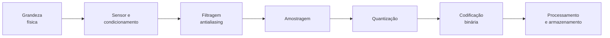
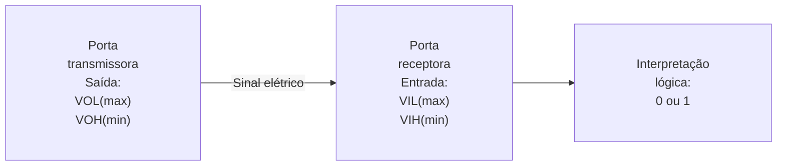
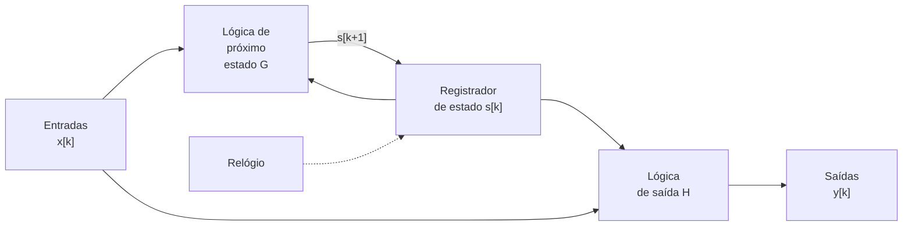
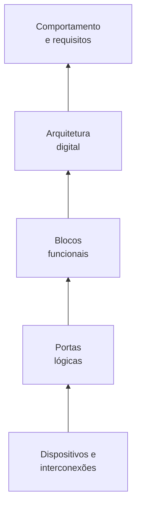
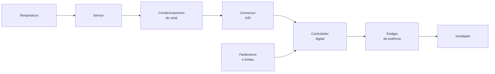
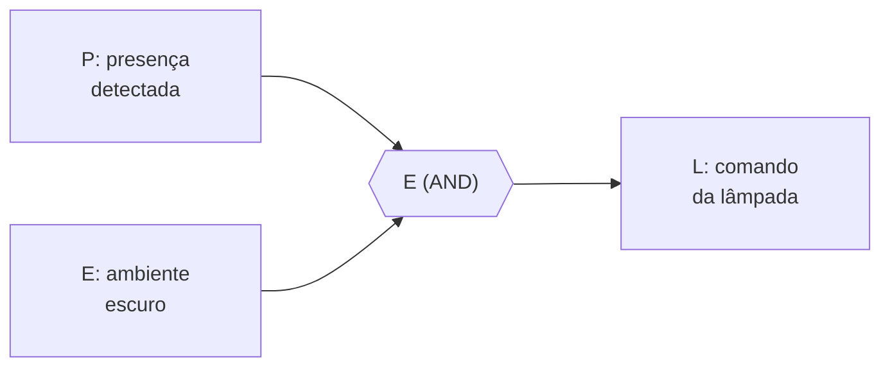

# 1. Introdução à Eletrônica Digital

A Eletrônica Digital investiga como informações podem ser representadas,
transformadas, armazenadas e transmitidas por circuitos eletrônicos que
distinguem estados discretos. Embora o sistema binário, baseado nos símbolos 0
e 1, seja predominante, a ideia de representação digital não se limita a dois
estados: ela pressupõe um conjunto definido de símbolos e regras para
interpretá-los. Uma mesma palavra binária pode representar uma quantidade, um
caractere, uma instrução ou uma condição de controle, dependendo do código
adotado.

A distinção entre o fenômeno físico e sua representação é essencial.
Temperatura, pressão, posição e tensão elétrica podem variar continuamente,
enquanto os circuitos digitais atribuem significado a faixas de valores e
processam símbolos. Essa abstração facilita a construção de sistemas
reprodutíveis e programáveis, mas não elimina as propriedades elétricas dos
dispositivos: transistores e interconexões apresentam atrasos, capacitâncias,
ruído, consumo de energia e limites de operação.

Em aplicações como instrumentação, automação, telecomunicações, veículos e
computadores, o projeto precisa articular diferentes perspectivas. Na interface
com o mundo físico, interessa compreender amostragem, quantização e
codificação; na organização funcional, importam as operações booleanas e a
distinção entre circuitos combinacionais e sequenciais; na implementação, são
indispensáveis níveis de tensão, margens de ruído, temporização e potência
dissipada. **Uma descrição logicamente correta não é suficiente se o circuito
não puder realizá-la de modo confiável nas condições de operação previstas.**

Este capítulo desenvolve essas relações e apresenta os níveis de abstração
empregados na análise e no projeto de sistemas digitais. Os fundamentos
matemáticos, as técnicas de síntese, as famílias lógicas e a implementação
física serão aprofundados nos capítulos seguintes.

## 1.1. Grandezas analógicas e digitais {#sec-analog-and-digital-quantities}

Grandezas físicas como temperatura, posição, pressão e tensão elétrica podem,
dentro de modelos macroscópicos, variar continuamente. Se uma tensão é
representada pela função $v(t)$, tanto o argumento temporal quanto a amplitude
podem assumir valores em intervalos contínuos. Um circuito analógico procura
explorar essa correspondência entre as características do sinal e as grandezas
representadas.

Um sistema digital, por outro lado, atribui significados a um conjunto de
símbolos. Em um sistema binário, esse conjunto é $\mathcal{B}=\{0,1\}$. A
associação entre um símbolo e um estado elétrico é realizada por convenções e
especificações técnicas. Não existe uma exigência universal de que o símbolo 1
corresponda a uma tensão de 5 V, nem de que o símbolo 0 seja necessariamente 0
V.

A distinção diz respeito **à representação e ao processamento da informação**,
não à natureza fundamentalmente diferente dos componentes: todo circuito
digital é físico e, portanto, está sujeito às leis da eletricidade e do
eletromagnetismo. Uma tensão de saída digital varia continuamente durante a
transição entre dois estados, ainda que o modelo lógico a represente como uma
mudança instantânea.

<!-- prettier-ignore -->
A {@ref fig-signal-types} distingue três formas de representação de sinais. A primeira apresenta uma amplitude contínua; a segunda utiliza um conjunto finito de níveis de amplitude; a terceira admite apenas dois níveis, associados aos símbolos binários. As formas de onda são esquemáticas e não representam necessariamente etapas sucessivas de um mesmo conversor.

<!-- prettier-ignore -->
::: figure Tipos de sinais {#fig-signal-types}

```tikz
\begin{tikzpicture}[
    scale=1.8,
    transform shape,
    line width=1.5pt,
    line cap=rect,
    line join=miter
]
\draw[smooth, samples=200, domain=0:8, variable=\x]
    plot ({\x},{8.0 + 0.8*sin(90*\x)});

\node[anchor=west, font=\large]
    at (9.0,8.0) {Sinal analógico};
\draw
    (0,4.7) -- (0.4,4.7)
    -- (0.4,5.1) -- (0.8,5.1)
    -- (0.8,5.5) -- (1.2,5.5)
    -- (1.2,5.9) -- (1.6,5.9)
    -- (1.6,6.3) -- (2.0,6.3)
    -- (2.0,5.9) -- (2.4,5.9)
    -- (2.4,5.5) -- (2.8,5.5)
    -- (2.8,5.1) -- (3.2,5.1)
    -- (3.2,4.7) -- (3.6,4.7)
    -- (3.6,4.3) -- (4.0,4.3)
    -- (4.0,3.9) -- (4.4,3.9)
    -- (4.4,3.5) -- (4.8,3.5)
    -- (4.8,3.9) -- (5.2,3.9)
    -- (5.2,4.3) -- (5.6,4.3)
    -- (5.6,4.7) -- (6.0,4.7)
    -- (6.0,5.1) -- (6.4,5.1)
    -- (6.4,5.5) -- (6.8,5.5)
    -- (6.8,5.9) -- (7.2,5.9)
    -- (7.2,5.5) -- (7.6,5.5)
    -- (7.6,5.1) -- (8.0,5.1);
\node[anchor=west, align=left, font=\large]
    at (9.0,5.0)
    {Sinal digital com\\
     múltiplos níveis\\
     de quantização\\
     (discreto)};
\draw
    (0,0.5) -- (0.5,0.5)
    -- (0.5,1.7) -- (1.5,1.7)
    -- (1.5,0.5) -- (2.0,0.5)
    -- (2.0,1.7) -- (2.5,1.7)
    -- (2.5,0.5) -- (4.0,0.5)
    -- (4.0,1.7) -- (5.0,1.7)
    -- (5.0,0.5) -- (5.5,0.5)
    -- (5.5,1.7) -- (6.0,1.7)
    -- (6.0,0.5) -- (7.0,0.5)
    -- (7.0,1.7) -- (7.5,1.7)
    -- (7.5,0.5) -- (8.0,0.5);
\node[anchor=west, font=\large]
    at (9.0,1.1) {Sinal digital binário};
\end{tikzpicture}
```

:::

<!-- prettier-ignore -->
A {@ref fig-analog-digital} compara, no mesmo sistema de eixos, uma senoide contínua, uma aproximação em degraus obtida por quantização e uma representação binária por limiar. As três curvas compartilham a mesma referência temporal, mas **não contêm a mesma quantidade de informação sobre a amplitude**: o sinal binário indica apenas de que lado do limiar está a grandeza, enquanto a aproximação multinível preserva mais distinções. A curva em degraus ilustra uma retenção entre instantes de atualização; não deve ser confundida com a forma física instantânea de todas as saídas digitais.

<!-- prettier-ignore -->
::: figure Comparação entre sinais analógico, discreto e binário {#fig-analog-digital}

```vega-lite
{
  "$schema": "https://vega.github.io/schema/vega-lite/v5.json",
  "description": "Superposição de uma senoide contínua, sua aproximação discreta quantizada e um sinal binário.",
  "config": {
    "view": {"stroke": null},
    "axis": {
      "labelFontSize": 13,
      "titleFontSize": 14,
      "gridColor": "#e5e7eb",
      "gridWidth": 0.8
    },
    "legend": {
      "labelFontSize": 13,
      "titleFontSize": 14
    }
  },
  "layer": [
    {
      "data": {
        "sequence": {
          "start": 0,
          "stop": 16.001,
          "step": 0.025,
          "as": "t"
        }
      },
      "transform": [
        {
          "calculate": "0.5 + 0.5*sin(PI*datum.t/4)",
          "as": "amplitude"
        },
        {
          "calculate": "'Analógico'",
          "as": "tipo"
        }
      ],
      "mark": {
        "type": "line",
        "strokeWidth": 2.5
      },
      "encoding": {
        "x": {
          "field": "t",
          "type": "quantitative",
          "title": "Tempo (unidades arbitrárias)",
          "scale": {
            "domain": [0,16],
            "nice": false
          },
          "axis": {
            "values": [0,1,2,3,4,5,6,7,8,9,10,11,12,13,14,15,16]
          }
        },
        "y": {
          "field": "amplitude",
          "type": "quantitative",
          "title": "Amplitude normalizada",
          "scale": {
            "domain": [0,1],
            "nice": false
          },
          "axis": {
            "values": [0,0.1,0.2,0.3,0.4,0.5,0.6,0.7,0.8,0.9,1],
            "format": ".1f"
          }
        },
        "color": {
          "field": "tipo",
          "type": "nominal",
          "title": "Tipos de sinais",
          "scale": {
            "domain": ["Analógico","Discreto","Binário"],
            "range": ["#2563eb","#16a34a","#dc2626"]
          }
        }
      }
    },
    {
      "data": {
        "sequence": {
          "start": 0,
          "stop": 16.25,
          "step": 0.25,
          "as": "t"
        }
      },
      "transform": [
        {
          "calculate": "0.5 + 0.5*sin(PI*datum.t/4)",
          "as": "analog"
        },
        {
          "calculate": "round(datum.analog*10)/10",
          "as": "nivel"
        },
        {
          "calculate": "'Discreto'",
          "as": "tipo"
        }
      ],
      "mark": {
        "type": "line",
        "interpolate": "step-after",
        "strokeWidth": 2.5
      },
      "encoding": {
        "x": {
          "field": "t",
          "type": "quantitative"
        },
        "y": {
          "field": "nivel",
          "type": "quantitative"
        },
        "color": {
          "field": "tipo",
          "type": "nominal"
        }
      }
    },
    {
      "data": {
        "sequence": {
          "start": 0,
          "stop": 16.025,
          "step": 0.025,
          "as": "t"
        }
      },
      "transform": [
        {
          "calculate": "0.5 + 0.5*sin(PI*datum.t/4)",
          "as": "analog"
        },
        {
          "calculate": "datum.analog >= 0.5 ? 1 : 0",
          "as": "bit"
        },
        {
          "calculate": "'Binário'",
          "as": "tipo"
        }
      ],
      "mark": {
        "type": "line",
        "interpolate": "step-after",
        "strokeWidth": 2.5,
        "strokeDash": [6,3]
      },
      "encoding": {
        "x": {
          "field": "t",
          "type": "quantitative"
        },
        "y": {
          "field": "bit",
          "type": "quantitative"
        },
        "color": {
          "field": "tipo",
          "type": "nominal"
        }
      }
    }
  ],
  "width": 960,
  "height": 600,
  "resolve": {
    "scale": {
      "x": "shared",
      "y": "shared",
      "color": "shared"
    }
  }
}
```

:::

A digitalização não é, por si só, uma melhoria de toda característica do sinal.
Ela introduz limitações de resolução e, quando envolve amostragem, de faixa de
frequências representáveis. Em compensação, oferece mecanismos de
armazenamento, processamento simbólico, reprodução e detecção de erros. A
decisão entre soluções analógicas, digitais ou mistas depende dos requisitos do
sistema.

## 1.2. Sinais contínuos, discretos e binários {#sec-continuous-discrete-binary-signals}

<!-- prettier-ignore -->
Como antecipado na {@ref sec-analog-and-digital-quantities}, é necessário distinguir duas propriedades independentes: **o domínio temporal**
e **o conjunto de amplitudes possíveis**. Um sinal pode ser contínuo no tempo e
discreto em amplitude, ou discreto no tempo e contínuo em amplitude. Assim, a
expressão “sinal discreto” não especifica, isoladamente, qual dessas
propriedades foi discretizada.

Considere um sinal analógico $x(t)$. A amostragem uniforme produz a sequência

$$x[n]=x(nT_s),\qquad n\in\mathbb{Z},\tag{1.1}$$

em que $T_s$ é o período de amostragem e $f_s=1/T_s$ é a frequência de
amostragem. A sequência $x[n]$ possui **tempo discreto**, mas suas amplitudes
ainda podem pertencer a um conjunto contínuo.

É importante distinguir **tempo discreto** de **amplitude discreta**. Uma
sequência de amostras pode manter valores reais arbitrários; inversamente, um
sinal pode assumir níveis quantizados e ainda ser representado por uma função
definida para todo instante. O termo _digital_ é frequentemente empregado
quando os valores discretos são codificados e manipulados simbolicamente, não
apenas quando a curva é desenhada em degraus.

A **quantização** associa cada amostra a um entre $L$ níveis de representação:

$$x_q[n]=Q\bigl(x[n]\bigr),\qquad x_q[n]\in\{q_0,q_1,\ldots,q_{L-1}\}.\tag{1.2}$$

Quando os níveis são codificados por palavras binárias de $N$ bits, podem-se
representar até

$$L=2^N\tag{1.3}$$

valores distintos. Por exemplo, oito bits permitem 256 códigos. Isso não
significa que qualquer conversor de oito bits tenha exatamente 256 níveis
analógicos igualmente espaçados em qualquer faixa: a relação depende de sua
arquitetura e especificação.

Quanto maior o número de níveis dentro de uma faixa fixa, menor tende a ser a
distância entre níveis adjacentes, embora isso aumente a quantidade de códigos
necessária. Em um quantizador uniforme, a escolha do passo e dos limites da
faixa determina o compromisso entre resolução e saturação. A **codificação** é
uma operação conceitualmente distinta: ela associa uma palavra binária ao
índice do nível quantizado.

O erro de quantização é definido por

$$e_q[n]=x_q[n]-x[n].\tag{1.4}$$

Em um quantizador uniforme ideal por arredondamento, com passo $\Delta$ e sem
saturação, vale $|e_q[n]|\leq\Delta/2$. Essa desigualdade deixa de descrever
adequadamente amostras fora da faixa admitida, nas quais ocorre saturação ou
outro tratamento de sobrecarga.

<!-- prettier-ignore -->
A {@ref fig-analog-digital} permite relacionar visualmente os três conceitos discutidos. A curva azul descreve um sinal harmônico contínuo; a representação verde, em degraus, aproxima suas amplitudes por valores quantizados em intervalos sucessivos; e o traçado vermelho mostra uma decisão binária obtida por comparação com um limiar. Os degraus constituem uma representação esquemática dos valores discretizados, e não a forma de onda elétrica necessariamente produzida por um conversor. A diferença entre a curva e os níveis representados evidencia a perda de resolução em amplitude; já a sequência binária conserva apenas a distinção entre dois estados, não os diversos valores de amplitude. Assim, a figura ilustra conceitos relacionados, mas não deve ser interpretada como o diagrama temporal de um único conversor analógico-digital real.

<!-- prettier-ignore -->
A {@ref fig-digitization-flow} organiza as operações envolvidas. Um circuito
eletrônico não precisa realizar todas elas: uma porta lógica recebe e fornece
estados binários sem necessariamente amostrar uma grandeza analógica.

<!-- prettier-ignore -->
::: figure Etapas conceituais de aquisição e representação digital de uma grandeza analógica {#fig-digitization-flow}



:::

Para sinais de banda limitada, o teorema da amostragem estabelece condições
para reconstrução ideal a partir das amostras; de maneira simplificada,
requer-se $f_s>2f_{\max}$ quando $f_{\max}$ é a maior frequência presente e são
atendidas as hipóteses do teorema. Na prática, emprega-se filtragem
antialiasing e uma margem adequada entre a banda útil e a frequência de
Nyquist. O assunto será aprofundado no capítulo dedicado aos conversores
analógico-digitais.

Um **bit** é um dígito binário. Uma palavra de $N$ bits pode representar
números, caracteres, instruções, estados de controle ou valores de sensores. O
significado não está contido nos bits isoladamente: ele depende da convenção de
codificação adotada.

## 1.3. Informação, representação e processamento digital {#sec-information-representation-processing}

Uma sequência binária pode ser interpretada de maneiras diferentes. A palavra
`01000001`, por exemplo, corresponde ao inteiro não sinalizado 65 quando
interpretada em base dois; no código ASCII, representa a letra latina maiúscula
`A`. Os oito bits são os mesmos, mas a interpretação é distinta.

Formalmente, uma codificação estabelece uma correspondência entre elementos de
um conjunto de informações $\mathcal{I}$ e palavras de um conjunto de códigos
$\mathcal{C}$. Para que a recuperação seja inequívoca, diferentes informações
que precisam ser distinguidas devem receber códigos diferentes no domínio de
uso:

$$E:\mathcal{I}\longrightarrow\mathcal{C}.\tag{1.5}$$

A eletrônica digital processa essas palavras por operações lógicas e
aritméticas. Uma função combinacional com $n$ entradas e $m$ saídas binárias
pode ser descrita por

$$f:\{0,1\}^{n}\longrightarrow\{0,1\}^{m}.\tag{1.6}$$

O resultado depende exclusivamente da combinação atual de entradas no modelo
ideal. A inclusão de memória permite representar operações cujo resultado
depende também de eventos anteriores.

O uso de estados discretos favorece a **regeneração de sinais**. Desde que a
entrada permaneça dentro de uma faixa reconhecida, um estágio lógico pode
produzir uma saída próxima de um nível nominal, reduzindo a acumulação de
pequenas perturbações de amplitude. Essa propriedade não elimina erros: ruídos
intensos, violações temporais, falhas de alimentação e interferências podem
alterar a informação.

Entre as vantagens dos sistemas digitais estão a programação de comportamentos,
a integração de grandes quantidades de funções em circuitos semicondutores, a
repetibilidade de operações e a disponibilidade de métodos de teste e
verificação. Entre as limitações estão a resolução finita, a necessidade de
conversão nas interfaces analógicas, o consumo energético, as restrições
temporais e a complexidade de integração.

## 1.4. Níveis lógicos e sinais elétricos {#sec-logic-levels-electrical-signals}

<!-- prettier-ignore -->
Os símbolos 0 e 1 não são tensões elétricas. Essa distinção, introduzida na {@ref sec-analog-and-digital-quantities}, é fundamental para a interpretação das especificações. Um circuito lógico implementa
esses símbolos por **faixas de valores elétricos aceitos**. Em lógica positiva,
valores de tensão mais elevados são associados ao nível lógico 1 e valores mais
baixos ao nível lógico 0. Em lógica negativa, a associação é invertida. A
escolha da convenção lógica não altera as leis físicas dos dispositivos.

Para uma interface digital convencional, os parâmetros fundamentais são:

<!-- prettier-ignore -->
A {@ref tab-logic-thresholds} reúne os quatro limites mais utilizados para
avaliar a compatibilidade estática entre circuitos digitais.

<!-- prettier-ignore -->
::: table Parâmetros de tensão de entrada e saída de uma interface digital {#tab-logic-thresholds .full-width}

| Parâmetro      | Significado                                                              |
| -------------- | ------------------------------------------------------------------------ |
| $V_{IL(\max)}$ | Maior tensão de entrada garantidamente reconhecida como nível baixo      |
| $V_{IH(\min)}$ | Menor tensão de entrada garantidamente reconhecida como nível alto       |
| $V_{OL(\max)}$ | Maior tensão de saída garantida quando o dispositivo fornece nível baixo |
| $V_{OH(\min)}$ | Menor tensão de saída garantida quando o dispositivo fornece nível alto  |

:::

Em condições usuais de compatibilidade, espera-se que
$V_{OL(\max)}<V_{IL(\max)}$ e $V_{OH(\min)}>V_{IH(\min)}$. A região entre os
limites de reconhecimento de entrada não deve ser tomada como um terceiro
estado lógico válido: nela o comportamento não é garantido pelas especificações
binárias convencionais.

As **margens estáticas de ruído** de uma ligação entre um transmissor e um
receptor são

$$NM_L=V_{IL(\max)}-V_{OL(\max)},\tag{1.7}$$

$$NM_H=V_{OH(\min)}-V_{IH(\min)}.\tag{1.8}$$

Essas relações quantificam a tolerância estática às perturbações de tensão, mas
não substituem a análise de pulsos rápidos, integridade de sinal, reflexões ou
temporização.

<!-- prettier-ignore -->
::: example Exemplo — margens de ruído de uma interface {#ex-noise-margins}

Considere, **apenas como especificação hipotética**,
$V_{OL(\max)}=0{,}4\,\mathrm{V}$, $V_{IL(\max)}=0{,}8\,\mathrm{V}$,
$V_{IH(\min)}=2{,}0\,\mathrm{V}$ e $V_{OH(\min)}=2{,}4\,\mathrm{V}$. Pelas
equações (1.7) e (1.8), ambas as margens são $0{,}4\,\mathrm{V}$. Isso não
autoriza conectar arbitrariamente quaisquer componentes de 5 V: devem ser
verificados também a tensão de alimentação, a corrente fornecida ou absorvida,
a carga e as condições de operação.

:::

<!-- prettier-ignore -->
A {@ref fig-noise-margin-bands} apresenta geometricamente as duas
margens de ruído para a especificação hipotética do exemplo. As faixas
ilustradas correspondem aos valores garantidos de saída e aos limites de
reconhecimento de entrada, e não a uma curva de transferência real.

<!-- prettier-ignore -->
::: figure Margens estáticas de ruído entre os limites de saída e de entrada {#fig-noise-margin-bands}

```tikz
\begin{tikzpicture}[x=1.7cm,y=1.05cm,scale=2,transform shape,>=stealth]
  \draw[->,thick] (0,0) -- (0,4.05) node[above] {$V$ (V)};

  \foreach \y/\lab in {0.4/{0{,}4},0.8/{0{,}8},2.0/{2{,}0},2.4/{2{,}4}} {
    \draw (-0.08,\y) -- (0.08,\y);
    \node[left] at (-0.12,\y) {$\lab$};
    \draw[densely dotted,gray] (0.1,\y) -- (5.25,\y);
  }

  % Títulos das colunas
  \node[above] at (1.35,3.65) {Entrada};
  \node[above] at (3.75,3.65) {Saída};

  % Regiões de entrada
  \fill[green!20] (0.75,0) rectangle (1.95,0.8);
  \fill[green!20] (0.75,2.0) rectangle (1.95,3.35);

  % Regiões de saída
  \fill[blue!20] (3.15,0) rectangle (4.35,0.4);
  \fill[blue!20] (3.15,2.4) rectangle (4.35,3.35);

  % Contornos
  \draw (0.75,0) rectangle (1.95,0.8);
  \draw (0.75,2.0) rectangle (1.95,3.35);
  \draw (3.15,0) rectangle (4.35,0.4);
  \draw (3.15,2.4) rectangle (4.35,3.35);

  % Rótulos centralizados nos retângulos
  % Entrada
  \node[font=\scriptsize] at (1.35,0.40) {baixo};
  \node[font=\scriptsize] at (1.35,2.675) {alto};

  % Saída
  \node[font=\scriptsize] at (3.75,0.20) {baixo};
  \node[font=\scriptsize] at (3.75,2.875) {alto};

  % Margens de ruído
  \draw[<->,thick] (2.55,0.4) -- (2.55,0.8);
  \node[right,font=\scriptsize] at (2.58,0.6) {$NM_L$};

  \draw[<->,thick] (2.55,2.0) -- (2.55,2.4);
  \node[right,font=\scriptsize] at (2.58,2.2) {$NM_H$};

  % Região não garantida
  \node[align=center,font=\scriptsize] at (3.75,1.35)
    {região não\\garantida};

\end{tikzpicture}
```

No exemplo, ambas as distâncias verticais são iguais a $0{,}4\,\mathrm{V}$. A
região entre $V_{IL(\max)}$ e $V_{IH(\min)}$ não constitui um terceiro estado
lógico garantido.

:::

<!-- prettier-ignore -->
A {@ref fig-logic-interface} ilustra os parâmetros de uma ligação lógica. A
especificação de saída pertence ao dispositivo transmissor; a de entrada, ao
receptor. Essa distinção é essencial ao conectar circuitos de famílias
diferentes.

<!-- prettier-ignore -->
::: figure Relação entre níveis garantidos na saída e limites reconhecidos na entrada {#fig-logic-interface}



:::

<!-- prettier-ignore -->
A {@ref fig-digital-timing} apresenta uma sequência de estados binários e um
sinal de relógio idealizado. O diagrama representa estados lógicos, não níveis
de tensão absolutos nem a forma física das transições.

<!-- prettier-ignore -->
::: figure Diagrama temporal de sinais binários e relógio idealizados {#fig-digital-timing}

```wavedrom
{
  signal: [
    { name: 'CLK', wave: 'p.......' },
    {},
    { name: 'A', wave: '0.1.0.1.' },
    {},
    { name: 'B', wave: '01..01..' },
    {},
    { name: 'A AND B', wave: '0.1.0.1.' }
  ],
  head: { text: 'Estados lógicos idealizados' },
  config: { hscale: 3 }
}
```

:::

**Nota:** a última linha deve ser interpretada apenas como ilustração
esquemática de estados lógicos, e não como uma verificação temporal exaustiva
da função E. Atrasos de propagação e transições elétricas reais não estão
representados.

Além da amplitude, os sinais digitais possuem propriedades temporais. O **tempo
de subida** e o **tempo de descida** medem a duração das transições segundo
níveis de referência especificados. O **atraso de propagação** mede a diferença
temporal entre uma mudança de entrada e a correspondente resposta da saída, de
acordo com os pontos de medição definidos. Tais parâmetros não são nulos e
variam com alimentação, temperatura, tecnologia e carga.

A potência dissipada é outro requisito fundamental. Em uma aproximação
frequentemente empregada para a parcela dinâmica de um nó CMOS,

$$P_{\mathrm{din}}\approx\alpha C_L V_{DD}^{2}f,\tag{1.9}$$

em que $\alpha$ é a atividade efetiva de comutação definida de acordo com a
convenção adotada, $C_L$ é a capacitância comutada, $V_{DD}$ é a tensão de
alimentação e $f$ é a frequência de referência. A expressão não inclui, por si
só, todas as perdas por correntes de curto-circuito durante transições ou
correntes de fuga. Esses fenômenos serão estudados nos capítulos sobre
dispositivos e famílias lógicas.

## 1.5. Sistemas combinacionais e sequenciais {#sec-combinational-sequential-systems}

A classificação funcional dos sistemas digitais distingue **subsistemas
combinacionais** e **subsistemas sequenciais**. A diferença está na dependência
de informações anteriores: nos primeiros, uma combinação de entradas determina
a saída lógica; nos segundos, é necessário conhecer também o estado interno.
Essa distinção descreve o comportamento funcional, não a ausência de atrasos
físicos.

Em um circuito combinacional ideal, a saída em determinado instante é função
dos valores atuais das entradas:

$$\mathbf{y}(t)=F\bigl(\mathbf{x}(t)\bigr).\tag{1.10}$$

A expressão é um modelo ideal de comportamento: um circuito real leva algum
tempo para responder às alterações das entradas. O atraso de propagação depende
da tecnologia, da carga e das condições elétricas; em certas situações,
diferenças entre caminhos de propagação também podem produzir transições
transitórias indesejadas (_glitches_). Portanto, a ausência de memória
funcional não implica propagação instantânea.

Entre os exemplos combinacionais estão os **somadores binários**, que calculam
bits de soma e transporte; os **multiplexadores**, que encaminham uma entrada
selecionada; os **decodificadores**, que associam combinações de entrada a
saídas específicas; e os **comparadores**, que indicam relações entre palavras
binárias. Em todos eles, após a estabilização dos sinais, a saída é determinada
pela combinação presente nas entradas.

Em um circuito sequencial, é necessário descrever também o **estado interno**.
Em um modelo síncrono discreto, pode-se escrever

$$\mathbf{s}[k+1]=G\bigl(\mathbf{s}[k],\mathbf{x}[k]\bigr),\tag{1.11}$$

$$\mathbf{y}[k]=H\bigl(\mathbf{s}[k],\mathbf{x}[k]\bigr).\tag{1.12}$$

O vetor $\mathbf{s}[k]$ representa as **variáveis de estado**: informações
preservadas que resumem o histórico relevante para a operação. O índice $k$
identifica etapas de atualização, frequentemente associadas a bordas de um
relógio. Assim, a mesma entrada pode produzir resultados diferentes quando o
estado armazenado é diferente. Nos modelos de **Moore**, a saída depende
somente do estado; nos de **Mealy**, pode depender do estado e da entrada.

São exemplos sequenciais os **flip-flops**, que armazenam um bit; os
**registradores**, que conservam palavras binárias; os **contadores**, que
evoluem entre estados em resposta a eventos; e as **máquinas de estados
finitos**, usadas em controladores de semáforos, elevadores e processos
industriais. Um contador, por exemplo, não determina seu próximo valor apenas
pelo pulso recebido: precisa conhecer a contagem anterior.

<!-- prettier-ignore -->
::: figure Organização funcional de um circuito sequencial síncrono {#fig-sequential-system}



:::

A memória funcional pode ser implementada por elementos de armazenamento e
realimentação. O histórico completo das entradas não precisa ser guardado:
basta preservar o estado necessário para determinar a evolução futura. Por
isso, um sistema sequencial deve ser analisado tanto pela lógica de suas
transições quanto pelas restrições temporais de seus elementos de memória.

A distinção não se resume à presença de uma forma de onda periódica. Há
circuitos sequenciais assíncronos, cujo estado pode mudar em resposta a eventos
sem um relógio global. Além disso, um sistema síncrono pode receber entradas
assíncronas e precisar de circuitos de sincronização para reduzir riscos de
metastabilidade.

Como exemplo introdutório, considere um controlador de iluminação com uma
entrada $p$ (presença detectada) e uma saída $l$ (lâmpada ligada). A relação
$l=p$ descreve uma solução combinacional ideal: a lâmpada acompanha a entrada.
Se o requisito determinar que a lâmpada permaneça acesa durante certo intervalo
após a última detecção, torna-se necessário representar tempo decorrido e
estado, caracterizando um sistema sequencial.

## 1.6. Abstração: dispositivos, portas, blocos e sistemas {#sec-levels-of-abstraction}

Um projeto digital pode ser descrito em diferentes níveis de abstração, cada um
adequado a uma classe de problemas:

1. **Dispositivos físicos:** transistores, diodos, capacitâncias e
   interconexões, descritos por grandezas elétricas e modelos de componentes.
2. **Portas lógicas:** blocos que realizam operações como inversão, conjunção e
   disjunção, caracterizados por função lógica e parâmetros elétricos.
3. **Blocos funcionais:** somadores, registradores, multiplexadores, memórias e
   unidades de controle.
4. **Arquitetura do sistema:** interligação de unidades de processamento,
   armazenamento, comunicação e interfaces.
5. **Comportamento especificado:** requisitos funcionais e temporais
   observáveis pelo usuário ou por outros sistemas.

<!-- prettier-ignore -->
A {@ref fig-abstraction-levels} representa essa hierarquia. O sentido
ascendente oculta detalhes de implementação; o descendente exige refinamento
até chegar a componentes e conexões realizáveis.

<!-- prettier-ignore -->
::: figure Níveis de abstração empregados no projeto de sistemas digitais {#fig-abstraction-levels}



:::

A abstração é útil, mas deve ser empregada com critérios. Uma descrição
funcional correta não garante que o circuito atenda à frequência de operação
pretendida. Da mesma forma, uma porta que realiza a tabela-verdade desejada
pode ser incompatível eletricamente com a entrada do estágio seguinte.

Ferramentas de descrição de hardware, simulação e síntese auxiliam a transitar
entre esses níveis. Linguagens como VHDL e Verilog permitem descrever
comportamentos e estruturas digitais; ferramentas de síntese transformam
subconjuntos apropriados dessas descrições em redes de elementos
implementáveis. O processo requer validação funcional e verificação temporal.

## 1.7. Evolução dos circuitos e das tecnologias digitais {#sec-historical-development}

Os fundamentos matemáticos da lógica binária antecedem os circuitos integrados
modernos. O desenvolvimento da álgebra booleana no século XIX estabeleceu uma
linguagem para operar com proposições e relações lógicas. No século XX, a
associação entre lógica simbólica e circuitos de chaveamento mostrou como
realizar funções booleanas por redes de dispositivos elétricos.

Os primeiros sistemas eletrônicos digitais utilizaram válvulas e outros
elementos de comutação, com restrições severas de volume, consumo e
confiabilidade. O desenvolvimento do transistor e, posteriormente, dos
circuitos integrados, possibilitou maior densidade de componentes e ampliou a
complexidade dos sistemas realizáveis.

Famílias lógicas como RTL, DTL, TTL e ECL representam diferentes estratégias de
implementação e compromissos entre velocidade, consumo e imunidade a ruído. A
tecnologia MOS e, em especial, a lógica CMOS tornaram-se fundamentais para a
integração em grande escala, favorecendo microprocessadores, memórias e
circuitos de aplicação específica.

A evolução não pode ser descrita apenas como miniaturização. Ela envolveu
também mudanças nas ferramentas de projeto, nos métodos de verificação, na
organização dos sistemas e nos processos de fabricação. Dispositivos
programáveis, como CPLDs e FPGAs, permitem configurar circuitos digitais para
aplicações específicas sem fabricar um novo circuito integrado dedicado para
cada projeto.

A história técnica também evidencia uma continuidade: apesar da mudança de
tecnologias, os princípios de representação binária, álgebra booleana,
temporização e organização de estados permanecem centrais. O que se transforma
são as possibilidades de integração e os limites práticos de cada
implementação.

## 1.8. Aplicações e metodologias de projeto {#sec-applications-design-methodology}

Sistemas digitais aparecem em aplicações tão diversas quanto medidores
eletrônicos, controles industriais, sistemas embarcados, telecomunicações,
processamento de áudio e imagem, instrumentação científica e infraestrutura
computacional. Em muitos desses casos, o sistema completo é **misto**: sensores
e atuadores interagem com grandezas analógicas, enquanto circuitos digitais
executam decisões, cálculos e armazenamento.

Considere um sistema de monitoramento de temperatura que deve ligar um
ventilador acima de um limite estabelecido e desligá-lo abaixo de outro limite.
Uma solução digital pode empregar sensor, condicionamento, conversão
analógico-digital, processamento e estágio de acionamento. Os limites distintos
de acionamento e desligamento introduzem histerese, reduzindo comutações
repetidas quando a temperatura oscila próxima ao ponto de decisão.

<!-- prettier-ignore -->
::: figure Exemplo de arquitetura de um controlador digital de temperatura {#fig-temperature-controller}



:::

O desenvolvimento de um projeto digital pode ser organizado em etapas
iterativas:

1. **Especificação:** definir entradas, saídas, condições de operação,
   precisão, tempo de resposta, alimentação e critérios de aceitação.
2. **Modelagem:** representar o comportamento por tabelas-verdade, expressões
   lógicas, diagramas de estados ou descrições de hardware.
3. **Arquitetura:** decompor o problema em blocos e estabelecer interfaces
   entre eles.
4. **Implementação:** selecionar componentes, famílias lógicas ou dispositivos
   programáveis, considerando requisitos elétricos e temporais.
5. **Verificação:** testar o comportamento previsto em simulação, incluindo
   casos limites e condições excepcionais.
6. **Validação:** confirmar, por medições e ensaios, que o sistema implementado
   atende à necessidade original.

**Verificação** e **validação** não são sinônimos. A primeira examina se o
projeto corresponde à especificação; a segunda investiga se a solução satisfaz
os requisitos de uso. Um circuito pode estar corretamente implementado e, ainda
assim, não resolver adequadamente o problema para o qual foi concebido.

### Estudo de caso — controlador de iluminação

Um sistema deve acender uma lâmpada quando houver presença detectada e a
iluminação ambiente estiver abaixo de um limiar. Sejam $P\in\{0,1\}$ a
indicação de presença, $E\in\{0,1\}$ a indicação de ambiente escuro e
$L\in\{0,1\}$ o comando de iluminação. A especificação lógica é

$$L=P\land E.\tag{1.13}$$

<!-- prettier-ignore -->
A {@ref tab-illumination-truth} apresenta a tabela-verdade correspondente.

<!-- prettier-ignore -->
::: table Tabela-verdade do controlador de iluminação {#tab-illumination-truth .full-width}

| $P$ | $E$ | $L$ |
| :-: | :-: | :-: |
|  0  |  0  |  0  |
|  0  |  1  |  0  |
|  1  |  0  |  0  |
|  1  |  1  |  1  |

:::

<!-- prettier-ignore -->
A função pode ser visualizada por uma porta E de duas entradas. A
{@ref fig-illumination-logic} representa somente a parte lógica do controle,
sem o circuito de potência necessário para acionar uma lâmpada.

<!-- prettier-ignore -->
::: figure Função lógica E do controlador de iluminação {#fig-illumination-logic}



:::

Essa tabela descreve **o comportamento desejado**, não uma implementação
elétrica completa. Ainda será necessário determinar como o sensor de
luminosidade produz o estado $E$, qual tensão representa cada nível, como a
carga será acionada e quais atrasos são aceitáveis. Se houver a exigência de
manter a lâmpada acesa após a saída de uma pessoa, o modelo combinacional
deixará de ser suficiente.

O exemplo antecipa um princípio metodológico que acompanhará toda a obra:
separar a especificação funcional da escolha da tecnologia de implementação,
sem esquecer que ambas precisam ser compatíveis.

## Síntese do capítulo {#sec-chapter-summary}

A Eletrônica Digital organiza informações por estados discretos, geralmente
binários, mas utiliza circuitos físicos cujos sinais são grandezas elétricas
contínuas. A amostragem discretiza o tempo; a quantização discretiza a
amplitude; a codificação atribui símbolos às informações. Portas e blocos
combinacionais realizam funções das entradas presentes, enquanto circuitos
sequenciais incorporam memória e evolução de estados. O projeto deve considerar
simultaneamente correção lógica, níveis elétricos, margens de ruído, atrasos,
potência e condições reais de funcionamento.

## Exercícios e questões para discussão {#sec-exercises}

<!-- prettier-ignore -->
:::: exercise Questão 1 — classificação de sinais {#ex-signal-classification}

Um sensor produz uma tensão contínua $v(t)$, medida por um conversor que
fornece 12 bits a cada milissegundo. Identifique quais grandezas são contínuas
ou discretas no tempo e na amplitude antes e depois da conversão. Explique por
que os 12 bits não tornam a tensão original discreta.

<!-- prettier-ignore -->
::: hint

Separe as operações de amostragem, quantização e codificação. Diferencie o
fenômeno físico de sua representação numérica.

:::

::::

<!-- prettier-ignore -->
:::: exercise Questão 2 — resolução e quantização {#ex-quantization}

Um quantizador uniforme ideal utiliza $N=10$ bits para codificar uma faixa de
entrada de $0$ a $5\,\mathrm{V}$, dividida em $2^{10}$ intervalos iguais, com
representação pelo ponto médio de cada intervalo. Determine o passo de
quantização e o maior módulo do erro de arredondamento, supondo operação dentro
da faixa, sem saturação.

<!-- prettier-ignore -->
::: solution

O número de intervalos é $2^{10}=1024$. Logo,
$\Delta=5/1024\,\mathrm{V}\approx4{,}883\,\mathrm{mV}$, e o limite ideal do
erro de arredondamento é $\Delta/2\approx2{,}441\,\mathrm{mV}$. O resultado
depende da convenção de quantização explicitada no enunciado.

:::

::::

<!-- prettier-ignore -->
:::: exercise Questão 3 — compatibilidade lógica {#ex-logic-compatibility}

Um transmissor garante $V_{OL(\max)}=0{,}3\,\mathrm{V}$ e
$V_{OH(\min)}=2{,}7\,\mathrm{V}$. Um receptor reconhece nível baixo até
$0{,}8\,\mathrm{V}$ e nível alto a partir de $2{,}0\,\mathrm{V}$. Calcule as
margens estáticas de ruído e discuta quais outras informações seriam
necessárias antes de aprovar a conexão.

<!-- prettier-ignore -->
::: solution

$NM_L=0{,}8-0{,}3=0{,}5\,\mathrm{V}$ e $NM_H=2{,}7-2{,}0=0{,}7\,\mathrm{V}$.
Ainda devem ser examinados limites absolutos de tensão, alimentação, correntes
de entrada e saída, carga, velocidade de comutação e condições ambientais.

:::

::::

<!-- prettier-ignore -->
:::: exercise Questão 4 — comportamento combinacional ou sequencial {#ex-combinational-or-sequential}

Classifique e justifique: (a) um comparador de duas palavras binárias; (b) um
contador de pulsos; (c) um detector que informa se a sequência `101` ocorreu
nas três últimas amostras; (d) um circuito que apresenta o complemento de cada
bit de entrada.

<!-- prettier-ignore -->
::: hint

Pergunte se é possível determinar a saída conhecendo apenas a entrada atual,
sem informação sobre entradas anteriores.

:::

::::

<!-- prettier-ignore -->
:::: exercise Questão 5 — especificação de sistema {#ex-system-specification}

Proponha os requisitos funcionais e elétricos iniciais de um controlador de
ventilação que utiliza um sensor analógico de temperatura. Desenhe um diagrama
de blocos e indique os ensaios necessários para validar a solução. Explique a
utilidade da histerese.

::::

## Referências bibliográficas {#sec-bibliography}

As obras a seguir fornecem os fundamentos teóricos e práticos para o estudo da
eletrônica digital, abrangendo sistemas de numeração, álgebra booleana, portas
lógicas, circuitos combinacionais e sequenciais, projeto de sistemas digitais,
linguagens de descrição de hardware e tecnologias de circuitos integrados.

Livros-texto clássicos estabelecem os princípios fundamentais da lógica
digital, enquanto referências modernas apresentam metodologias de projeto
contemporâneas, dispositivos de lógica programável, tecnologias CMOS e
arquitetura de computadores. Em conjunto, essas fontes dão suporte ao estudo de
sistemas digitais, desde sua representação lógica até sua implementação física.

1. MANO, M. Morris. **Digital Logic and Computer Design**. Prentice-Hall, 1979.

2. MANO, M. Morris; CILETTI, Michael D. **Digital Design: With an Introduction
   to the Verilog HDL, VHDL, and SystemVerilog**. 6th ed. Pearson, 2018.
   Available at:
   https://www.pearson.com/en-gb/subject-catalog/p/Mano-Digital-Design-Global-Edition-6th-Edition/P200000004916.
   Accessed: October 31, 2026.

3. TOCCI, Ronald J.; WIDMER, Neal S.; MOSS, Gregory L. **Digital Systems:
   Principles and Applications**. 12th ed. Pearson, 2017.

4. FLOYD, Thomas L. **Digital Fundamentals**. 11th ed. Pearson, 2015.

5. TOKHEIM, Roger L.; HOPPE, Patrick E. **Digital Electronics: Principles and
   Applications**. McGraw Hill, 2026 Release. Available at:
   https://www.mheducation.co.uk/engineering/electrical-engineering/digital-electronics.
   Accessed: October 31, 2026.

6. BROWN, Stephen; VRANESIC, Zvonko. **Fundamentals of Digital Logic with
   Verilog Design**. 3rd ed. McGraw-Hill, 2014.

7. KOHAVI, Zvi; JHA, Niraj K. **Switching and Finite Automata Theory**. 3rd ed.
   Cambridge University Press, 2010. Available at:
   https://doi.org/10.1017/CBO9780511816239. Accessed: October 31, 2026.

8. HARRIS, Sarah L.; HARRIS, David Money. **Digital Design and Computer
   Architecture: RISC-V Edition**. 1st ed. Morgan Kaufmann, 2021. Available at:
   https://shop.elsevier.com/books/digital-design-and-computer-architecture-risc-v-edition/harris/978-0-12-820064-3.
   Accessed: October 31, 2026.

9. WESTE, Neil H. E.; HARRIS, David Money. **CMOS VLSI Design: A Circuits and
   Systems Perspective**. 4th ed. Addison-Wesley, 2011. Available at:
   https://www.pearson.com/en-us/subject-catalog/p/cmos-vlsi-design-a-circuits-and-systems-perspective/P200000003427.
   Accessed: October 31, 2026.

10. RABAEY, Jan M.; CHANDRAKASAN, Anantha; NIKOLIĆ, Borivoje. **Digital
    Integrated Circuits: A Design Perspective**. 2nd ed. Prentice Hall, 2003.

11. HOROWITZ, Paul; HILL, Winfield. **The Art of Electronics**. 3rd ed.
    Cambridge University Press, 2015.

12. WAKERLY, John F. **Digital Design: Principles and Practices**. 4th ed.
    Prentice Hall, 2005.

13. ROTH, Charles H.; KINNEY, Larry L. **Fundamentals of Logic Design**. 7th
    ed. Cengage Learning, 2014.

14. MIT OPENCOURSEWARE. **Computation Structures**. Massachusetts Institute of
    Technology, Spring 2017. Available at:
    https://ocw.mit.edu/courses/6-004-computation-structures-spring-2017/.
    Accessed: October 31, 2026.
