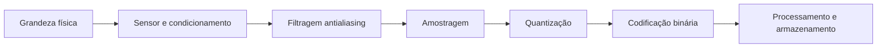
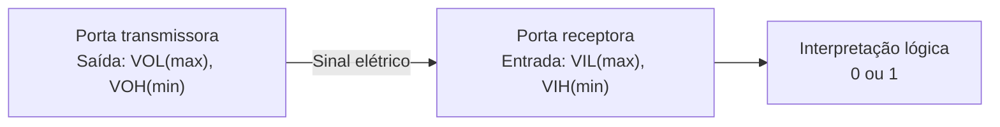
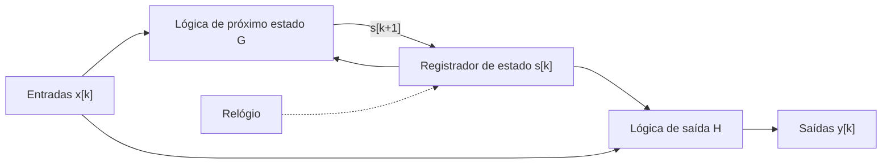
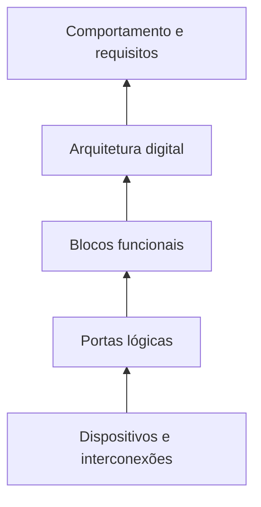
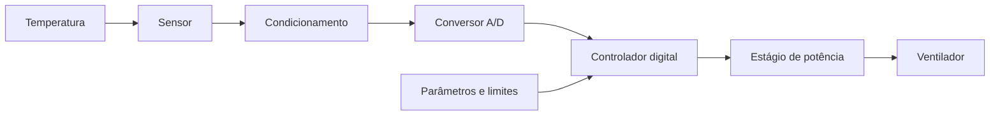

# 1. Introdução à Eletrônica Digital

A Eletrônica Digital estuda a representação, o processamento, o armazenamento e
a transmissão de informações por circuitos eletrônicos que operam com um
conjunto discreto de estados. Embora a implementação dominante seja binária, a
noção de sistema digital é mais geral: o aspecto decisivo é que a informação
seja associada a símbolos distinguíveis, e não à reprodução exata de cada valor
instantâneo de uma grandeza física.

A presença de circuitos digitais em instrumentos de medição, equipamentos
industriais, sistemas de comunicação, automóveis e computadores torna
indispensável compreender tanto sua organização lógica quanto suas limitações
elétricas. Uma expressão booleana descreve o comportamento funcional de uma
porta; entretanto, a porta construída com transistores possui tensões,
correntes, atrasos, capacitâncias e dissipação de energia. **O projeto digital
exige conciliar esses dois níveis de descrição.**

Este capítulo estabelece os conceitos e a terminologia utilizados no restante
da obra. A representação numérica, a álgebra booleana, a implementação com
transistores e as técnicas de síntese serão desenvolvidas nos capítulos
seguintes.

## Objetivos de aprendizagem

Ao concluir o capítulo, espera-se que o leitor seja capaz de distinguir
grandezas e sinais analógicos e digitais; explicar amostragem, quantização e
codificação sem confundir esses processos; interpretar níveis lógicos e margens
de ruído; diferenciar circuitos combinacionais de sequenciais; identificar
níveis de abstração do projeto eletrônico; e formular requisitos elementares
para um sistema digital.

## 1.1. Grandezas analógicas e digitais {#sec-analog-and-digital-quantities}

Grandezas físicas como temperatura, posição, pressão e tensão elétrica podem,
dentro de modelos macroscópicos, variar continuamente. Se uma tensão é
representada pela função $v(t)$, tanto o argumento temporal quanto a amplitude
podem assumir valores em intervalos contínuos. Um circuito analógico procura
explorar essa correspondência entre as características do sinal e as grandezas
representadas.

Um sistema digital, por outro lado, atribui significados a um conjunto de
símbolos. Em um sistema binário, esse conjunto é $\mathcal{B}=\{0,1\}$. A
associação entre um símbolo e um estado elétrico é realizada por convenções e
especificações técnicas. Não existe uma exigência universal de que o símbolo 1
corresponda a uma tensão de 5 V, nem de que o símbolo 0 seja necessariamente 0
V.

A distinção diz respeito **à representação e ao processamento da informação**,
não à natureza fundamentalmente diferente dos componentes: todo circuito
digital é físico e, portanto, está sujeito às leis da eletricidade e do
eletromagnetismo. Uma tensão de saída digital varia continuamente durante a
transição entre dois estados, ainda que o modelo lógico a represente como uma
mudança instantânea.

A {@ref fig-analog-digital} apresenta uma comparação conceitual. A forma
analógica admite uma amplitude continuamente variável; a representação digital
mantém estados interpretados como 0 e 1 durante intervalos de tempo. O gráfico
não implica que as transições elétricas reais sejam instantâneas.

::: figure Comparação conceitual entre um sinal analógico e uma representação
digital binária {#fig-analog-digital}

```vega-lite
{
  "$schema": "https://vega.github.io/schema/vega-lite/v5.json",
  "description": "Comparação conceitual entre uma forma de onda analógica e sua representação digital binária.",
  "data": {"values": [
    {"t":0,"analog":0.50,"digital":1},{"t":1,"analog":0.85,"digital":1},
    {"t":2,"analog":1.00,"digital":1},{"t":3,"analog":0.85,"digital":1},
    {"t":4,"analog":0.50,"digital":1},{"t":5,"analog":0.15,"digital":0},
    {"t":6,"analog":0.00,"digital":0},{"t":7,"analog":0.15,"digital":0},
    {"t":8,"analog":0.50,"digital":1},{"t":9,"analog":0.85,"digital":1},
    {"t":10,"analog":1.00,"digital":1},{"t":11,"analog":0.85,"digital":1},
    {"t":12,"analog":0.50,"digital":1},{"t":13,"analog":0.15,"digital":0},
    {"t":14,"analog":0.00,"digital":0},{"t":15,"analog":0.15,"digital":0},
    {"t":16,"analog":0.50,"digital":1}
  ]},
  "transform": [{"fold":["analog","digital"],"as":["tipo","amplitude"]}],
  "mark":{"type":"line","point":true},
  "encoding": {
    "x":{"field":"t","type":"quantitative","title":"Tempo (unidades arbitrárias)"},
    "y":{"field":"amplitude","type":"quantitative","title":"Amplitude normalizada","scale":{"domain":[0,1.05]}},
    "color":{"field":"tipo","type":"nominal","title":"Representação","scale":{"domain":["analog","digital"],"range":["#2563eb","#dc2626"]}},
    "strokeDash":{"field":"tipo","type":"nominal"}
  },
  "width":600,"height":220
}
```

:::

A digitalização não é, por si só, uma melhoria de toda característica do sinal.
Ela introduz limitações de resolução e, quando envolve amostragem, de faixa de
frequências representáveis. Em compensação, oferece mecanismos de
armazenamento, processamento simbólico, reprodução e detecção de erros. A
decisão entre soluções analógicas, digitais ou mistas depende dos requisitos do
sistema.

## 1.2. Sinais contínuos, discretos e binários {#sec-continuous-discrete-binary-signals}

É necessário distinguir duas propriedades independentes: **o domínio temporal**
e **o conjunto de amplitudes possíveis**. Um sinal pode ser contínuo no tempo e
discreto em amplitude, ou discreto no tempo e contínuo em amplitude. Assim, a
expressão “sinal discreto” não especifica, isoladamente, qual dessas
propriedades foi discretizada.

Considere um sinal analógico $x(t)$. A amostragem uniforme produz a sequência

$$x[n]=x(nT_s),\qquad n\in\mathbb{Z},\tag{1.1}$$

em que $T_s$ é o período de amostragem e $f_s=1/T_s$ é a frequência de
amostragem. A sequência $x[n]$ possui **tempo discreto**, mas suas amplitudes
ainda podem pertencer a um conjunto contínuo.

A **quantização** associa cada amostra a um entre $L$ níveis de representação:

$$x_q[n]=Q\bigl(x[n]\bigr),\qquad x_q[n]\in\{q_0,q_1,\ldots,q_{L-1}\}.\tag{1.2}$$

Quando os níveis são codificados por palavras binárias de $N$ bits, podem-se
representar até

$$L=2^N\tag{1.3}$$

valores distintos. Por exemplo, oito bits permitem 256 códigos. Isso não
significa que qualquer conversor de oito bits tenha exatamente 256 níveis
analógicos igualmente espaçados em qualquer faixa: a relação depende de sua
arquitetura e especificação.

O erro de quantização é definido por

$$e_q[n]=x_q[n]-x[n].\tag{1.4}$$

Em um quantizador uniforme ideal por arredondamento, com passo $\Delta$ e sem
saturação, vale $|e_q[n]|\leq\Delta/2$. Essa desigualdade deixa de descrever
adequadamente amostras fora da faixa admitida, nas quais ocorre saturação ou
outro tratamento de sobrecarga.

A {@ref fig-digitization-flow} organiza as operações envolvidas. Um circuito
eletrônico não precisa realizar todas elas: uma porta lógica recebe e fornece
estados binários sem necessariamente amostrar uma grandeza analógica.

::: figure Etapas conceituais de aquisição e representação digital de uma
grandeza analógica {#fig-digitization-flow}



:::

Para sinais de banda limitada, o teorema da amostragem estabelece condições
para reconstrução ideal a partir das amostras; de maneira simplificada,
requer-se $f_s>2f_{\max}$ quando $f_{\max}$ é a maior frequência presente e são
atendidas as hipóteses do teorema. Na prática, emprega-se filtragem
antialiasing e uma margem adequada entre a banda útil e a frequência de
Nyquist. O assunto será aprofundado no capítulo dedicado aos conversores
analógico-digitais.

Um **bit** é um dígito binário. Uma palavra de $N$ bits pode representar
números, caracteres, instruções, estados de controle ou valores de sensores. O
significado não está contido nos bits isoladamente: ele depende da convenção de
codificação adotada.

## 1.3. Informação, representação e processamento digital {#sec-information-representation-processing}

Uma sequência binária pode ser interpretada de maneiras diferentes. A palavra
`01000001`, por exemplo, corresponde ao inteiro não sinalizado 65 quando
interpretada em base dois; no código ASCII, representa a letra latina maiúscula
`A`. Os oito bits são os mesmos, mas a interpretação é distinta.

Formalmente, uma codificação estabelece uma correspondência entre elementos de
um conjunto de informações $\mathcal{I}$ e palavras de um conjunto de códigos
$\mathcal{C}$. Para que a recuperação seja inequívoca, diferentes informações
que precisam ser distinguidas devem receber códigos diferentes no domínio de
uso:

$$E:\mathcal{I}\longrightarrow\mathcal{C}.\tag{1.5}$$

A eletrônica digital processa essas palavras por operações lógicas e
aritméticas. Uma função combinacional com $n$ entradas e $m$ saídas binárias
pode ser descrita por

$$f:\{0,1\}^{n}\longrightarrow\{0,1\}^{m}.\tag{1.6}$$

O resultado depende exclusivamente da combinação atual de entradas no modelo
ideal. A inclusão de memória permite representar operações cujo resultado
depende também de eventos anteriores.

O uso de estados discretos favorece a **regeneração de sinais**. Desde que a
entrada permaneça dentro de uma faixa reconhecida, um estágio lógico pode
produzir uma saída próxima de um nível nominal, reduzindo a acumulação de
pequenas perturbações de amplitude. Essa propriedade não elimina erros: ruídos
intensos, violações temporais, falhas de alimentação e interferências podem
alterar a informação.

Entre as vantagens dos sistemas digitais estão a programação de comportamentos,
a integração de grandes quantidades de funções em circuitos semicondutores, a
repetibilidade de operações e a disponibilidade de métodos de teste e
verificação. Entre as limitações estão a resolução finita, a necessidade de
conversão nas interfaces analógicas, o consumo energético, as restrições
temporais e a complexidade de integração.

## 1.4. Níveis lógicos e sinais elétricos {#sec-logic-levels-electrical-signals}

Os símbolos 0 e 1 não são tensões elétricas. Um circuito lógico implementa
esses símbolos por **faixas de valores elétricos aceitos**. Em lógica positiva,
valores de tensão mais elevados são associados ao nível lógico 1 e valores mais
baixos ao nível lógico 0. Em lógica negativa, a associação é invertida. A
escolha da convenção lógica não altera as leis físicas dos dispositivos.

Para uma interface digital convencional, os parâmetros fundamentais são:

| Parâmetro      | Significado                                                              |
| -------------- | ------------------------------------------------------------------------ |
| $V_{IL(\max)}$ | Maior tensão de entrada garantidamente reconhecida como nível baixo      |
| $V_{IH(\min)}$ | Menor tensão de entrada garantidamente reconhecida como nível alto       |
| $V_{OL(\max)}$ | Maior tensão de saída garantida quando o dispositivo fornece nível baixo |
| $V_{OH(\min)}$ | Menor tensão de saída garantida quando o dispositivo fornece nível alto  |

Em condições usuais de compatibilidade, espera-se que
$V_{OL(\max)}<V_{IL(\max)}$ e $V_{OH(\min)}>V_{IH(\min)}$. A região entre os
limites de reconhecimento de entrada não deve ser tomada como um terceiro
estado lógico válido: nela o comportamento não é garantido pelas especificações
binárias convencionais.

As **margens estáticas de ruído** de uma ligação entre um transmissor e um
receptor são

$$NM_L=V_{IL(\max)}-V_{OL(\max)},\tag{1.7}$$

$$NM_H=V_{OH(\min)}-V_{IH(\min)}.\tag{1.8}$$

Essas relações quantificam a tolerância estática às perturbações de tensão, mas
não substituem a análise de pulsos rápidos, integridade de sinal, reflexões ou
temporização.

::: example Exemplo — margens de ruído de uma interface {#ex-noise-margins}

Considere, **apenas como especificação hipotética**,
$V_{OL(\max)}=0{,}4\,\mathrm{V}$, $V_{IL(\max)}=0{,}8\,\mathrm{V}$,
$V_{IH(\min)}=2{,}0\,\mathrm{V}$ e $V_{OH(\min)}=2{,}4\,\mathrm{V}$. Pelas
equações (1.7) e (1.8), ambas as margens são $0{,}4\,\mathrm{V}$. Isso não
autoriza conectar arbitrariamente quaisquer componentes de 5 V: devem ser
verificados também a tensão de alimentação, a corrente fornecida ou absorvida,
a carga e as condições de operação.

:::

A {@ref fig-logic-interface} ilustra os parâmetros de uma ligação lógica. A
especificação de saída pertence ao dispositivo transmissor; a de entrada, ao
receptor. Essa distinção é essencial ao conectar circuitos de famílias
diferentes.

::: figure Relação entre níveis garantidos na saída e limites reconhecidos na
entrada {#fig-logic-interface}



:::

Além da amplitude, os sinais digitais possuem propriedades temporais. O **tempo
de subida** e o **tempo de descida** medem a duração das transições segundo
níveis de referência especificados. O **atraso de propagação** mede a diferença
temporal entre uma mudança de entrada e a correspondente resposta da saída, de
acordo com os pontos de medição definidos. Tais parâmetros não são nulos e
variam com alimentação, temperatura, tecnologia e carga.

A potência dissipada é outro requisito fundamental. Em uma aproximação
frequentemente empregada para a parcela dinâmica de um nó CMOS,

$$P_{\mathrm{din}}\approx\alpha C_L V_{DD}^{2}f,\tag{1.9}$$

em que $\alpha$ é a atividade efetiva de comutação definida de acordo com a
convenção adotada, $C_L$ é a capacitância comutada, $V_{DD}$ é a tensão de
alimentação e $f$ é a frequência de referência. A expressão não inclui, por si
só, todas as perdas por correntes de curto-circuito durante transições ou
correntes de fuga. Esses fenômenos serão estudados nos capítulos sobre
dispositivos e famílias lógicas.

## 1.5. Sistemas combinacionais e sequenciais {#sec-combinational-sequential-systems}

A classificação funcional mais importante distingue circuitos
**combinacionais** e **sequenciais**.

Em um circuito combinacional ideal, a saída em determinado instante é função
dos valores atuais das entradas:

$$\mathbf{y}(t)=F\bigl(\mathbf{x}(t)\bigr).\tag{1.10}$$

A expressão ignora o atraso físico, que precisa ser considerado na
implementação real. Exemplos incluem codificadores, multiplexadores,
comparadores e somadores.

Em um circuito sequencial, é necessário descrever também o **estado interno**.
Em um modelo síncrono discreto, pode-se escrever

$$\mathbf{s}[k+1]=G\bigl(\mathbf{s}[k],\mathbf{x}[k]\bigr),\tag{1.11}$$

$$\mathbf{y}[k]=H\bigl(\mathbf{s}[k],\mathbf{x}[k]\bigr).\tag{1.12}$$

O índice $k$ identifica etapas de atualização, frequentemente associadas a
bordas de um relógio. Registradores, contadores e controladores baseados em
máquinas de estados são exemplos sequenciais. Nos modelos de Moore, a saída
depende somente do estado; nos de Mealy, pode depender do estado e da entrada.

::: figure Organização funcional de um circuito sequencial síncrono
{#fig-sequential-system}



:::

A distinção não se resume à presença de uma forma de onda periódica. Há
circuitos sequenciais assíncronos, cujo estado pode mudar em resposta a eventos
sem um relógio global. Além disso, um sistema síncrono pode receber entradas
assíncronas e precisar de circuitos de sincronização para reduzir riscos de
metastabilidade.

Como exemplo introdutório, considere um controlador de iluminação com uma
entrada $p$ (presença detectada) e uma saída $l$ (lâmpada ligada). A relação
$l=p$ descreve uma solução combinacional ideal: a lâmpada acompanha a entrada.
Se o requisito determinar que a lâmpada permaneça acesa durante certo intervalo
após a última detecção, torna-se necessário representar tempo decorrido e
estado, caracterizando um sistema sequencial.

## 1.6. Abstração: dispositivos, portas, blocos e sistemas {#sec-levels-of-abstraction}

Um projeto digital pode ser descrito em diferentes níveis de abstração, cada um
adequado a uma classe de problemas:

1. **Dispositivos físicos:** transistores, diodos, capacitâncias e
   interconexões, descritos por grandezas elétricas e modelos de componentes.
2. **Portas lógicas:** blocos que realizam operações como inversão, conjunção e
   disjunção, caracterizados por função lógica e parâmetros elétricos.
3. **Blocos funcionais:** somadores, registradores, multiplexadores, memórias e
   unidades de controle.
4. **Arquitetura do sistema:** interligação de unidades de processamento,
   armazenamento, comunicação e interfaces.
5. **Comportamento especificado:** requisitos funcionais e temporais
   observáveis pelo usuário ou por outros sistemas.

A {@ref fig-abstraction-levels} representa essa hierarquia. O sentido
ascendente oculta detalhes de implementação; o descendente exige refinamento
até chegar a componentes e conexões realizáveis.

::: figure Níveis de abstração empregados no projeto de sistemas digitais
{#fig-abstraction-levels}



:::

A abstração é útil, mas deve ser empregada com critérios. Uma descrição
funcional correta não garante que o circuito atenda à frequência de operação
pretendida. Da mesma forma, uma porta que realiza a tabela-verdade desejada
pode ser incompatível eletricamente com a entrada do estágio seguinte.

Ferramentas de descrição de hardware, simulação e síntese auxiliam a transitar
entre esses níveis. Linguagens como VHDL e Verilog permitem descrever
comportamentos e estruturas digitais; ferramentas de síntese transformam
subconjuntos apropriados dessas descrições em redes de elementos
implementáveis. O processo requer validação funcional e verificação temporal.

## 1.7. Evolução dos circuitos e das tecnologias digitais {#sec-historical-development}

Os fundamentos matemáticos da lógica binária antecedem os circuitos integrados
modernos. O desenvolvimento da álgebra booleana no século XIX estabeleceu uma
linguagem para operar com proposições e relações lógicas. No século XX, a
associação entre lógica simbólica e circuitos de chaveamento mostrou como
realizar funções booleanas por redes de dispositivos elétricos.

Os primeiros sistemas eletrônicos digitais utilizaram válvulas e outros
elementos de comutação, com restrições severas de volume, consumo e
confiabilidade. O desenvolvimento do transistor e, posteriormente, dos
circuitos integrados, possibilitou maior densidade de componentes e ampliou a
complexidade dos sistemas realizáveis.

Famílias lógicas como RTL, DTL, TTL e ECL representam diferentes estratégias de
implementação e compromissos entre velocidade, consumo e imunidade a ruído. A
tecnologia MOS e, em especial, a lógica CMOS tornaram-se fundamentais para a
integração em grande escala, favorecendo microprocessadores, memórias e
circuitos de aplicação específica.

A evolução não pode ser descrita apenas como miniaturização. Ela envolveu
também mudanças nas ferramentas de projeto, nos métodos de verificação, na
organização dos sistemas e nos processos de fabricação. Dispositivos
programáveis, como CPLDs e FPGAs, permitem configurar circuitos digitais para
aplicações específicas sem fabricar um novo circuito integrado dedicado para
cada projeto.

A história técnica também evidencia uma continuidade: apesar da mudança de
tecnologias, os princípios de representação binária, álgebra booleana,
temporização e organização de estados permanecem centrais. O que se transforma
são as possibilidades de integração e os limites práticos de cada
implementação.

## 1.8. Aplicações e metodologias de projeto {#sec-applications-design-methodology}

Sistemas digitais aparecem em aplicações tão diversas quanto medidores
eletrônicos, controles industriais, sistemas embarcados, telecomunicações,
processamento de áudio e imagem, instrumentação científica e infraestrutura
computacional. Em muitos desses casos, o sistema completo é **misto**: sensores
e atuadores interagem com grandezas analógicas, enquanto circuitos digitais
executam decisões, cálculos e armazenamento.

Considere um sistema de monitoramento de temperatura que deve ligar um
ventilador acima de um limite estabelecido e desligá-lo abaixo de outro limite.
Uma solução digital pode empregar sensor, condicionamento, conversão
analógico-digital, processamento e estágio de acionamento. Os limites distintos
de acionamento e desligamento introduzem histerese, reduzindo comutações
repetidas quando a temperatura oscila próxima ao ponto de decisão.

::: figure Exemplo de arquitetura de um controlador digital de temperatura
{#fig-temperature-controller}



:::

O desenvolvimento de um projeto digital pode ser organizado em etapas
iterativas:

1. **Especificação:** definir entradas, saídas, condições de operação,
   precisão, tempo de resposta, alimentação e critérios de aceitação.
2. **Modelagem:** representar o comportamento por tabelas-verdade, expressões
   lógicas, diagramas de estados ou descrições de hardware.
3. **Arquitetura:** decompor o problema em blocos e estabelecer interfaces
   entre eles.
4. **Implementação:** selecionar componentes, famílias lógicas ou dispositivos
   programáveis, considerando requisitos elétricos e temporais.
5. **Verificação:** testar o comportamento previsto em simulação, incluindo
   casos limites e condições excepcionais.
6. **Validação:** confirmar, por medições e ensaios, que o sistema implementado
   atende à necessidade original.

**Verificação** e **validação** não são sinônimos. A primeira examina se o
projeto corresponde à especificação; a segunda investiga se a solução satisfaz
os requisitos de uso. Um circuito pode estar corretamente implementado e, ainda
assim, não resolver adequadamente o problema para o qual foi concebido.

### Estudo de caso — controlador de iluminação

Um sistema deve acender uma lâmpada quando houver presença detectada e a
iluminação ambiente estiver abaixo de um limiar. Sejam $P\in\{0,1\}$ a
indicação de presença, $E\in\{0,1\}$ a indicação de ambiente escuro e
$L\in\{0,1\}$ o comando de iluminação. A especificação lógica é

$$L=P\land E.\tag{1.13}$$

A tabela-verdade correspondente é:

| $P$ | $E$ | $L$ |
| :-: | :-: | :-: |
|  0  |  0  |  0  |
|  0  |  1  |  0  |
|  1  |  0  |  0  |
|  1  |  1  |  1  |

Essa tabela descreve **o comportamento desejado**, não uma implementação
elétrica completa. Ainda será necessário determinar como o sensor de
luminosidade produz o estado $E$, qual tensão representa cada nível, como a
carga será acionada e quais atrasos são aceitáveis. Se houver a exigência de
manter a lâmpada acesa após a saída de uma pessoa, o modelo combinacional
deixará de ser suficiente.

O exemplo antecipa um princípio metodológico que acompanhará toda a obra:
separar a especificação funcional da escolha da tecnologia de implementação,
sem esquecer que ambas precisam ser compatíveis.

## Síntese do capítulo

A Eletrônica Digital organiza informações por estados discretos, geralmente
binários, mas utiliza circuitos físicos cujos sinais são grandezas elétricas
contínuas. A amostragem discretiza o tempo; a quantização discretiza a
amplitude; a codificação atribui símbolos às informações. Portas e blocos
combinacionais realizam funções das entradas presentes, enquanto circuitos
sequenciais incorporam memória e evolução de estados. O projeto deve considerar
simultaneamente correção lógica, níveis elétricos, margens de ruído, atrasos,
potência e condições reais de funcionamento.

## Exercícios e questões para discussão

:::: exercise Questão 1 — classificação de sinais {#ex-signal-classification}

Um sensor produz uma tensão contínua $v(t)$, medida por um conversor que
fornece 12 bits a cada milissegundo. Identifique quais grandezas são contínuas
ou discretas no tempo e na amplitude antes e depois da conversão. Explique por
que os 12 bits não tornam a tensão original discreta.

::: hint

Separe as operações de amostragem, quantização e codificação. Diferencie o
fenômeno físico de sua representação numérica.

:::

::::

:::: exercise Questão 2 — resolução e quantização {#ex-quantization}

Um quantizador uniforme ideal utiliza $N=10$ bits para codificar uma faixa de
entrada de $0$ a $5\,\mathrm{V}$, dividida em $2^{10}$ intervalos iguais.
Determine o passo de quantização e o maior módulo do erro de arredondamento,
supondo operação dentro da faixa, sem saturação.

::: solution

O número de intervalos é $2^{10}=1024$. Logo,
$\Delta=5/1024\,\mathrm{V}\approx4{,}883\,\mathrm{mV}$, e o limite ideal do
erro de arredondamento é $\Delta/2\approx2{,}441\,\mathrm{mV}$. O resultado
depende da convenção de quantização explicitada no enunciado.

:::

::::

:::: exercise Questão 3 — compatibilidade lógica {#ex-logic-compatibility}

Um transmissor garante $V_{OL(\max)}=0{,}3\,\mathrm{V}$ e
$V_{OH(\min)}=2{,}7\,\mathrm{V}$. Um receptor reconhece nível baixo até
$0{,}8\,\mathrm{V}$ e nível alto a partir de $2{,}0\,\mathrm{V}$. Calcule as
margens estáticas de ruído e discuta quais outras informações seriam
necessárias antes de aprovar a conexão.

::: solution

$NM_L=0{,}8-0{,}3=0{,}5\,\mathrm{V}$ e $NM_H=2{,}7-2{,}0=0{,}7\,\mathrm{V}$.
Ainda devem ser examinados limites absolutos de tensão, alimentação, correntes
de entrada e saída, carga, velocidade de comutação e condições ambientais.

:::

::::

:::: exercise Questão 4 — comportamento combinacional ou sequencial
{#ex-combinational-or-sequential}

Classifique e justifique: (a) um comparador de duas palavras binárias; (b) um
contador de pulsos; (c) um detector que informa se a sequência `101` ocorreu
nas três últimas amostras; (d) um circuito que apresenta o complemento de cada
bit de entrada.

::: hint

Pergunte se é possível determinar a saída conhecendo apenas a entrada atual,
sem informação sobre entradas anteriores.

:::

::::

:::: exercise Questão 5 — especificação de sistema {#ex-system-specification}

Proponha os requisitos funcionais e elétricos iniciais de um controlador de
ventilação que utiliza um sensor analógico de temperatura. Desenhe um diagrama
de blocos e indique os ensaios necessários para validar a solução. Explique a
utilidade da histerese.

::::

## Referências bibliográficas

As obras a seguir fundamentam a apresentação introdutória, complementada por
literatura de projeto digital e documentação didática sobre interfaces lógicas.
As fontes de divulgação são úteis para contextualização e aplicações, mas não
substituem especificações de componentes ou bibliografia técnica especializada.

1. BRAGA, Newton C. **Curso de Eletrônica Digital**. _Saber Eletrônica
   Especial_, n. 8, 2002. Material em PDF fornecido para este capítulo.
2. CAMPOS, Frederico Oioli de. **Elementos Básicos da Eletrônica Digital**.
   Apostila didática, São Paulo, 2001. Material em PDF fornecido para este
   capítulo.
3. TOKHEIM, Roger L. **Fundamentos de Eletrônica Digital**, v. 1: _Sistemas
   Combinacionais_. Capítulo 1, “Eletrônica digital”. Trecho em PDF fornecido
   para este capítulo.
4. CENTRO FEDERAL DE EDUCAÇÃO TECNOLÓGICA DE SANTA CATARINA, Unidade São José.
   **Eletrônica Digital 1 — Capítulo 2: Funções e Portas Lógicas**. Material
   didático em PDF fornecido para este capítulo.
5. MIT OPENCOURSEWARE. **Computation Structures — Annotated Slides, 2.1**.
   Disponível em:
   https://ocw.mit.edu/courses/6-004-computation-structures-spring-2017/pages/c2/c2s1/.
   Acesso em: 18 out. 2026.
6. UNIVERSITY OF WISCONSIN–MADISON. **ECE353: Device Electrical
   Characteristics**. Disponível em:
   https://ece353.engr.wisc.edu/gpio-pins/device-electrical-characteristics/.
   Acesso em: 18 out. 2026.
7. VICTOR VISION. **Eletrônica Digital: Fundamentos e Componentes**. Disponível
   em: https://victorvision.com.br/blog/eletronica-digital/. Acesso em: 18
   out. 2026.
8. BASICÃO DA ELETRÔNICA. **O que é Eletrônica Digital?** Disponível em:
   https://basicaodaeletronica.com.br/eletronica-digital/o-que-e-eletronica-digital/.
   Acesso em: 18 out. 2026.
9. MAKERHERO. **Fundamentos da Eletrônica Digital e Suas Aplicações**.
   Disponível em:
   https://www.makerhero.com/blog/fundamentos-da-eletronica-digital-e-suas-aplicacoes/.
   Acesso em: 18 out. 2026.
10. MANUAL DA AUTOMAÇÃO. **O que é Eletrônica Digital?** Disponível em:
    https://manualdaautomacao.com/o-que-e-eletronica-digital/. Acesso em: 18
    out. 2026.
11. REDEWEB. **Eletrônica Digital: O que é, Elementos e Características**.
    Disponível em:
    https://www.redeweb.com/pt/apresentar/eletr%C3%B4nica-digital/. Acesso em:
    18 out. 2026.
12. WIKIPEDIA CONTRIBUTORS. **Digital electronics**. Disponível em:
    https://en.wikipedia.org/wiki/Digital_electronics. Acesso em: 18 out. 2026.
