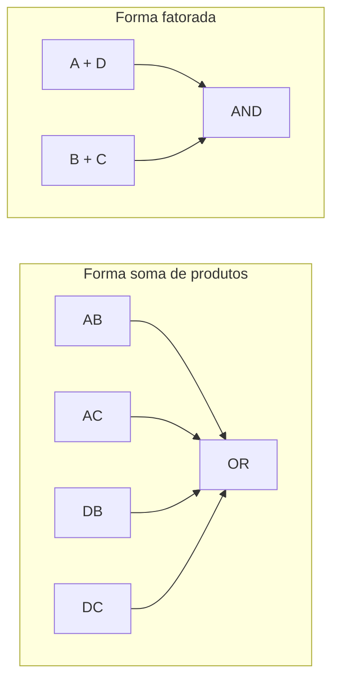

# 5. Simplificação e minimização de funções lógicas

No [Capítulo 3](boolean-algebra-and-logic-functions.md), estudamos a
equivalência entre expressões booleanas e suas representações canônicas. No
[Capítulo 4](logic-gates-and-circuit-representation.md), relacionamos essas
expressões a redes de portas lógicas. Neste capítulo, passamos da
**representação de uma função** à **escolha de uma implementação**: buscamos
expressões equivalentes que possam ser realizadas de maneira adequada às
restrições do projeto.

A minimização algébrica é um ponto de partida, não uma garantia de circuito
fisicamente ótimo. O número de portas, a quantidade de entradas por porta, a
profundidade lógica, o compartilhamento de sinais, os atrasos, o consumo e os
riscos de transição podem favorecer soluções distintas.

## Objetivos de aprendizagem

Ao concluir o capítulo, o leitor deverá ser capaz de simplificar expressões
booleanas; construir e interpretar mapas de Karnaugh; identificar implicantes
primos e essenciais; empregar condições indiferentes; executar as etapas do
método de Quine–McCluskey; selecionar uma cobertura de mintermos; reconhecer
oportunidades de fatoração multinível; comparar critérios de custo lógico e
físico; e identificar e eliminar riscos estáticos em implementações
combinacionais.

## 5.1. Simplificação algébrica {#sec-algebraic-simplification}

Duas expressões são **funcionalmente equivalentes** quando produzem a mesma
saída para toda combinação de entradas especificada. A simplificação procura
uma representação equivalente com menor custo segundo um critério escolhido.
Para funções em soma de produtos (SOP), um critério introdutório é reduzir a
quantidade de termos e de literais; para implementação física, esse critério
pode ser insuficiente.

Considere

$$
F=\overline A B+AB+C.\tag{5.1}
$$

Pela distributividade e pela complementaridade,

$$
F=B(\overline A+A)+C=B+C.\tag{5.2}
$$

A entrada $A$ é irrelevante para o valor de $F$. A transformação é exata: não
depende de valores particulares das entradas nem de hipóteses sobre atrasos.

<!-- prettier-ignore -->
::: example Absorção de um termo redundante {#ex-algebraic-absorption}

Seja $G=A+AB+\overline A B$. Primeiro, $A+AB=A$ pela absorção. Em seguida,
$A+\overline A B=A+B$. Portanto, $G=A+B$. A igualdade pode ser conferida por
uma tabela-verdade, mas a demonstração algébrica vale para todas as combinações
de entrada.

:::

A lei do consenso, já apresentada no Capítulo 3, fornece outro mecanismo:

$$
AB+\overline A C+BC=AB+\overline A C.\tag{5.3}
$$

O termo $BC$ é redundante **do ponto de vista da função estática**. Na seção
5.9 veremos que um termo logicamente redundante pode, em certas implementações,
ser útil para impedir um risco transitório.

<!-- prettier-ignore -->
::: note Equivalência não é identidade de implementação {#note-equivalence-vs-implementation}

Expressões equivalentes descrevem a mesma função booleana, mas podem produzir
circuitos com características temporais diferentes. Além disso, uma redução na
contagem de literais não implica necessariamente menor área, atraso ou potência
após o mapeamento para uma tecnologia concreta.

:::

## 5.2. Mapas de Karnaugh {#sec-karnaugh-maps}

Um **mapa de Karnaugh** reorganiza as linhas da tabela-verdade para que células
adjacentes correspondam a combinações que diferem em **uma única variável**.
Essa disposição permite reconhecer visualmente termos que podem ser combinados
pela identidade

$$
XY+X\overline Y=X.\tag{5.4}
$$

As linhas e colunas usam a ordem Gray. Em um mapa de quatro variáveis, por
exemplo, os pares $AB$ e $CD$ são ordenados como $00,01,11,10$, e não em ordem
binária natural.

<!-- prettier-ignore -->
::: table Correspondência entre células e mintermos em um mapa de quatro variáveis {#tbl-four-variable-kmap-index .full-width}

| $AB\backslash CD$ |   $00$   |   $01$   |   $11$   |   $10$   |
| :---------------: | :------: | :------: | :------: | :------: |
|       $00$        |  $m_0$   |  $m_1$   |  $m_3$   |  $m_2$   |
|       $01$        |  $m_4$   |  $m_5$   |  $m_7$   |  $m_6$   |
|       $11$        | $m_{12}$ | $m_{13}$ | $m_{15}$ | $m_{14}$ |
|       $10$        |  $m_8$   |  $m_9$   | $m_{11}$ | $m_{10}$ |

:::

<!-- prettier-ignore -->
A {@ref fig-kmap-four-variable-layout} apresenta a mesma disposição em uma grade. A primeira e a última coluna são adjacentes, assim como a primeira e a última linha: as bordas opostas do mapa se conectam logicamente.

<!-- prettier-ignore -->
::: figure Disposição Gray das células de um mapa de Karnaugh de quatro variáveis {#fig-kmap-four-variable-layout}

```tikz
\begin{tikzpicture}[scale=1.8,transform shape]
\foreach \x/\lab in {0/00,1/01,2/11,3/10}{\node at (\x+0.5,4.35) {$\lab$};\node at (-0.45,3.5-\x) {$\lab$};}
\node at (-0.55,4.35) {$AB\backslash CD$};
\foreach \x/\y/\m in {0/3/0,1/3/1,2/3/3,3/3/2,0/2/4,1/2/5,2/2/7,3/2/6,0/1/12,1/1/13,2/1/15,3/1/14,0/0/8,1/0/9,2/0/11,3/0/10}{
  \draw (\x,\y) rectangle ++(1,1);
  \node at (\x+0.5,\y+0.5) {$m_{\m}$};
}
\end{tikzpicture}
```

:::

<!-- prettier-ignore -->
::: example Leitura de um mapa de três variáveis {#ex-three-variable-kmap}

Considere $F(A,B,C)=\Sigma m(0,1,2,3,5,7)$. Os quatro mintermos
$m_0,m_1,m_2,m_3$ correspondem a $A=0$, independentemente de $B$ e $C$, e
produzem o implicante $\overline A$. Os mintermos $m_1,m_3,m_5,m_7$
correspondem a $C=1$ e produzem $C$. A função reduzida é

$$
F=\overline A+C.\tag{5.5}
$$

Os grupos se sobrepõem em $m_1$ e $m_3$. A sobreposição é permitida e não
altera a função.

:::

## 5.3. Agrupamentos e implicantes {#sec-groupings-and-implicants}

Para obter uma forma SOP a partir do mapa, agrupamos células com saída 1 em
retângulos de $1,2,4,8,\ldots$ células, admitindo a continuidade pelas bordas.
Cada agrupamento elimina as variáveis que mudam de valor dentro dele;
permanecem somente as variáveis constantes. Os agrupamentos podem se sobrepor,
e todas as células de saída 1 devem estar cobertas.

Um **implicante** é um termo produto que, sempre que vale 1, força a função a
valer 1 nas combinações especificadas. Um **implicante primo** não pode ser
ampliado para outro implicante pela remoção de mais um literal. Um **implicante
primo essencial** cobre pelo menos um mintermo de saída 1 que nenhum outro
implicante primo cobre.

<!-- prettier-ignore -->
::: table Relação entre tamanho de um agrupamento e número de literais em um mapa de quatro variáveis {#tbl-kmap-group-sizes .full-width}

| Células do grupo | Variáveis eliminadas |   Literais restantes   |
| :--------------: | :------------------: | :--------------------: |
|        1         |          0           |           4            |
|        2         |          1           |           3            |
|        4         |          2           |           2            |
|        8         |          3           |           1            |
|        16        |          4           | 0 (função constante 1) |

:::

<!-- prettier-ignore -->
::: warning Agrupamentos válidos {#warn-kmap-valid-groups}

A proximidade geométrica, isoladamente, não basta. Um agrupamento deve conter
um número de células igual a uma potência de dois, formar um retângulo no mapa
com adjacência Gray e não incluir células de saída obrigatoriamente 0.
Agrupamentos diagonais não são válidos.

:::

<!-- prettier-ignore -->
::: example Agrupamentos pelas bordas {#ex-kmap-wraparound}

Na função $F(A,B,C,D)=\Sigma m(0,2,8,10)$, as quatro células correspondentes às
combinações $AB=00$ ou $10$ e $CD=00$ ou $10$ ocupam os quatro cantos do mapa.
Apesar de parecerem separadas no desenho plano, constituem um único grupo por
adjacência nas bordas. Como $B=0$ e $D=0$ em todas elas,

$$
F=\overline B\,\overline D.\tag{5.6}
$$

:::

Para obter uma forma POS, pode-se agrupar as células de saída 0. Cada
agrupamento produz um termo soma que vale 0 naquela região. A escolha entre SOP
e POS depende também da biblioteca de portas e da topologia pretendida.

## 5.4. Condições indiferentes (_don't care_) {#sec-dont-care-minimization}

Uma função **incompletamente especificada** possui combinações de entrada nas
quais a saída não é imposta pelo problema. Essas combinações são marcadas por
$X$ e podem ser tratadas como 0 ou 1 durante a minimização, desde que a
implementação respeite todas as combinações especificadas.

Escrevemos, por exemplo,

$$
F(A,B,C)=\Sigma m(1,3,7),\qquad d(A,B,C)=\Sigma m(5).\tag{5.7}
$$

O conjunto $d$ identifica as condições indiferentes. Se utilizarmos $m_5$ como
1, os quatro mintermos $m_1,m_3,m_5,m_7$ formam o grupo $C=1$, e obtemos $F=C$.
Se não o utilizarmos, a função também poderá ser implementada, mas geralmente
com mais literais.

<!-- prettier-ignore -->
::: table Especificação e escolha de implementação com uma condição indiferente {#tbl-dont-care-example .full-width}

| $A$ | $B$ | $C$ | Saída especificada | Implementação $F=C$ |
| :-: | :-: | :-: | :----------------: | :-----------------: |
|  0  |  0  |  0  |         0          |          0          |
|  0  |  0  |  1  |         1          |          1          |
|  0  |  1  |  0  |         0          |          0          |
|  0  |  1  |  1  |         1          |          1          |
|  1  |  0  |  0  |         0          |          0          |
|  1  |  0  |  1  |        $X$         |          1          |
|  1  |  1  |  0  |         0          |          0          |
|  1  |  1  |  1  |         1          |          1          |

:::

<!-- prettier-ignore -->
::: note Significado de uma condição indiferente {#note-dont-care-meaning}

$X$ não representa uma saída elétrica indefinida que a implementação deva
produzir. Representa liberdade de projeto em uma combinação de entrada. A
escolha precisa ser justificada pela especificação: não se deve declarar
indiferente uma condição que possa ocorrer e cuja saída tenha significado para
a segurança ou o funcionamento do sistema.

:::

## 5.5. Método de Quine–McCluskey {#sec-quine-mccluskey}

O método de **Quine–McCluskey** sistematiza a combinação de mintermos e permite
identificar implicantes primos sem depender exclusivamente da inspeção visual
de mapas. É particularmente útil para compreender algoritmos de minimização
tabular; para problemas grandes, sua complexidade pode crescer rapidamente.

O procedimento básico consiste em agrupar mintermos pelo número de bits 1;
combinar termos que diferem em exatamente uma posição; repetir a combinação
enquanto possível; e registrar os termos que não puderam ser combinados, os
implicantes primos. Um hífen representa uma variável eliminada, que pode
assumir 0 ou 1.

<!-- prettier-ignore -->
::: example Minimização tabular de quatro variáveis {#ex-quine-mccluskey}

Considere

$$
F(A,B,C,D)=\Sigma m(0,1,2,3,8,9,10,11,14,15).\tag{5.8}
$$

<!-- prettier-ignore -->
Na primeira etapa, combinamos pares de mintermos adjacentes. A {@ref tbl-qm-combinations} apresenta combinações representativas; o procedimento completo deve considerar todas as combinações válidas.

<!-- prettier-ignore -->
::: table Exemplos de combinações no método de Quine–McCluskey {#tbl-qm-combinations .full-width}

| Termos combinados | Representações binárias | Termo resultante |
| :---------------: | :---------------------: | :--------------: |
|     $m_0,m_1$     |     `0000`, `0001`      |      `000-`      |
|     $m_0,m_2$     |     `0000`, `0010`      |      `00-0`      |
|     $m_8,m_9$     |     `1000`, `1001`      |      `100-`      |
|  $m_{10},m_{14}$  |     `1010`, `1110`      |      `1-10`      |
|  $m_{11},m_{15}$  |     `1011`, `1111`      |      `1-11`      |

:::

Após combinações sucessivas, surgem os implicantes primos `-0--` e `1-1-`,
correspondentes a $\overline B$ e $AC$. O primeiro cobre
$m_0,m_1,m_2,m_3,m_8,m_9,m_{10},m_{11}$; o segundo cobre
$m_{10},m_{11},m_{14},m_{15}$. Assim,

$$
F=\overline B+AC.\tag{5.9}
$$

A expressão cobre todos os mintermos especificados e nenhum dos demais. A
cobertura deve ser verificada explicitamente, não apenas inferida do número de
combinações.

:::

O método pode ser aplicado também a condições indiferentes: elas participam da
formação de implicantes, mas não precisam ser cobertas na solução final.

## 5.6. Seleção de implicantes essenciais {#sec-essential-prime-implicants}

A obtenção dos implicantes primos não encerra necessariamente a minimização. É
preciso selecionar um conjunto de implicantes que cubra todos os mintermos de
saída 1. A **tabela de cobertura** explicita essa escolha: linhas representam
implicantes primos; colunas, mintermos a cobrir.

<!-- prettier-ignore -->
::: table Cobertura pelos implicantes primos do exemplo tabular {#tbl-prime-implicant-chart .full-width}

|  Implicante   | $m_0$ | $m_1$ | $m_2$ | $m_3$ | $m_8$ | $m_9$ | $m_{10}$ | $m_{11}$ | $m_{14}$ | $m_{15}$ |
| :-----------: | :---: | :---: | :---: | :---: | :---: | :---: | :------: | :------: | :------: | :------: |
| $\overline B$ |   ✓   |   ✓   |   ✓   |   ✓   |   ✓   |   ✓   |    ✓     |    ✓     |    —     |    —     |
|     $AC$      |   —   |   —   |   —   |   —   |   —   |   —   |    ✓     |    ✓     |    ✓     |    ✓     |

:::

No exemplo, $\overline B$ é essencial porque cobre, entre outros, $m_0$, que
$AC$ não cobre; $AC$ é essencial porque cobre $m_{14}$ e $m_{15}$. Não resta
mintermo descoberto. Em outros problemas, após selecionar os essenciais, podem
permanecer mintermos que admitem diferentes coberturas. Nesse caso, é
necessário comparar as alternativas, por exemplo pela quantidade de implicantes
e de literais.

Uma técnica clássica para organizar a seleção residual é o **método de
Petrick**, que traduz as possibilidades de cobertura em uma expressão booleana
sobre as escolhas de implicantes. Sua aplicação detalhada pode ser reservada a
exercícios avançados ou ferramentas de minimização.

## 5.7. Minimização de circuitos multiníveis {#sec-multilevel-minimization}

Uma expressão SOP mínima pode não ser a forma mais adequada para implementação.
A **fatoração** permite compartilhar operações e produzir circuitos com mais de
dois níveis lógicos, eventualmente reduzindo o número de entradas de portas ou
a duplicação de subexpressões.

Considere

$$
F=AB+AC+DB+DC.\tag{5.10}
$$

Fatorando,

$$
F=A(B+C)+D(B+C)=(A+D)(B+C).\tag{5.11}
$$

A expressão original possui quatro produtos de dois literais; a forma fatorada
possui duas somas de dois literais e um produto final. O benefício físico
depende das portas disponíveis, das capacitâncias de entrada e saída e dos
requisitos de temporização.

<!-- prettier-ignore -->
::: figure Duas organizações funcionais equivalentes para uma expressão lógica {#fig-multilevel-factorization}



:::

A figura é **funcional**: os retângulos representam operações e não símbolos
físicos de portas. Ao comparar implementações, também se deve considerar o
_fan-out_ (número de cargas dirigidas por uma saída) e a possível necessidade
de buffers.

## 5.8. Compromissos entre área, atraso e consumo {#sec-area-delay-power-tradeoffs}

O custo de um circuito depende da tecnologia e do contexto. Em uma
implementação com circuitos integrados discretos, podem importar a quantidade
de encapsulamentos e interconexões; em ASICs, a área de células, os atrasos
caracterizados e o consumo; em FPGAs, o mapeamento para LUTs, a utilização de
recursos e o roteamento.

<!-- prettier-ignore -->
::: table Critérios de comparação de implementações logicamente equivalentes {#tbl-implementation-cost-criteria .full-width}

| Critério         | Indicador possível                                        | Observação                                     |
| ---------------- | --------------------------------------------------------- | ---------------------------------------------- |
| Área             | Portas, células, LUTs ou recursos físicos                 | Depende da tecnologia de implementação         |
| Atraso           | Caminho crítico e carga elétrica                          | A profundidade lógica é apenas uma aproximação |
| Consumo dinâmico | Atividade de comutação, capacitância, tensão e frequência | Depende dos sinais e das condições de operação |
| Consumo estático | Correntes de fuga e polarização                           | Varia com tecnologia e temperatura             |
| Robustez         | Margens temporais e imunidade a ruído                     | Exige análise elétrica e temporal              |
| Testabilidade    | Observabilidade e controlabilidade                        | Pode justificar redundância intencional        |

:::

Uma aproximação útil para o consumo dinâmico de um nó capacitivo em tecnologia
CMOS é

$$
P_{\mathrm{din}}\approx\alpha C V_{DD}^{2}f,\tag{5.12}
$$

em que $\alpha$ é o fator de atividade efetivo, $C$ a capacitância comutada,
$V_{DD}$ a tensão de alimentação e $f$ a frequência de referência. A convenção
para $\alpha$ deve ser mantida consistente com a contagem de transições
adotada. A expressão não inclui, isoladamente, todas as parcelas de consumo do
circuito.

<!-- prettier-ignore -->
::: example Escolha entre duas implementações {#ex-cost-tradeoff}

Uma implementação pode empregar menos portas, mas exigir uma porta com muitas
entradas ou apresentar maior carga em um nó compartilhado. Outra pode duplicar
uma subexpressão e reduzir o atraso do caminho crítico. Sem uma biblioteca
tecnológica e sem as cargas e restrições do projeto, não é correto declarar uma
delas universalmente superior.

:::

## 5.9. Riscos lógicos (_hazards_) e condições transitórias {#sec-logic-hazards}

As equivalências booleanas descrevem valores estáveis. Em circuitos reais, os
caminhos de propagação apresentam atrasos distintos. Durante a mudança de uma
entrada, esses atrasos podem provocar um pulso transitório não previsto pela
tabela-verdade. Esse fenômeno é denominado **risco lógico** (_hazard_).

Um **risco estático-1** ocorre quando a saída deveria permanecer em 1, mas pode
apresentar momentaneamente 0. Um **risco estático-0** ocorre quando a saída
deveria permanecer em 0, mas pode apresentar momentaneamente 1. Um **risco
dinâmico** envolve múltiplas transições quando apenas uma transição estável é
esperada; pode ocorrer em redes multiníveis.

Considere

$$
F=AB+\overline A C.\tag{5.13}
$$

Se $B=C=1$, a função vale 1 tanto para $A=0$ quanto para $A=1$. Entretanto, uma
implementação com caminhos independentes para $A$ e $\overline A$ pode produzir
um breve intervalo em que ambos os produtos estejam em 0, fazendo a saída cair
transitoriamente.

Pela lei do consenso, podemos acrescentar o termo redundante $BC$:

$$
F_{\mathrm{seg}}=AB+\overline A C+BC.\tag{5.14}
$$

Quando $B=C=1$, o termo $BC$ mantém a saída em 1 durante a transição de $A$,
desde que a implementação preserve esse caminho e sejam satisfeitas as
hipóteses usuais de análise de risco estático para uma única entrada variável.

<!-- prettier-ignore -->
::: figure Exemplo conceitual de um pulso espúrio em uma transição com risco estático-1 {#fig-static-one-hazard}

```wavedrom
{ "signal": [
  { "name": "A", "wave": "0...1..." },
  { "name": "B=C", "wave": "1......." },
  { "name": "F ideal", "wave": "1......." },
  { "name": "F com risco", "wave": "1...010." },
  { "name": "F com consenso", "wave": "1......." }
], "config": { "hscale": 2 } }
```

:::

O diagrama é ilustrativo: a duração e até a ocorrência do pulso dependem dos
atrasos reais. O termo de consenso não elimina automaticamente todos os riscos
de uma rede arbitrária, sobretudo quando várias entradas mudam simultaneamente.
Em projetos síncronos, a análise temporal e a amostragem por registradores são
fundamentais; em circuitos assíncronos, os requisitos podem ser ainda mais
restritivos.

<!-- prettier-ignore -->
::: warning Minimização e robustez {#warn-hazards-minimization}

A remoção de termos redundantes para minimizar a função estática pode eliminar
caminhos que protegiam a saída contra certos pulsos transitórios. Uma
implementação correta precisa satisfazer não apenas a tabela-verdade, mas
também os requisitos de temporização e de comportamento durante as transições.

:::

## Síntese do capítulo

A simplificação algébrica e os mapas de Karnaugh permitem reconhecer
equivalências e reduzir expressões. O método de Quine–McCluskey organiza a
busca por implicantes primos e a seleção de uma cobertura. Condições
indiferentes ampliam a liberdade de implementação, desde que justificadas pela
especificação. A fatoração multinível e a análise de custos mostram que a forma
mínima de uma expressão não determina, sozinha, a melhor realização física. Por
fim, os riscos lógicos lembram que a equivalência estática não garante
identidade temporal.

## Exercícios propostos

<!-- prettier-ignore -->
:::: exercise Simplificação por fatoração {#exr-factor-basic}

Simplifique $F=\overline A B+AB+AC$ e indique quais variáveis permanecem na
expressão reduzida.

<!-- prettier-ignore -->
::: solution

$\overline A B+AB=B(\overline A+A)=B$. Logo, $F=B+AC$; permanecem $A$, $B$ e
$C$.

:::

::::

<!-- prettier-ignore -->
:::: exercise Mapa de Karnaugh com três variáveis {#exr-kmap-three}

Minimize $F(A,B,C)=\Sigma m(0,1,2,3,5,7)$ e justifique os agrupamentos.

<!-- prettier-ignore -->
::: solution

O grupo $m_0,m_1,m_2,m_3$ fornece $\overline A$; o grupo $m_1,m_3,m_5,m_7$
fornece $C$. Portanto, $F=\overline A+C$.

:::

::::

<!-- prettier-ignore -->
:::: exercise Adjacência pelas bordas {#exr-kmap-edges}

Determine uma forma SOP mínima de $F(A,B,C,D)=\Sigma m(0,2,8,10)$.

<!-- prettier-ignore -->
::: solution

As quatro células são adjacentes pelas bordas do mapa. Os bits constantes são
$B=0$ e $D=0$; portanto, $F=\overline B\,\overline D$.

:::

::::

<!-- prettier-ignore -->
:::: exercise Condição indiferente {#exr-dont-care}

Para $F(A,B,C)=\Sigma m(1,3,7)$ e $d=\Sigma m(5)$, obtenha uma implementação
mínima e explique a escolha feita para a condição indiferente.

<!-- prettier-ignore -->
::: solution

Tomando a saída em $m_5$ como 1, os quatro mintermos com $C=1$ formam um grupo.
Assim, $F=C$ atende a todas as combinações especificadas.

:::

::::

<!-- prettier-ignore -->
:::: exercise Método tabular {#exr-qm-four}

Utilize combinações de mintermos para simplificar $F(A,B,C,D)=\Sigma
m(0,1,2,3,8,9,10,11,14,15)$.

<!-- prettier-ignore -->
::: solution

Os implicantes primos essenciais são $-0--$ e $1-1-$, correspondentes a
$\overline B$ e $AC$. A cobertura é $F=\overline B+AC$.

:::

::::

<!-- prettier-ignore -->
:::: exercise Fatoração multinível {#exr-factor-multilevel}

Fatore $F=AB+AC+DB+DC$ e compare qualitativamente a expressão original com a
fatorada.

<!-- prettier-ignore -->
::: solution

$F=(A+D)(B+C)$. A forma fatorada reduz a repetição de produtos, mas a
comparação física exige conhecer as portas e as cargas disponíveis.

:::

::::

<!-- prettier-ignore -->
:::: exercise Produto de somas {#exr-pos-kmap}

Obtenha uma forma POS mínima de $F(A,B,C)=\Sigma m(1,3,5,7)$.

<!-- prettier-ignore -->
::: solution

A função vale 1 exatamente quando $C=1$; portanto, a forma POS mínima é
simplesmente $F=C$.

:::

::::

<!-- prettier-ignore -->
:::: exercise Risco estático {#exr-static-hazard}

Explique por que a implementação de $F=AB+\overline A C$ pode apresentar risco
estático-1 quando $B=C=1$. Proponha uma expressão equivalente que cubra essa
transição.

<!-- prettier-ignore -->
::: solution

Os atrasos distintos nos caminhos de $A$ e $\overline A$ podem produzir um
intervalo com ambos os produtos nulos. Acrescentar o consenso $BC$ produz
$F=AB+\overline A C+BC$, mantendo um caminho ativo nessa transição sob as
hipóteses usuais de uma única entrada variável.

:::

::::

<!-- prettier-ignore -->
:::: exercise Custo de implementação {#exr-physical-cost}

Por que a expressão com menos literais nem sempre corresponde ao circuito de
menor atraso? Indique pelo menos três fatores de implementação.

<!-- prettier-ignore -->
::: solution

Atraso depende de portas e células disponíveis, profundidade e topologia, carga
capacitiva, fan-out e interconexões. Uma fatoração pode reduzir literais e
aumentar a carga em um nó compartilhado, ou exigir mais estágios.

:::

::::

## Referências bibliográficas

1. MANO, M. Morris; CILETTI, Michael D. **Digital Design**. 5. ed.
   Pearson, 2013.
2. HARRIS, David Money; HARRIS, Sarah L. **Digital Design and Computer
   Architecture**. 2. ed. Morgan Kaufmann, 2012.
3. WAKERLY, John F. **Digital Design: Principles and Practices**. 4. ed.
   Pearson, 2005.
4. FLOYD, Thomas L. **Digital Fundamentals**. 11. ed. Pearson, 2015.
5. MCCLUSKEY, Edward J. **Minimization of Boolean Functions**. _Bell System
   Technical Journal_, v. 35, n. 6, p. 1417–1444, 1956.
6. KARNAUGH, Maurice. **The Map Method for Synthesis of Combinational Logic
   Circuits**. _Transactions of the AIEE_, Part I, v. 72, n. 9, p.
   593–599, 1953.

---

[Voltar ao sumário](README.md) ·
[Capítulo 4 — Portas lógicas e representação de circuitos](logic-gates-and-circuit-representation.md)
· [Capítulo 6 — Projeto de circuitos combinacionais](README.md#chapter-06)
