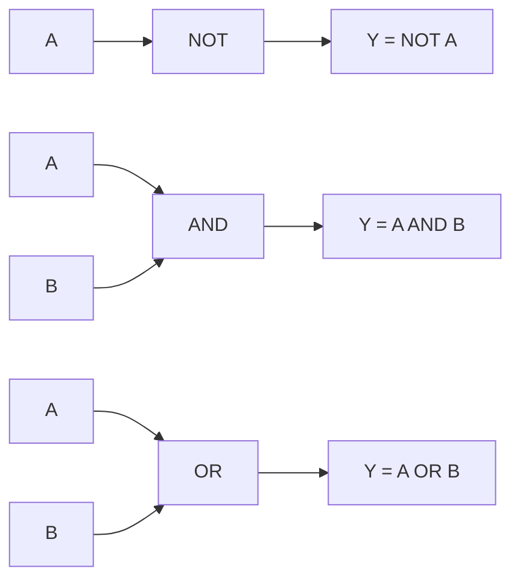
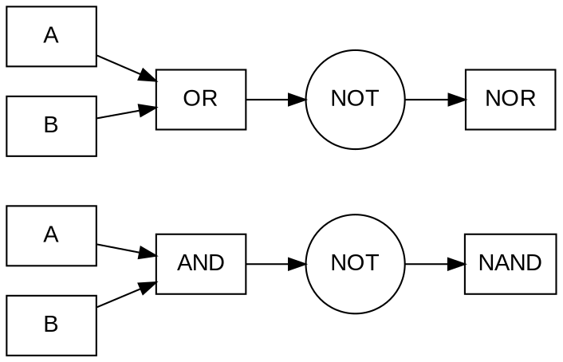
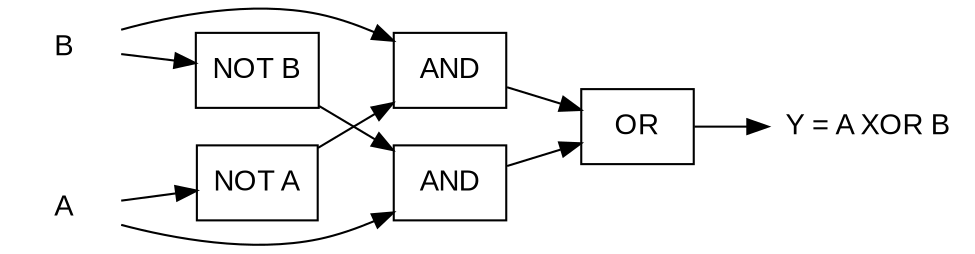
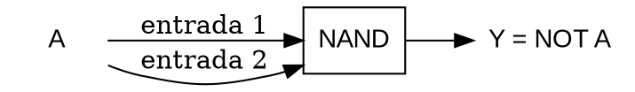
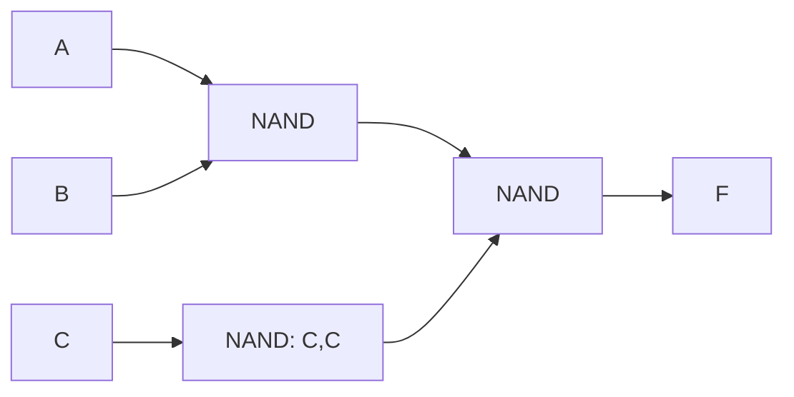
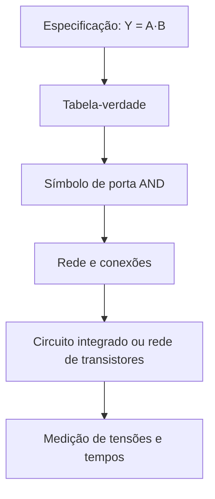
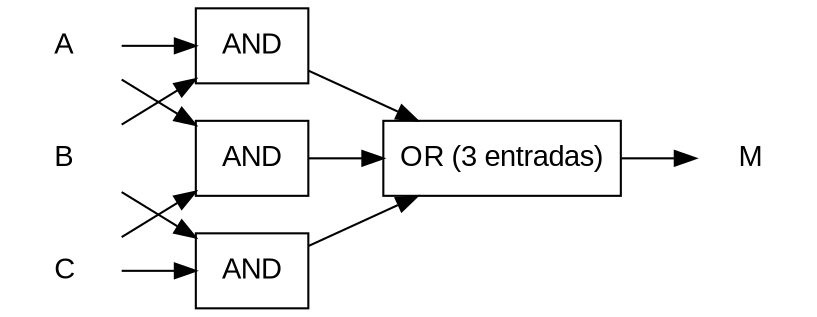
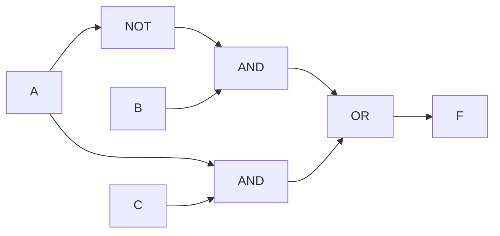
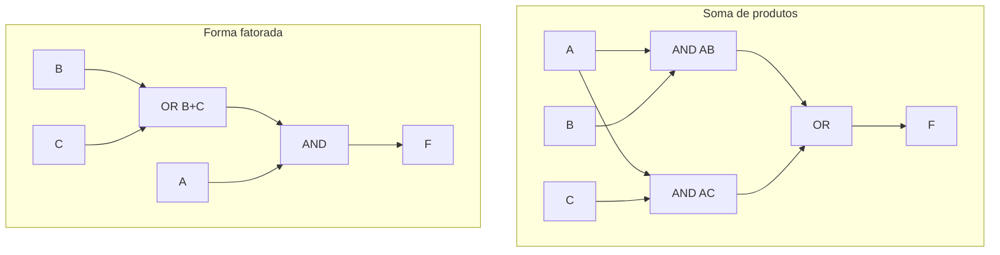

<!-- Revisão 7: teste de MathJSLab inline em títulos de blocos. Não alterar os circuitos TikZ validados. -->

# 4. Portas lógicas e representação de circuitos

No [Capítulo 3](boolean-algebra-and-logic-functions.md), estudamos funções
booleanas como objetos matemáticos, independentemente dos dispositivos que as
realizam. Neste capítulo, passamos da **função** à sua **representação como
circuito**: portas lógicas, conexões, símbolos e diagramas temporais. A
passagem é importante porque uma mesma função admite várias redes de portas,
com diferentes quantidades de componentes, níveis de lógica, atrasos e
necessidades de acionamento.

Uma porta lógica é um bloco eletrônico que implementa uma operação booleana
sobre sinais interpretados como estados discretos. O símbolo de uma porta
representa seu comportamento funcional; não descreve, por si só, a tecnologia
interna, as tensões de alimentação, os limites elétricos ou os tempos de
propagação. Essas características serão aprofundadas nos capítulos sobre
dispositivos semicondutores, famílias lógicas e integridade de sinais.

## Objetivos de aprendizagem

Ao concluir o capítulo, o leitor deverá ser capaz de reconhecer as portas NOT,
AND, OR, NAND, NOR, XOR e XNOR; relacionar símbolos, expressões e
tabelas-verdade; explicar a universalidade de NAND e NOR; interpretar bolhas de
inversão e convenções de sinais ativos em nível baixo; converter funções
booleanas em redes de portas; distinguir redes de dois e de múltiplos níveis;
estimar o efeito qualitativo de atrasos de propagação; e interpretar diagramas
temporais, incluindo a ocorrência de pulsos transitórios.

Os esquemas utilizam a biblioteca `circuits.logic.US` do TikZ, carregada
explicitamente em cada bloco por `\usetikzlibrary{circuits.logic.US}`. A escala
global `scale=2.5, transform shape` segue a configuração que produziu símbolos
maiores no teste de renderização realizado no aplicativo; rótulos de entradas
adjacentes recebem deslocamentos verticais para facilitar a leitura. O tamanho
final também depende do espaço de exibição. Os diagramas representam funções e
conexões, não uma simulação elétrica.

## 4.1. Portas NOT, AND e OR {#sec-not-and-or-gates}

As portas **NOT** (inversora), **AND** (E) e **OR** (OU) realizam as operações
fundamentais da álgebra booleana. Na notação adotada nesta obra, a negação é
indicada por uma barra superior, a conjunção por justaposição ou multiplicação
lógica e a disjunção pelo sinal $+$.

<!-- prettier-ignore -->
::: definition Porta lógica {#def-logic-gate}

Uma **porta lógica** é um elemento de circuito cujo comportamento funcional é
descrito por uma função booleana. Suas entradas e saídas são interpretadas
segundo convenções de níveis lógicos, embora as tensões e correntes físicas
sejam contínuas e apresentem transições de duração finita.

:::

A porta NOT possui uma entrada $A$ e uma saída $Y$:

$$
Y=\overline{A}.\tag{4.1}
$$

A porta AND de duas entradas fornece 1 somente se ambas forem 1:

$$
Y=AB=A\land B.\tag{4.2}
$$

A porta OR de duas entradas fornece 1 quando pelo menos uma delas for 1:

$$
Y=A+B=A\lor B.\tag{4.3}
$$

<!-- prettier-ignore -->
::: table Tabelas-verdade das portas fundamentais {#tbl-basic-gates .full-width}

| $A$ | $B$ | NOT $\overline A$ | AND $AB$ | OR $A+B$ |
| :-: | :-: | :---------------: | :------: | :------: |
|  0  |  0  |         1         |    0     |    0     |
|  0  |  1  |         1         |    0     |    1     |
|  1  |  0  |         0         |    0     |    1     |
|  1  |  1  |         0         |    1     |    1     |

:::

A coluna NOT depende apenas de $A$; $B$ aparece na tabela para permitir a
comparação com as portas de duas entradas. A AND e a OR podem ter mais de duas
entradas. Por exemplo, $Y=ABC$ vale 1 somente quando as três entradas são 1;
$Y=A+B+C$ vale 0 somente quando todas são 0. A associatividade permite agrupar
entradas sem alterar a função ideal: $(AB)C=A(BC)$ e $(A+B)+C=A+(B+C)$.

<!-- prettier-ignore -->
::: figure Organização conceitual das três operações fundamentais {#fig-basic-gate-functions}



:::

<!-- prettier-ignore -->
A {@ref fig-basic-gate-functions} é um **diagrama funcional**, não um desenho de símbolos normalizados. A diferença entre essas representações será discutida na {@ref sec-symbols-and-conventions}.

<!-- prettier-ignore -->
::: example Intertravamento de segurança lógico {#ex-basic-interlock}

Considere um comando $C$, uma condição de proteção $P$ e uma saída de
habilitação $H$. Se a habilitação deve ocorrer somente quando há comando e a
proteção está satisfeita, a especificação é $H=CP$. Se o sinal de proteção
disponível for $F=1$ quando há falha, a mesma condição pode ser escrita como
$H=C\overline F$. O segundo circuito requer inversão do sinal de falha antes da
conjunção, salvo se houver uma entrada de polaridade apropriada.

Esse exemplo trata apenas da função lógica; sistemas reais de segurança exigem
análise de falhas, arquitetura apropriada e normas aplicáveis.

:::

<!-- prettier-ignore -->
Os símbolos gráficos permitem reconhecer imediatamente a operação, diferentemente dos diagramas de caixas. A {@ref fig-ansi-basic-gates} emprega a convenção norte-americana (ANSI/IEEE), com a pequena circunferência indicando inversão.

<!-- prettier-ignore -->
::: figure Símbolos de portas NOT, AND e OR em convenção ANSI/IEEE (estilo norte-americano) {#fig-ansi-basic-gates}

```tikz
\usetikzlibrary{circuits.logic.US}
\begin{tikzpicture}[circuit logic US, scale=2.5, transform shape]
\node[not gate US, draw] (n) at (0,4.2) {};
\node[and gate US, draw] (a) at (0,1.4) {};
\node[or gate US, draw] (o) at (0,-1.4) {};
\draw (n.input) -- ++(-1.4,0) node[left] {$A$};
\draw (n.output) -- ++(0.8,0) node[right] {$\overline A$};
\draw (a.input 1) -- ++(-1.4,0) node[left,yshift=8pt] {$A$};
\draw (a.input 2) -- ++(-1.4,0) node[left,yshift=-8pt] {$B$};
\draw (o.input 1) -- ++(-1.4,0) node[left,yshift=8pt] {$A$};
\draw (o.input 2) -- ++(-1.4,0) node[left,yshift=-8pt] {$B$};
\draw (a.output) -- ++(0.8,0) node[right] {$AB$};
\draw (o.output) -- ++(0.8,0) node[right] {$A+B$};
\end{tikzpicture}
```

:::

## 4.2. Portas NAND e NOR {#sec-nand-nor-gates}

<!-- prettier-ignore -->
A {@ref fig-nand-nor-structure} destaca a inversão aplicada aos resultados das operações AND e OR. O bloco NOT é uma representação funcional, não a bolha gráfica utilizada nos símbolos normalizados.
<!-- prettier-ignore -->
::: figure Composição funcional de NAND e NOR {#fig-nand-nor-structure}



:::

A porta **NAND** produz a negação do resultado AND; a porta **NOR** produz a
negação do resultado OR:

$$
Y_{\mathrm{NAND}}=\overline{AB},\qquad
Y_{\mathrm{NOR}}=\overline{A+B}.\tag{4.4}
$$

<!-- prettier-ignore -->
::: table Tabelas-verdade de NAND e NOR {#tbl-nand-nor .full-width}

| $A$ | $B$ | NAND $\overline{AB}$ | NOR $\overline{A+B}$ |
| :-: | :-: | :------------------: | :------------------: |
|  0  |  0  |          1           |          1           |
|  0  |  1  |          1           |          0           |
|  1  |  0  |          1           |          0           |
|  1  |  1  |          0           |          0           |

:::

A NAND fornece 0 apenas quando todas as entradas são 1. A NOR fornece 1 apenas
quando todas as entradas são 0. Uma porta NAND ou NOR pode ser entendida como
uma AND ou OR seguida de inversão, mas **isso não significa** que um circuito
integrado NAND contenha necessariamente duas portas físicas separadas. O
comportamento pode ser implementado diretamente por uma rede de transistores.

Pelos teoremas de De Morgan, estudados na
[Seção 3.5](boolean-algebra-and-logic-functions.md#sec-demorgan-theorems),
temos

$$
\overline{AB}=\overline A+\overline B,
\qquad
\overline{A+B}=\overline A\,\overline B.\tag{4.5}
$$

Essas identidades explicam por que uma porta NAND pode ser interpretada como
uma OR de entradas invertidas e uma NOR como uma AND de entradas invertidas.
Essa equivalência é particularmente útil na leitura de diagramas com **bolhas
de inversão**.

<!-- prettier-ignore -->
A {@ref fig-ansi-derived-gates} apresenta as quatro portas derivadas. Compare as bolhas nas saídas de NAND, NOR e XNOR com a ausência de bolha na XOR.

<!-- prettier-ignore -->
::: figure Símbolos de NAND, NOR, XOR e XNOR com bolhas de inversão {#fig-ansi-derived-gates}

```tikz
\usetikzlibrary{circuits.logic.US}
\begin{tikzpicture}[circuit logic US, scale=2.5, transform shape]
\node[nand gate US, draw] (a) at (0,5.4) {};
\node[nor gate US, draw] (o) at (0,2.1) {};
\node[xor gate US, draw] (x) at (0,-1.2) {};
\node[xnor gate US, draw] (e) at (0,-4.5) {};
\foreach \g in {a,o,x,e} {\draw (\g.input 1) -- ++(-1.4,0) node[left, yshift=8pt] {$A$}; \draw (\g.input 2) -- ++(-1.4,0) node[left, yshift=-8pt] {$B$}; \draw (\g.output) -- ++(0.9,0);}
\node[right] at (2.3,5.4) {NAND}; \node[right] at (2.3,2.1) {NOR};
\node[right] at (2.3,-1.2) {XOR}; \node[right] at (2.3,-4.5) {XNOR};
\end{tikzpicture}
```

:::

## 4.3. Portas XOR e XNOR {#sec-xor-xnor-gates}

<!-- prettier-ignore -->
A {@ref fig-xor-gate-decomposition} mostra uma realização da XOR com inversores, duas portas AND e uma porta OR. Ela ilustra a expressão $A\oplus B=\overline A B+A\overline B$.
<!-- prettier-ignore -->
::: figure Decomposição de uma XOR de duas entradas em portas básicas {#fig-xor-gate-decomposition}



:::

A porta **XOR** (OU-exclusivo) produz 1 quando duas entradas são diferentes. A
**XNOR** (equivalência) produz 1 quando são iguais:

$$
A\oplus B=\overline A B+A\overline B,\tag{4.6}
$$

$$
A\odot B=\overline{A\oplus B}=AB+\overline A\,\overline B.\tag{4.7}
$$

<!-- prettier-ignore -->
::: table Tabelas-verdade de XOR e XNOR {#tbl-xor-xnor-gates .full-width}

| $A$ | $B$ | XOR $A\oplus B$ | XNOR $A\odot B$ |
| :-: | :-: | :-------------: | :-------------: |
|  0  |  0  |        0        |        1        |
|  0  |  1  |        1        |        0        |
|  1  |  0  |        1        |        0        |
|  1  |  1  |        0        |        1        |

:::

O XOR é empregado em somadores, comparação de bits, geração de paridade e
operações de alternância controlada. Em particular, $A\oplus0=A$ e
$A\oplus1=\overline A$: uma entrada de controle pode determinar se a outra será
preservada ou invertida.

Para três ou mais entradas, o XOR associativo representa a **paridade ímpar**:

$$
P=A\oplus B\oplus C.\tag{4.8}
$$

O resultado é 1 quando há um número ímpar de entradas iguais a 1. A expressão
não significa que exatamente uma entrada deva valer 1; para $A=B=C=1$, a saída
também é 1.

<!-- prettier-ignore -->
::: example Detector de desigualdade de um bit {#ex-bit-mismatch}

Duas linhas $A$ e $B$ devem ser comparadas. Se o sinal de erro deve valer 1
quando os valores diferem, basta $E=A\oplus B$. Se o sinal de concordância deve
valer 1 quando são iguais, utiliza-se $C=A\odot B$. Para palavras com vários
bits, a comparação requer combinar os resultados de cada posição; o projeto
completo será estudado nos capítulos sobre circuitos combinacionais.

:::

## 4.4. Portas universais {#sec-universal-gates}

<!-- prettier-ignore -->
A {@ref fig-nand-universal-inverter} mostra uma das construções fundamentais da universalidade da NAND: ligar as duas entradas da mesma porta ao sinal $A$ realiza a inversão lógica.
<!-- prettier-ignore -->
::: figure Inversor lógico implementado com uma porta NAND {#fig-nand-universal-inverter}



:::

Um conjunto de portas é **funcionalmente completo** quando permite implementar
qualquer função booleana de um número finito de variáveis. As portas NAND,
consideradas isoladamente como tipo de porta, formam um conjunto funcionalmente
completo; o mesmo ocorre com as portas NOR. Por isso são chamadas **portas
universais**.

A demonstração pode ser construída realizando NOT, AND e OR exclusivamente com
NAND. Denotando $A\uparrow B=\overline{AB}$, temos

$$
\overline A=A\uparrow A,\tag{4.9}
$$

$$
AB=(A\uparrow B)\uparrow(A\uparrow B),\tag{4.10}
$$

$$
A+B=(A\uparrow A)\uparrow(B\uparrow B).\tag{4.11}
$$

De modo análogo, definindo $A\downarrow B=\overline{A+B}$ para NOR,

$$
\overline A=A\downarrow A,\tag{4.12}
$$

$$
A+B=(A\downarrow B)\downarrow(A\downarrow B),\tag{4.13}
$$

$$
AB=(A\downarrow A)\downarrow(B\downarrow B).\tag{4.14}
$$

<!-- prettier-ignore -->
::: example Implementação de %`F=A*B+C`% somente com NAND {#ex-nand-only}

Aplicando De Morgan, podemos escrever

$$
F=AB+C=\overline{\overline{AB}\;\overline C}.\tag{4.15}
$$

Assim, basta formar $N_1=\overline{AB}$, $N_2=\overline C$ e
$F=\overline{N_1N_2}$. Com NAND de duas entradas, $N_2$ é obtido ligando as
duas entradas da porta ao mesmo sinal $C$. São necessárias três portas NAND de
duas entradas.

<!-- prettier-ignore -->
::: figure Rede NAND equivalente à função %F=A*B+C% {#fig-nand-only-network}



:::

<!-- prettier-ignore -->
O diagrama da {@ref fig-nand-only-network} descreve a conectividade funcional; a indicação `C,C` significa que ambas as entradas de $N_2$ recebem o mesmo sinal.

:::

A universalidade é uma propriedade lógica, não uma garantia de melhor solução
física. Uma implementação com apenas NAND pode consumir mais portas, apresentar
maior atraso ou exigir mais conexões que outra que utilize uma biblioteca
variada. A escolha depende das células e restrições disponíveis.

<!-- prettier-ignore -->
A {@ref fig-ansi-and-or-network} mostra a realização direta de $F=AB+C$; a {@ref fig-ansi-nand-network} apresenta a mesma função exclusivamente com NAND. A identidade $F=\overline{\overline{AB}\cdot\overline C}$ fundamenta a segunda rede.

<!-- prettier-ignore -->
::: figure Implementação de %`F=A*B+C`% com portas AND e OR {#fig-ansi-and-or-network}

```tikz
\usetikzlibrary{circuits.logic.US}
\begin{tikzpicture}[circuit logic US, scale=2.5, transform shape]
\node[and gate US, draw] (a) at (0,1) {};
\node[or gate US, draw] (o) at (3,0) {};
\draw (a.input 1) -- ++(-1,0) node[left, yshift=8pt] {$A$};
\draw (a.input 2) -- ++(-1,0) node[left, yshift=-8pt] {$B$};
\draw (a.output) -- ++(0.8,0) |- (o.input 1);
\draw (o.input 2) -- ++(-3,0) node[left, yshift=-8pt] {$C$};
\draw (o.output) -- ++(1,0) node[right] {$F$};
\end{tikzpicture}
```

:::

<!-- prettier-ignore -->
::: figure Implementação de %F=A*B+C% exclusivamente com portas NAND {#fig-ansi-nand-network}

```tikz
\usetikzlibrary{circuits.logic.US}
\begin{tikzpicture}[circuit logic US, scale=2.5, transform shape]
\node[nand gate US, draw] (g1) at (0,2) {};
\node[nand gate US, draw] (g2) at (0,-0.5) {};
\node[nand gate US, draw] (g3) at (3,0.7) {};
\draw (g1.input 1) -- ++(-1,0) node[left, yshift=8pt] {$A$};
\draw (g1.input 2) -- ++(-1,0) node[left, yshift=-8pt] {$B$};
\draw (g2.input 1) -- ++(-1,0) node[left, yshift=8pt] {$C$};
\draw (g2.input 2) -- ++(-0.4,0) coordinate (cjoin);
\draw (cjoin) |- (g2.input 1);
\draw (g1.output) -- ++(0.8,0) |- (g3.input 1);
\draw (g2.output) -- ++(0.8,0) |- (g3.input 2);
\draw (g3.output) -- ++(1,0) node[right] {$F$};
\end{tikzpicture}
```

:::

## 4.5. Símbolos e convenções de representação {#sec-symbols-and-conventions}

Diagramas de circuitos digitais usam símbolos gráficos para distinguir
operações e indicar a conectividade. Entre as convenções mais difundidas estão
os símbolos de formato distintivo, historicamente associados ao padrão
ANSI/IEEE, e os símbolos retangulares com indicação de função, associados à
família IEC 60617. A escolha da convenção deve ser consistente ao longo do
documento.

<!-- prettier-ignore -->
::: table Convenções funcionais de identificação das portas {#tbl-gate-notations .full-width}

| Porta | Expressão para duas entradas | Identificação funcional usual                                   |
| :---- | :--------------------------- | :-------------------------------------------------------------- |
| NOT   | $Y=\overline A$              | Inversor; triângulo com bolha na saída na simbologia distintiva |
| AND   | $Y=AB$                       | AND; formato em D na simbologia distintiva                      |
| OR    | $Y=A+B$                      | OR; contorno curvilíneo na simbologia distintiva                |
| NAND  | $Y=\overline{AB}$            | AND com bolha de saída                                          |
| NOR   | $Y=\overline{A+B}$           | OR com bolha de saída                                           |
| XOR   | $Y=A\oplus B$                | OR com curva adicional na entrada                               |
| XNOR  | $Y=\overline{A\oplus B}$     | XOR com bolha de saída                                          |

:::

A **bolha** é um pequeno círculo junto a um terminal e indica inversão lógica
nesse ponto. Em uma saída, a bolha significa que o valor apresentado é o
complemento da função indicada pelo corpo do símbolo. Em uma entrada, indica
que o sinal é interpretado com polaridade invertida. A bolha não deve ser
confundida com um ponto de junção elétrica, que indica conexão entre
condutores.

<!-- prettier-ignore -->
::: definition Sinal ativo em nível baixo {#def-active-low-signal}

Um sinal é **ativo em nível baixo** quando a condição que ele representa está
afirmada no valor lógico 0. Pode ser identificado por uma barra sobre o nome,
por um sufixo como `_n` ou por outra convenção explicitamente definida no
projeto.

:::

Por exemplo, uma entrada denominada $\overline{RESET}$ pode solicitar
reinicialização quando vale 0. Isso não significa que o dispositivo opere com
lógica negativa em todas as demais entradas. A polaridade de ativação de um
sinal e a convenção global de lógica positiva são conceitos distintos.

Para leitura correta de esquemas, também é necessário observar:

- **Cruzamentos e junções:** duas linhas que se cruzam não estão
  necessariamente conectadas; a presença de um ponto de junção ou a convenção
  gráfica adotada determina a conexão.
- **Direção do sinal:** normalmente representada da esquerda para a direita,
  mas não é uma propriedade elétrica obrigatória.
- **Identificação de terminais:** nomes, números de pinos e alimentação devem
  ser consultados na documentação do componente real.
- **Portas de múltiplas entradas:** o número de entradas do símbolo deve
  corresponder ao componente ou à função modelada.
- **Sinais constantes:** conexões a 0 ou 1 lógico exigem implementação elétrica
  adequada; não devem ser inferidas apenas do desenho.

<!-- prettier-ignore -->
::: figure Relação entre especificação, representação lógica e realização física {#fig-representation-levels}



:::

<!-- prettier-ignore -->
A {@ref fig-representation-levels} enfatiza que um símbolo lógico não equivale a um esquema de transistores. Para circuitos reais, os níveis elétricos e as condições de carga estudados na [Seção 1.4](introduction-to-digital-electronics.md#sec-logic-levels-electrical-signals) continuam relevantes.

## 4.6. Implementação de funções por portas lógicas {#sec-implementing-boolean-functions}

<!-- prettier-ignore -->
A {@ref fig-three-input-majority} apresenta um circuito de votação de três entradas: a saída é 1 quando pelo menos duas entradas são 1, conforme $M=AB+AC+BC$.
<!-- prettier-ignore -->
::: figure Rede lógica de votação por maioria de três entradas {#fig-three-input-majority}



:::

A implementação de uma função começa por uma especificação inequívoca,
frequentemente expressa como tabela-verdade ou expressão booleana. Uma
estratégia direta é associar cada operação a uma porta e ligar os resultados
intermediários conforme a precedência dos operadores. A estratégia é correta
funcionalmente, mas nem sempre produz o circuito mais econômico.

Considere

$$
F(A,B,C)=\overline A B+AC.\tag{4.16}
$$

<!-- prettier-ignore -->
A rede direta contém um inversor para $A$, duas portas AND e uma porta OR. Definindo $P=\overline A B$ e $Q=AC$, a saída é $F=P+Q$. A {@ref tbl-mux-function} permite verificar o comportamento sem depender do desenho.

<!-- prettier-ignore -->
::: table Tabela-verdade da função combinacional com três entradas {#tbl-mux-function .full-width}

| $A$ | $B$ | $C$ | $\overline A B$ | $AC$ | $F$ |
| :-: | :-: | :-: | :-------------: | :--: | :-: |
|  0  |  0  |  0  |        0        |  0   |  0  |
|  0  |  0  |  1  |        0        |  0   |  0  |
|  0  |  1  |  0  |        1        |  0   |  1  |
|  0  |  1  |  1  |        1        |  0   |  1  |
|  1  |  0  |  0  |        0        |  0   |  0  |
|  1  |  0  |  1  |        0        |  1   |  1  |
|  1  |  1  |  0  |        0        |  0   |  0  |
|  1  |  1  |  1  |        0        |  1   |  1  |

:::

<!-- prettier-ignore -->
::: figure Rede de portas para a função seletora de dados {#fig-mux-gate-network}



:::

A função também pode ser interpretada como um seletor de dados: quando $A=0$,
$F=B$; quando $A=1$, $F=C$. Esse é o comportamento de um **multiplexador 2:1**,
que será estudado no Capítulo 7. A mesma função pode, portanto, ser realizada
por portas discretas ou por um bloco funcional específico.

<!-- prettier-ignore -->
::: example Procedimento de síntese e conferência {#ex-implementation-workflow}

Para implementar $Y=(A+B)\overline C$, proceda assim:

1. Gere $S=A+B$ por uma porta OR.
2. Gere $N=\overline C$ por uma porta NOT.
3. Gere $Y=SN$ por uma porta AND.
4. Confira a tabela-verdade: se $C=1$, a saída deve ser sempre 0; se $C=0$, a
   saída deve ser $A+B$.

A conferência por casos reduz erros de conexão e de precedência. Em uma
implementação física, a validação também precisará considerar tensões, cargas e
temporização.

:::

<!-- prettier-ignore -->
O uso de portas de duas entradas para realizar operações com muitos operandos requer uma estrutura de associação. Para quatro entradas, uma AND em cadeia e uma árvore equilibrada realizam a mesma função booleana, mas têm diferentes profundidades de portas. O efeito temporal será retomado na {@ref sec-multilevel-circuits}.

<!-- prettier-ignore -->
A {@ref fig-ansi-majority-network} realiza $M=AB+AC+BC$, função que produz 1 quando pelo menos duas das três entradas são 1. A {@ref fig-ansi-mux-network} representa a função $F=\overline A B+AC$, equivalente a um multiplexador 2:1 controlado por $A$.

<!-- prettier-ignore -->
::: figure Rede de três portas AND e uma OR para votação por maioria {#fig-ansi-majority-network}

```tikz
\usetikzlibrary{circuits.logic.US}
\begin{tikzpicture}[circuit logic US, scale=2.5, transform shape]
\node[and gate US, draw] (g1) at (0,4.2) {};
\node[and gate US, draw] (g2) at (0,1) {};
\node[and gate US, draw] (g3) at (0,-2.2) {};
\node[or gate US, draw, logic gate inputs=nnn] (g4) at (4.2,1) {};
\draw (g1.input 1) -- ++(-1.4,0) node[left, yshift=8pt] {$A$};
\draw (g1.input 2) -- ++(-1.4,0) node[left, yshift=-8pt] {$B$};
\draw (g2.input 1) -- ++(-1.4,0) node[left, yshift=8pt] {$A$};
\draw (g2.input 2) -- ++(-1.4,0) node[left, yshift=-8pt] {$C$};
\draw (g3.input 1) -- ++(-1.4,0) node[left, yshift=8pt] {$B$};
\draw (g3.input 2) -- ++(-1.4,0) node[left, yshift=-8pt] {$C$};
\draw (g1.output) -- ++(0.6,0) |- (g4.input 1);
\draw (g2.output) -- (g4.input 2);
\draw (g3.output) -- ++(0.6,0) |- (g4.input 3);
\draw (g4.output) -- ++(0.9,0) node[right] {$M$};
\end{tikzpicture}
```

:::

<!-- prettier-ignore -->
::: figure Rede inversora, AND e OR para a função seletora de dados {#fig-ansi-mux-network}

```tikz
\usetikzlibrary{circuits.logic.US}
\begin{tikzpicture}[circuit logic US, scale=2.5, transform shape]
\node[not gate US, draw] (inv) at (0,3.6) {};
\node[and gate US, draw] (g1) at (3,2.8) {};
\node[and gate US, draw] (g2) at (3,-1.0) {};
\node[or gate US, draw] (g3) at (6.5,0.9) {};
\draw (inv.input) -- ++(-1.4,0) node[left] {$A$};
\draw (inv.output) -- ++(0.6,0) |- (g1.input 1);
\draw (g1.input 2) -- ++(-1.2,0) node[left, yshift=-8pt] {$B$};
\draw (g2.input 1) -- ++(-1.2,0) node[left, yshift=8pt] {$A$};
\draw (g2.input 2) -- ++(-1.2,0) node[left, yshift=-8pt] {$C$};
\draw (g1.output) -- ++(0.6,0) |- (g3.input 1);
\draw (g2.output) -- ++(0.6,0) |- (g3.input 2);
\draw (g3.output) -- ++(0.8,0) node[right] {$F$};
\end{tikzpicture}
```

:::

## 4.7. Circuitos multiníveis {#sec-multilevel-circuits}

Uma **rede lógica multinível** contém caminhos nos quais a informação atravessa
sucessivas portas. Sua **profundidade lógica** é o maior número de estágios de
portas em um caminho de entrada até a saída, conforme o critério de contagem
adotado. Essa medida não é igual ao atraso físico, mas ajuda a compreender sua
origem.

Por exemplo, a função

$$
F=AB+AC=A(B+C)\tag{4.17}
$$

admite ao menos duas implementações:

- **Soma de produtos:** duas AND em paralelo, seguidas de OR.
- **Forma fatorada:** uma OR para $B+C$, seguida de AND com $A$.

Ambas têm dois níveis lógicos nos caminhos mais longos, mas a forma fatorada
utiliza duas portas em vez de três, supondo portas simples de duas entradas.
Isso não garante que ela seja sempre mais rápida: as capacitâncias, os tempos
de cada tipo de porta e a distribuição de carga também importam.

<!-- prettier-ignore -->
::: table Comparação funcional de duas redes equivalentes {#tbl-network-comparison .full-width}

| Critério                   | $AB+AC$                            | $A(B+C)$                           |
| :------------------------- | :--------------------------------- | :--------------------------------- |
| Função booleana            | A mesma                            | A mesma                            |
| Portas de duas entradas    | 3                                  | 2                                  |
| Profundidade máxima        | 2                                  | 2                                  |
| Compartilhamento de termos | Dois produtos                      | Um fator comum                     |
| Atraso real                | Depende da biblioteca e das cargas | Depende da biblioteca e das cargas |

:::

A **reconvergência** ocorre quando um sinal se divide em caminhos distintos e
depois volta a influenciar uma mesma saída. Se os caminhos tiverem atrasos
diferentes, podem surgir transições transitórias que não são previstas pela
avaliação estática da expressão. Esse fenômeno está relacionado aos **riscos
lógicos** (_hazards_), estudados de modo sistemático no Capítulo 5.

<!-- prettier-ignore -->
::: figure Dois arranjos equivalentes para %`F=A*B+A*C`% {#fig-factored-networks}



:::

Ao comparar arquiteturas, considere simultaneamente número de portas, número de
entradas por porta, profundidade, fan-out, cargas e condições elétricas. O
processo de minimização algébrica e por mapas de Karnaugh será aprofundado no
capítulo seguinte.

### Descrição de hardware e conferência funcional

Uma descrição HDL expressa as mesmas funções sem especificar a tecnologia dos
transistores. O módulo Verilog abaixo serve como exemplo de código-fonte; sua
execução depende de um simulador habilitado no aplicativo.

```verilog
module portas_basicas(input wire a, b,
                     output wire y_not, y_and, y_or,
                     output wire y_nand, y_nor, y_xor, y_xnor);
  assign y_not  = ~a;
  assign y_and  = a & b;
  assign y_or   = a | b;
  assign y_nand = ~(a & b);
  assign y_nor  = ~(a | b);
  assign y_xor  = a ^ b;
  assign y_xnor = ~(a ^ b);
endmodule
```

O banco de testes percorre as quatro combinações de duas entradas e imprime os
resultados. Salve o módulo e o banco de testes em arquivos apropriados ou
forneça ambos ao executor HDL configurado. **Não se pressupõe que a simples
inclusão de um bloco `verilog` execute a simulação.**

```verilog
`timescale 1ns/1ps
module tb_portas_basicas;
  reg a, b;
  wire y_not, y_and, y_or, y_nand, y_nor, y_xor, y_xnor;
  portas_basicas dut(a,b,y_not,y_and,y_or,y_nand,y_nor,y_xor,y_xnor);
  initial begin
    $display("A B | NOT AND OR NAND NOR XOR XNOR");
    a=0; b=0; #10; $display("%b %b | %b   %b   %b    %b    %b   %b    %b", a,b,y_not,y_and,y_or,y_nand,y_nor,y_xor,y_xnor);
    a=0; b=1; #10; $display("%b %b | %b   %b   %b    %b    %b   %b    %b", a,b,y_not,y_and,y_or,y_nand,y_nor,y_xor,y_xnor);
    a=1; b=0; #10; $display("%b %b | %b   %b   %b    %b    %b   %b    %b", a,b,y_not,y_and,y_or,y_nand,y_nor,y_xor,y_xnor);
    a=1; b=1; #10; $display("%b %b | %b   %b   %b    %b    %b   %b    %b", a,b,y_not,y_and,y_or,y_nand,y_nor,y_xor,y_xnor);
    $finish;
  end
endmodule
```

<!-- prettier-ignore -->
A {@ref fig-ideal-gate-waveforms} é um diagrama ideal obtido diretamente das tabelas-verdade. Não representa atrasos de propagação nem substitui um arquivo VCD produzido por simulação.

<!-- prettier-ignore -->
::: figure Formas de onda ideais de AND, OR e XOR para sequências de entradas {#fig-ideal-gate-waveforms}

```wavedrom
{
  "signal": [
    {
      "name": "A",
      "wave": "0.1.0.1."
    },
    {
      "name": "B",
      "wave": "01010101"
    },
    {
      "name": "AND",
      "wave": "0..10..1"
    },
    {
      "name": "OR",
      "wave": "01..01.."
    },
    {
      "name": "XOR",
      "wave": "01.0.1.0"
    }
  ],
  "head": {
    "text": "Operações booleanas ideais em oito intervalos"
  }
}
```

:::

### Circuitos e execução: distinção entre formatos

Um **esquema TikZ** descreve símbolos e conexões para visualização; uma
**netlist** descreve componentes e nós conforme uma gramática específica; um
**módulo HDL** descreve comportamento ou estrutura; um **testbench** fornece
estímulos e verifica respostas; e um **VCD** registra transições observadas.
Esses formatos não são intercambiáveis. Nesta revisão, as redes gráficas e o
Verilog constituem exemplos didáticos verificáveis; a execução interativa
deverá ser ajustada às opções concretas de `netlist`, `hdl` e `hdl-interactive`
da instalação.

## 4.8. Introdução ao atraso de propagação e aos diagramas temporais {#sec-propagation-delay-and-timing-diagrams}

<!-- prettier-ignore -->
A {@ref fig-combinational-propagation} representa um exemplo didático de atraso em uma porta inversora. Os sinais são idealizados e o deslocamento temporal não está em escala de um componente específico.
<!-- prettier-ignore -->
::: figure Exemplo de propagação temporal através de uma porta inversora {#fig-combinational-propagation}

```wavedrom
{ "signal": [
  { "name": "Entrada A", "wave": "0..1...0..1..." },
  { "name": "Saída ideal NOT A", "wave": "1..0...1..0..." },
  { "name": "Saída com atraso", "wave": "1...0...1..0.." }
], "config": { "hscale": 2 } }
```

:::

O modelo booleano ideal considera que uma mudança de entrada produz
imediatamente a mudança correspondente na saída. Em circuitos reais, há um
intervalo entre esses eventos: o **atraso de propagação**. Para uma porta
inversora, distinguem-se frequentemente

$$
t_{PLH}=t(\text{saída em subida})-t(\text{entrada correspondente}),\tag{4.18}
$$

$$
t_{PHL}=t(\text{saída em descida})-t(\text{entrada correspondente}).\tag{4.19}
$$

As medidas são realizadas nos pontos de referência especificados,
frequentemente a uma fração definida da amplitude de transição. Os valores
dependem da tecnologia, da tensão de alimentação, da temperatura, da carga e do
sentido da transição. Não se deve pressupor que $t_{PLH}=t_{PHL}$.

<!-- prettier-ignore -->
::: definition Diagrama temporal {#def-timing-diagram}

Um **diagrama temporal** representa os estados de sinais em função do tempo e
evidencia relações como precedência, simultaneidade ideal, atrasos, pulsos e
condições de habilitação. É uma ferramenta de análise funcional e temporal, não
um substituto das formas de onda analógicas medidas em osciloscópio.

:::

<!-- prettier-ignore -->
A {@ref fig-timing-not} ilustra a inversão de um sinal. O desenho representa a relação lógica ideal; em uma medição, as bordas da saída apareceriam deslocadas e com duração finita.

<!-- prettier-ignore -->
::: figure Diagrama temporal lógico de uma porta NOT {#fig-timing-not}

```wavedrom
{ "signal": [
  { "name": "A", "wave": "0.1.0.1.0." },
  { "name": "Y = NOT A", "wave": "1.0.1.0.1." }
], "config": { "hscale": 2 } }
```

:::

Para um caminho de portas em série, uma estimativa inicial do atraso pode ser
obtida pela soma dos atrasos dos estágios atravessados:

$$
t_{\mathrm{caminho}}\approx\sum_{i=1}^{m}t_{p,i}.\tag{4.20}
$$

Essa aproximação requer cuidado: o atraso de cada estágio depende da transição
e da carga efetiva; em análises temporais reais, usam-se modelos caracterizados
e verificam-se os caminhos críticos. A frequência máxima de circuitos síncronos
também depende dos tempos de estabelecimento, retenção e da distribuição de
relógio, assuntos dos Capítulos 9 e 10.

### Transições transitórias e riscos lógicos

Considere

$$
F=AB+\overline A C.\tag{4.21}
$$

Com $B=C=1$, a função ideal é $F=A+\overline A=1$ para qualquer valor de $A$.
Contudo, se $A$ passar de 1 para 0, o termo $AB$ pode cair antes de $\overline
A C$ subir, produzindo brevemente $F=0$. Trata-se de um **risco estático de
nível alto** em uma implementação específica de soma de produtos.

O termo de consenso $BC$ permite escrever uma realização logicamente
equivalente:

$$
F=AB+\overline A C+BC.\tag{4.22}
$$

Sob as hipóteses usuais de análise de riscos em redes combinacionais de duas
camadas e mudança de uma entrada por vez, a inclusão do termo $BC$ mantém um
caminho ativo durante essa transição e elimina esse risco estático específico.
A técnica não garante ausência de todos os riscos em redes arbitrárias, nem
substitui análise de temporização.

**Atenção — limites dos diagramas lógicos.** Diagramas com estados 0 e 1 não
mostram, por si só, a duração analógica das bordas, o comportamento em regiões
de tensão indefinida ou efeitos de integridade de sinal. Atrasos e pulsos
transitórios devem ser avaliados conforme a tecnologia e as condições de
operação.

<!-- prettier-ignore -->
::: example Estimativa de atraso de um caminho {#ex-path-delay}

Uma rede possui três portas em série, com atrasos máximos hipotéticos de
$4\,\mathrm{ns}$, $6\,\mathrm{ns}$ e $5\,\mathrm{ns}$ para as transições
relevantes. Desprezando outros efeitos e supondo que os máximos possam ser
combinados, a estimativa conservadora do caminho é
$t_{\mathrm{caminho}}\leq15\,\mathrm{ns}$. Isso não estabelece, isoladamente, a
frequência máxima de um sistema síncrono, pois faltam os parâmetros dos
elementos de memória e do relógio.

:::

## Laboratório de leitura de circuitos

<!-- prettier-ignore -->
Compare as {@ref fig-ansi-and-or-network} e {@ref fig-ansi-nand-network}: ambas implementam a mesma função, mas usam famílias de portas diferentes. Em seguida, percorra as quatro combinações de $A$ e $B$ no módulo Verilog e confira os resultados com as tabelas-verdade. Por fim, use a {@ref fig-ideal-gate-waveforms} para distinguir o valor lógico ideal de um possível atraso físico na saída.

## Síntese do capítulo

Portas lógicas concretizam operações booleanas por meio de dispositivos
eletrônicos. NOT, AND e OR são operações fundamentais; NAND e NOR acrescentam
inversão e são funcionalmente completas; XOR e XNOR expressam diferença e
igualdade entre bits. Os símbolos e as convenções gráficas ajudam a comunicar
funções e conexões, mas não substituem a especificação elétrica dos
componentes. Uma função pode ser implementada por redes distintas, com
diferentes quantidades de portas e profundidades lógicas. Por fim, atrasos
finitos e caminhos reconvergentes explicam por que circuitos reais podem
apresentar transições que não aparecem em tabelas-verdade estáticas.

## Exercícios e questões para discussão

<!-- prettier-ignore -->
:::: exercise Questão 1 — identificação de portas {#ex4-identify-gates}

Construa a tabela-verdade de $Y=\overline{AB}$ e de $Z=\overline{A+B}$.
Identifique as portas correspondentes e indique para qual combinação de
entradas as duas saídas são simultaneamente 1.

<!-- prettier-ignore -->
::: solution

$Y$ é NAND e $Z$ é NOR. Ambas valem 1 somente para $A=B=0$.

:::

::::

<!-- prettier-ignore -->
:::: exercise Questão 2 — XOR de três entradas {#ex4-three-input-xor}

Determine a saída $P=A\oplus B\oplus C$ para as oito combinações de entrada.
Explique por que a interpretação “exatamente uma entrada em 1” está incorreta.

<!-- prettier-ignore -->
::: hint

Conte a quantidade de entradas em 1 e verifique se ela é par ou ímpar.

:::

::::

<!-- prettier-ignore -->
:::: exercise Questão 3 — realização com NAND {#ex4-nand-realization}

Implemente $Y=A+B$ usando exclusivamente portas NAND de duas entradas.
Apresente as expressões intermediárias e conte as portas.

<!-- prettier-ignore -->
::: solution

$N_A=\overline A=\overline{AA}$ e $N_B=\overline B=\overline{BB}$. Portanto
$Y=\overline{N_AN_B}=A+B$. São três portas NAND de duas entradas.

:::

::::

<!-- prettier-ignore -->
:::: exercise Questão 4 — realização com NOR {#ex4-nor-realization}

Implemente $Y=AB$ usando exclusivamente portas NOR de duas entradas. Justifique
pela identidade de De Morgan.

<!-- prettier-ignore -->
::: solution

$N_A=\overline A=\overline{A+A}$, $N_B=\overline B=\overline{B+B}$ e
$Y=\overline{N_A+N_B}=AB$. São três portas NOR.

:::

::::

<!-- prettier-ignore -->
:::: exercise Questão 5 — tabela e rede de portas {#ex4-gate-network}

Para $F(A,B,C)=\overline A B+AC$, construa a tabela-verdade, desenhe a rede de
portas e descreva a função de $A$ como seletor entre $B$ e $C$.

<!-- prettier-ignore -->
::: hint

<!-- prettier-ignore -->
Avalie separadamente os casos $A=0$ e $A=1$. Compare com a {@ref tbl-mux-function}.

:::

::::

<!-- prettier-ignore -->
:::: exercise Questão 6 — simplificação e custo {#ex4-factoring}

Compare as realizações de $F=AB+AC$ e $F=A(B+C)$ quanto à função, ao número de
portas de duas entradas e à profundidade lógica. É possível afirmar, sem
conhecer a tecnologia, qual delas é mais rápida?

<!-- prettier-ignore -->
::: solution

As funções são equivalentes por distributividade. A primeira usa três portas e
a segunda, duas. A profundidade máxima é dois níveis em ambas. Sem dados
elétricos e temporais, não é possível concluir qual é mais rápida.

:::

::::

<!-- prettier-ignore -->
:::: exercise Questão 7 — polaridade dos sinais {#ex4-active-low}

Uma entrada $RESET_n$ é ativa em nível baixo. Explique o significado de
$RESET_n=0$ e discuta por que isso não implica que todas as portas do sistema
utilizem lógica negativa.

::::

<!-- prettier-ignore -->
:::: exercise Questão 8 — atrasos {#ex4-delay-estimate}

Um caminho atravessa quatro portas com atrasos máximos hipotéticos de $2$, $3$,
$4$ e $3\,\mathrm{ns}$. Estime o atraso máximo acumulado sob o modelo aditivo.
Liste duas razões pelas quais a estimativa pode diferir de uma medição.

<!-- prettier-ignore -->
::: solution

A soma é $12\,\mathrm{ns}$. Entre as razões estão diferenças de carga, tensão
de alimentação, temperatura, sentido da transição e imprecisões do modelo
simplificado.

:::

::::

<!-- prettier-ignore -->
:::: exercise Questão 9 — risco estático {#ex4-static-hazard}

Para $F=AB+\overline A C$, verifique que $F=1$ nos dois estados de $A$ quando
$B=C=1$. Explique como atrasos diferentes podem produzir um pulso de nível
baixo e qual é o papel do termo $BC$.

<!-- prettier-ignore -->
::: hint

A tabela-verdade descreve estados estáveis; o risco decorre da ordem temporal
em que os produtos deixam de valer 1 e passam a valer 1.

:::

::::

<!-- prettier-ignore -->
:::: exercise Questão 10 — projeto de interface {#ex4-interface-project}

Especifique, em nível funcional, uma saída $L$ que deve ser ativada quando o
comando $C$ estiver ativo e não houver falha $F$. Represente a expressão, a
tabela-verdade e uma rede de portas. Discuta quais informações elétricas ainda
seriam necessárias para conectar a saída a um atuador real.

::::

## Referências bibliográficas

As referências a seguir oferecem fundamentação complementar sobre portas
lógicas, símbolos, funções booleanas e implementação de circuitos. As
convenções de simbologia devem ser conferidas nas normas e nas folhas de dados
aplicáveis ao projeto concreto.

1. MANO, M. Morris; CILETTI, Michael D. **Digital Design**. 5. ed.
   Pearson, 2013.
2. FLOYD, Thomas L. **Digital Fundamentals**. 11. ed. Pearson, 2015.
3. TOCCI, Ronald J.; WIDMER, Neal S.; MOSS, Gregory L. **Digital Systems:
   Principles and Applications**. 12. ed. Pearson, 2017.
4. HARRIS, David Money; HARRIS, Sarah L. **Digital Design and Computer
   Architecture**. 2. ed. Morgan Kaufmann, 2012.
5. WAKERLY, John F. **Digital Design: Principles and Practices**. 4. ed.
   Pearson, 2005.
6. IEEE. **IEEE Std 91-1984: Graphic Symbols for Logic Functions**. IEEE, 1984.
   Referência histórica para a simbologia de funções lógicas; verificar a
   situação normativa e revisões aplicáveis.
7. IEC. **IEC 60617 — Graphical Symbols for Diagrams**. Base de dados de
   símbolos gráficos para diagramas. Consultar a edição e os símbolos
   aplicáveis.

---

[Voltar ao sumário](README.md) ·
[Capítulo 3 — Álgebra booleana e funções lógicas](boolean-algebra-and-logic-functions.md)
