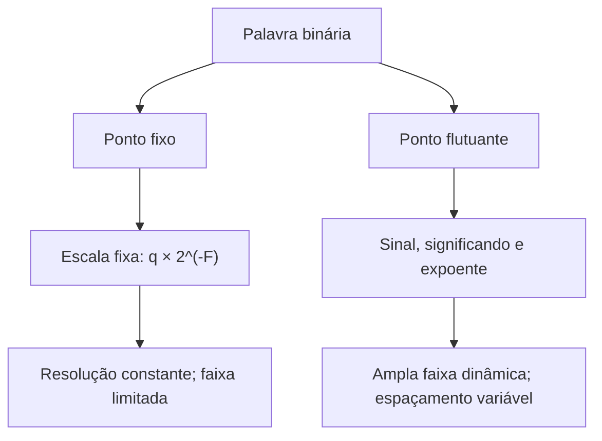
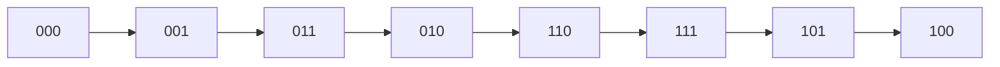

# 2. Sistemas de numeração e representação da informação

A informação manipulada por um circuito digital não se confunde com os sinais
elétricos que a transportam. Uma mesma sequência de bits pode representar um
número inteiro, uma medida, um caractere, uma instrução ou parte de uma
mensagem. Interpretá-la corretamente exige conhecer **a base numérica, o
formato, a largura da palavra e as convenções de codificação**. Este capítulo
desenvolve essas noções, dando continuidade à
[introdução à Eletrônica Digital](introduction-to-digital-electronics.md).

Os sistemas posicionais permitem representar números com um alfabeto finito de
algarismos; a representação binária torna esses números compatíveis com
circuitos de dois estados; e os códigos digitais ampliam essa capacidade para
informações que não são necessariamente números. A precisão, a faixa de valores
e a possibilidade de detectar erros dependem das escolhas de representação.

## Objetivos de aprendizagem

Ao concluir este capítulo, o leitor deverá ser capaz de interpretar números
posicionais; converter números entre bases; executar operações binárias;
distinguir números sem sinal e em complemento de dois; reconhecer
transbordamentos; explicar as limitações de representações em ponto fixo e
flutuante; utilizar códigos BCD, Gray e alfanuméricos; e analisar mecanismos
elementares de detecção de erros.

## 2.1. Sistemas posicionais e bases numéricas {#sec-positional-number-systems}

Em um sistema **posicional** de base inteira $b\geq2$, utilizam-se $b$
algarismos distintos, associados aos valores $0,1,\ldots,b-1$. O valor de cada
algarismo depende de sua posição. Para um número com parte inteira e
fracionária, a expansão é

$$
(x)_b=\sum_{i=-m}^{n}d_i b^i,\qquad 0\leq d_i<b.\tag{2.1}
$$

O índice $i=0$ corresponde à unidade; índices positivos indicam potências
sucessivas da base, e índices negativos indicam frações. O símbolo $(x)_b$
informa a base e evita ambiguidades: $(101)*2=5*{10}$, enquanto
$(101)_{10}=101_{10}$.

<!-- prettier-ignore -->
::: definition Peso posicional {#def-positional-weight}

O **peso** de um algarismo $d_i$ na posição $i$ de uma representação de base
$b$ é $b^i$. Sua contribuição ao valor representado é $d_i b^i$.

:::

<!-- prettier-ignore -->
::: example Decomposição de um número posicional {#ex-positional-expansion}

A representação $(2304{,}12)_5$ é válida porque todos os algarismos pertencem
ao conjunto $\{0,1,2,3,4\}$. Seu valor é

$$2\cdot5^3+3\cdot5^2+0\cdot5^1+4\cdot5^0+1\cdot5^{-1}+2\cdot5^{-2}=329{,}28_{10}.$$

Observe que a vírgula separa posições, não modifica a regra de pesos.

:::

<!-- prettier-ignore -->
A {@ref fig-binary-positional-weights} destaca que o valor de uma palavra resulta da soma dos pesos das posições cujos bits são iguais a 1.

<!-- prettier-ignore -->
::: figure Pesos posicionais de uma palavra binária de quatro bits {#fig-binary-positional-weights}

```tikz
\begin{tikzpicture}[scale=1.35,transform shape]
\foreach \x/\bit/\weight in {0/1/8,1/0/4,2/1/2,3/1/1}{
  \draw[thick] (\x*1.5,0) rectangle ++(1.35,0.95);
  \node at (\x*1.5+0.675,0.48) {\Large \bit};
  \node at (\x*1.5+0.675,-0.38) {$\weight$};
}
\node[anchor=east] at (-0.18,-0.38) {Peso:};
\node at (2.92,-1.05) {$1011_2=8+0+2+1=11_{10}$};
\end{tikzpicture}
```

:::

A quantidade de representações possíveis com $N$ posições em base $b$ é $b^N$.
Isso não implica que todas representem valores distintos quando se admitem
zeros à esquerda, sinais ou formatos especiais; a afirmação pressupõe palavras
de comprimento fixo interpretadas como sequências de algarismos.

## 2.2. Sistemas decimal, binário, octal e hexadecimal {#sec-decimal-binary-octal-hexadecimal}

<!-- prettier-ignore -->
O sistema decimal emprega dez algarismos; o binário, dois; o octal, oito; e o hexadecimal, dezesseis. Neste último, as letras A a F representam os valores decimais 10 a 15. A {@ref tbl-base-comparison} apresenta algumas correspondências.

<!-- prettier-ignore -->
::: table Correspondência entre representações de inteiros não negativos {#tbl-base-comparison .full-width}

| Decimal | Binário | Octal | Hexadecimal |
| ------: | ------: | ----: | ----------: |
|       0 |    0000 |     0 |           0 |
|       1 |    0001 |     1 |           1 |
|       5 |    0101 |     5 |           5 |
|       8 |    1000 |    10 |           8 |
|      10 |    1010 |    12 |           A |
|      15 |    1111 |    17 |           F |
|      16 |   10000 |    20 |          10 |
|      31 |   11111 |    37 |          1F |

:::

O octal e o hexadecimal são particularmente convenientes porque $8=2^3$ e
$16=2^4$. Assim, cada algarismo octal corresponde a **três bits**, e cada
algarismo hexadecimal, a **quatro bits**. Não se trata de uma alteração no
valor: são formas mais compactas de escrever a mesma sequência binária.

<!-- prettier-ignore -->
::: example Agrupamento de bits {#ex-bit-grouping}

Para converter $(110101101)_2$ em hexadecimal, agrupam-se os bits da direita
para a esquerda, completando o grupo mais à esquerda com zeros:
`0001 1010 1101`. Logo, $(110101101)_2=(1AD)_{16}$. Para octal: `110 101 101`,
resultando em $(655)_8$.

:::

A escolha de uma base é uma convenção de representação. O hardware pode
processar bits enquanto a documentação apresenta endereços e máscaras em
hexadecimal, ou quantidades físicas em decimal.

## 2.3. Conversão entre bases {#sec-base-conversion}

<!-- prettier-ignore -->
A conversão **para decimal** consiste em aplicar os pesos posicionais da {@ref sec-positional-number-systems}. Para converter um inteiro decimal não negativo para a base $b$, realizam-se divisões sucessivas por $b$; os restos, lidos na ordem inversa à obtenção, formam os algarismos.

<!-- prettier-ignore -->
::: example Conversão de inteiro decimal para binário {#ex-decimal-to-binary}

Para representar $45_{10}$ em binário:

<!-- prettier-ignore -->
As divisões sucessivas produzem os pares quociente–resto: $45=2\cdot22+1$; $22=2\cdot11+0$; $11=2\cdot5+1$; $5=2\cdot2+1$; $2=2\cdot1+0$; $1=2\cdot0+1$. A {@ref tbl-decimal-binary-divisions} organiza o procedimento.

Lendo os restos de baixo para cima, obtém-se $(45)_{10}=(101101)_2$. A
verificação é $32+8+4+1=45$.

:::

<!-- prettier-ignore -->
::: table Divisões sucessivas de 45 por 2 {#tbl-decimal-binary-divisions .full-width}

| Dividendo | Quociente | Resto |
| --------: | --------: | :---: |
|        45 |        22 |   1   |
|        22 |        11 |   0   |
|        11 |         5 |   1   |
|         5 |         2 |   1   |
|         2 |         1 |   0   |
|         1 |         0 |   1   |

:::

<!-- prettier-ignore -->
Na {@ref tbl-decimal-binary-divisions}, a leitura dos restos **de baixo para cima** reconstrói a representação binária.

Para uma fração decimal $0\leq x<1$, multiplicações sucessivas por $b$ fornecem
os algarismos após a vírgula: em cada etapa, a parte inteira do produto é o
próximo algarismo e a parte fracionária restante é multiplicada novamente.

<!-- prettier-ignore -->
::: example Conversão de fração decimal {#ex-fraction-to-binary}

Multiplicando sucessivamente a parte fracionária por 2, obtemos
$0{,}625\cdot2=1{,}25$ (bit 1, resto $0{,}25$); $0{,}25\cdot2=0{,}5$ (bit 0,
resto $0{,}5$); e $0{,}5\cdot2=1{,}0$ (bit 1, resto zero). Portanto,
$(0{,}625)_{10}=(0{,}101)_2$. O procedimento termina quando o resto fracionário
se anula.

:::

<!-- prettier-ignore -->
Nem toda fração decimal possui expansão binária finita. Por exemplo, $0{,}1_{10}$ é periódico em base dois. Uma representação com número limitado de bits precisa aproximá-lo. A conversão entre octal, binário e hexadecimal pode ser realizada diretamente por agrupamento de bits, como na {@ref ex-bit-grouping}.

## 2.4. Aritmética binária {#sec-binary-arithmetic}

As operações binárias seguem os mesmos princípios posicionais da aritmética
decimal. Na adição, $1+1=10_2$: escreve-se 0 na posição atual e transporta-se 1
para a próxima. Na subtração, pode ser necessário tomar emprestada uma unidade
da posição imediatamente superior, equivalente a duas unidades da posição
corrente.

<!-- prettier-ignore -->
::: table Regras elementares de adição binária {#tbl-binary-addition .full-width}

| $a$ | $b$ | Soma | Transporte |
| :-: | :-: | :--: | :--------: |
|  0  |  0  |  0   |     0      |
|  0  |  1  |  1   |     0      |
|  1  |  0  |  1   |     0      |
|  1  |  1  |  0   |     1      |

:::

<!-- prettier-ignore -->
::: example Adição e multiplicação binárias {#ex-binary-arithmetic}

A adição $(1011)_2+(0110)_2$ produz $(10001)_2$, isto é, $11+6=17$. Na
multiplicação, cada bit 1 do multiplicador gera uma cópia deslocada do
multiplicando; cada bit 0 gera uma parcela nula. Assim,
$(101)_2\times(11)_2=(1111)_2$, ou $5\times3=15$.

:::

<!-- prettier-ignore -->
A {@ref fig-binary-addition-carries} explicita os transportes da soma apresentada no exemplo. Cada coluna é processada da direita para a esquerda.

<!-- prettier-ignore -->
::: figure Adição binária com indicação dos transportes entre colunas {#fig-binary-addition-carries}

```tikz
\begin{tikzpicture}[scale=1.5,transform shape]
\node[anchor=east] at (-0.25,1.4) {Transporte};
\node[anchor=east] at (-0.25,0.65) {Parcelas};
\node[anchor=east] at (-0.25,-0.25) {Resultado};
\foreach \x/\carry/\a/\b/\result in {0/1/0/0/1,1/1/1/0/0,2/1/0/1/0,3/0/1/1/0,4/0/1/0/1}{
  \node at (\x*0.85+0.4,1.4) {\scriptsize \carry};
  \node at (\x*0.85+0.4,0.8) {\a};
  \node at (\x*0.85+0.4,0.3) {\b};
  \node at (\x*0.85+0.4,-0.45) {\result};
}
\draw[thick] (0,-0.02)--(4.2,-0.02);
\node[anchor=west] at (4.55,0.8) {$01011_2$};
\node[anchor=west] at (4.55,0.3) {$00110_2$};
\node[anchor=west] at (4.55,-0.45) {$10001_2$};
\end{tikzpicture}
```

:::

A divisão binária pode ser feita por subtrações e deslocamentos sucessivos. Em
circuitos reais, somadores, subtratores e multiplicadores são implementados com
redes lógicas e elementos de armazenamento; essas arquiteturas serão examinadas
no Capítulo 8, dedicado aos circuitos aritméticos digitais.

<!-- prettier-ignore -->
Uma operação aritmética em palavra de largura fixa deve ser distinguida da operação sobre inteiros matemáticos sem limite de magnitude. Em uma palavra de $N$ bits, uma soma pode produzir um transporte além do bit mais significativo. O significado desse transporte depende da interpretação adotada, como veremos na {@ref sec-signed-unsigned-numbers}.

## 2.5. Complemento de um e complemento de dois {#sec-ones-twos-complement}

Para uma palavra binária de $N$ bits, o **complemento de um** é obtido
invertendo cada bit: 0 torna-se 1 e 1 torna-se 0. Se $u$ é o valor sem sinal da
palavra, o complemento de um tem valor $2^N-1-u$.

O **complemento de dois** é obtido somando uma unidade ao complemento de um e
descartando eventual transporte além da largura da palavra:

$$C_2(u)\equiv 2^N-u\pmod{2^N}.\tag{2.2}$$

<!-- prettier-ignore -->
::: example Complementos em oito bits {#ex-complements}

Para `0000 1101` (13 em decimal):

- Complemento de um: `1111 0010`.
- Complemento de dois: `1111 0011`.

Interpretada como inteiro **com sinal em complemento de dois**, a segunda
palavra representa $-13$. Interpretada como inteiro **sem sinal**, a mesma
palavra representa 243. A interpretação é parte indispensável da especificação.

:::

<!-- prettier-ignore -->
A {@ref fig-twos-complement-steps} apresenta as duas operações aplicadas a uma palavra de oito bits. A largura permanece constante em todas as etapas.

<!-- prettier-ignore -->
::: figure Obtenção do complemento de dois por inversão dos bits e adição de uma unidade {#fig-twos-complement-steps}

```tikz
\begin{tikzpicture}[scale=1.5,transform shape]
\node[draw,rounded corners,minimum width=3.6cm,minimum height=0.7cm] (a) at (0,2.4) {\texttt{0000 1101}};
\node at (3.2,2.4) {inverter bits};
\draw[->,thick] (0,2.02)--(0,1.55);
\node[draw,rounded corners,minimum width=3.6cm,minimum height=0.7cm] (b) at (0,1.2) {\texttt{1111 0010}};
\node at (3.2,1.2) {somar 1};
\draw[->,thick] (0,0.82)--(0,0.35);
\node[draw,rounded corners,minimum width=3.6cm,minimum height=0.7cm] at (0,0) {\texttt{1111 0011}};
\end{tikzpicture}
```

:::

O complemento de dois simplifica a implementação da subtração porque, em
aritmética de $N$ bits,

$$a-b\equiv a+C_2(b)\pmod{2^N}.\tag{2.3}$$

O complemento de um também foi empregado historicamente para representar
números negativos, mas possui duas representações de zero (`000…0` e `111…1`).
No complemento de dois, existe apenas uma representação de zero; em
contrapartida, o intervalo negativo contém um valor a mais que o positivo.

## 2.6. Números com e sem sinal {#sec-signed-unsigned-numbers}

Uma palavra de $N$ bits admite $2^N$ padrões distintos. Na interpretação **sem
sinal**, esses padrões representam os inteiros de $0$ a $2^N-1$. Na
interpretação **com sinal em complemento de dois**, representam os inteiros de
$-2^{N-1}$ a $2^{N-1}-1$.

Para bits $b_{N-1}\ldots b_1b_0$, a interpretação em complemento de dois é

$$x=-b_{N-1}2^{N-1}+\sum_{i=0}^{N-2}b_i2^i.\tag{2.4}$$

O bit mais significativo tem peso negativo nessa interpretação, não porque a
tensão associada a ele seja negativa, mas por uma convenção matemática de
codificação.

<!-- prettier-ignore -->
::: table Interpretações de palavras de quatro bits {#tbl-signed-unsigned .full-width}

|  Bits  | Sem sinal | Complemento de dois |
| :----: | --------: | ------------------: |
| `0000` |         0 |                   0 |
| `0111` |         7 |                   7 |
| `1000` |         8 |                  −8 |
| `1101` |        13 |                  −3 |
| `1111` |        15 |                  −1 |

:::

<!-- prettier-ignore -->
A {@ref fig-word-interpretation} mostra que os mesmos quatro bits podem designar valores diferentes. O circuito não precisa alterar os níveis elétricos para que a interpretação numérica mude.

<!-- prettier-ignore -->
::: figure Interpretação de uma mesma palavra binária com e sem sinal {#fig-word-interpretation}

```tikz
\begin{tikzpicture}[scale=1.35,transform shape]
\node[draw,rounded corners,minimum width=2.7cm,minimum height=0.8cm] (bits) at (0,1.5) {\texttt{1101}};
\node[draw,rounded corners,minimum width=3.4cm,minimum height=0.8cm] (u) at (-3.0,-0.3) {Sem sinal: $13$};
\node[draw,rounded corners,minimum width=4.3cm,minimum height=0.8cm] (s) at (3.0,-0.3) {Complemento de dois: $-3$};
\draw[->,thick] (bits.south) -- (u.north);
\draw[->,thick] (bits.south) -- (s.north);
\end{tikzpicture}
```

:::

Uma soma de largura fixa é executada módulo $2^N$. **Transporte de saída** e
**transbordamento com sinal** não são equivalentes. Em complemento de dois,
ocorre transbordamento quando dois operandos de mesmo sinal produzem resultado
de sinal oposto, considerando a largura fixa.

<!-- prettier-ignore -->
::: example Transbordamento em quatro bits {#ex-signed-overflow}

`0111 + 0011 = 1010` em quatro bits. Como inteiros sem sinal, $7+3=10$ e não há
transbordamento sem sinal. Como inteiros em complemento de dois, o resultado
codifica $-6$, embora $7+3=10$ esteja fora da faixa $[-8,7]$: ocorreu
transbordamento com sinal.

:::

Ao aumentar a largura de uma palavra sem sinal, acrescentam-se zeros à esquerda
(**extensão por zeros**). Para um número em complemento de dois, replica-se o
bit de sinal (**extensão de sinal**). Essas operações preservam o valor
representado quando realizadas corretamente.

## 2.7. Ponto fixo e introdução à representação em ponto flutuante {#sec-fixed-floating-point}

Os números inteiros não são suficientes para expressar todas as medidas e
cálculos. Uma representação em **ponto fixo** associa uma escala conhecida a
uma palavra inteira. Se a palavra armazena o inteiro $q$ e há $F$ posições
fracionárias binárias, o valor representado é

$$x=q\,2^{-F}.\tag{2.5}$$

A escolha de $F$ determina o espaçamento entre valores consecutivos,
$\Delta=2^{-F}$, enquanto a largura total e o formato com ou sem sinal
determinam a faixa de representação.

<!-- prettier-ignore -->
::: example Representação de ponto fixo {#ex-fixed-point}

Uma palavra de oito bits, interpretada **sem sinal** e com quatro bits
fracionários, contém `0011 1010`. O inteiro armazenado é $58$; portanto, o
valor é $58/16=3{,}625$. O passo é $1/16=0{,}0625$ e o maior valor
representável é $255/16=15{,}9375$.

:::

<!-- prettier-ignore -->
Em um formato sem sinal de oito bits com quatro posições fracionárias, a vírgula binária é uma **convenção de escala**, não um bit adicional. A {@ref fig-fixed-point-bit-fields} ilustra a leitura da palavra do exemplo.

<!-- prettier-ignore -->
::: figure Distribuição dos bits em um formato ilustrativo de ponto fixo com quatro bits fracionários {#fig-fixed-point-bit-fields}

```tikz
\begin{tikzpicture}[scale=2.6, transform shape]

% Oito bits, distribuídos em células contíguas.
\foreach \x/\bit in {0/0,1/0,2/1,3/1,4/1,5/0,6/1,7/0}{
  \draw[thick] (\x*0.8,0) rectangle ++(0.8,0.85);
  \node at (\x*0.8+0.4,0.425) {\bit};
}

% Separador entre os quatro bits inteiros e os quatro fracionários.
\draw[very thick,dashed] (3.2,-0.15)--(3.2,1.0);

% Indicação dos dois grupos de quatro bits.
\draw[<->] (0,-0.35)--(3.2,-0.35);
\draw[<->] (3.2,-0.35)--(6.4,-0.35);

\node at (1.6,-0.73) {parte inteira};
\node at (4.8,-0.73) {parte fracionária};

% Valor representado.
\node at (3.2,-1.4) {$0011{,}1010_2=3{,}625_{10}$};

\end{tikzpicture}
```

:::

A representação em **ponto flutuante** utiliza um significando e um expoente
para abranger magnitudes muito diferentes. Em termos conceituais,

$$x=(-1)^s\,m\,2^e,\tag{2.6}$$

em que $s$ indica o sinal, $m$ é o significando e $e$ é o expoente. Formatos
padronizados, como os da família IEEE 754, definem precisamente os campos, a
polarização do expoente, os valores subnormais, os infinitos e os valores NaN.
A expressão acima é um modelo conceitual, não a descrição completa da
codificação IEEE 754.

<!-- prettier-ignore -->
::: figure Comparação conceitual entre formatos de ponto fixo e ponto flutuante {#fig-number-formats}



:::

Nem toda quantidade real é exatamente representável em um formato finito. Além
dos limites de faixa, há erros de arredondamento. Em particular, resultados que
parecem simples em decimal podem não ter representação binária exata. A escolha
entre ponto fixo e flutuante envolve precisão, faixa dinâmica, custo de
hardware, consumo e requisitos de aplicação.

## 2.8. Códigos BCD, Gray e códigos alfanuméricos {#sec-bcd-gray-alphanumeric}

Nem todo código binário representa um número pela soma direta dos pesos $2^i$.
Em **BCD 8421** (_Binary-Coded Decimal_), cada algarismo decimal é codificado
separadamente em quatro bits. Assim, $59_{10}$ é representado por `0101 1001`
em BCD, enquanto sua representação binária natural é `0011 1011`. Em BCD 8421,
os grupos de `1010` a `1111` não representam algarismos decimais válidos.

<!-- prettier-ignore -->
A {@ref tbl-binary-bcd-comparison} compara duas codificações do mesmo valor decimal. O BCD não é a escrita binária usual do número inteiro: ele codifica separadamente seus algarismos decimais.

<!-- prettier-ignore -->
::: table Comparação entre representação binária natural e código BCD 8421 {#tbl-binary-bcd-comparison .full-width}

| Valor decimal | Binário natural |  BCD 8421   |
| :-----------: | :-------------: | :---------: |
|       9       |     `1001`      |   `1001`    |
|      12       |     `1100`      | `0001 0010` |
|      47       |    `101111`     | `0100 0111` |
|      59       |    `111011`     | `0101 1001` |

:::

O **código Gray refletido** organiza palavras consecutivas de modo que apenas
um bit se altere entre palavras adjacentes. Para um número binário $b$, o Gray
correspondente pode ser calculado por

$$g=b\oplus(b\gg1),\tag{2.7}$$

em que $\oplus$ indica XOR bit a bit e $\gg1$ indica deslocamento de uma
posição à direita.

<!-- prettier-ignore -->
::: table Sequência Gray refletida de três bits {#tbl-gray-code .full-width}

| Decimal | Binário natural | Gray |
| ------: | :-------------: | :--: |
|       0 |       000       | 000  |
|       1 |       001       | 001  |
|       2 |       010       | 011  |
|       3 |       011       | 010  |
|       4 |       100       | 110  |
|       5 |       101       | 111  |
|       6 |       110       | 101  |
|       7 |       111       | 100  |

:::

<!-- prettier-ignore -->
::: figure Alterações de bits em uma sequência binária e em uma sequência Gray {#fig-gray-transitions}



:::

<!-- prettier-ignore -->
Na sequência Gray refletida de três bits da {@ref tbl-gray-code}, também a transição cíclica de `100` para `000` altera apenas um bit. A propriedade refere-se a **palavras adjacentes na sequência escolhida**, não a quaisquer duas palavras Gray.

O código Gray é útil em aplicações como encoders de posição, nas quais
transições simultâneas de vários bits podem produzir leituras intermediárias
indesejadas. A propriedade de uma única mudança por passo não elimina, por si
só, problemas de sincronização ou ruído elétrico.

Os **códigos alfanuméricos** associam sequências de bits a caracteres. O ASCII
define códigos para letras latinas básicas, algarismos, pontuação e caracteres
de controle. O Unicode, por sua vez, atribui pontos de código a caracteres de
numerosos sistemas de escrita; UTF-8 é uma forma de codificar esses pontos de
código em sequências de bytes de comprimento variável.

<!-- prettier-ignore -->
::: example Valor, caractere e codificação {#ex-text-encoding}

A sequência `0100 0001` pode ser interpretada como o inteiro sem sinal 65 ou
como o caractere `A` em ASCII e UTF-8. A letra `Á`, por outro lado, não
pertence ao conjunto ASCII básico; em UTF-8, o ponto de código U+00C1 é
representado pelos bytes `1100 0011 1000 0001` (hexadecimal `C3 81`).

:::

Portanto, um arquivo de texto não é simplesmente uma lista de números: sua
interpretação depende do padrão de codificação e, em certos contextos, de
regras adicionais de apresentação.

## 2.9. Códigos de detecção de erros e paridade {#sec-error-detection-parity}

A transmissão e o armazenamento de bits podem sofrer alterações por ruído,
falhas ou defeitos físicos. Um **código de detecção de erros** acrescenta
redundância para identificar determinados padrões de alteração. Detectar um
erro não é necessariamente localizar sua posição nem corrigi-lo.

No esquema de **paridade par**, acrescenta-se um bit para que a quantidade
total de bits iguais a 1 seja par. Para uma palavra de dados $d_{N-1}\ldots
d_0$, o bit de paridade é

$$p=d_0\oplus d_1\oplus\cdots\oplus d_{N-1}.\tag{2.8}$$

O receptor verifica se o XOR de todos os bits recebidos, incluindo $p$, é zero.

<!-- prettier-ignore -->
::: example Paridade par {#ex-even-parity}

A palavra de dados `1011001` contém quatro bits 1. Portanto, o bit de paridade
par é 0. Se um único bit da palavra transmitida for invertido, a verificação
indicará erro. Se dois bits forem invertidos, a paridade continuará par e o
erro poderá passar despercebido.

:::

<!-- prettier-ignore -->
A {@ref tbl-parity-detection} compara situações em que a verificação de paridade é satisfeita ou violada. Os exemplos supõem a transmissão de uma palavra de sete bits de dados seguida por seu bit de paridade.

<!-- prettier-ignore -->
::: table Exemplos de detecção por paridade par {#tbl-parity-detection .full-width}

| Situação                      | Dados recebidos | Bit de paridade recebido | Total de bits 1 | Verificação        |
| :---------------------------- | :-------------: | :----------------------: | :-------------: | :----------------- |
| Sem alteração                 |    `1011001`    |           `0`            |        4        | Paridade válida    |
| Um bit de dados invertido     |    `1010001`    |           `0`            |        3        | Erro detectado     |
| Dois bits de dados invertidos |    `1000001`    |           `0`            |        2        | Erro não detectado |

:::

A capacidade de detecção pode ser analisada por meio da **distância de
Hamming**, que é o número de posições diferentes entre duas palavras de mesmo
comprimento. Um código com distância mínima $d_{\min}$ detecta garantidamente
até $d_{\min}-1$ erros de bits por palavra. Para correção garantida de até $t$
erros, é necessário $d_{\min}\geq2t+1$.

<!-- prettier-ignore -->
::: definition Distância de Hamming {#def-hamming-distance}

A distância de Hamming entre duas palavras binárias de mesmo comprimento é a
quantidade de posições nas quais seus bits diferem. A distância mínima de um
código é a menor distância entre duas palavras válidas distintas.

:::

Códigos de Hamming e verificações de redundância cíclica (CRC) ampliam as
possibilidades de detecção ou correção conforme suas estruturas e parâmetros.
Um CRC não oferece garantia universal de detectar qualquer erro: sua eficácia
depende do polinômio gerador, do comprimento das mensagens e do padrão de
falhas. O estudo detalhado desses códigos pertence também à teoria da
informação e aos sistemas de comunicação digital.

## Síntese do capítulo

Os sistemas posicionais atribuem valores por potências de uma base; as bases
binária, octal e hexadecimal permitem representar eficientemente palavras
digitais. A aritmética binária opera sobre esses padrões, mas a largura fixa
impõe limites que precisam ser interpretados conforme o formato com ou sem
sinal. O complemento de dois torna a subtração compatível com circuitos
somadores. Ponto fixo e ponto flutuante oferecem compromissos diferentes entre
faixa e precisão. Códigos como BCD, Gray, ASCII e UTF-8 mostram que os bits
podem representar informações de naturezas distintas. Por fim, a redundância
permite detectar determinadas alterações, sem dispensar a análise das
limitações de cada código.

## Exercícios e questões para discussão

<!-- prettier-ignore -->
:::: exercise Questão 1 — valor posicional {#exercise-positional-value}

Calcule o valor decimal de $(2A{,}8)_{16}$ e explique o peso de cada algarismo.

<!-- prettier-ignore -->
::: solution

$2\cdot16+10\cdot1+8\cdot16^{-1}=42{,}5_{10}$.

:::

::::

<!-- prettier-ignore -->
:::: exercise Questão 2 — conversões {#exercise-base-conversion}

Converta $173_{10}$ para binário, octal e hexadecimal. Verifique os resultados
por expansão posicional.

<!-- prettier-ignore -->
::: solution

$173_{10}=10101101_2=255_8=AD_{16}$.

:::

::::

<!-- prettier-ignore -->
:::: exercise Questão 3 — frações {#exercise-binary-fractions}

Converta $0{,}375_{10}$ para binário. Investigue por que $0{,}1_{10}$ não
possui expansão binária finita.

<!-- prettier-ignore -->
::: hint

Use multiplicações sucessivas por dois e examine os fatores do denominador da
fração irredutível.

:::

::::

<!-- prettier-ignore -->
:::: exercise Questão 4 — complementos {#exercise-complements}

Represente $-37$ em complemento de dois com oito bits. Some a palavra obtida à
representação de $+37$ e interprete o resultado, desprezando o transporte
final.

<!-- prettier-ignore -->
::: solution

$37=00100101_2$; o complemento de dois é `11011011`. A soma em oito bits é
`00000000` com transporte de saída 1.

:::

::::

<!-- prettier-ignore -->
:::: exercise Questão 5 — transbordamento {#exercise-overflow}

Analise `1001 + 1010` em quatro bits, primeiro como números sem sinal e depois
como números em complemento de dois. Indique o resultado armazenado e a
ocorrência de transbordamento em cada interpretação.

<!-- prettier-ignore -->
::: solution

O resultado armazenado é `0011`, com transporte final 1. Sem sinal, $9+10=19$
excede 15: há transbordamento. Em complemento de dois, $-7+(-6)=-13$ está fora
de $[-8,7]$: também há transbordamento com sinal.

:::

::::

<!-- prettier-ignore -->
:::: exercise Questão 6 — ponto fixo {#exercise-fixed-point}

Uma palavra de 12 bits sem sinal usa cinco bits fracionários. Determine o
passo, a faixa representável e o valor associado à palavra `0001 1010 0100`.

<!-- prettier-ignore -->
::: hint

Interprete primeiro os 12 bits como inteiro sem sinal e multiplique por
$2^{-5}$.

:::

::::

<!-- prettier-ignore -->
:::: exercise Questão 7 — códigos {#exercise-digital-codes}

Escreva o número decimal 47 em binário natural e em BCD 8421. Converta o
binário natural de 47 para Gray e explique por que as representações são
diferentes.

<!-- prettier-ignore -->
::: solution

Binário natural: `101111`; BCD: `0100 0111`; Gray de `101111`: `111000`.

:::

::::

<!-- prettier-ignore -->
:::: exercise Questão 8 — paridade e distância {#exercise-parity-distance}

Determine o bit de paridade par para `1100101`. Calcule a distância de Hamming
entre `101101` e `100011`. Explique por que a paridade simples não detecta
todas as alterações de dois bits.

<!-- prettier-ignore -->
::: solution

`1100101` possui quatro bits 1: paridade 0. As palavras `101101` e `100011`
diferem na terceira, quarta e quinta posições (contadas da esquerda para a
direita); sua distância de Hamming é 3. Duas inversões preservam a paridade.

:::

::::

<!-- prettier-ignore -->
:::: exercise Questão 9 — estudo aplicado {#exercise-representation-choice}

Um equipamento registra temperatura, posição angular e mensagens de
diagnóstico. Proponha representações digitais adequadas para cada informação,
justificando resolução, faixa, formato de código e eventuais mecanismos de
detecção de erros.

::::

## Referências bibliográficas

1. MANO, M. Morris; CILETTI, Michael D. **Digital Design**. 6. ed.
   Pearson, 2018.
2. FLOYD, Thomas L. **Digital Fundamentals**. 11. ed. Pearson, 2015.
3. TOCCI, Ronald J.; WIDMER, Neal S.; MOSS, Gregory L. **Digital Systems:
   Principles and Applications**. 12. ed. Pearson, 2017.
4. HARRIS, David Money; HARRIS, Sarah L. **Digital Design and Computer
   Architecture**. 2. ed. Morgan Kaufmann, 2012.
5. IEEE. **IEEE Standard for Floating-Point Arithmetic**. IEEE Std 754-2019.
   IEEE, 2019.
6. THE UNICODE CONSORTIUM. **The Unicode Standard**. Disponível em:
   https://www.unicode.org/standard/standard.html. Acesso em: 24 out. 2026.
7. RFC EDITOR. **RFC 3629: UTF-8, a transformation format of ISO 10646**. 2003.
   Disponível em: https://www.rfc-editor.org/rfc/rfc3629. Acesso em: 24
   out. 2026.
