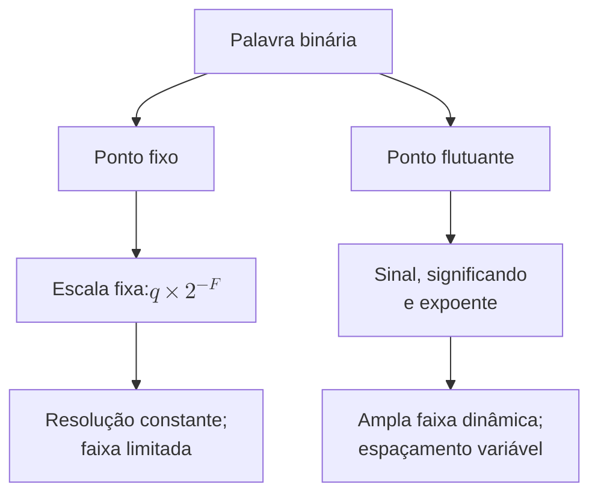
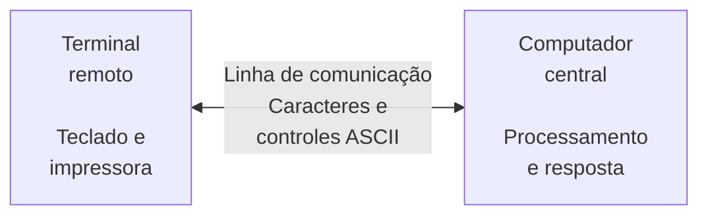

# 2. Sistemas de numeração e representação da informação

Um circuito digital manipula padrões de estados físicos aos quais atribuímos
significados por meio de convenções. Uma sequência de oito bits pode designar
uma quantidade, um número negativo, uma fração, uma letra, uma instrução ou uma
combinação de indicadores. Portanto, **informação, representação e sinal
elétrico são conceitos distintos**: o sinal transporta estados; o código
organiza esses estados; e a interpretação determina o significado.

Este capítulo desenvolve a representação posicional, as bases decimal, binária,
octal e hexadecimal, as conversões e operações aritméticas, a organização das
palavras digitais e as representações de inteiros com e sem sinal. Examina
também complementos numéricos, ponto fixo e flutuante, codificação decimal,
código Gray, caracteres ASCII e Unicode, além de princípios de detecção de
erros. Ao longo do percurso, relacionamos as escolhas matemáticas à largura de
palavra, ao transbordamento, à precisão, ao armazenamento e à implementação em
circuitos eletrônicos.

A mesma quantidade admite diferentes escritas, mas nem toda sequência de bits
corresponde a um número. Compreender essa distinção é indispensável para
interpretar dados de sensores, registradores, barramentos, memórias e
processadores, dando continuidade à
[introdução à Eletrônica Digital](introduction-to-digital-electronics.md).

## 2.1. Sistemas posicionais e bases numéricas {#sec-positional-number-systems}

Em um sistema **posicional** de base inteira $b\geq2$, utilizam-se $b$
algarismos distintos, associados aos valores $0,1,\ldots,b-1$. O valor de cada
algarismo depende de sua posição. Para um número com parte inteira e
fracionária, a expansão é

$$x_b=\sum_{i=-m}^{n}d_i b^i,\qquad 0\leq d_i<b\tag{2.1}$$

O índice $i=0$ corresponde à unidade; índices positivos indicam potências
sucessivas da base, e índices negativos indicam frações. O símbolo $x_b$
informa a base e evita ambiguidades: ${101}_2=5_{10}$, enquanto ${101}_{10}$ é
o próprio $101$. Usamos omitir o número da base quando é a base decimal.

<!-- prettier-ignore -->
::: definition Peso posicional {#def-positional-weight}

O **peso** de um algarismo $d_i$ na posição $i$ de uma representação de base
$b$ é $b^i$. Sua contribuição ao valor representado é $d_i b^i$.

:::

<!-- prettier-ignore -->
::: example Decomposição de um número posicional {#ex-positional-expansion}

A representação $2304{,}12_5$ é válida porque todos os algarismos pertencem ao
conjunto $\{0,1,2,3,4\}$. Seu valor é

$$
2\cdot5^3+3\cdot5^2+0\cdot5^1+4\cdot5^0+1\cdot5^{-1}+2\cdot5^{-2}=329{,}28_{10}\tag{2.2}
$$

Observe que a vírgula separa posições, não modifica a regra de pesos.

:::

A quantidade de representações possíveis com $N$ posições em base $b$ é $b^N$.
Isso não implica que todas representem valores distintos quando se admitem
zeros à esquerda, sinais ou formatos especiais; a afirmação pressupõe palavras
de comprimento fixo interpretadas como sequências de algarismos.

O sistema de numeração empregado cotidianamente é o **decimal**, de base dez.
Ele dispõe de dez algarismos, de $0$ a $9$, mas permite escrever quantidades
arbitrariamente grandes por meio da combinação entre algarismos e posições. A
posição imediatamente à esquerda da unidade vale dez vezes a anterior; cada
deslocamento para a esquerda multiplica o peso por dez. Assim, em $1349_{10}$,
o algarismo $3$ não representa três unidades, mas três centenas. A {@ref
fig-decimal-place-value} explicita os pesos e a decomposição do número.

$$
1349_{10}=1\cdot10^3+3\cdot10^2+4\cdot10^1+9\cdot10^0.\tag{2.3}
$$

<!-- prettier-ignore -->
::: figure Representação posicional do número decimal 1349 na base decimal {#fig-decimal-place-value}

```tikz
\begin{tikzpicture}[
    scale=1.6,
    transform shape,
    >=stealth,
    line cap=round,
    term/.style={font=\large,inner sep=0pt},
    digit/.style={font=\Large,inner sep=0pt}
]

% Coordenadas das quatro colunas
% Espaçamento reduzido de 3.0 para 2.5
\coordinate (c1) at (0,0);
\coordinate (c2) at (2.5,0);
\coordinate (c3) at (5.0,0);
\coordinate (c4) at (7.5,0);

% Tabela de potências de dez (à esquerda)
% Deslocada 0.4 unidade para a direita
\node[anchor=west,font=\large] at (-4.0,4.3) {$10^0=1$};
\node[anchor=west,font=\large] at (-4.0,3.7) {$10^1=10$};
\node[anchor=west,font=\large] at (-4.0,3.1) {$10^2=100$};
\node[anchor=west,font=\large] at (-4.0,2.5) {$10^3=1000$};
\node[anchor=west,font=\large] at (-4.0,1.9) {$10^4=10000$};
\node[anchor=west,font=\large] at (-4.0,1.3) {$10^5=100000$};

\node[font=\large] at (-3.65,0.65) {$\vdots$};
\node[font=\large] at (-2.35,0.65) {$\vdots$};

% Pesos das posições decimais
\node[font=\large] at (0,4.2) {$10^3$};
\node[font=\large] at (2.5,4.2) {$10^2$};
\node[font=\large] at (5.0,4.2) {$10^1$};
\node[font=\large] at (7.5,4.2) {$10^0$};

% Identificação dos pesos, dígitos e decomposição
\node[anchor=west,font=\large] at (9.0,4.2) {Peso};
\node[anchor=west,font=\large] at (9.0,2.4) {Dígito};
\node[anchor=west,font=\large] at (9.0,0.9) {Decomposição};

% Setas indicando os pesos
\draw[->,line width=1.2pt] (0,2.9) -- (0,3.85);
\draw[->,line width=1.2pt] (2.5,2.9) -- (2.5,3.85);
\draw[->,line width=1.2pt] (5.0,2.9) -- (5.0,3.85);
\draw[->,line width=1.2pt] (7.5,2.9) -- (7.5,3.85);

% Algarismos do número 1349 em negrito
\node[digit] (dig1) at (0,2.4) {$\mathbf{1}$};
\node[digit] (dig2) at (2.5,2.4) {$\mathbf{3}$};
\node[digit] (dig3) at (5.0,2.4) {$\mathbf{4}$};
\node[digit] (dig4) at (7.5,2.4) {$\mathbf{9}$};

% Decomposição: sinais de multiplicação centralizados
% nas mesmas colunas dos pesos e dígitos

% Termo 1
\node[term,anchor=east] at (-0.35,0.9) {$1$};
\node[term] (mul1) at (0,0.9) {$\times$};
\node[term,anchor=west] at (0.35,0.9) {$10^3$};

% Termo 2
\node[term,anchor=east] at (2.15,0.9) {$3$};
\node[term] (mul2) at (2.5,0.9) {$\times$};
\node[term,anchor=west] at (2.85,0.9) {$10^2$};

% Termo 3
\node[term,anchor=east] at (4.65,0.9) {$4$};
\node[term] (mul3) at (5.0,0.9) {$\times$};
\node[term,anchor=west] at (5.35,0.9) {$10^1$};

% Termo 4
\node[term,anchor=east] at (7.15,0.9) {$9$};
\node[term] (mul4) at (7.5,0.9) {$\times$};
\node[term,anchor=west] at (7.85,0.9) {$10^0$};

% Sinais de adição com espaçamento equilibrado
% entre os termos da decomposição
\node[term] at (1.48,0.9) {$+$};
\node[term] at (3.98,0.9) {$+$};
\node[term] at (6.48,0.9) {$+$};

% Traços verticais de associação
\draw[line width=0.9pt] (0,1.95) -- (0,1.35);
\draw[line width=0.9pt] (2.5,1.95) -- (2.5,1.35);
\draw[line width=0.9pt] (5.0,1.95) -- (5.0,1.35);
\draw[line width=0.9pt] (7.5,1.95) -- (7.5,1.35);

% Chave inferior ajustada à largura da decomposição
\draw[line width=0.9pt]
    (-0.65,0.45)
    .. controls (-0.65,0.15) and (-0.50,0.1) .. (-0.30,0.1)
    -- (3.30,0.1)
    .. controls (3.60,0.1) and (3.65,-0.2) .. (3.75,-0.35)
    .. controls (3.85,-0.2) and (3.90,0.1) .. (4.20,0.1)
    -- (8.05,0.1)
    .. controls (8.25,0.1) and (8.40,0.15) .. (8.40,0.45);

% Resultado
\node[font=\Large] at (3.75,-0.85) {$1349$};

\end{tikzpicture}
```

:::

O mecanismo posicional não depende do número dez. Se adotarmos a **base
quatro**, o conjunto de algarismos passa a ser $\{0,1,2,3\}$, e as posições,
contadas da direita para a esquerda, têm pesos $4^0$, $4^1$, $4^2$ e assim
sucessivamente. A {@ref fig-base4-place-value} mostra a representação $322_4$.
O símbolo $3$ na primeira posição à esquerda contribui com três grupos de
dezesseis, não com três centenas; o mesmo símbolo assume outro valor porque
mudou a base.

$$
{322}_4=3\cdot4^2+2\cdot4^1+2\cdot4^0={58}_{10}.\tag{2.4}
$$

A comparação evidencia duas regras gerais: **a base determina os algarismos
permitidos** e **a posição determina a potência que multiplica cada
algarismo**. Por isso, a sequência escrita como `322` não determina sozinha uma
quantidade: $322_4$ e $322_{10}$ são números distintos. Também se explica por
que o símbolo `4` não pode aparecer em uma representação válida na base quatro.

<!-- prettier-ignore -->
::: figure Representação posicional do número 322 na base 4 {#fig-base4-place-value}

```tikz
\begin{tikzpicture}[
    scale=1.6,
    transform shape,
    >=stealth,
    line cap=round,
    term/.style={font=\large,inner sep=0pt},
    digit/.style={font=\Large,inner sep=0pt}
]

% Coordenadas das três colunas
% Espaçamento reduzido de 3.0 para 2.5
\coordinate (c1) at (0,0);
\coordinate (c2) at (2.5,0);
\coordinate (c3) at (5.0,0);

% Tabela de potências de quatro (à esquerda)
% Aproximada do diagrama central
\node[anchor=west,font=\large] at (-3.8,4.3) {$4^0=1$};
\node[anchor=west,font=\large] at (-3.8,3.7) {$4^1=4$};
\node[anchor=west,font=\large] at (-3.8,3.1) {$4^2=16$};
\node[anchor=west,font=\large] at (-3.8,2.5) {$4^3=64$};
\node[anchor=west,font=\large] at (-3.8,1.9) {$4^4=256$};
\node[anchor=west,font=\large] at (-3.8,1.3) {$4^5=1024$};

\node[font=\large] at (-3.45,0.65) {$\vdots$};
\node[font=\large] at (-2.15,0.65) {$\vdots$};

% Pesos das posições na base 4
\node[font=\large] at (0,4.2) {$4^2$};
\node[font=\large] at (2.5,4.2) {$4^1$};
\node[font=\large] at (5.0,4.2) {$4^0$};

% Identificações à direita
% Deslocadas para evitar sobreposição com "=58"
\node[anchor=west,font=\large] at (7.8,4.2) {Peso};
\node[anchor=west,font=\large] at (7.8,2.4) {Dígito};
\node[anchor=west,font=\large] at (7.8,0.9) {Decomposição};

% Setas indicando os pesos
\draw[->,line width=1.2pt] (0,2.9) -- (0,3.85);
\draw[->,line width=1.2pt] (2.5,2.9) -- (2.5,3.85);
\draw[->,line width=1.2pt] (5.0,2.9) -- (5.0,3.85);

% Dígitos do número 322 na base 4
\node[digit] at (0,2.4) {$\mathbf{3}$};
\node[digit] at (2.5,2.4) {$\mathbf{2}$};
\node[digit] at (5.0,2.4) {$\mathbf{2}$};

% Decomposição em potências de quatro
% Sinais de multiplicação alinhados com pesos e dígitos

% Termo 1: 3 x 4^2
\node[term,anchor=east] at (-0.35,0.9) {$3$};
\node[term] at (0,0.9) {$\times$};
\node[term,anchor=west] at (0.35,0.9) {$4^2$};

% Termo 2: 2 x 4^1
\node[term,anchor=east] at (2.15,0.9) {$2$};
\node[term] at (2.5,0.9) {$\times$};
\node[term,anchor=west] at (2.85,0.9) {$4^1$};

% Termo 3: 2 x 4^0
\node[term,anchor=east] at (4.65,0.9) {$2$};
\node[term] at (5.0,0.9) {$\times$};
\node[term,anchor=west] at (5.35,0.9) {$4^0$};

% Sinais de adição com espaçamento equilibrado
\node[term] at (1.48,0.9) {$+$};
\node[term] at (3.98,0.9) {$+$};

% Resultado da decomposição na base decimal
\node[term,anchor=west] at (6.15,0.9) {$=58$};

% Traços verticais entre dígitos e multiplicações
\draw[line width=0.9pt] (0,1.95) -- (0,1.35);
\draw[line width=0.9pt] (2.5,1.95) -- (2.5,1.35);
\draw[line width=0.9pt] (5.0,1.95) -- (5.0,1.35);

% Chave inferior ajustada à largura dos três termos
% O extremo direito fica antes do sinal de igualdade
\draw[line width=0.9pt]
    (-0.65,0.45)
    .. controls (-0.65,0.15) and (-0.50,0.1) .. (-0.30,0.1)
    -- (2.05,0.1)
    .. controls (2.35,0.1) and (2.40,-0.2) .. (2.50,-0.35)
    .. controls (2.60,-0.2) and (2.65,0.1) .. (2.95,0.1)
    -- (5.45,0.1)
    .. controls (5.65,0.1) and (5.80,0.15) .. (5.80,0.45);

% Representação na base 4 e equivalência decimal
\node[font=\Large] at (2.5,-0.85) {$322_4=58_{10}$};

\end{tikzpicture}
```

:::

No **sistema binário**, a base é dois e existem apenas os algarismos $0$ e $1$.
Os pesos das posições passam a ser $1$, $2$, $4$, $8$, $16$, $32$ e assim por
diante. A {@ref fig-binary-place-value} representa $110101_2$, cuja
decomposição é

$$
{110101}_2=1\cdot2^5+1\cdot2^4+0\cdot2^3+1\cdot2^2+0\cdot2^1+1\cdot2^0={53}_{10}.\tag{2.5}
$$

Um dígito binário recebe o nome de **bit** (_binary digit_). A adoção do
sistema binário é particularmente adequada aos circuitos digitais porque seus
dois símbolos podem ser associados a duas classes de estados lógicos, embora os
níveis elétricos que implementam esses estados dependam da tecnologia. Isso não
significa que todo padrão de bits seja necessariamente um número: sua
interpretação continua subordinada ao formato adotado.

As duas representações anteriores apresentam a **mesma regra posicional
aplicada a duas bases diferentes**. Elas não representam o mesmo número; foram
escolhidas para tornar visível a mudança dos pesos. O princípio geral pode ser
retomado na forma $d_i b^i$, e a {@ref fig-binary-place-value} oferece um
exemplo binário, no qual somente as posições que contêm $1$ contribuem para a
soma. As questões de largura de palavra, MSB e LSB serão retomadas na {@ref
sec-bits-words-significance}.

<!-- prettier-ignore -->
::: figure Representação posicional do número binário 110101 {#fig-binary-place-value}

```tikz
\begin{tikzpicture}[
    scale=1.6,
    transform shape,
    >=stealth,
    line cap=round,
    term/.style={font=\large,inner sep=0pt},
    digit/.style={font=\Large,inner sep=0pt}
]

% Parâmetros geométricos
% Espaçamento entre colunas reduzido para 2.2
% Centros das seis colunas: 0, 2.2, 4.4, 6.6, 8.8, 11.0

% Tabela de potências de dois (à esquerda)
% Aproximada do diagrama central
\node[anchor=west,font=\large] at (-3.25,4.3) {$2^0=1$};
\node[anchor=west,font=\large] at (-3.25,3.7) {$2^1=2$};
\node[anchor=west,font=\large] at (-3.25,3.1) {$2^2=4$};
\node[anchor=west,font=\large] at (-3.25,2.5) {$2^3=8$};
\node[anchor=west,font=\large] at (-3.25,1.9) {$2^4=16$};
\node[anchor=west,font=\large] at (-3.25,1.3) {$2^5=32$};

\node[font=\large] at (-2.90,0.65) {$\vdots$};
\node[font=\large] at (-1.75,0.65) {$\vdots$};

% Pesos das seis posições binárias
\node[font=\large] at (0,4.2) {$2^5$};
\node[font=\large] at (2.2,4.2) {$2^4$};
\node[font=\large] at (4.4,4.2) {$2^3$};
\node[font=\large] at (6.6,4.2) {$2^2$};
\node[font=\large] at (8.8,4.2) {$2^1$};
\node[font=\large] at (11.0,4.2) {$2^0$};

% Identificações à direita, mais próximas do diagrama
% Mantida uma distância suficiente do resultado = 53
\node[anchor=west,font=\large] at (13.35,4.2) {Peso};
\node[anchor=west,font=\large] at (13.35,2.4) {Dígito};
\node[anchor=west,font=\large] at (13.35,0.9) {Decomposição};

% Setas indicando os pesos
\draw[->,line width=1.2pt] (0,2.9) -- (0,3.85);
\draw[->,line width=1.2pt] (2.2,2.9) -- (2.2,3.85);
\draw[->,line width=1.2pt] (4.4,2.9) -- (4.4,3.85);
\draw[->,line width=1.2pt] (6.6,2.9) -- (6.6,3.85);
\draw[->,line width=1.2pt] (8.8,2.9) -- (8.8,3.85);
\draw[->,line width=1.2pt] (11.0,2.9) -- (11.0,3.85);

% Dígitos do número binário 110101
\node[digit] at (0,2.4) {$\mathbf{1}$};
\node[digit] at (2.2,2.4) {$\mathbf{1}$};
\node[digit] at (4.4,2.4) {$\mathbf{0}$};
\node[digit] at (6.6,2.4) {$\mathbf{1}$};
\node[digit] at (8.8,2.4) {$\mathbf{0}$};
\node[digit] at (11.0,2.4) {$\mathbf{1}$};

% Decomposição em potências de dois
% Os sinais de multiplicação permanecem alinhados
% verticalmente aos dígitos e pesos.

% Termo 1: 1 x 2^5
\node[term,anchor=east] at (-0.35,0.9) {$1$};
\node[term] at (0,0.9) {$\times$};
\node[term,anchor=west] at (0.35,0.9) {$2^5$};

% Termo 2: 1 x 2^4
\node[term,anchor=east] at (1.85,0.9) {$1$};
\node[term] at (2.2,0.9) {$\times$};
\node[term,anchor=west] at (2.55,0.9) {$2^4$};

% Termo 3: 0 x 2^3
\node[term,anchor=east] at (4.05,0.9) {$0$};
\node[term] at (4.4,0.9) {$\times$};
\node[term,anchor=west] at (4.75,0.9) {$2^3$};

% Termo 4: 1 x 2^2
\node[term,anchor=east] at (6.25,0.9) {$1$};
\node[term] at (6.6,0.9) {$\times$};
\node[term,anchor=west] at (6.95,0.9) {$2^2$};

% Termo 5: 0 x 2^1
\node[term,anchor=east] at (8.45,0.9) {$0$};
\node[term] at (8.8,0.9) {$\times$};
\node[term,anchor=west] at (9.15,0.9) {$2^1$};

% Termo 6: 1 x 2^0
\node[term,anchor=east] at (10.65,0.9) {$1$};
\node[term] at (11.0,0.9) {$\times$};
\node[term,anchor=west] at (11.35,0.9) {$2^0$};

% Sinais de adição
% Centralizados nos intervalos entre os termos
\node[term] at (1.10,0.9) {$+$};
\node[term] at (3.30,0.9) {$+$};
\node[term] at (5.50,0.9) {$+$};
\node[term] at (7.70,0.9) {$+$};
\node[term] at (9.90,0.9) {$+$};

% Resultado decimal da decomposição
\node[term,anchor=west] at (12.0,0.9) {$=53$};

% Traços verticais entre dígitos e multiplicações
\draw[line width=0.9pt] (0,1.95) -- (0,1.35);
\draw[line width=0.9pt] (2.2,1.95) -- (2.2,1.35);
\draw[line width=0.9pt] (4.4,1.95) -- (4.4,1.35);
\draw[line width=0.9pt] (6.6,1.95) -- (6.6,1.35);
\draw[line width=0.9pt] (8.8,1.95) -- (8.8,1.35);
\draw[line width=0.9pt] (11.0,1.95) -- (11.0,1.35);

% Chave inferior abrangendo somente os termos da decomposição
% Extremidades ligeiramente além do primeiro e último termos
% O resultado = 53 permanece fora da chave
\draw[line width=0.9pt]
    (-0.65,0.45)
    .. controls (-0.65,0.15) and (-0.50,0.1) .. (-0.30,0.1)
    -- (5.05,0.1)
    .. controls (5.35,0.1) and (5.40,-0.2) .. (5.50,-0.35)
    .. controls (5.60,-0.2) and (5.65,0.1) .. (5.95,0.1)
    -- (11.30,0.1)
    .. controls (11.50,0.1) and (11.65,0.15) .. (11.65,0.45);

% Número binário e equivalente decimal
\node[font=\Large] at (5.50,-0.85)
    {$110101_2=53_{10}$};

\end{tikzpicture}
```

:::

## 2.2. Sistemas decimal, binário, octal e hexadecimal {#sec-decimal-binary-octal-hexadecimal}

<!-- prettier-ignore -->
O sistema decimal emprega dez algarismos; o binário, dois; o octal, oito; e o hexadecimal, dezesseis. Neste último, as letras A a F representam os valores decimais 10 a 15. A {@ref tbl-base-comparison} apresenta algumas correspondências.

<!-- prettier-ignore -->
::: table Correspondência entre representações de inteiros não negativos {#tbl-base-comparison .full-width}

| Decimal | Binário | Octal | Hexadecimal |
| ------: | ------: | ----: | ----------: |
|       0 |    0000 |     0 |           0 |
|       1 |    0001 |     1 |           1 |
|       5 |    0101 |     5 |           5 |
|       8 |    1000 |    10 |           8 |
|      10 |    1010 |    12 |           A |
|      15 |    1111 |    17 |           F |
|      16 |   10000 |    20 |          10 |
|      31 |   11111 |    37 |          1F |

:::

O octal e o hexadecimal são particularmente convenientes porque $8=2^3$ e
$16=2^4$. Assim, cada algarismo octal corresponde a **três bits**, e cada
algarismo hexadecimal, a **quatro bits**. Não se trata de uma alteração no
valor: são formas mais compactas de escrever a mesma sequência binária.

<!-- prettier-ignore -->
::: example Agrupamento de bits {#ex-bit-grouping}

Para converter ${110101101}_2$ em hexadecimal, agrupam-se os bits da direita
para a esquerda, completando o grupo mais à esquerda com zeros:
`0001 1010 1101`. Logo, ${110101101}_2={1AD}_{16}$. Para octal: `110 101 101`,
resultando em ${655}_8$.

:::

A escolha de uma base é uma convenção de representação. O hardware pode
processar bits enquanto a documentação apresenta endereços e máscaras em
hexadecimal, ou quantidades físicas em decimal.

## 2.3. Conversão entre bases {#sec-base-conversion}

<!-- prettier-ignore -->
A conversão **para decimal** consiste em aplicar os pesos posicionais da {@ref sec-positional-number-systems}. Para converter um inteiro decimal não negativo para a base $b$, realizam-se divisões sucessivas por $b$; os restos, lidos na ordem inversa à obtenção, formam os algarismos.

<!-- prettier-ignore -->
::: example Conversão de inteiro decimal para binário {#ex-decimal-to-binary}

Para representar $45_{10}$ em binário:

<!-- prettier-ignore -->
As divisões sucessivas produzem os pares quociente–resto: $45=2\cdot22+1$; $22=2\cdot11+0$; $11=2\cdot5+1$; $5=2\cdot2+1$; $2=2\cdot1+0$; $1=2\cdot0+1$. A {@ref tbl-decimal-binary-divisions} organiza o procedimento.

Lendo os restos de baixo para cima, obtém-se $45_{10}=101101_2$. A verificação
é $32+8+4+1=45$.

:::

<!-- prettier-ignore -->
::: table Divisões sucessivas de 45 por 2 {#tbl-decimal-binary-divisions .full-width}

| Dividendo | Quociente | Resto |
| --------: | --------: | :---: |
|        45 |        22 |   1   |
|        22 |        11 |   0   |
|        11 |         5 |   1   |
|         5 |         2 |   1   |
|         2 |         1 |   0   |
|         1 |         0 |   1   |

:::

<!-- prettier-ignore -->
Na {@ref tbl-decimal-binary-divisions}, a leitura dos restos **de baixo para cima** reconstrói a representação binária.

Para uma fração decimal $0\leq x<1$, multiplicações sucessivas por $b$ fornecem
os algarismos após a vírgula: em cada etapa, a parte inteira do produto é o
próximo algarismo e a parte fracionária restante é multiplicada novamente.

<!-- prettier-ignore -->
::: example Conversão de fração decimal {#ex-fraction-to-binary}

Multiplicando sucessivamente a parte fracionária por 2, obtemos
$0{,}625\cdot2=1{,}25$ (bit 1, resto $0{,}25$); $0{,}25\cdot2=0{,}5$ (bit 0,
resto $0{,}5$); e $0{,}5\cdot2=1{,}0$ (bit 1, resto zero). Portanto,
${0{,}625}_{10}={0{,}101}_2$. O procedimento termina quando o resto fracionário
se anula.

:::

<!-- prettier-ignore -->
Nem toda fração decimal possui expansão binária finita. Por exemplo, $0{,}1_{10}$ é periódico em base dois. Uma representação com número limitado de bits precisa aproximá-lo. A conversão entre octal, binário e hexadecimal pode ser realizada diretamente por agrupamento de bits, como na {@ref ex-bit-grouping}.

O procedimento de divisões sucessivas não é uma simples regra de memorização: a
cada etapa, o resto determina o algarismo de menor peso ainda não identificado.
A figura a seguir desenvolve esse procedimento para $118_{10}$, cujo resultado
é $1110110_2$.

<!-- prettier-ignore -->
::: figure Conversão de 118 decimal para binário por divisões sucessivas {#fig-decimal-to-binary-118}

```tikz
\begin{tikzpicture}[
    scale=1.6,
    transform shape,
    >=stealth,
    line cap=round,
    num/.style={font=\Large,inner sep=0pt},
    resto/.style={num,font=\Large\bfseries}
]

% Parâmetros geométricos
% Passo horizontal: 1.15
% Passo vertical:   1.10
%
% Dividendos e subtraendos alinhados pela direita.
% Subtraendos elevados em 0.35 unidade.
% Traços das subtrações elevados em 0.30 unidade.
% Restos mantidos nas posições originais.
% Cada quociente aparece uma única vez.

% Escada contínua
\draw[line width=1.1pt]
    (0,9.3) -- (0,8.2) -- (1.15,8.2)
    -- (1.15,7.1) -- (2.30,7.1)
    -- (2.30,6.0) -- (3.45,6.0)
    -- (3.45,4.9) -- (4.60,4.9)
    -- (4.60,3.8) -- (5.75,3.8)
    -- (5.75,2.7) -- (6.90,2.7)
    -- (6.90,1.6) -- (8.05,1.6);

% Primeira divisão: 118 / 2 = 59, resto 0
% Subtração afastada do segmento vertical da escada

\node[num,anchor=east] (d118) at (-0.50,8.75) {$118$};
\node[num,anchor=west] at (0.10,8.75) {$2$};

% Subtraendo
\node[num,anchor=east] at (d118.east |- 0,8.20) {$-118$};

% Quociente e divisor da próxima divisão (inalterados)
\node[num,anchor=west] (q59) at (0.10,7.65) {$59$};
\node[num,anchor=west] at (1.25,7.65) {$2$};

% Traço da subtração
\draw[line width=0.8pt] (-1.75,7.82) -- (-0.50,7.82);

% Resto
\node[resto,anchor=east] at (d118.east |- 0,7.28) {$\mathbf{0}$};

% Segunda divisão: 59 / 2 = 29, resto 1
\node[num,anchor=east] at (q59.east |- 0,7.10) {$-58$};
\node[num,anchor=west] (q29) at (1.25,6.55) {$29$};
\node[num,anchor=west] at (2.40,6.55) {$2$};

\draw[line width=0.8pt]
    ([xshift=-0.95cm]q59.east |- 0,6.72)
    -- (q59.east |- 0,6.72);
\node[resto,anchor=east] at (q59.east |- 0,6.18) {$\mathbf{1}$};

% Terceira divisão: 29 / 2 = 14, resto 1
\node[num,anchor=east] at (q29.east |- 0,6.00) {$-28$};
\node[num,anchor=west] (q14) at (2.40,5.45) {$14$};
\node[num,anchor=west] at (3.55,5.45) {$2$};

\draw[line width=0.8pt]
    ([xshift=-0.95cm]q29.east |- 0,5.62)
    -- (q29.east |- 0,5.62);
\node[resto,anchor=east] at (q29.east |- 0,5.08) {$\mathbf{1}$};

% Quarta divisão: 14 / 2 = 7, resto 0
\node[num,anchor=east] at (q14.east |- 0,4.90) {$-14$};
\node[num,anchor=west] (q7) at (3.55,4.35) {$7$};
\node[num,anchor=west] at (4.70,4.35) {$2$};

\draw[line width=0.8pt]
    ([xshift=-0.95cm]q14.east |- 0,4.52)
    -- (q14.east |- 0,4.52);
\node[resto,anchor=east] at (q14.east |- 0,3.98) {$\mathbf{0}$};

% Quinta divisão: 7 / 2 = 3, resto 1
\node[num,anchor=east] at (q7.east |- 0,3.80) {$-6$};
\node[num,anchor=west] (q3) at (4.70,3.25) {$3$};
\node[num,anchor=west] at (5.85,3.25) {$2$};

\draw[line width=0.8pt]
    ([xshift=-0.75cm]q7.east |- 0,3.42)
    -- (q7.east |- 0,3.42);
\node[resto,anchor=east] at (q7.east |- 0,2.88) {$\mathbf{1}$};

% Sexta divisão: 3 / 2 = 1, resto 1
\node[num,anchor=east] at (q3.east |- 0,2.70) {$-2$};
\node[num,anchor=west] (q1) at (5.85,2.15) {$1$};
\node[num,anchor=west] at (7.00,2.15) {$2$};

\draw[line width=0.8pt]
    ([xshift=-0.75cm]q3.east |- 0,2.32)
    -- (q3.east |- 0,2.32);
\node[resto,anchor=east] at (q3.east |- 0,1.78) {$\mathbf{1}$};

% Sétima divisão: 1 / 2 = 0, resto 1
\node[num,anchor=east] at (q1.east |- 0,1.60) {$-0$};
\node[num,anchor=west] (q0) at (7.00,1.05) {$0$};

\draw[line width=0.8pt]
    ([xshift=-0.75cm]q1.east |- 0,1.22)
    -- (q1.east |- 0,1.22);
\node[resto,anchor=east] at (q1.east |- 0,0.68) {$\mathbf{1}$};

% Seta de leitura dos restos (inalterada)
\draw[->,line width=1.2pt]
    (6.70,0.10)
    -- (5.40,0.10)
    -- (-1.65,7.05);

% Legenda (inalterada)
\node[font=\large] at (3.5,-0.45)
    {Restos lidos de baixo para cima};

% Resultado (inalterado)
\node[font=\Large] at (3.5,-1.25)
    {$118_{10}=1110110_2$};

\end{tikzpicture}
```

:::

## 2.4. Bits, palavras e significância posicional {#sec-bits-words-significance}

O **bit** é uma posição binária capaz de assumir os valores lógicos $0$ e $1$.
Uma sequência ordenada de bits forma uma palavra de largura definida. O
agrupamento de oito bits é denominado **byte**; palavras de processadores,
registradores e barramentos podem ter outras larguras. A largura não determina,
por si só, a interpretação dos dados.

Em uma palavra binária de $N$ bits, numerada da direita para a esquerda, o bit
$b_0$ ocupa a posição de peso $2^0$ e o bit $b_{N-1}$ ocupa a posição de peso
$2^{N-1}$. O primeiro é o **LSB** (_least significant bit_); o segundo é o
**MSB** (_most significant bit_). A denominação se refere à posição,
independentemente de o bit conter $0$ ou $1$.

<!-- prettier-ignore -->
::: figure Identificação dos bits mais significativo (MSB) e menos significativo (LSB) em uma palavra binária de 8 bits {#fig-msb-lsb}

```tikz
\begin{tikzpicture}[scale=2.25,transform shape,>=stealth]

  % Palavra binária de 8 bits
  \foreach \bit [count=\i from 0] in {1,0,1,1,0,1,0,1} {
    \draw[thick] (\i,0) rectangle ++(1,0.8);
    \node[font=\large] at (\i+0.5,0.4) {\bit};
  }

  % Índices dos bits
  \foreach \i in {0,...,7} {
    \pgfmathtruncatemacro{\indice}{7-\i}
    \node[above,font=\scriptsize] at (\i+0.5,0.85)
      {$b_{\indice}$};
  }

  % Indicação do MSB
  \draw[->,thick] (0.5,-1.1) -- (0.5,-0.08);
  \node[align=center,font=\small] at (0.5,-1.65)
    {MSB\\Bit mais significativo\\Peso $2^7=128$};

  % Indicação do LSB
  \draw[->,thick] (7.5,-1.1) -- (7.5,-0.08);
  \node[align=center,font=\small] at (7.5,-1.65)
    {LSB\\Bit menos significativo\\Peso $2^0=1$};

\end{tikzpicture}
```

:::

Em uma interpretação **sem sinal**, o valor é a soma dos pesos correspondentes
aos bits iguais a um:

$$
u=\sum_{i=0}^{N-1} b_i 2^i\tag{2.6}
$$

Uma palavra de $N$ bits comporta $2^N$ padrões, e o maior inteiro sem sinal é
$2^N-1$. Em uma palavra de oito bits, por exemplo, a faixa é de $0$ a $255$.

Convém distinguir **ordem de significância dos bits** de **ordem de
armazenamento dos bytes** (_endianness_). Em uma palavra de múltiplos bytes, a
convenção _big-endian_ armazena primeiro o byte mais significativo; a
_little-endian_, o menos significativo. Isso não inverte os pesos dos bits nem
altera o valor matemático da palavra: muda a disposição de seus bytes na
memória ou na transmissão.

### 2.4.1. Palavra de máquina e módulo de operação

Uma **palavra de máquina** é um conjunto de posições digitais tratado como
unidade de armazenamento, transferência ou operação por determinado subsistema.
Sua largura é uma característica do formato e da arquitetura: pode coincidir
com a largura de um registrador, de um operando ou de uma unidade aritmética,
mas essas grandezas não precisam ser iguais. A palavra, portanto, estabelece
quantos padrões distintos estão disponíveis, e não o significado desses
padrões.

O texto histórico _Representação de números em processadores_ emprega a
expressão **módulo de operação de uma máquina** para designar o maior número
representável sem sinal, acrescido de uma unidade, quando se opera com um
conjunto fixo de algarismos. Em notação atual, para $n$ posições de uma base
$b$, esse módulo é

$$
M=b^n.\tag{2.7}
$$

O maior valor sem sinal é $M-1$. A operação de largura fixa retém somente a
classe de congruência do resultado módulo $M$:

$$
R=(a\mathbin{\circ}c)\bmod M,\tag{2.8}
$$

em que $\circ$ representa uma operação aritmética implementada pelo circuito.
Em um contador decimal de três algarismos, $M=10^3=1000$; em um registrador
binário de oito bits, $M=2^8=256$. Assim, incrementar `999` em um contador
decimal de três posições produz `000`, e incrementar `1111 1111` em um contador
binário de oito bits produz `0000 0000`, desde que se descarte o transporte de
saída.

<!-- prettier-ignore -->
::: figure Retorno ao zero em contadores de largura fixa {#fig-modular-counter-wrap}

```tikz
\begin{tikzpicture}[
    scale=2.25,
    transform shape,
    >=stealth,
    line cap=round,
    line join=round,
    every node/.style={font=\large}
]

% Margens explícitas para evitar recorte pelo TikZJax
\path[use as bounding box] (-0.5,-0.8) rectangle (9.5,2.8);

% Contador decimal de três algarismos
\draw[line width=1.4pt,rounded corners=0.12cm]
    (0.8,1.4) rectangle (3.2,2.2);

\node at (2,1.8) {\texttt{999}};

\draw[line width=1.4pt,rounded corners=0.12cm]
    (5.8,1.4) rectangle (8.2,2.2);

\node at (7,1.8) {\texttt{000}};

\draw[->,line width=1.4pt]
    (3.2,1.8) -- node[above,align=center]
    {$+1$\\$M=1000$} (5.8,1.8);

% Contador binário de oito bits
\draw[line width=1.4pt,rounded corners=0.12cm]
    (0.8,-0.4) rectangle (3.2,0.4);

\node at (2,0) {\texttt{1111 1111}};

\draw[line width=1.4pt,rounded corners=0.12cm]
    (5.8,-0.4) rectangle (8.2,0.4);

\node at (7,0) {\texttt{0000 0000}};

\draw[->,line width=1.4pt]
    (3.2,0) -- node[above,align=center]
    {$+1$\\$M=256$} (5.8,0);

\end{tikzpicture}
```

:::

A expressão **módulo de operação** não deve ser confundida com o _módulo_ ou
valor absoluto de um número negativo. Também é necessário distinguir a
capacidade combinatória da palavra ($b^n$ padrões) da faixa de inteiros
interpretáveis: quando se reserva informação para sinal, escala ou códigos
especiais, a interpretação dos padrões muda. A relação com os complementos será
desenvolvida na {@ref sec-ones-twos-complement}.

## 2.5. Aritmética binária {#sec-binary-arithmetic}

As operações binárias seguem os mesmos princípios posicionais da aritmética
decimal. Na adição, $1+1=10_2$: escreve-se 0 na posição atual e transporta-se 1
para a próxima. Na subtração, pode ser necessário tomar emprestada uma unidade
da posição imediatamente superior, equivalente a duas unidades da posição
corrente.

<!-- prettier-ignore -->
::: table Regras elementares de adição binária {#tbl-binary-addition .full-width}

| $a$ | $b$ | Soma | Transporte |
| :-: | :-: | :--: | :--------: |
|  0  |  0  |  0   |     0      |
|  0  |  1  |  1   |     0      |
|  1  |  0  |  1   |     0      |
|  1  |  1  |  0   |     1      |

:::

<!-- prettier-ignore -->
::: example Adição e multiplicação binárias {#ex-binary-arithmetic}

A adição ${1011}_2+{0110}_2$ produz ${10001}_2$, isto é, $11+6=17$. Na
multiplicação, cada bit 1 do multiplicador gera uma cópia deslocada do
multiplicando; cada bit 0 gera uma parcela nula. Assim,
${101}_2\times{11}_2={1111}_2$, ou $5\times3=15$.

:::

<!-- prettier-ignore -->
A {@ref fig-binary-addition-carries} explicita os transportes da soma apresentada no exemplo. Cada coluna é processada da direita para a esquerda.

<!-- prettier-ignore -->
::: figure Adição binária com indicação dos transportes entre colunas {#fig-binary-addition-carries}

```tikz
\begin{tikzpicture}[scale=2.5,transform shape]
\node[anchor=east] at (-0.25,1.4) {Transporte};
\node[anchor=east] at (-0.25,0.65) {Parcelas};
\node[anchor=east] at (-0.25,-0.25) {Resultado};
\foreach \x/\carry/\a/\b/\result in {0/1/0/0/1,1/1/1/0/0,2/1/0/1/0,3/0/1/1/0,4/0/1/0/1}{
  \node at (\x*0.85+0.4,1.4) {\scriptsize \carry};
  \node at (\x*0.85+0.4,0.8) {\a};
  \node at (\x*0.85+0.4,0.3) {\b};
  \node at (\x*0.85+0.4,-0.45) {\result};
}
\draw[thick] (0,-0.02)--(4.2,-0.02);
\node[anchor=west] at (4.55,0.8) {$01011_2$};
\node[anchor=west] at (4.55,0.3) {$00110_2$};
\node[anchor=west] at (4.55,-0.45) {$10001_2$};
\end{tikzpicture}
```

:::

A divisão binária pode ser feita por subtrações e deslocamentos sucessivos. Em
circuitos reais, somadores, subtratores e multiplicadores são implementados com
redes lógicas e elementos de armazenamento; essas arquiteturas serão examinadas
no Capítulo 8, dedicado aos circuitos aritméticos digitais.

<!-- prettier-ignore -->
Uma operação aritmética em palavra de largura fixa deve ser distinguida da operação sobre inteiros matemáticos sem limite de magnitude. Em uma palavra de $N$ bits, uma soma pode produzir um transporte além do bit mais significativo. O significado desse transporte depende da interpretação adotada, como veremos na {@ref sec-signed-unsigned-numbers}.

## 2.6. Complemento de um e complemento de dois {#sec-ones-twos-complement}

### 2.6.1. Complementos em uma base arbitrária

Os complementos são uma consequência direta da aritmética modular introduzida
na {@ref sec-bits-words-significance}. Fixadas a base $b$ e a largura $n$, o
módulo de operação é $M=b^n$. Para $0<x<M$, o **complemento à base** é o
representante de $-x$ módulo $M$:

$$
C_b(x)=M-x=b^n-x.\tag{2.9}
$$

O **complemento à base diminuída de uma unidade** é

$$
C_{b-1}(x)=M-1-x=b^n-1-x.\tag{2.10}
$$

No caso decimal, são respectivamente os complementos de dez e de nove; no caso
binário, os complementos de dois e de um. O complemento à base do zero, como
_palavra de largura fixa_, é `00…0`, porque $M\equiv0\pmod M$. Para $x>0$, as
duas definições estão relacionadas por

$$
C_b(x)=C_{b-1}(x)+1.\tag{2.11}
$$

Essas definições tornam explícito por que não se pode calcular um complemento
sem especificar a largura: o complemento de dez de $27$ é $73$ em duas
posições, mas $973$ em três posições.

#### 2.6.1.1. Propriedade de involução

Complementar duas vezes restitui a palavra original. Para o complemento à base,
a identidade é entendida módulo $M$:

$$
C_b(C_b(x))\equiv M-(M-x)\equiv x\pmod M.\tag{2.12}
$$

Para o complemento à base diminuída de uma unidade, a igualdade é direta:

$$
C_{b-1}(C_{b-1}(x))=M-1-(M-1-x)=x.\tag{2.13}
$$

A segunda expressão também mostra que a soma de um número com seu complemento à
base diminuída de uma unidade forma uma palavra com todos os algarismos iguais
a $b-1$:

$$
x+C_{b-1}(x)=b^n-1=\underbrace{(b-1)(b-1)\cdots(b-1)}_{n\text{ algarismos}}{}_b.\tag{2.14}
$$

A obtenção desse complemento é particularmente simples: substitui-se cada
algarismo $d$ por $b-1-d$. Na base dez, $408$ torna-se $591$; na base dois,
basta inverter cada bit. Já o complemento à base é obtido acrescentando uma
unidade ao complemento anterior.

#### 2.6.1.2. Por que a subtração pode ser feita por adição

Em uma unidade aritmética que descarta o transporte além de $n$ posições, a
identidade fundamental é

$$
a-c\equiv a+(M-c)\equiv a+C_b(c)\pmod M.\tag{2.15}
$$

A vantagem de implementação é significativa: um circuito somador, associado à
lógica de complementação, pode realizar também subtrações. Entretanto, o padrão
obtido precisa ser interpretado de acordo com o formato adotado. Um resultado
modular que parece grande na leitura sem sinal pode codificar um valor
negativo; a presença ou ausência de transporte de saída, por si só, não resolve
todos os casos de transbordamento com sinal.

<!-- prettier-ignore -->
::: example Subtração decimal por complemento de dez {#ex-decimal-ten-complement}

Considere um contador decimal de três dígitos, portanto módulo $1000$. Para
calcular $745-481$, somamos o complemento de dez de $481$:

$$
C_{10}(481)=1000-481=519\tag{2.16}
$$

$$
745+519=1264\equiv264\pmod{1000}\tag{2.17}
$$

O milhar excedente é descartado e o resultado armazenado é $264$. Esse exemplo
histórico ilustra por que a aritmética modular é apropriada a contadores e
registradores de largura fixa.

:::

<!-- prettier-ignore -->
::: example Resultado negativo em um contador decimal de três posições {#ex-negative-decimal-complement}

Considere $513-897=-384$. O complemento de dez de $897$ em três posições é
$103$. Somando-o a $513$, obtém-se $616$, sem transporte além da terceira
posição:

$$
513+C_{10}(897)=513+103=616.\tag{2.18}
$$

O resultado `616` não significa que a diferença matemática seja positiva. É a
**codificação modular** de $-384$, pois $616=1000-384$. Ao complementar
novamente `616`, recuperamos a magnitude $384$. O mesmo circuito executou a
operação sem precisar trocar a ordem dos operandos.

:::

#### 2.6.1.3. Complementos de números fracionários

O princípio também vale para uma palavra que contém $n$ algarismos inteiros e
$m$ algarismos fracionários, com a posição da vírgula previamente estabelecida.
A resolução é $\delta=b^{-m}$, e o maior padrão representável vale
$b^n-\delta$. Para um número positivo $x$ que caiba no formato, o complemento à
base diminuída de uma unidade generaliza-se como

$$
C_{b-1}(x)=b^n-b^{-m}-x.\tag{2.19}
$$

O complemento à base é $C_b(x)=b^n-x$, interpretado com a mesma largura e
escala. Em base dois, com quatro posições inteiras e três fracionárias, por
exemplo, a inversão de `0011,011` resulta em `1100,100`; adicionar o incremento
mínimo `0,001` produz `1100,101`. A posição da vírgula não participa da
inversão: ela determina a escala do incremento.

O complemento à base diminuída de uma unidade pode ser calculado algarismo a
algarismo: na base dez, cada dígito $d$ torna-se $9-d$; na base dois, cada bit
é invertido. A soma de uma palavra com seu complemento de um produz uma palavra
formada exclusivamente por bits iguais a um. A representação em complemento de
um admite dois zeros, ao contrário do complemento de dois.

Para uma palavra binária de $N$ bits, o **complemento de um** é obtido
invertendo cada bit: 0 torna-se 1 e 1 torna-se 0. Se $u$ é o valor sem sinal da
palavra, o complemento de um tem valor $2^N-1-u$.

O **complemento de dois** é obtido somando uma unidade ao complemento de um e
descartando eventual transporte além da largura da palavra:

$$
C_2(u)\equiv 2^N-u\pmod{2^N}\tag{2.20}
$$

<!-- prettier-ignore -->
::: example Complementos em oito bits {#ex-complements}

Para `0000 1101` (13 em decimal):

- Complemento de um: `1111 0010`.
- Complemento de dois: `1111 0011`.

Interpretada como inteiro **com sinal em complemento de dois**, a segunda
palavra representa $-13$. Interpretada como inteiro **sem sinal**, a mesma
palavra representa 243. A interpretação é parte indispensável da especificação.

:::

<!-- prettier-ignore -->
A {@ref fig-twos-complement-steps} apresenta as duas operações aplicadas a uma palavra de oito bits. A largura permanece constante em todas as etapas.

<!-- prettier-ignore -->
::: figure Obtenção do complemento de dois por inversão dos bits e adição de uma unidade {#fig-twos-complement-steps}

```tikz
\begin{tikzpicture}[
    scale=2.25,
    transform shape,
    >=stealth,
    line cap=round,
    line join=round,
    every node/.style={font=\large}
]

% Margem de segurança para evitar recortes
\path[use as bounding box]
    (-0.5,-0.8) rectangle (8.5,3.2);

% Primeiro valor: representação positiva
\draw[line width=1.4pt,rounded corners=0.12cm]
    (0.8,2.1) rectangle (4.4,2.8);

\node at (2.6,2.45) {\texttt{0000 1101}};

\node[anchor=west] at (5.0,2.45) {inverter bits};

% Primeira transformação: complemento de um
\draw[->,line width=1.4pt]
    (2.6,2.1) -- (2.6,1.55);

% Segundo valor: bits invertidos
\draw[line width=1.4pt,rounded corners=0.12cm]
    (0.8,0.85) rectangle (4.4,1.55);

\node at (2.6,1.20) {\texttt{1111 0010}};

\node[anchor=west] at (5.0,1.20) {somar 1};

% Segunda transformação: complemento de dois
\draw[->,line width=1.4pt]
    (2.6,0.85) -- (2.6,0.30);

% Terceiro valor: resultado final
\draw[line width=1.4pt,rounded corners=0.12cm]
    (0.8,-0.40) rectangle (4.4,0.30);

\node at (2.6,-0.05) {\texttt{1111 0011}};

\end{tikzpicture}
```

:::

O complemento de dois simplifica a implementação da subtração porque, em
aritmética de $N$ bits,

$$
a-b\equiv a+C_2(b)\pmod{2^N}\tag{2.21}
$$

O complemento de um também foi empregado historicamente para representar
números negativos, mas possui duas representações de zero (`000…0` e `111…1`).
No complemento de dois, existe apenas uma representação de zero; em
contrapartida, o intervalo negativo contém um valor a mais que o positivo.

## 2.7. Números com e sem sinal {#sec-signed-unsigned-numbers}

### 2.7.1. Sinal e magnitude, complemento de um e complemento de dois

A representação **sinal e magnitude** reserva um bit para indicar o sinal e usa
os demais para a magnitude. Em uma palavra de 16 bits, $-499$ pode ser escrito
como `1000 0001 1111 0011` nessa convenção. Já o complemento de um inverte os
16 bits da representação de $+499$; o complemento de dois acrescenta uma
unidade ao resultado. As três codificações não são intercambiáveis: o hardware
e o software precisam concordar sobre a convenção.

<!-- prettier-ignore -->
::: table Comparação das representações de menos 499 em 16 bits {#tbl-negative-499 .full-width}

| Convenção           |  Palavra de 16 bits   |
| :------------------ | :-------------------: |
| Sinal e magnitude   | `1000 0001 1111 0011` |
| Complemento de um   | `1111 1110 0000 1100` |
| Complemento de dois | `1111 1110 0000 1101` |

:::

<!-- prettier-ignore -->
::: example Três maneiras de codificar o mesmo número negativo {#ex-negative-356-encodings}

Em uma palavra de 16 bits, $356_{10}=0000\ 0001\ 0110\ 0100_2$. Para
representar $-356$, o formato de sinal e magnitude marca o primeiro bit,
enquanto os formatos por complemento operam sobre a palavra inteira:

| Representação       |   Padrão de 16 bits   |
| :------------------ | :-------------------: |
| Sinal e magnitude   | `1000 0001 0110 0100` |
| Complemento de um   | `1111 1110 1001 1011` |
| Complemento de dois | `1111 1110 1001 1100` |

No complemento de dois, a verificação pode ser feita pela soma modular:
$356+65180=65536\equiv0\pmod{65536}$. Portanto, `1111 1110 1001 1100` é a
codificação de $-356$ nesse formato.

:::

Em sinal e magnitude e em complemento de um existem padrões distintos para $+0$
e $-0$. No complemento de dois, há apenas um zero, e a representação do valor
negativo de maior magnitude não possui correspondente positivo dentro da mesma
largura. Por exemplo, em oito bits, $-128$ é representável, mas $+128$ não é.

Uma palavra de $N$ bits admite $2^N$ padrões distintos. Na interpretação **sem
sinal**, esses padrões representam os inteiros de $0$ a $2^N-1$. Na
interpretação **com sinal em complemento de dois**, representam os inteiros de
$-2^{N-1}$ a $2^{N-1}-1$.

Para bits $b_{N-1}\ldots b_1b_0$, a interpretação em complemento de dois é

$$
x=-b_{N-1}2^{N-1}+\sum_{i=0}^{N-2}b_i2^i\tag{2.22}
$$

O bit mais significativo tem peso negativo nessa interpretação, não porque a
tensão associada a ele seja negativa, mas por uma convenção matemática de
codificação.

<!-- prettier-ignore -->
::: table Interpretações de palavras de quatro bits {#tbl-signed-unsigned .full-width}

|  Bits  | Sem sinal | Complemento de dois |
| :----: | --------: | ------------------: |
| `0000` |         0 |                   0 |
| `0111` |         7 |                   7 |
| `1000` |         8 |                  −8 |
| `1101` |        13 |                  −3 |
| `1111` |        15 |                  −1 |

:::

<!-- prettier-ignore -->
A {@ref fig-word-interpretation} mostra que os mesmos quatro bits podem designar valores diferentes. O circuito não precisa alterar os níveis elétricos para que a interpretação numérica mude.

<!-- prettier-ignore -->
::: figure Interpretação de uma mesma palavra binária com e sem sinal {#fig-word-interpretation}

```tikz
\begin{tikzpicture}[
    scale=2.025,
    transform shape,
    >=stealth,
    line cap=round,
    line join=round,
    every node/.style={font=\large}
]

% Margem de segurança
\path[use as bounding box]
    (0,0) rectangle (14.5,4.5);

% Bloco superior: centralizado no conjunto
\draw[line width=1.4pt,rounded corners=0.12cm]
    (6.35,3.1) rectangle (8.15,3.9);

\node at (7.25,3.5) {\texttt{1101}};

% Bloco inferior esquerdo: largura 6
\draw[line width=1.4pt,rounded corners=0.12cm]
    (0.5,0.7) rectangle (6.5,1.5);

\node at (3.5,1.1) {Sem sinal: $13$};

% Bloco inferior direito: largura 6
\draw[line width=1.4pt,rounded corners=0.12cm]
    (8.0,0.7) rectangle (14.0,1.5);

\node at (11.0,1.1) {Complemento de dois: $-3$};

% Setas de interpretação
\draw[->,line width=1.4pt]
    (7.25,3.1) -- (3.5,1.5);

\draw[->,line width=1.4pt]
    (7.25,3.1) -- (11.0,1.5);

\end{tikzpicture}
```

:::

Uma soma de largura fixa é executada módulo $2^N$. **Transporte de saída** e
**transbordamento com sinal** não são equivalentes. Em complemento de dois,
ocorre transbordamento quando dois operandos de mesmo sinal produzem resultado
de sinal oposto, considerando a largura fixa.

<!-- prettier-ignore -->
::: example Transbordamento em quatro bits {#ex-signed-overflow}

`0111 + 0011 = 1010` em quatro bits. Como inteiros sem sinal, $7+3=10$ e não há
transbordamento sem sinal. Como inteiros em complemento de dois, o resultado
codifica $-6$, embora $7+3=10$ esteja fora da faixa $[-8,7]$: ocorreu
transbordamento com sinal.

:::

Ao aumentar a largura de uma palavra sem sinal, acrescentam-se zeros à esquerda
(**extensão por zeros**). Para um número em complemento de dois, replica-se o
bit de sinal (**extensão de sinal**). Essas operações preservam o valor
representado quando realizadas corretamente.

## 2.8. Ponto fixo e introdução à representação em ponto flutuante {#sec-fixed-floating-point}

Os números inteiros não são suficientes para expressar todas as medidas e
cálculos. Uma representação em **ponto fixo** associa uma escala conhecida a
uma palavra inteira. Se a palavra armazena o inteiro $q$ e há $F$ posições
fracionárias binárias, o valor representado é

$$
x=q\,2^{-F}\tag{2.23}
$$

A escolha de $F$ determina o espaçamento entre valores consecutivos,
$\Delta=2^{-F}$, enquanto a largura total e o formato com ou sem sinal
determinam a faixa de representação.

<!-- prettier-ignore -->
::: example Representação de ponto fixo {#ex-fixed-point}

Uma palavra de oito bits, interpretada **sem sinal** e com quatro bits
fracionários, contém `0011 1010`. O inteiro armazenado é $58$; portanto, o
valor é $58/16=3{,}625$. O passo é $1/16=0{,}0625$ e o maior valor
representável é $255/16=15{,}9375$.

:::

<!-- prettier-ignore -->
Em um formato sem sinal de oito bits com quatro posições fracionárias, a vírgula binária é uma **convenção de escala**, não um bit adicional. A {@ref fig-fixed-point-bit-fields} ilustra a leitura da palavra do exemplo.

<!-- prettier-ignore -->
::: figure Distribuição dos bits em um formato ilustrativo de ponto fixo com quatro bits fracionários {#fig-fixed-point-bit-fields}

```tikz
\begin{tikzpicture}[scale=2.6, transform shape]

% Oito bits, distribuídos em células contíguas.
\foreach \x/\bit in {0/0,1/0,2/1,3/1,4/1,5/0,6/1,7/0}{
  \draw[thick] (\x*0.8,0) rectangle ++(0.8,0.85);
  \node at (\x*0.8+0.4,0.425) {\bit};
}

% Separador entre os quatro bits inteiros e os quatro fracionários.
\draw[very thick,dashed] (3.2,-0.15)--(3.2,1.0);

% Indicação dos dois grupos de quatro bits.
\draw[<->] (0,-0.35)--(3.2,-0.35);
\draw[<->] (3.2,-0.35)--(6.4,-0.35);

\node at (1.6,-0.73) {parte inteira};
\node at (4.8,-0.73) {parte fracionária};

% Valor representado.
\node at (3.2,-1.4) {$0011{,}1010_2=3{,}625_{10}$};

\end{tikzpicture}
```

:::

A representação em **ponto flutuante** utiliza um significando e um expoente
para abranger magnitudes muito diferentes. Em termos conceituais,

$$
x=(-1)^s\,m\,2^e,\tag{2.24}
$$

em que $s$ indica o sinal, $m$ é o significando e $e$ é o expoente. Formatos
padronizados, como os da família IEEE 754, definem precisamente os campos, a
polarização do expoente, os valores subnormais, os infinitos e os valores NaN.
A expressão acima é um modelo conceitual, não a descrição completa da
codificação IEEE 754.

<!-- prettier-ignore -->
::: figure Comparação conceitual entre formatos de ponto fixo e ponto flutuante {#fig-number-formats}



:::

Nem toda quantidade real é exatamente representável em um formato finito. Além
dos limites de faixa, há erros de arredondamento. Em particular, resultados que
parecem simples em decimal podem não ter representação binária exata. A escolha
entre ponto fixo e flutuante envolve precisão, faixa dinâmica, custo de
hardware, consumo e requisitos de aplicação.

### 2.8.1. Escala, quantização e faixa dinâmica

Em um formato fixo com $F$ bits fracionários, a resolução entre valores
adjacentes é $\Delta=2^{-F}$, desde que a escala seja unitária. O
arredondamento para a grade representável introduz erro de quantização; quando
realizado ao valor mais próximo, o erro absoluto ideal é limitado por
$\Delta/2$, na ausência de saturação ou transbordamento. Um aumento de $F$
melhora a resolução, mas reduz a faixa de valores inteiros para uma largura
total constante.

### 2.8.2. Representação em ponto flutuante

O ponto flutuante expressa um número por sinal, significando e expoente, com
uma escala que varia conforme a magnitude. Em termos gerais,

$$
x=(-1)^s\,m\,\beta^e,\tag{2.25}
$$

em que $s$ é o bit de sinal, $m$ é o significando, $\beta$ é a base do sistema
e $e$ é o expoente. A fonte histórica fornecida utiliza a expressão
**mantissa**; em descrições modernas, prefere-se frequentemente
**significando**, para evitar ambiguidades terminológicas.

Na representação normalizada binária usual, o significando de um número finito
não nulo possui dígito inicial igual a um, salvo nas representações subnormais.
O padrão IEEE 754 define formatos, arredondamentos e casos especiais, como
infinitos e NaNs. O ponto flutuante amplia a faixa dinâmica, mas não torna
exatas todas as frações decimais: por exemplo, $0{,}1_{10}$ não possui expansão
binária finita.

<!-- prettier-ignore -->
::: table Comparação conceitual entre ponto fixo e ponto flutuante {#tbl-fixed-floating-comparison .full-width}

| Critério               | Ponto fixo                                   | Ponto flutuante                                        |
| :--------------------- | :------------------------------------------- | :----------------------------------------------------- |
| Escala                 | Definida externamente ou pelo formato        | Determinada pelo expoente                              |
| Resolução absoluta     | Tipicamente constante                        | Varia com a magnitude                                  |
| Faixa dinâmica         | Limitada pela escala e largura               | Ampla, para uma mesma largura                          |
| Erros de representação | Quantização e transbordamento                | Arredondamento, subfluxo e transbordamento             |
| Aplicações             | Controle, DSP embarcado, valores escalonados | Cálculo científico, simulação e processamento numérico |

:::

### 2.8.3. Precisão e alcance: um exemplo de palavra de 20 bits

A fonte histórica propõe dividir uma palavra de 20 bits em um campo de 6 bits
para o expoente (incluindo o sinal) e outro de 14 bits para a mantissa
(incluindo o sinal). Esse **formato didático não é IEEE 754**; sua utilidade
está em explicitar a troca entre precisão e alcance. Admitindo um expoente
inteiro de $-31$ a $+31$ e uma mantissa fracionária normalizada com 13 bits de
magnitude, os valores positivos normalizados obedecem, aproximadamente, a

$$
2^{-1}2^{-31}\leq x\leq (1-2^{-13})2^{31}.\tag{2.26}
$$

A menor magnitude normalizada é $2^{-32}$; a maior é $2\,147\,221\,504$. A
precisão relativa depende principalmente dos bits de significando, enquanto a
faixa dinâmica depende principalmente do campo de expoente. Esses limites não
incluem zero, eventuais representações especiais ou números subnormais, que
precisariam de regras adicionais.

É possível escolher uma base de escala diferente de dois. Se $\beta=16$,
incrementar o expoente em uma unidade multiplica a escala por dezesseis,
equivalendo a um deslocamento de quatro posições binárias. Para o mesmo
intervalo de expoentes, isso aumenta a faixa de magnitudes, mas altera a
distribuição dos valores representáveis e pode prejudicar a precisão relativa
em certas regiões. **A base do expoente, a base em que os algarismos são
armazenados e a escala da mantissa são decisões distintas de projeto.**

<!-- prettier-ignore -->
::: table Influência dos campos de uma representação em ponto flutuante {#tbl-floating-fields-tradeoffs .full-width}

| Decisão de projeto                   | Principal consequência                                                         |
| :----------------------------------- | :----------------------------------------------------------------------------- |
| Mais bits de significando            | Menor espaçamento relativo entre números próximos                              |
| Mais bits de expoente                | Maior faixa de magnitudes                                                      |
| Base de escala maior                 | Maior variação de escala por unidade do expoente                               |
| Normalização                         | Elimina representações redundantes de valores não nulos no formato considerado |
| Regras para zero e valores especiais | Definem o comportamento em casos que a expressão $m\beta^e$ não especifica     |

:::

## 2.9. Códigos BCD, Gray e códigos alfanuméricos {#sec-bcd-gray-alphanumeric}

### 2.9.1. Da representação numérica à codificação decimal

A representação posicional binária e a **codificação decimal em binário**
resolvem problemas distintos. Na primeira, converte-se o _valor inteiro_ para
uma soma de potências de dois. Na segunda, preserva-se a escrita decimal por
posições e codifica-se **cada algarismo decimal separadamente**. A família de
códigos denominada **BCD** (_Binary-Coded Decimal_, ou decimal codificado em
binário) realiza essa segunda operação. No formato natural mais comum, chamado
**BCD 8421**, cada algarismo decimal ocupa quatro bits.

Considere o valor decimal $59$. Em binário natural, sua representação é
$111011_2$, porque $59=32+16+8+2+1$. Em BCD 8421, separam-se os algarismos $5$
e $9$: $5\mapsto0101$ e $9\mapsto1001$. A palavra codificada é `0101 1001`.
Embora essa sequência tenha oito bits, **não deve ser interpretada como um
inteiro binário natural**; fazê-lo produziria o valor decimal $89$, não $59$. A
{@ref tbl-binary-bcd-comparison} mostra outras correspondências.

<!-- prettier-ignore -->
::: table Comparação entre representação binária natural e código BCD 8421 {#tbl-binary-bcd-comparison .full-width}

| Valor decimal | Binário natural |  BCD 8421   |
| :-----------: | :-------------: | :---------: |
|       9       |     `1001`      |   `1001`    |
|      12       |     `1100`      | `0001 0010` |
|      47       |    `101111`     | `0100 0111` |
|      59       |    `111011`     | `0101 1001` |

:::

O peso dos quatro bits de **cada grupo** BCD 8421 é, da esquerda para a
direita, $8$, $4$, $2$ e $1$. Entretanto, o peso de um _grupo_ completo no
número codificado é decimal: unidades, dezenas, centenas e assim
sucessivamente. Se $d_j$ é o valor decimal decodificado do grupo $j$, então

$$
N=\sum_{j=0}^{k-1}d_j10^j,\qquad d_j\in\{0,1,\ldots,9\}\tag{2.27}
$$

Essa expressão mostra que o BCD é uma **codificação de algarismos decimais**,
não uma nova base posicional. A base do número representado permanece dez; os
bits apenas materializam cada algarismo.

### 2.9.2. Código BCD 8421 e combinações inválidas

Quatro bits permitem $2^4=16$ padrões, mas o sistema decimal possui apenas dez
algarismos. Consequentemente, os códigos de `0000` a `1001` representam os
algarismos de $0$ a $9$, enquanto `1010`, `1011`, `1100`, `1101`, `1110` e
`1111` não são algarismos válidos em BCD 8421. Esses seis padrões podem
sinalizar uma condição inválida, mas sua simples ausência **não constitui um
mecanismo completo de detecção de erros**: uma alteração de bits pode
transformar um dígito válido em outro igualmente válido.

<!-- prettier-ignore -->
::: table Algarismos decimais em BCD 8421 e excesso de três {#tbl-bcd-excess-three .full-width}

| Decimal | BCD 8421 | Excesso de três |
| ------: | :------: | :-------------: |
|       0 |   0000   |      0011       |
|       1 |   0001   |      0100       |
|       2 |   0010   |      0101       |
|       3 |   0011   |      0110       |
|       4 |   0100   |      0111       |
|       5 |   0101   |      1000       |
|       6 |   0110   |      1001       |
|       7 |   0111   |      1010       |
|       8 |   1000   |      1011       |
|       9 |   1001   |      1100       |

:::

Observe que a terceira coluna da {@ref tbl-bcd-excess-three} apresenta **outro
código decimal**, não uma variante da escrita binária natural. O excesso de
três será discutido adiante.

### 2.9.3. BCD empacotado, desempacotado e decimal zonado

O formato BCD 8421 pode ser organizado de maneiras diferentes na memória. Em
**BCD empacotado** (_packed BCD_), cada grupo de quatro bits (_nibble_)
armazena um algarismo, de modo que um byte pode conter dois algarismos
decimais. Em **BCD desempacotado** (_unpacked BCD_), cada algarismo ocupa
normalmente um byte, e os quatro bits superiores podem ser preenchidos ou
reservados segundo a convenção da máquina. No **decimal zonado** (_zoned
decimal_), esses bits superiores formam uma zona associada à codificação de
caracteres ou à indicação de sinal, conforme o sistema.

Por exemplo, o número decimal $93$ pode ser representado como `1001 0011` em um
byte BCD empacotado, ou como os dois bytes `0000 1001` e `0000 0011` em uma
convenção simples de BCD desempacotado. Em formatos empacotados que incluem um
**nibble de sinal**, a distribuição dos algarismos e o preenchimento dependem
da convenção utilizada; portanto, não se deve presumir que toda sequência de
BCD empacotado seja exclusivamente composta de pares de algarismos.

<!-- prettier-ignore -->
::: figure Comparação entre codificação binária natural e BCD 8421 para o número decimal 93 {#fig-bcd-versus-binary}

```tikz
\begin{tikzpicture}[scale=2.5,transform shape]
  \node[anchor=east,font=\small] at (-0.2,1.5) {Binário natural};
  \node[anchor=east,font=\small] at (-0.2,0) {BCD 8421};
  \foreach \x/\bit in {0/0,1/1,2/0,3/1,4/1,5/1,6/0,7/1}{
    \draw[thick] (\x*0.72,1.1) rectangle ++(0.72,0.75);
    \node at (\x*0.72+0.36,1.475) {\bit};
  }
  \foreach \x/\bit in {0/1,1/0,2/0,3/1,4/0,5/0,6/1,7/1}{
    \draw[thick] (\x*0.72,-0.4) rectangle ++(0.72,0.75);
    \node at (\x*0.72+0.36,-0.025) {\bit};
  }
  \draw[very thick] (2.88,-0.4)--(2.88,0.35);
  \node[below,font=\scriptsize] at (1.44,-0.48) {Algarismo 9};
  \node[below,font=\scriptsize] at (4.32,-0.48) {Algarismo 3};
  \node[above,font=\scriptsize] at (2.88,1.93) {$93_{10}=01011101_2$};
\end{tikzpicture}
```

:::

A {@ref fig-bcd-versus-binary} ilustra duas sequências de oito bits que
codificam o **mesmo valor** sob convenções diferentes. A igualdade de largura é
circunstancial: para outros valores, a quantidade de bits necessária pode
diferir.

### 2.9.4. Adição em BCD 8421 e correção decimal

A soma de dois algarismos BCD pode ser realizada inicialmente como uma soma
binária de quatro bits. Contudo, o resultado binário só é um dígito BCD válido
se estiver entre $0$ e $9$. Quando a soma é maior que $9$, ou quando há
transporte para além dos quatro bits, é necessário efetuar a **correção
decimal**, adicionando $0110_2$ (seis) ao resultado de quatro bits e propagando
o transporte decimal. Essa correção compensa a existência dos seis padrões
binários que não correspondem a algarismos decimais.

Por exemplo, a soma decimal $7+8=15$ produz inicialmente
$0111_2+1000_2=1111_2$. Como `1111` não é um algarismo BCD, adicionamos `0110`,
obtendo `1 0101`: o transporte vale uma dezena e o grupo `0101` vale cinco
unidades. Assim, o resultado BCD é `0001 0101`, correspondente ao decimal $15$.

<!-- prettier-ignore -->
::: table Exemplo de correção de uma soma BCD 8421 {#tbl-bcd-addition-correction .full-width}

| Etapa                    | Representação | Interpretação                                |
| :----------------------- | :-----------: | :------------------------------------------- |
| Primeira parcela         |    `0111`     | Algarismo decimal 7                          |
| Segunda parcela          |    `1000`     | Algarismo decimal 8                          |
| Soma binária provisória  |    `1111`     | Valor 15; padrão inválido como algarismo BCD |
| Correção decimal         |   `+ 0110`    | Adição de seis                               |
| Resultado com transporte |   `1 0101`    | Uma dezena e cinco unidades                  |
| Resultado BCD            |  `0001 0101`  | Número decimal 15                            |

:::

O procedimento precisa ser aplicado **algarismo a algarismo**, propagando os
transportes entre as posições decimais. A implementação de somadores BCD
demanda lógica adicional para detectar a necessidade de correção. Na subtração
decimal, podem-se empregar circuitos de empréstimo, complementos decimais ou
procedimentos específicos da arquitetura; não basta aplicar indiscriminadamente
o complemento de dois à palavra BCD inteira.

### 2.9.5. Complementos decimais e código excesso de três

A discussão dos complementos numéricos da {@ref sec-ones-twos-complement}
permite compreender uma alternativa à subtração direta. Para uma palavra de $k$
algarismos decimais, o **complemento de nove** de $N$ é $10^k-1-N$, e o
**complemento de dez** é $10^k-N$ (considerando a aritmética de largura fixa).
Por exemplo, com três algarismos, os complementos de nove e de dez de $275$
são, respectivamente, $724$ e $725$. Somar o complemento de dez de um
subtraendo e descartar o transporte que excede a largura permite efetuar a
subtração quando o resultado é não negativo.

O **código excesso de três** (_Excess-3_ ou XS-3) representa cada algarismo
decimal $d$ por meio do padrão binário correspondente a $d+3$. Assim, $0$
corresponde a `0011`, e $9$ corresponde a `1100`. É um código
**autocomplementar**: inverter os quatro bits do código de $d$ produz o código
de $9-d$. Essa propriedade facilita a obtenção do complemento de nove
_algarismo a algarismo_, embora a aritmética no código XS-3 ainda exija regras
próprias de correção.

$$
\operatorname{XS3}(9-d)=\neg\operatorname{XS3}(d),\qquad 0\leq d\leq9\tag{2.28}
$$

O BCD 8421, em contraste, **não** possui essa propriedade de
autocomplementação. É importante separar a propriedade de um código de
algarismos das regras de representação de números negativos: um formato decimal
com sinal também precisa especificar onde e como o sinal é armazenado.

### 2.9.6. Eficiência de armazenamento, vantagens e limitações

Um número decimal de $k$ algarismos exige $4k$ bits em BCD 8421 sem compactação
adicional. Para representar diretamente todos os valores de $0$ a $10^k-1$ em
binário natural, bastam $\lceil\log_2(10^k)\rceil$ bits. Para seis algarismos,
isso corresponde a **24 bits BCD**, contra **20 bits binários**. A diferença é
uma consequência da escolha de reservar quatro bits para cada algarismo
decimal, mesmo que seis dos dezesseis padrões de cada grupo não sejam usados.

Essa redundância pode ser útil quando é importante conservar algarismos
decimais exatamente, como em instrumentos de medida, sistemas financeiros e
interfaces de apresentação numérica. Entretanto, **BCD não garante exatidão de
uma medição física**: a exatidão depende também do sensor, da quantização, da
calibração e das operações realizadas. Tampouco elimina automaticamente todos
os erros de arredondamento; isso depende das regras e da precisão da aritmética
decimal implementada.

O custo está no maior espaço de armazenamento, na lógica adicional de validação
e correção e, em certas arquiteturas, na menor eficiência das operações em
comparação com inteiros binários naturais. A escolha entre binário natural,
BCD, ponto fixo decimal e formatos de ponto flutuante deve considerar a
aplicação, a faixa numérica, a precisão exigida e a compatibilidade com os
dispositivos de entrada e saída.

### 2.9.7. Famílias de códigos BCD: ponderação e autocomplementação

A expressão _BCD_ designa uma **família de códigos** que associa padrões
binários aos dez algarismos decimais. O código 8421 é o mais conhecido, mas não
é o único. Em um **código ponderado**, cada posição possui um peso previamente
definido e o valor do algarismo é obtido pela soma dos pesos cujos bits
valem 1. Em códigos não ponderados, como o excesso de três, a interpretação
depende de uma regra de transformação.

Para um código de quatro bits com pesos $w_3,w_2,w_1,w_0$, a interpretação
ponderada é

$$
d=w_3c_3+w_2c_2+w_1c_1+w_0c_0.\tag{2.29}
$$

A escolha dos pesos, sozinha, pode não determinar uma codificação única: alguns
pesos permitem **mais de um padrão** para o mesmo algarismo. É preciso fixar a
tabela de correspondência. A {@ref tbl-bcd-families} apresenta uma seleção
consistente de códigos usuais, incluindo o **2421 de Aiken**, que é
autocomplementar, e o excesso de três, que é não ponderado e também
autocomplementar.

<!-- prettier-ignore -->
::: table Comparação de famílias de códigos decimais de quatro bits {#tbl-bcd-families .full-width}

| Algarismo |  8421  | 2421 (Aiken) | Excesso de três |
| --------: | :----: | :----------: | :-------------: |
|         0 | `0000` |    `0000`    |     `0011`      |
|         1 | `0001` |    `0001`    |     `0100`      |
|         2 | `0010` |    `0010`    |     `0101`      |
|         3 | `0011` |    `0011`    |     `0110`      |
|         4 | `0100` |    `0100`    |     `0111`      |
|         5 | `0101` |    `1011`    |     `1000`      |
|         6 | `0110` |    `1100`    |     `1001`      |
|         7 | `0111` |    `1101`    |     `1010`      |
|         8 | `1000` |    `1110`    |     `1011`      |
|         9 | `1001` |    `1111`    |     `1100`      |

:::

A propriedade **autocomplementar** significa que a inversão dos quatro bits
produz a codificação do algarismo complementar a nove. Isso simplifica
circuitos para complemento de nove, mas não substitui as regras de transporte,
sinal e correção de uma unidade aritmética decimal. Os códigos 5421 e 2421
possuem variantes e convenções distintas; por isso, a tabela de codificação
deve sempre acompanhar a especificação do equipamento.

<!-- prettier-ignore -->
::: figure Complemento de nove por inversão dos bits em excesso de três {#fig-xs3-complement}

```tikz
\begin{tikzpicture}[
    scale=1.5,
    transform shape,
    >=stealth,
    line cap=round,
    line join=round,
    every node/.style={font=\large}
]

% Margens de segurança
\path[use as bounding box]
    (0,0) rectangle (12,5);

% Identificação dos algarismos
\node at (2.5,4.0) {Algarismo $2$};
\node at (9.5,4.0) {Algarismo $7=9-2$};

% Bloco esquerdo: representação XS-3 do algarismo 2
\draw[line width=1.4pt,rounded corners=0.12cm]
    (1.0,2.2) rectangle (4.0,3.0);

\node at (2.5,2.6) {\texttt{0101}};

% Bloco direito: representação XS-3 do algarismo 7
\draw[line width=1.4pt,rounded corners=0.12cm]
    (8.0,2.2) rectangle (11.0,3.0);

\node at (9.5,2.6) {\texttt{1010}};

% Seta horizontal entre os blocos
\draw[->,line width=1.4pt]
    (4.1,2.6) -- (7.9,2.6);

% Legenda da operação, acima da seta
\node[font=\large] at (6.0,3.25)
    {Inversão bit a bit};

% Identificação do código
\node at (6.0,0.9)
    {Excesso de três (XS-3)};

\end{tikzpicture}
```

:::

### 2.9.8. Códigos decimais e a interface com circuitos

A representação BCD é especialmente conveniente quando a entrada ou a saída do
sistema é decimal. Um teclado de algarismos pode produzir códigos para os
dígitos introduzidos; um contador BCD mantém a contagem de $0$ a $9$ e reinicia
na passagem para a próxima dezena; um decodificador BCD para sete segmentos
transforma o algarismo em sinais de acionamento de um mostrador. Essa cadeia
distingue **codificação**, **armazenamento**, **aritmética** e
**apresentação**: são operações diferentes, ainda que usem os mesmos algarismos
decimais.

Em projetos atuais, a escolha de BCD deve ser justificada pelas exigências de
interface, compatibilidade ou aritmética decimal exata em uma precisão
definida. Para processamento binário de uso geral, o binário natural costuma
ser mais econômico em bits e circuitos. O custo adicional do BCD não decorre de
uma suposta incapacidade do hardware de operar em decimal, mas da necessidade
de circuitos e convenções específicos.

### 2.9.9. Código Gray: transições de estado e minimização de mudanças {#sec-gray-code}

Em sistemas que traduzem posição, movimento ou estados físicos em palavras
digitais, a escolha do código influencia a confiabilidade da leitura. No
**binário natural**, a passagem de $7$ (`0111`) para $8$ (`1000`) exige a
alteração dos quatro bits. Se sensores, contatos ou circuitos não mudarem
exatamente ao mesmo tempo, a leitura poderá atravessar combinações transitórias
muito diferentes dos dois valores legítimos.

O **código Gray refletido** (_binary-reflected Gray code_, BRGC) organiza $2^n$
palavras de $n$ bits de maneira que duas palavras consecutivas difiram em
**exatamente um bit**. Essa propriedade também vale para a passagem da última
palavra à primeira na sequência cíclica usual. Diferentemente do BCD, o Gray
não foi concebido para preservar algarismos decimais, mas para organizar
**transições entre estados**.

Historicamente, códigos de mudança unitária têm antecedentes nos sistemas de
comutação e na tecnologia eletromecânica. A redução do número de contatos que
precisam mudar em uma transição era especialmente atraente em sistemas com
relés, contatos mecânicos e leitores de posição: menos mudanças simultâneas
significam menos oportunidades para combinações transitórias ambíguas. **Isso
não significa que o código tenha sido inventado exclusivamente para limitar
corrente em relés**: George R. Stibitz já descrevera uma forma relacionada em
pedido de patente de 1941, e Frank Gray desenvolveu o código binário refletido
no contexto de sistemas de comunicação por pulsos, em patente depositada
em 1947. A diminuição de comutações pode reduzir atividade elétrica em certas
implementações, mas a corrente e a energia de uma transição dependem também das
cargas e dos circuitos físicos.

A conversão de uma palavra binária natural $b$ para Gray é expressa por

$$
g=b\oplus(b\gg1).\tag{2.30}
$$

Aqui, $\oplus$ é a operação XOR bit a bit e $\gg1$ representa o deslocamento
lógico de uma posição à direita. Em termos dos bits, para uma palavra de $n$
posições,

$$
g_{n-1}=b_{n-1},\qquad g_i=b_{i+1}\oplus b_i\quad(0\leq i<n-1).\tag{2.31}
$$

A decodificação procede acumulando XOR a partir do bit mais significativo:

$$
b_{n-1}=g_{n-1},\qquad b_i=b_{i+1}\oplus g_i.\tag{2.32}
$$

<!-- prettier-ignore -->
::: table Sequência de código Gray refletido de três bits {#tbl-gray-code .full-width}

| Estado | Binário natural | Código Gray | Bits alterados em relação ao estado anterior (Gray) |
| -----: | :-------------: | :---------: | :-------------------------------------------------: |
|      0 |      `000`      |    `000`    |                          —                          |
|      1 |      `001`      |    `001`    |                          1                          |
|      2 |      `010`      |    `011`    |                          1                          |
|      3 |      `011`      |    `010`    |                          1                          |
|      4 |      `100`      |    `110`    |                          1                          |
|      5 |      `101`      |    `111`    |                          1                          |
|      6 |      `110`      |    `101`    |                          1                          |
|      7 |      `111`      |    `100`    |                          1                          |

:::

A distância de Hamming entre duas palavras $x$ e $y$ é o número de posições nas
quais seus bits diferem. Para estados adjacentes no percurso Gray,

$$
d_H(G(k),G(k+1))=1.\tag{2.33}
$$

<!-- prettier-ignore -->
::: figure Comparação de transições consecutivas no binário natural e no código Gray {#fig-gray-transitions}

```tikz id="u48w7s"
\begin{tikzpicture}[
    scale=1.4,
    transform shape,
    >=stealth,
    line cap=round,
    line join=round,
    every node/.style={font=\large}
]

% Margens de segurança
\path[use as bounding box]
    (0,0) rectangle (17,5.5);

% Título da transição
\node at (8.5,4.8)
    {Transição do estado $7$ para o estado $8$};

% Identificação das representações
\node[anchor=east] at (4.0,3.3)
    {Binário natural};

\node[anchor=east] at (4.0,1.5)
    {Código Gray};

% Linha 1: binário natural
\draw[line width=1.4pt,rounded corners=0.12cm]
    (4.5,2.9) rectangle (7.0,3.7);

\node at (5.75,3.3) {\texttt{0111}};

\draw[line width=1.4pt,rounded corners=0.12cm]
    (9.0,2.9) rectangle (11.5,3.7);

\node at (10.25,3.3) {\texttt{1000}};

\draw[->,line width=1.4pt]
    (7.1,3.3) -- (8.9,3.3);

\node[anchor=west] at (12.0,3.3)
    {4 bits mudam};

% Linha 2: código Gray
\draw[line width=1.4pt,rounded corners=0.12cm]
    (4.5,1.1) rectangle (7.0,1.9);

\node at (5.75,1.5) {\texttt{0100}};

\draw[line width=1.4pt,rounded corners=0.12cm]
    (9.0,1.1) rectangle (11.5,1.9);

\node at (10.25,1.5) {\texttt{1100}};

\draw[->,line width=1.4pt]
    (7.1,1.5) -- (8.9,1.5);

\node[anchor=west] at (12.0,1.5)
    {1 bit muda};

\end{tikzpicture}
```

:::

Na {@ref fig-gray-transitions}, a transição $7\rightarrow8$ ilustra o problema:
o binário natural muda `0111` para `1000`, enquanto o Gray muda `0100` para
`1100`. A figura não implica que o Gray **corrija erros**; ela mostra que, numa
passagem ideal entre posições adjacentes, há somente uma variável binária que
precisa comutar.

<!-- prettier-ignore -->
::: figure Sequência cíclica Gray de dois bits nos vértices de um quadrado {#fig-gray-square}

```tikz
\begin{tikzpicture}[
    scale=1.8,
    transform shape,
    >=stealth,
    line cap=round,
    line join=round,
    every node/.style={font=\large}
]

% Margens de segurança
\path[use as bounding box]
    (0,0) rectangle (8,8);

% Centros dos vértices
\coordinate (A) at (1.2,6.8);
\coordinate (B) at (6.8,6.8);
\coordinate (C) at (6.8,1.2);
\coordinate (D) at (1.2,1.2);

% Círculos dos estados
\draw[line width=1.4pt] (A) circle (0.55);
\draw[line width=1.4pt] (B) circle (0.55);
\draw[line width=1.4pt] (C) circle (0.55);
\draw[line width=1.4pt] (D) circle (0.55);

% Identificação dos estados Gray
\node at (A) {\texttt{00}};
\node at (B) {\texttt{01}};
\node at (C) {\texttt{11}};
\node at (D) {\texttt{10}};

% Transições entre estados consecutivos
\draw[->,line width=1.4pt]
    (1.75,6.8) -- (6.25,6.8);

\draw[->,line width=1.4pt]
    (6.8,6.25) -- (6.8,1.75);

\draw[->,line width=1.4pt]
    (6.25,1.2) -- (1.75,1.2);

\draw[->,line width=1.4pt]
    (1.2,1.75) -- (1.2,6.25);

% Legenda central
\node[align=center] at (4,4)
    {Uma mudança\\por aresta};

\end{tikzpicture}
```

:::

A representação geométrica da {@ref fig-gray-square} evidencia a **adjacência
cíclica**: cada aresta corresponde à alteração de um único bit. A mesma
organização fundamenta a ordenação de linhas e colunas dos mapas de Karnaugh,
estudados adiante no livro.

Em um **encoder absoluto rotativo**, trilhas concêntricas podem codificar cada
posição angular. Quando a fronteira entre duas posições passa pelos sensores,
contatos ou fotodetectores podem responder em instantes ligeiramente distintos.
O Gray reduz a possibilidade de uma leitura transitória muito distante da
posição real, desde que a transição ocorra entre posições vizinhas e que o
circuito trate adequadamente sinais assíncronos. **Não elimina** oscilações de
contato, metastabilidade, erros por ruído nem problemas de amostragem; esses
fenômenos exigem cuidados adicionais.

Além de encoders, o código Gray é usado em contadores assíncronos, na
transferência de ponteiros entre domínios de relógio (por exemplo, FIFOs
assíncronas) e no mapeamento de símbolos vizinhos em modulações digitais. A
vantagem depende da aplicação: nem sempre um código Gray reduz o consumo
energético total, e sua interpretação numérica requer conversão.

Os **códigos alfanuméricos** associam sequências de bits a caracteres. O ASCII
define códigos para letras latinas básicas, algarismos, pontuação e caracteres
de controle. O Unicode, por sua vez, atribui pontos de código a caracteres de
numerosos sistemas de escrita; UTF-8 é uma forma de codificar esses pontos de
código em sequências de bytes de comprimento variável.

<!-- prettier-ignore -->
::: example Valor, caractere e codificação {#ex-text-encoding}

A sequência `0100 0001` pode ser interpretada como o inteiro sem sinal 65 ou
como o caractere `A` em ASCII e UTF-8. A letra `Á`, por outro lado, não
pertence ao conjunto ASCII básico; em UTF-8, o ponto de código U+00C1 é
representado pelos bytes `1100 0011 1000 0001` (hexadecimal `C3 81`).

:::

### 2.9.10. ASCII: representação de caracteres em sete bits {#sec-ascii-characters}

O ASCII surgiu no contexto dos **teletipos, terminais remotos e sistemas de
telecomunicação**. O problema original não era apenas imprimir letras: um
terminal precisava enviar caracteres a uma máquina distante e também receber
instruções para movimentar o mecanismo de impressão, iniciar ou encerrar blocos
de informação, confirmar recepção e coordenar a comunicação. Por isso, o
alfabeto ASCII compreende tanto símbolos visíveis quanto **caracteres de
controle**, que devem ser entendidos como parte de um protocolo entre
dispositivos.

A padronização começou no início da década de 1960 e sua primeira versão foi
publicada em 1963. O ASCII de sete bits sucedeu códigos telegráficos
anteriores, como variantes do código Baudot, que utilizavam cinco bits e
precisavam recorrer a mudanças de conjunto para acomodar letras e figuras. O
emprego de sete bits permitiu combinar letras maiúsculas e minúsculas, números,
pontuação e funções de controle em uma única tabela de 128 posições.

<!-- prettier-ignore -->
::: figure Modelo conceitual de um terminal remoto com transmissão de dados e comandos ASCII {#fig-ascii-remote-terminal}



:::

Na {@ref fig-ascii-remote-terminal}, os códigos não imprimíveis podem produzir
efeitos distintos conforme a implementação do terminal. Um `BEL` podia acionar
uma campainha; `CR` comandava o retorno do carro de impressão; `LF` avançava o
papel uma linha. Em terminais de vídeo posteriores, sequências iniciadas por
`ESC` passaram a controlar recursos como a posição do cursor. Essas funções
históricas ajudam a explicar por que ASCII **não é simplesmente uma tabela de
letras**.

O **ASCII** (_American Standard Code for Information Interchange_) associa os
valores inteiros de $0$ a $127$ a caracteres de controle e caracteres
imprimíveis. Sua representação básica utiliza sete bits. Os códigos $0$ a $31$
e $127$ são reservados a controles; os demais incluem espaço, sinais de
pontuação, algarismos e letras do alfabeto latino básico.

A tabela organiza os três bits mais significativos ($b_6b_5b_4$) nas colunas e
os quatro menos significativos ($b_3b_2b_1b_0$) nas linhas. A letra `A`
corresponde a $65_{10}=1000001_2=41_{16}$; o caractere `0` corresponde a
$48_{10}=0110000_2=30_{16}$. O caractere `0` não é o valor numérico zero.

<!-- prettier-ignore -->
::: table Tabela de caracteres ASCII de 7 bits {#tab-ascii .full-width}

|             |                   |         |         |         | $b_6 b_5 b_4$ |         |         |         |         |
| :---------: | :---------------: | :-----: | :-----: | :-----: | :-----------: | :-----: | :-----: | :-----: | :-----: |
| **Decimal** | $b_3 b_2 b_1 b_0$ | **000** | **001** | **010** |    **011**    | **100** | **101** | **110** | **111** |
|      0      |     **0000**      |   NUL   |   DLE   |   SP    |       0       |    @    |    P    |    `    |    p    |
|      1      |     **0001**      |   SOH   |   DC1   |    !    |       1       |    A    |    Q    |    a    |    q    |
|      2      |     **0010**      |   STX   |   DC2   |    "    |       2       |    B    |    R    |    b    |    r    |
|      3      |     **0011**      |   ETX   |   DC3   |    #    |       3       |    C    |    S    |    c    |    s    |
|      4      |     **0100**      |   EOT   |   DC4   |    $    |       4       |    D    |    T    |    d    |    t    |
|      5      |     **0101**      |   ENQ   |   NAK   |    %    |       5       |    E    |    U    |    e    |    u    |
|      6      |     **0110**      |   ACK   |   SYN   |    &    |       6       |    F    |    V    |    f    |    v    |
|      7      |     **0111**      |   BEL   |   ETB   |    '    |       7       |    G    |    W    |    g    |    w    |
|      8      |     **1000**      |   BS    |   CAN   |    (    |       8       |    H    |    X    |    h    |    x    |
|      9      |     **1001**      |   HT    |   EM    |    )    |       9       |    I    |    Y    |    i    |    y    |
|     10      |     **1010**      |   LF    |   SUB   |    *    |       :       |    J    |    Z    |    j    |    z    |
|     11      |     **1011**      |   VT    |   ESC   |    +    |       ;       |    K    |    [    |    k    |    {    |
|     12      |     **1100**      |   FF    |   FS    |    ,    |       <       |    L    |    \    |    l    |   \|    |
|     13      |     **1101**      |   CR    |   GS    |    -    |       =       |    M    |    ]    |    m    |    }    |
|     14      |     **1110**      |   SO    |   RS    |    .    |       >       |    N    |    ^    |    n    |    ~    |
|     15      |     **1111**      |   SI    |   US    |    /    |       ?       |    O    |    _    |    o    |   DEL   |

:::

Alguns códigos ASCII representam **ações ou delimitadores**, e não símbolos
visíveis. `CR` (_carriage return_) e `LF` (_line feed_) estão associados ao
controle de linhas; `HT` representa tabulação horizontal; `ESC` introduz
sequências de controle em diversos protocolos. O significado operacional
depende do dispositivo e do protocolo empregado.

<!-- prettier-ignore -->
::: table Descrição dos caracteres de controle do código ASCII {#tab-ascii-control-characters .full-width}

| Sigla | Descrição                                                         |
| :---: | :---------------------------------------------------------------- |
| `ACK` | Aviso de que o terminal receptor está identificado                |
| `BEL` | Campainha                                                         |
| `BS`  | Retorno de carro de uma posição                                   |
| `CAN` | Anulação                                                          |
| `CR`  | Retorno de carro total                                            |
| `DC`  | Comando para dispositivo auxiliar                                 |
| `DEL` | Apagamento, invalidação                                           |
| `EM`  | Fim do meio (papel, fita)                                         |
| `ENQ` | Pergunta para saber qual o receptor                               |
| `EOT` | Fim de transmissão                                                |
| `ESC` | Escape                                                            |
| `ETB` | Fim de transmissão do bloco                                       |
| `ETX` | Fim de texto                                                      |
| `FF`  | Alimentação de formulário                                         |
| `FS`  | Separação de arquivo                                              |
| `GS`  | Separação de grupo                                                |
| `HT`  | Tabulação horizontal                                              |
| `IS`  | Separação de informação                                           |
| `LF`  | Mudança de linha                                                  |
| `NAK` | Não reconhecimento do código de receptor enviado pelo transmissor |
| `NL`  | Nova linha                                                        |
| `NUL` | Nulo                                                              |
| `RS`  | Separação de registro                                             |
| `SI`  | No código                                                         |
| `SO`  | Fora do código                                                    |
| `SOH` | Começo do texto, cabeçalho                                        |
| `SP`  | Espaço                                                            |
| `STX` | Começo do texto                                                   |
| `SUB` | Substituição                                                      |
| `SYN` | Sincronização                                                     |
| `TC`  | Comando de transmissão                                            |
| `US`  | Separador de itens                                                |
| `VT`  | Tabulação vertical                                                |

:::

### 2.9.11. Estrutura dos caracteres de controle e comunicação terminal

Os valores ASCII de `00` a `1F` (hexadecimal) formam o conjunto de controles
C0; `7F` corresponde a `DEL`. Entre os controles históricos, alguns descrevem
**estrutura de mensagem** (`SOH`, `STX`, `ETX`, `EOT`), outros se relacionam a
**respostas e sincronização** (`ACK`, `NAK`, `SYN`, `ENQ`) e outros a
**movimento e apresentação** (`BS`, `HT`, `LF`, `FF`, `CR`). `DC1` a `DC4` são
controles de dispositivo; convenções posteriores frequentemente usam `DC1` e
`DC3` como `XON` e `XOFF` para controle de fluxo por software.

<!-- prettier-ignore -->
::: table Exemplos de funções históricas de controle em terminais e linhas de dados {#tbl-ascii-terminal-controls .full-width}

| Código | Hexadecimal | Função típica no contexto original                           |
| :----: | :---------: | :----------------------------------------------------------- |
| `NUL`  |    `00`     | Preenchimento ou ausência de informação útil                 |
| `BEL`  |    `07`     | Acionamento de campainha ou aviso                            |
|  `BS`  |    `08`     | Retrocesso de uma posição                                    |
|  `HT`  |    `09`     | Tabulação horizontal                                         |
|  `LF`  |    `0A`     | Avanço para a linha seguinte                                 |
|  `CR`  |    `0D`     | Retorno à posição inicial da linha                           |
| `SOH`  |    `01`     | Início de cabeçalho                                          |
| `STX`  |    `02`     | Início de texto                                              |
| `ETX`  |    `03`     | Fim de texto                                                 |
| `EOT`  |    `04`     | Fim de transmissão                                           |
| `ACK`  |    `06`     | Confirmação positiva, conforme protocolo                     |
| `NAK`  |    `15`     | Confirmação negativa, conforme protocolo                     |
| `ESC`  |    `1B`     | Introdução de sequências de escape em protocolos específicos |
| `DEL`  |    `7F`     | Exclusão ou invalidação histórica de caractere               |

:::

A interpretação desses códigos **não é universalmente idêntica** em todos os
dispositivos. Por exemplo, sistemas de texto adotam diferentes convenções para
término de linha: `LF` é frequente em sistemas Unix, enquanto `CR` seguido de
`LF` é convencional em arquivos de texto do Windows e em diversos protocolos de
rede. O padrão ASCII define os valores dos códigos; seu comportamento em uma
interface concreta depende do protocolo e do software.

<!-- prettier-ignore -->
::: figure Exemplo de fluxo ASCII com texto, retorno de carro e avanço de linha {#fig-ascii-crlf-stream}

```tikz id="7c92au"
\begin{tikzpicture}[
    scale=2.1,
    transform shape,
    >=stealth,
    line cap=round,
    line join=round,
    every node/.style={font=\large}
]

% Margens de segurança para evitar recortes
\path[use as bounding box]
    (0,0) rectangle (11,4);

% Caracteres ASCII transmitidos
% Cada bloco possui largura 1.4 e altura 1.0

% H
\draw[line width=1.4pt,rounded corners=0.10cm]
    (0.7,2.2) rectangle (2.1,3.2);
\node at (1.4,2.7) {\texttt{H}};

% O
\draw[line width=1.4pt,rounded corners=0.10cm]
    (2.3,2.2) rectangle (3.7,3.2);
\node at (3.0,2.7) {\texttt{O}};

% L
\draw[line width=1.4pt,rounded corners=0.10cm]
    (3.9,2.2) rectangle (5.3,3.2);
\node at (4.6,2.7) {\texttt{L}};

% A
\draw[line width=1.4pt,rounded corners=0.10cm]
    (5.5,2.2) rectangle (6.9,3.2);
\node at (6.2,2.7) {\texttt{A}};

% CR - Carriage Return
\draw[line width=1.4pt,rounded corners=0.10cm]
    (7.1,2.2) rectangle (8.5,3.2);
\node at (7.8,2.7) {\texttt{CR}};

% LF - Line Feed
\draw[line width=1.4pt,rounded corners=0.10cm]
    (8.7,2.2) rectangle (10.1,3.2);
\node at (9.4,2.7) {\texttt{LF}};

% Seta indicando a ordem de transmissão
\draw[->,line width=1.4pt]
    (0.7,1.6) -- (10.1,1.6);

% Legenda centralizada
\node at (5.4,0.8)
    {Ordem de transmissão};

\end{tikzpicture}
```

:::

É fundamental distinguir **caractere**, **código** e **sinal elétrico**: ASCII
atribui valores a caracteres e controles; a transmissão serial desses valores
depende de uma camada física e de regras de enquadramento, temporização e,
eventualmente, paridade. Por exemplo, um enlace serial pode transportar os sete
bits ASCII dentro de um quadro com bit de início, bit de parada e um bit
adicional de paridade. Esse bit adicional **não pertence ao código ASCII de
sete bits**.

### 2.9.12. Tabelas de oito bits, páginas de código e Unicode {#sec-extended-ascii-unicode}

O termo **ASCII estendido** é informal: não existe uma única tabela ASCII
padronizada de 256 caracteres. Diversas páginas de código de oito bits mantêm
os primeiros 128 valores compatíveis com ASCII e atribuem significados
diferentes aos valores de $128$ a $255$. A **IBM Code Page 437 (CP437)**, usada
em computadores pessoais históricos, inclui caracteres acentuados, símbolos
matemáticos e elementos gráficos para desenho de caixas.

A tabela seguinte representa a CP437, organizada por nibbles. Os valores de
controle $0$ a $31$ e $127$ são mostrados pelas respectivas siglas ASCII; os
demais seguem o mapeamento de caracteres CP437.

<!-- prettier-ignore -->
::: table Página de código IBM CP437 de oito bits {#tab-ascii-extended .full-width}

|             |                |          |          |          |          |          |          |          | $b_7 b_6 b_5 b_4$ |          |          |          |          |          |          |          |          |
| :---------: | :------------: | :------: | :------: | :------: | :------: | :------: | :------: | :------: | :---------------: | :------: | :------: | :------: | :------: | :------: | :------: | :------: | :------: |
| **Decimal** | $b_3b_2b_1b_0$ | **0000** | **0001** | **0010** | **0011** | **0100** | **0101** | **0110** |     **0111**      | **1000** | **1001** | **1010** | **1011** | **1100** | **1101** | **1110** | **1111** |
|      0      |    **0000**    |   NUL    |   DLE    |    SP    |    0     |    @     |    P     |   \\`    |         p         |    Ç     |    É     |    á     |    ░     |    └     |    ╨     |    α     |    ≡     |
|      1      |    **0001**    |   SOH    |   DC1    |    !     |    1     |    A     |    Q     |    a     |         q         |    ü     |    æ     |    í     |    ▒     |    ┴     |    ╤     |    ß     |    ±     |
|      2      |    **0010**    |   STX    |   DC2    |    "     |    2     |    B     |    R     |    b     |         r         |    é     |    Æ     |    ó     |    ▓     |    ┬     |    ╥     |    Γ     |    ≥     |
|      3      |    **0011**    |   ETX    |   DC3    |    #     |    3     |    C     |    S     |    c     |         s         |    â     |    ô     |    ú     |    │     |    ├     |    ╙     |    π     |    ≤     |
|      4      |    **0100**    |   EOT    |   DC4    |    $     |    4     |    D     |    T     |    d     |         t         |    ä     |    ö     |    ñ     |    ┤     |    ─     |    ╘     |    Σ     |    ⌠     |
|      5      |    **0101**    |   ENQ    |   NAK    |    %     |    5     |    E     |    U     |    e     |         u         |    à     |    ò     |    Ñ     |    ╡     |    ┼     |    ╒     |    σ     |    ⌡     |
|      6      |    **0110**    |   ACK    |   SYN    |    &     |    6     |    F     |    V     |    f     |         v         |    å     |    û     |    ª     |    ╢     |    ╞     |    ╓     |    µ     |    ÷     |
|      7      |    **0111**    |   BEL    |   ETB    |    '     |    7     |    G     |    W     |    g     |         w         |    ç     |    ù     |    º     |    ╖     |    ╟     |    ╫     |    τ     |    ≈     |
|      8      |    **1000**    |    BS    |   CAN    |    (     |    8     |    H     |    X     |    h     |         x         |    ê     |    ÿ     |    ¿     |    ╕     |    ╚     |    ╪     |    Φ     |    °     |
|      9      |    **1001**    |    HT    |    EM    |    )     |    9     |    I     |    Y     |    i     |         y         |    ë     |    Ö     |    ⌐     |    ╣     |    ╔     |    ┘     |    Θ     |    ∙     |
|     10      |    **1010**    |    LF    |   SUB    |    *     |    :     |    J     |    Z     |    j     |         z         |    è     |    Ü     |    ¬     |    ║     |    ╩     |    ┌     |    Ω     |    ·     |
|     11      |    **1011**    |    VT    |   ESC    |    +     |    ;     |    K     |    [     |    k     |         {         |    ï     |    ¢     |    ½     |    ╗     |    ╦     |    █     |    δ     |    √     |
|     12      |    **1100**    |    FF    |    FS    |    ,     |    <     |    L     |    \\    |    l     |        \\         |          |    î     |    £     |    ¼     |    ╝     |    ╠     |    ▄     |    ∞     | ⁿ   |
|     13      |    **1101**    |    CR    |    GS    |    -     |    =     |    M     |    ]     |    m     |         }         |    ì     |    ¥     |    ¡     |    ╜     |    ═     |    ▌     |    φ     |    ²     |
|     14      |    **1110**    |    SO    |    RS    |    .     |    >     |    N     |    ^     |    n     |         ~         |    Ä     |    ₧     |    «     |    ╛     |    ╬     |    ▐     |    ε     |    ■     |
|     15      |    **1111**    |    SI    |    US    |    /     |    ?     |    O     |    _     |    o     |        DEL        |    Å     |    ƒ     |    »     |    ┐     |    ╧     |    ▀     |    ∩     |   NBSP   |

:::

O Unicode atribui **pontos de código** a caracteres de diferentes línguas e
sistemas de escrita. **UTF-8** codifica esses pontos de código em sequências de
um a quatro bytes; os caracteres ASCII de $0$ a $127$ preservam exatamente seus
valores de um byte. Um caractere Unicode não corresponde necessariamente a um
byte, e uma sequência visualmente apresentada como um único símbolo pode
envolver mais de um ponto de código.

<!-- prettier-ignore -->
::: example Codificação de caracteres em ASCII e UTF-8 {#ex-ascii-utf8}

A letra `A` é `41` em hexadecimal tanto em ASCII quanto em UTF-8. A letra `Á`
não existe no ASCII básico; em UTF-8, o ponto de código U+00C1 é representado
pelos bytes `C3 81` (hexadecimal). Uma aplicação que interprete esses bytes
segundo outra página de código poderá exibir caracteres diferentes.

:::

Portanto, um arquivo de texto não é simplesmente uma lista de números: sua
interpretação depende do padrão de codificação e, em certos contextos, de
regras adicionais de apresentação.

## 2.10. Códigos de detecção de erros e paridade {#sec-error-detection-parity}

A transmissão e o armazenamento de bits podem sofrer alterações por ruído,
falhas ou defeitos físicos. Um **código de detecção de erros** acrescenta
redundância para identificar determinados padrões de alteração. Detectar um
erro não é necessariamente localizar sua posição nem corrigi-lo.

No esquema de **paridade par**, acrescenta-se um bit para que a quantidade
total de bits iguais a 1 seja par. Para uma palavra de dados $d_{N-1}\ldots
d_0$, o bit de paridade é

$$
p=d_0\oplus d_1\oplus\cdots\oplus d_{N-1}\tag{2.34}
$$

O receptor verifica se o XOR de todos os bits recebidos, incluindo $p$, é zero.

<!-- prettier-ignore -->
::: example Paridade par {#ex-even-parity}

A palavra de dados `1011001` contém quatro bits 1. Portanto, o bit de paridade
par é 0. Se um único bit da palavra transmitida for invertido, a verificação
indicará erro. Se dois bits forem invertidos, a paridade continuará par e o
erro poderá passar despercebido.

:::

<!-- prettier-ignore -->
A {@ref tbl-parity-detection} compara situações em que a verificação de paridade é satisfeita ou violada. Os exemplos supõem a transmissão de uma palavra de sete bits de dados seguida por seu bit de paridade.

<!-- prettier-ignore -->
::: table Exemplos de detecção por paridade par {#tbl-parity-detection .full-width}

| Situação                      | Dados recebidos | Bit de paridade recebido | Total de bits 1 | Verificação        |
| :---------------------------- | :-------------: | :----------------------: | :-------------: | :----------------- |
| Sem alteração                 |    `1011001`    |           `0`            |        4        | Paridade válida    |
| Um bit de dados invertido     |    `1010001`    |           `0`            |        3        | Erro detectado     |
| Dois bits de dados invertidos |    `1000001`    |           `0`            |        2        | Erro não detectado |

:::

A capacidade de detecção pode ser analisada por meio da **distância de
Hamming**, que é o número de posições diferentes entre duas palavras de mesmo
comprimento. Um código com distância mínima $d_{\min}$ detecta garantidamente
até $d_{\min}-1$ erros de bits por palavra. Para correção garantida de até $t$
erros, é necessário $d_{\min}\geq2t+1$.

<!-- prettier-ignore -->
::: definition Distância de Hamming {#def-hamming-distance}

A distância de Hamming entre duas palavras binárias de mesmo comprimento é a
quantidade de posições nas quais seus bits diferem. A distância mínima de um
código é a menor distância entre duas palavras válidas distintas.

:::

Códigos de Hamming e verificações de redundância cíclica (CRC) ampliam as
possibilidades de detecção ou correção conforme suas estruturas e parâmetros.
Um CRC não oferece garantia universal de detectar qualquer erro: sua eficácia
depende do polinômio gerador, do comprimento das mensagens e do padrão de
falhas. O estudo detalhado desses códigos pertence também à teoria da
informação e aos sistemas de comunicação digital.

## Síntese do capítulo

Os sistemas posicionais atribuem valores por potências de uma base; as bases
binária, octal e hexadecimal permitem representar eficientemente palavras
digitais. A aritmética binária opera sobre esses padrões, mas a largura fixa
impõe limites que precisam ser interpretados conforme o formato com ou sem
sinal. O complemento de dois torna a subtração compatível com circuitos
somadores. Ponto fixo e ponto flutuante oferecem compromissos diferentes entre
faixa e precisão. Códigos como BCD, Gray, ASCII e UTF-8 mostram que os bits
podem representar informações de naturezas distintas. Por fim, a redundância
permite detectar determinadas alterações, sem dispensar a análise das
limitações de cada código.

## Exercícios e questões para discussão

<!-- prettier-ignore -->
:::: exercise Questão 1 — valor posicional {#exercise-positional-value}

Calcule o valor decimal de $(2A{,}8)_{16}$ e explique o peso de cada algarismo.

<!-- prettier-ignore -->
::: solution

$2\cdot16+10\cdot1+8\cdot16^{-1}=42{,}5_{10}$.

:::

::::

<!-- prettier-ignore -->
:::: exercise Questão 2 — conversões {#exercise-base-conversion}

Converta $173_{10}$ para binário, octal e hexadecimal. Verifique os resultados
por expansão posicional.

<!-- prettier-ignore -->
::: solution

$173_{10}=10101101_2=255_8=AD_{16}$.

:::

::::

<!-- prettier-ignore -->
:::: exercise Questão 3 — frações {#exercise-binary-fractions}

Converta $0{,}375_{10}$ para binário. Investigue por que $0{,}1_{10}$ não
possui expansão binária finita.

<!-- prettier-ignore -->
::: hint

Use multiplicações sucessivas por dois e examine os fatores do denominador da
fração irredutível.

:::

::::

<!-- prettier-ignore -->
:::: exercise Questão 4 — complementos {#exercise-complements}

Represente $-37$ em complemento de dois com oito bits. Some a palavra obtida à
representação de $+37$ e interprete o resultado, desprezando o transporte
final.

<!-- prettier-ignore -->
::: solution

$37=00100101_2$; o complemento de dois é `11011011`. A soma em oito bits é
`00000000` com transporte de saída 1.

:::

::::

<!-- prettier-ignore -->
:::: exercise Questão 5 — transbordamento {#exercise-overflow}

Analise `1001 + 1010` em quatro bits, primeiro como números sem sinal e depois
como números em complemento de dois. Indique o resultado armazenado e a
ocorrência de transbordamento em cada interpretação.

<!-- prettier-ignore -->
::: solution

O resultado armazenado é `0011`, com transporte final 1. Sem sinal, $9+10=19$
excede 15: há transbordamento. Em complemento de dois, $-7+(-6)=-13$ está fora
de $[-8,7]$: também há transbordamento com sinal.

:::

::::

<!-- prettier-ignore -->
:::: exercise Questão 6 — ponto fixo {#exercise-fixed-point}

Uma palavra de 12 bits sem sinal usa cinco bits fracionários. Determine o
passo, a faixa representável e o valor associado à palavra `0001 1010 0100`.

<!-- prettier-ignore -->
::: hint

Interprete primeiro os 12 bits como inteiro sem sinal e multiplique por
$2^{-5}$.

:::

::::

<!-- prettier-ignore -->
:::: exercise Questão 7 — códigos {#exercise-digital-codes}

Escreva o número decimal 47 em binário natural e em BCD 8421. Converta o
binário natural de 47 para Gray e explique por que as representações são
diferentes.

<!-- prettier-ignore -->
::: solution

Binário natural: `101111`; BCD: `0100 0111`; Gray de `101111`: `111000`.

:::

::::

<!-- prettier-ignore -->
:::: exercise Questão 8 — paridade e distância {#exercise-parity-distance}

Determine o bit de paridade par para `1100101`. Calcule a distância de Hamming
entre `101101` e `100011`. Explique por que a paridade simples não detecta
todas as alterações de dois bits.

<!-- prettier-ignore -->
::: solution

`1100101` possui quatro bits 1: paridade 0. As palavras `101101` e `100011`
diferem na terceira, quarta e quinta posições (contadas da esquerda para a
direita); sua distância de Hamming é 3. Duas inversões preservam a paridade.

:::

::::

<!-- prettier-ignore -->
:::: exercise Questão 9 — estudo aplicado {#exercise-representation-choice}

Um equipamento registra temperatura, posição angular e mensagens de
diagnóstico. Proponha representações digitais adequadas para cada informação,
justificando resolução, faixa, formato de código e eventuais mecanismos de
detecção de erros.

::::

## Referências bibliográficas

1. MANO, M. Morris; CILETTI, Michael D. **Digital Design**. 6. ed.
   Pearson, 2018.
2. FLOYD, Thomas L. **Digital Fundamentals**. 11. ed. Pearson, 2015.
3. TOCCI, Ronald J.; WIDMER, Neal S.; MOSS, Gregory L. **Digital Systems:
   Principles and Applications**. 12. ed. Pearson, 2017.
4. HARRIS, David Money; HARRIS, Sarah L. **Digital Design and Computer
   Architecture**. 2. ed. Morgan Kaufmann, 2012.
5. IEEE. **IEEE Standard for Floating-Point Arithmetic**. IEEE Std 754-2019.
   IEEE, 2019.
6. THE UNICODE CONSORTIUM. **The Unicode Standard**. Disponível em:
   https://www.unicode.org/standard/standard.html.
7. RFC EDITOR. **RFC 3629: UTF-8, a transformation format of ISO 10646**. 2003.
   Disponível em: https://www.rfc-editor.org/rfc/rfc3629.
