# Blocos funcionais básicos e implementação de funções booleanas

> **Nota de transcrição:** texto convertido das páginas digitalizadas
> fornecidas pelo usuário. Foram preservadas a sequência, a nomenclatura
> histórica e as afirmações técnicas do original, inclusive as referências
> temporais. As ilustrações foram redesenhadas como vetores SVG e TikZ. A
> reconstrução de circuitos complexos é esquemática e requer conferência
> técnica das conexões com o original antes de uso como referência de projeto.
> Alguns símbolos e caracteres pouco legíveis foram normalizados
> tipograficamente. A última página termina no início da continuação de uma
> explicação, e o texto termina nesse ponto.

## 1.2.3. Blocos funcionais básicos e simbologia

Alguns blocos funcionais são mais fáceis de se implementar na prática,
recebendo, por esse motivo, o nome de **blocos funcionais básicos**.

Como primeiro caso a ser analisado consideremos o bloco “E”, representativo de
um produto de variáveis booleanas. Tal bloco é normalmente representado da
seguinte forma:

<!-- prettier-ignore -->
::: figure Bloco funcional E de múltiplas entradas {#fig-original-bloco-e}

```tikz
\usetikzlibrary{circuits.logic.US}
\begin{tikzpicture}[scale=1.5,transform shape]
\node[and gate US,draw,logic gate inputs=nnn,minimum width=1.8cm,minimum height=1.5cm] (g) at (3,0) {};
\draw (g.input 1)--++(-1,0) node[left] {$a$};
\draw (g.input 2)--++(-1,0) node[left] {$b$};
\draw (g.input 3)--++(-1,0) node[left] {$n$};
\draw (g.output)--++(1,0) node[right] {$F=ab\cdots n$};
\end{tikzpicture}
```

:::

Ou seja, a função de saída tem o valor 1 somente quando todas as entradas
estiverem no valor 1.

Outro bloco funcional básico importante na prática é o bloco “Ou”. O bloco
“Ou”, também denominado de “Ou inclusivo”, realiza a operação $+$, “Ou”, entre
variáveis booleanas, do modo representado a seguir.

<!-- prettier-ignore -->
::: figure Bloco funcional Ou de múltiplas entradas {#fig-original-bloco-ou}

```tikz
\usetikzlibrary{circuits.logic.US}
\begin{tikzpicture}[scale=1.5,transform shape]
\node[or gate US,draw,logic gate inputs=nnn,minimum width=1.8cm,minimum height=1.5cm] (g) at (3,0) {};
\draw (g.input 1)--++(-1,0) node[left] {$a$};
\draw (g.input 2)--++(-1,0) node[left] {$b$};
\draw (g.input 3)--++(-1,0) node[left] {$n$};
\draw (g.output)--++(1,0) node[right] {$F$};
\end{tikzpicture}
```

$$
F=a+b+c+\cdots+n.
$$

:::

Ou seja, a função de saída $F$ tem o valor 1 quando pelo menos uma das entradas
estiver no valor 1.

A função booleana complementação pode ser representada pelo bloco “Não”, cujo
símbolo está delineado a seguir.

<!-- prettier-ignore -->
::: figure Exemplos de representação da complementação por bolhas de inversão {#fig-original-complementacao}

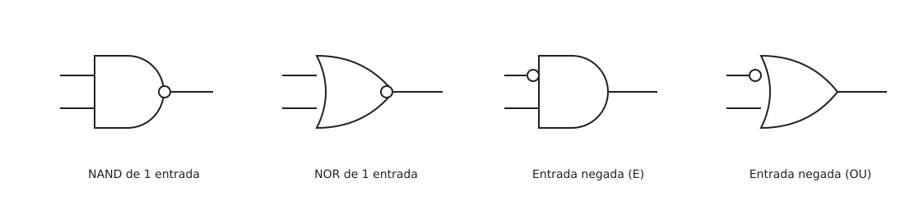

:::

De modo geral um pequeno círculo representa a função negação.

Nessas condições um bloco “E” com mais de uma entrada representa a função
booleana “negação de E” ou “NE”.

<!-- prettier-ignore -->
::: figure Bloco NE de múltiplas entradas {#fig-original-bloco-ne}

```tikz
\usetikzlibrary{circuits.logic.US}
\begin{tikzpicture}[scale=1.5,transform shape]
\node[nand gate US,draw,logic gate inputs=nnn,minimum width=1.8cm,minimum height=1.5cm] (g) at (3,0) {};
\draw (g.input 1)--++(-1,0) node[left] {$a$};
\draw (g.input 2)--++(-1,0) node[left] {$b$};
\draw (g.input 3)--++(-1,0) node[left] {$n$};
\draw (g.output)--++(1,0) node[right] {$F$};
\end{tikzpicture}
```

$$
F=\overline{ab\cdots n}=\bar a+\bar b+\cdots+\bar n.
$$

:::

Ou seja, a função de saída $F$ é igual a zero quando todas as variáveis
aplicadas às entradas tiverem o valor 1.

A função “Nou” resulta da negação de um circuito “Ou”, seja:

<!-- prettier-ignore -->
::: figure Bloco Nou de múltiplas entradas {#fig-original-bloco-nou}

```tikz
\usetikzlibrary{circuits.logic.US}
\begin{tikzpicture}[scale=1.5,transform shape]
\node[nor gate US,draw,logic gate inputs=nnn,minimum width=1.8cm,minimum height=1.5cm] (g) at (3,0) {};
\draw (g.input 1)--++(-1,0) node[left] {$a$};
\draw (g.input 2)--++(-1,0) node[left] {$b$};
\draw (g.input 3)--++(-1,0) node[left] {$n$};
\draw (g.output)--++(1,0) node[right] {$F$};
\end{tikzpicture}
```

$$
F=\overline{a+b+\cdots+n}=\bar a\bar b\cdots\bar n.
$$

:::

Ou seja, a função $F$ tem o valor 0 quando pelo menos uma das variáveis de
entrada tem o valor 1.

Além dos blocos descritos anteriormente existem miríades de derivações,
combinando o circuito de negação com os blocos “Ou” e “E”, nos quais alguns
exemplos estão representados a seguir, com duas entradas.

<!-- prettier-ignore -->
::: figure Exemplos de funções derivadas com entradas complementadas {#fig-original-funcoes-derivadas}

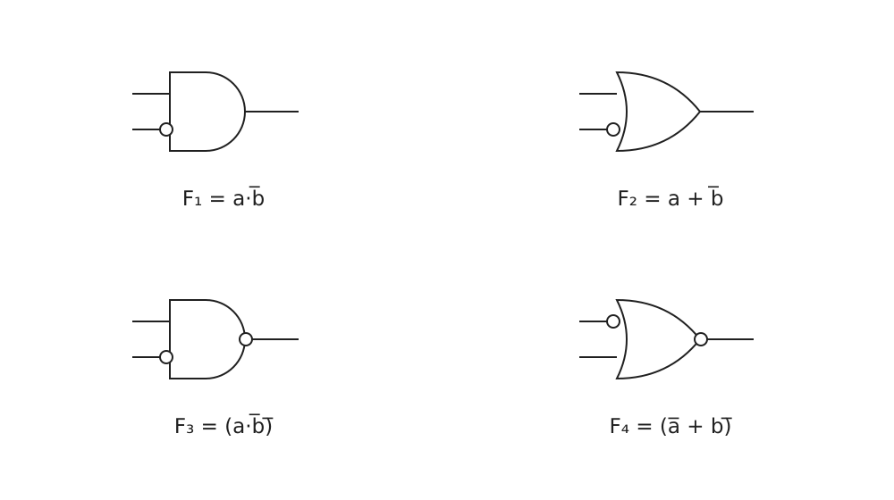

$$
\begin{aligned}
F_1 &= a\bar b,\\
F_2 &= a+\bar b,\\
F_3 &= \overline{a\bar b}=\bar a+b,\\
F_4 &= \overline{\bar a+b}=a\bar b.
\end{aligned}
$$

:::

Um bloco funcional de grande importância prática é o bloco “Ou exclusivo”, cuja
saída é igual a 1 quando apenas uma das entradas for igual a 1. Tal bloco é
representado esquematicamente pelo diagrama a seguir.

<!-- prettier-ignore -->
::: figure Função Ou exclusivo {#fig-original-xor}

```tikz
\usetikzlibrary{circuits.logic.US}
\begin{tikzpicture}[scale=1.5,transform shape]
\node[xor gate US,draw,logic gate inputs=nn,minimum width=1.8cm,minimum height=1.5cm] (g) at (3,0) {};
\draw (g.input 1)--++(-1,0) node[left] {$a$};
\draw (g.input 2)--++(-1,0) node[left] {$b$};
\draw (g.output)--++(1,0) node[right] {$F$};
\end{tikzpicture}
```

$$
F=\bar a b+a\bar b.
$$

:::

Ou seja, $F$ na saída é igual a 1 quando a entrada $a$ for igual a zero e a
entrada $b$ for igual a 1, ou quando a entrada $a$ for igual a 1 e a entrada
$b$ for igual a zero. A função “Ou exclusivo”, por ser muito comum, é
representada pelo símbolo $\oplus$. Nessas condições temos

$$
F=a\oplus b.
$$

A função “Coincidência” é tal que a saída $F$ é igual a 1 quando o valor das
variáveis de entrada coincidem. Essa função pode ser representada
esquematicamente pelo bloco delineado a seguir.

<!-- prettier-ignore -->
::: figure Função Coincidência {#fig-original-coincidencia}

```tikz
\usetikzlibrary{circuits.logic.US}
\begin{tikzpicture}[scale=1.5,transform shape]
\node[xnor gate US,draw,logic gate inputs=nn,minimum width=1.8cm,minimum height=1.5cm] (g) at (3,0) {};
\draw (g.input 1)--++(-1,0) node[left] {$a$};
\draw (g.input 2)--++(-1,0) node[left] {$b$};
\draw (g.output)--++(1,0) node[right] {$F$};
\end{tikzpicture}
```

$$
F=ab+\bar a\bar b.
$$

:::

Ou seja, a função $F$ é igual a 1 quando $a$ e $b$ forem ambos iguais a zero,
ou, então, quando $a$ e $b$ forem ambos iguais a 1. Por ser muito comum, a
função “Coincidência” é representada por

$$
F=a\odot b.
$$

**Exercício.** Mostre que $a\odot b=\overline{a\oplus b}$.

## 1.2.4. Implementação de funções booleanas com componentes discretos. Integração em pequena escala

Os blocos lógicos “Ou” e “E” podem ser implementados simplesmente,
empregando-se lógica de diodos e resistores. Consideremos que estamos operando
em lógica positiva, e que a correspondência entre valores digitais e níveis de
tensão seja tal que

$$
V(0)=0\,\mathrm{V}\qquad V(1)=+5\,\mathrm{V}.
$$

Nessas condições, o leitor pode verificar facilmente que a tensão de saída do
circuito da Fig. 1-3a é igual, aproximadamente, a 5 V, ou seja, igual a $V(1)$,
somente quando todas entradas estiverem em $V(1)$.

<!-- prettier-ignore -->
::: figure Circuitos E e Ou com diodos — Figura 1-3 {#fig-original-1-3}

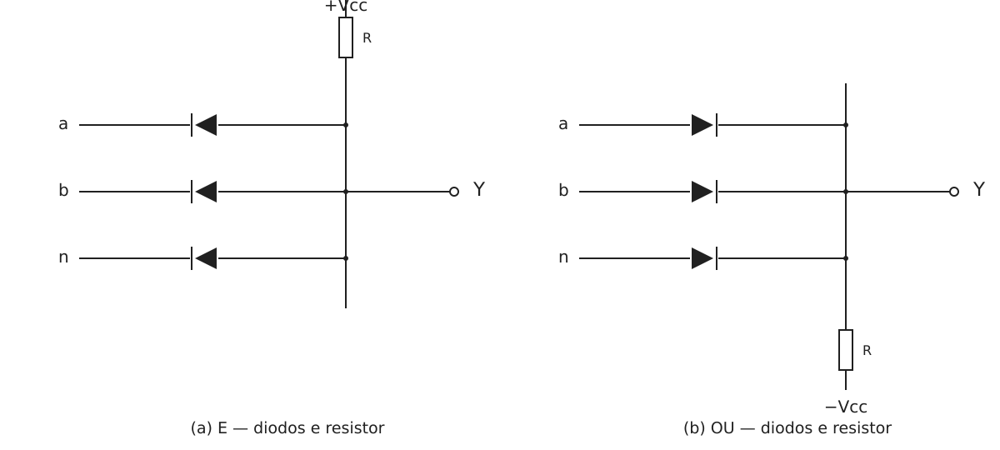

:::

Da mesma forma, reportando-nos agora à Fig. 1-3b, podemos notar que a tensão de
saída será aproximadamente igual a $V(1)$ quando uma ou mais quaisquer entradas
estiverem no nível $V(1)$. Na prática não se utiliza mais que dois estágios em
cascata, compostos de circuitos com diodos, devido à rápida degeneração dos
níveis de tensão e dos tempos de transição do sinal.

<!-- prettier-ignore -->
::: figure Circuitos NE e Nou em lógica positiva com componentes discretos — Figura 1-4 {#fig-original-1-4}

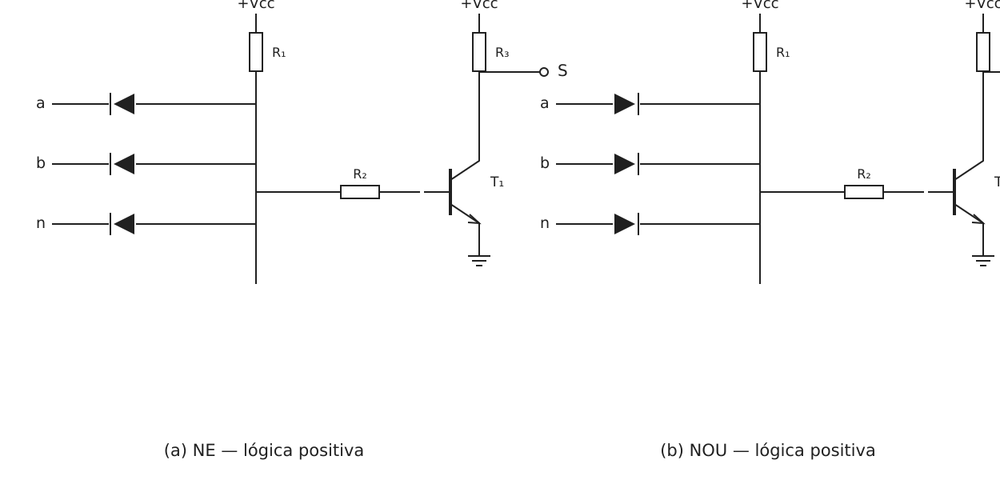

:::

Associando-se os circuitos descritos anteriormente, com blocos inversores,
construídos com transistores, obtemos blocos “NE” e “Nou” que se encontram
esquematizados na Fig. 1-4. Em tais circuitos o transistor opera como
amplificador, podendo resultar na saída um sinal com tempo de transição mais
rápido que o tempo de transição do sinal aplicado na entrada.

O desenvolvimento das técnicas de circuitos integrados fez com que se tornasse
indiferente a construção de componentes passivos e componentes ativos, já que
todos esses eram construídos em uma única pastilha de silício. O primeiro passo
dado dentro da tecnologia de circuitos integrados na adaptação do circuito
esquematizado na Fig. 1-4a foi a substituição do resistor $R_2$ por diodos
polarizados diretamente, cuja única função é ajustar os níveis de tensão para a
operação correta do transistor $T_1$. Na Fig. 1-5 temos desenvolvido um
circuito onde foram introduzidas essas modificações, estando indicadas as
tensões correspondentes à aplicação na entrada dos valores digitais 1 e 0.

<!-- prettier-ignore -->
::: figure Valores de tensão em um circuito NE — Figura 1-5 {#fig-original-1-5}

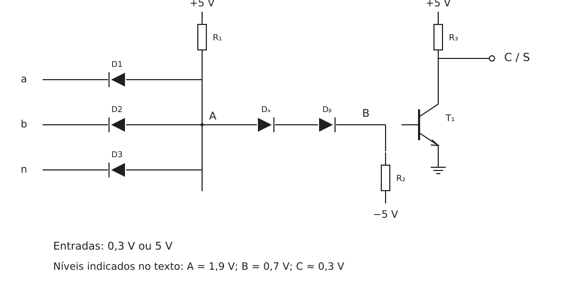

:::

Para o valor digital 1, fixamos $V(1)=5\,\mathrm{V}$ e para o valor digital 0,
fixamos $V(0)=0{,}3\,\mathrm{V}$, valor de tensão, esse, correspondente à
tensão de saturação de um transistor de junção. Vamos admitir que a queda de
tensão através dos diodos seja $0{,}6\,\mathrm{V}$. Caso todas entradas estejam
no valor digital 1, correspondente a $+5\,\mathrm{V}$, os diodos
$D_1,D_2,\ldots,D_n$ estarão cortados. O resistor $R_1$, nesse caso, é
projetado de tal forma que impõe a saturação do transistor $T_1$, de forma que
a tensão $V_{be}$ de $T_1$ é igual a $0{,}7\,\mathrm{V}$, enquanto que a tensão
no ponto A é $1{,}9\,\mathrm{V}$ e, finalmente, a tensão do coletor de $T_1$ é
aproximadamente $0{,}3\,\mathrm{V}$. O leitor deve observar que uma grande
vantagem do circuito esquematizado na Fig. 1-5 é que os valores de tensões nos
pontos A, B e C são praticamente independentes do valor dos resistores $R_1$,
$R_2$ e $R_3$.

Quando uma das entradas passar ao valor digital 0, ou seja, quando passar a
$0{,}3\,\mathrm{V}$, no ponto A teremos imposta a tensão de $0{,}9\,\mathrm{V}$
e, no ponto B, uma tensão de $0{,}3\,\mathrm{V}$, o que é suficiente para
cortar o transistor e fazer com que a tensão no ponto C tenda a
$+5\,\mathrm{V}$.

Retornando novamente à técnica de circuitos integrados, habitualmente os diodos
são obtidos a partir de determinadas interconexões do transistor, sendo a mais
utilizada a interconexão base-coletor, como mostra o esquema da Fig. 1-6.

<!-- prettier-ignore -->
::: figure As interconexões de um transistor de junção para que este opere como um diodo — Figura 1-6 {#fig-original-1-6}

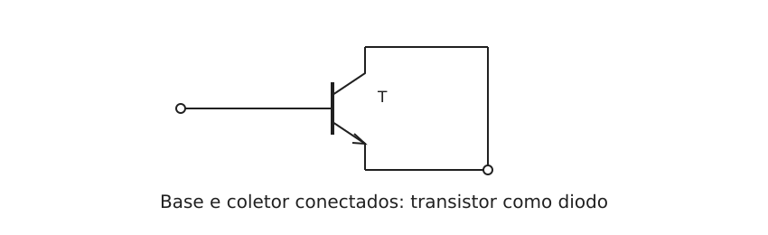

:::

<!-- prettier-ignore -->
::: figure Implementação e simplificação de circuito integrado em pastilha de silício — Figura 1-7 {#fig-original-1-7}

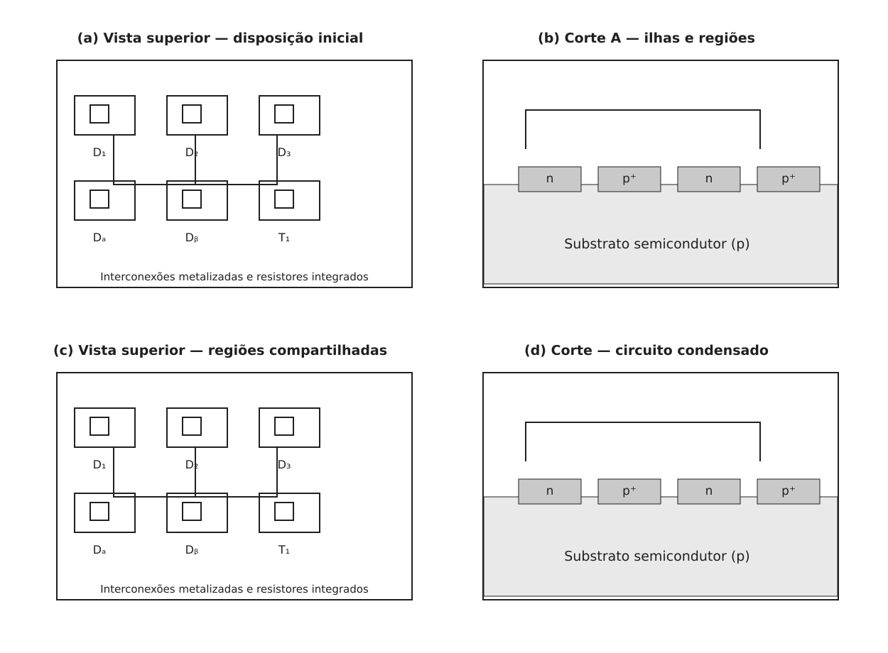

:::

Vamos nos reportar agora à Fig. 1-7. Se colocado sem simplificações o circuito
da Fig. 1-7 poderia ser distribuído de forma mostrada na Fig. 1-7a. Todavia são
possíveis simplificações. Os coletores dos transistores correspondentes aos
diodos $D_1$, $D_2$, $D_3$ (estamos admitindo três entradas) estão conectados
no mesmo ponto, o mesmo acontecendo com as respectivas bases, de forma que
esses elementos podem ser reduzidos a um único, como mostra a Fig. 1-7c e d. Da
mesma forma que na ilha $n$, onde está o resistor $R_1$, as ilhas onde estão os
resistores $R_2$ e $R_3$ podem ser conectadas em $+V_{cc}$.

Finalmente o coletor do transistor correspondente a $D_A$ está conectado no
mesmo ponto que os coletores dos transistores correspondentes a $D_1$, $D_2$ e
$D_3$, podendo formar com isso uma única ilha $n$.

Esquematicamente representa-se os circuitos semelhantes aos mostrados na Fig.
1-7c, de acordo com os diagramas delineados na Fig. 1-8.

<!-- prettier-ignore -->
::: figure Esquema de um circuito Lógica de Diodos e Transistores, LTD, integrado — Figura 1-8 {#fig-original-1-8}

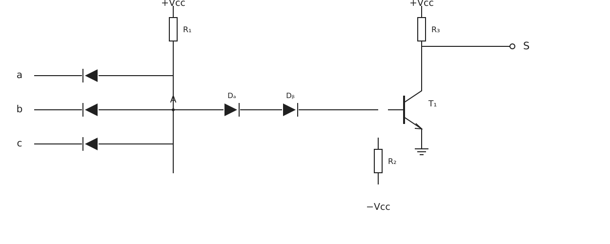

:::

Uma posterior inovação nos circuitos LTD foi a ideia de permitir a saturação do
transistor de emissores múltiplos, presente na entrada, cuja função, como
vimos, é substituir os diodos $D_1$, $D_2$ e $D_3$. A saturação do transistor
de entrada baixa o valor da tensão do ponto A a tal ponto, que torna
dispensáveis os diodos $D_A$ e $D_B$ e o resistor $R_2$. O tipo de circuito
lógico Integrado em Pequena Escala, IPE, que resulta disso é o LTT (em inglês
TTL).

Na Fig. 1-9, temos esquematizado um circuito LTT simples. Com relação ao
circuito da Fig. 1-8, foram eliminados os diodos $D_A$ e $D_B$ e o resistor
$R_2$, tendo sido, porém, acrescentados outros transistores cuja função é
baixar a impedância de saída.

Para analisarmos os níveis de tensão do circuito esquematizado na Fig. 1-9,
vamos admitir que a tensão $V_{ce}$ de saturação nos transistores $T_2$ e $T_5$
seja no máximo igual a $0{,}3\,\mathrm{V}$, e que a tensão $V_{ce}$ de
saturação do transistor $T_1$ seja $0{,}1\,\mathrm{V}$, em virtude desse
transistor não possuir resistor de carga. Vamos admitir também que a queda de
tensão direta nos diodos e a tensão $V_{be}$, correspondente aos transistores
na região ativa, sejam de $0{,}6\,\mathrm{V}$. Finalmente, a tensão $V_{be}$ de
transistores, na saturação, será considerada igual a $0{,}7\,\mathrm{V}$.

<!-- prettier-ignore -->
::: figure Circuito LTT derivado da lógica de transistores e diodos — Figura 1-9 {#fig-original-1-9}

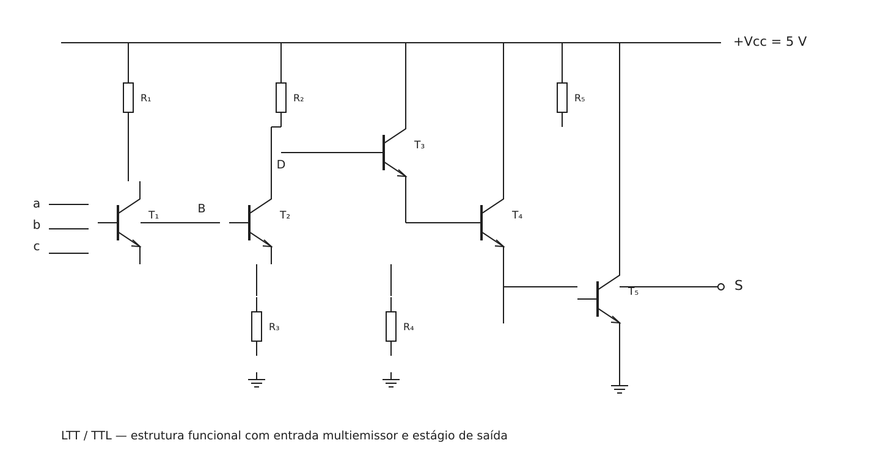

:::

Admitindo no circuito esquematizado na Fig. 1-9 que todas entradas estejam no
nível lógico 1 (qualquer tensão maior que $+2\,\mathrm{V}$) a tensão no ponto C
é de $+0{,}7\,\mathrm{V}$ em virtude de o transistor $T_5$ estar saturado e a
tensão no ponto B será igual a $1{,}4\,\mathrm{V}$ em virtude de $T_2$ também
estar saturado. O transistor $T_1$ está operando na região reversa, portanto,
com a junção base-coletor polarizada diretamente, no que resulta a tensão no
ponto A igual a $2{,}0\,\mathrm{V}$ (o que justifica nossa imposição prévia de
que $V(1)\geq 2{,}0$). Por $T_2$ estar saturado, a tensão no ponto D é de cerca
de $1{,}0\,\mathrm{V}$ e, pelo fato do transistor $T_3$ estar na região ativa,
a tensão no ponto E é de cerca de $0{,}4\,\mathrm{V}$, o que garante o corte do
transistor $T_4$.

Consideremos agora que uma entrada qualquer esteja no valor digital zero,
correspondente à tensão de $0{,}3\,\mathrm{V}$. Estando o transistor $T_1$
saturado, a tensão no ponto A será de $1{,}0\,\mathrm{V}$ e a tensão no ponto B
cerca de $0{,}4\,\mathrm{V}$.

Esse valor de tensão garante o corte dos transistores $T_2$ e $T_5$. O
transistor $T_2$, estando cortado, faz com que a tensão no ponto D seja
aproximadamente igual a $+V_{cc}$, pois temos apenas a queda de tensão em
$R_2$, devida à corrente de base do transistor $T_3$.

Admitindo a tensão $+V_{cc}=5\,\mathrm{V}$ e a queda de tensão através de
$R_2$, devida à corrente de base de $T_3$ cerca de $0{,}2\,\mathrm{V}$, a
tensão no ponto D é igual a $4{,}8\,\mathrm{V}$. Estando o transistor $T_3$ na
região ativa, a tensão no ponto E é de $4{,}2\,\mathrm{V}$ aproximadamente.
Finalmente, tendo em conta também que o transistor $T_4$ se encontra na região
ativa, a tensão de saída é de $3{,}6\,\mathrm{V}$. O leitor deve observar que
esse valor é suficientemente maior que os $2{,}0\,\mathrm{V}$ previamente
estabelecidos, de forma que é possível encadear grande número de circuitos
semelhantes em cascata, sem termos problemas mais sérios com a propagação de
sinais espúrios e ruídos.

A partir de 1967, até hoje (1976), os circuitos LTT (TTL) integrados em pequena
escala dominaram de forma quase absoluta o mercado de circuitos digitais.
Existem hoje circuitos LTT associados com diodos Schottky, que apresentam tempo
de transição de ordem de $0{,}007\,\mu\mathrm{s}$. Todavia, apesar de todo esse
domínio, estamos atualmente assistindo o ocaso de dominância dos circuitos LTT,
que estão sendo rapidamente substituídos por circuitos MOS complementares. De
fato, a enorme vantagem apresentada pelos circuitos MOS Complementares — quer
sob o ponto de vista de consumo de potência das fontes, quer sob o ponto de
vista de maior margem de ruído — parece condenar a lógica LTT irremediavelmente
ao obsoletismo. Provavelmente, dentro de poucos anos, os circuitos LTT serão
apenas utilizados em aplicações onde se requer grande velocidade de operação e
grande excursão de sinais. Outra família de circuitos integrados IPE
constituídos por transistores de junção que encontra aplicação prática
relativamente extensa é a Lógica por Acoplamento de Emissor, LAE (em inglês
ECL).

Nos circuitos integrados LAE, procura-se fazer a excursão lógica dos sinais
$[V(1)-V(0)]$ o menor possível, evitando-se a saturação dos transistores e
considerando-se a comutação entre esses dispositivos predominantemente de
corrente ao invés de tensão.

Admitamos inicialmente que as entradas $a$, $b$ e $c$ no valor digital 0, ou
seja, em $V(0)$, de forma que os transistores $T_1$, $T_2$ e $T_3$ estão
cortados. Nessas condições, coincide praticamente com a tensão $+V_{cc}$ se
dispensarmos o efeito da corrente de base do transistor $T_5$. A tensão no
ponto $S_1$ é, então, aproximadamente igual a $+V_{cc}-0{,}6$ ou seja $\cong
4{,}4\,\mathrm{V}$. Vamos fixar $V(1)=4{,}4\,\mathrm{V}$. Aplicando essa tensão
em uma das entradas, digamos “a”, o transistor $T_1$ deve começar a conduzir,
não entrando todavia em saturação, de modo que vamos fixar a tensão, no ponto
B, também em $4{,}4\,\mathrm{V}$, o que resulta numa tensão de saída, em $S_1$,
de $3{,}8\,\mathrm{V}$, tensão essa correspondente ao valor digital zero.
Determinados esses dois níveis, para a operação correta do circuito, é
interessante que a base do transistor $T_4$ seja voltada para uma tensão
$V_{bb}=4{,}1\,\mathrm{V}$.

Admitindo novamente a tensão $V(0)=3{,}8\,\mathrm{V}$ nas entradas $a$, $b$,
$c$, a tensão no ponto A comum aos emissores é de $3{,}5\,\mathrm{V}$, de forma
que a tensão $V_{be}$ de $T_1$, $T_2$ e $T_3$ é igual a $0{,}3\,\mathrm{V}$,
insuficiente para que esses transistores conduzam. O transistor $T_4$, uma vez
conduzindo, faz com que a tensão no ponto C seja $4{,}4\,\mathrm{V}$ e a tensão
na saída $S_2$, igual a $3{,}8\,\mathrm{V}$, correspondente ao valor digital
zero. O leitor deve observar que os transistores $T_5$ e $T_6$ encontram-se
sempre na região ativa, de forma que sua tensão $V_{be}$ foi considerada, em
qualquer caso, igual a $0{,}6\,\mathrm{V}$.

Quando uma das entradas $a$, $b$ ou $c$ passa ao valor digital 1, ou seja,
passa a $4{,}4\,\mathrm{V}$, o correspondente transistor passa à região ativa
impondo a tensão de $3{,}8\,\mathrm{V}$, no ponto A.

Essa imposição de tensão leva o transistor $T_4$ ao corte, fazendo com que a
tensão do ponto C se aproxime de $+V_{cc}$ e, assim, a tensão de saída em $S_2$
passe ao valor digital 1.

O circuito da Fig. 1-10 apresenta uma inconveniência. A ilha $n$ correspondente
ao ponto B coletor comum dos transistores de entrada é muito grande, bem maior
que a ilha $n$ correspondente ao ponto C, coletor do transistor $T_4$. Esse
fato, além de introduzir no regime transitório assimetrias no circuito, limita
a máxima velocidade de operação do circuito.

<!-- prettier-ignore -->
::: figure Circuito integrado lógico utilizando lógica por acoplamento de emissor — Figura 1-10 {#fig-original-1-10}

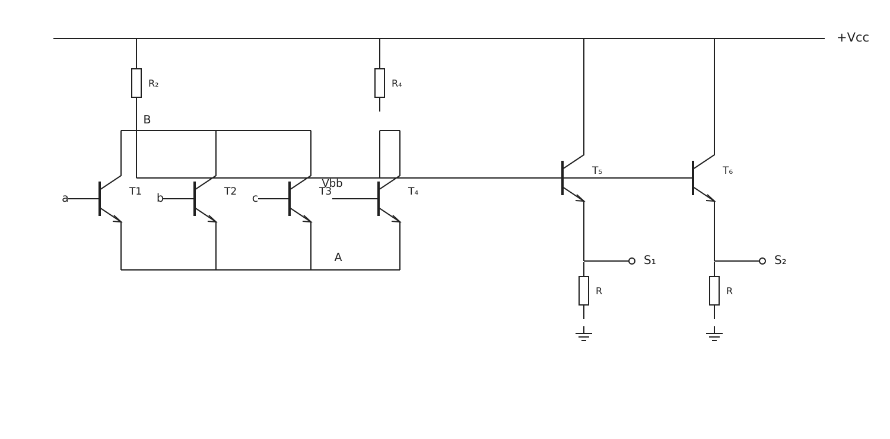

:::

Por isso, algumas vezes, emprega-se Lógica de Seguidores de Emissor, ao invés
de LAE. Um circuito LSE está esquematizado na Fig. 1-11.

Os circuitos LAE são empregados onde se exige velocidade de operação
ultraelevada, sendo muito sensíveis ao nível de ruído elétrico ambiente.

Os circuitos lógicos a MOS complementar representam, sem dúvida alguma, o mais
promissor desenvolvimento dentro da tecnologia de circuitos integrados. Para
entender a operação desses circuitos vamos, inicialmente, considerar a operação
de um circuito inversor, como o esquematizado na Fig. 1-12.

<!-- prettier-ignore -->
::: figure Lógica de seguidores de emissor — Figura 1-11 {#fig-original-1-11}

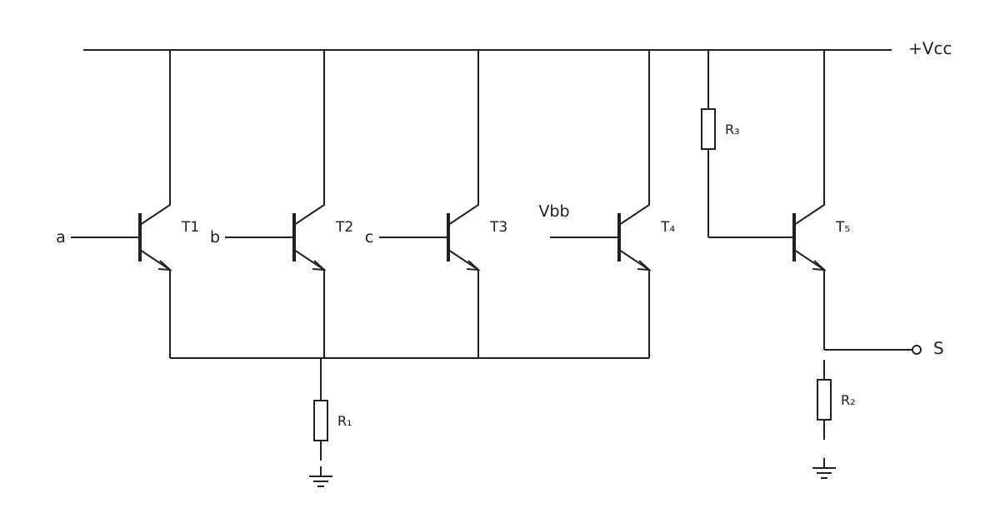

:::

<!-- prettier-ignore -->
::: figure Circuito inversor MOS complementar e curvas características justapostas — Figura 1-12 {#fig-original-1-12}

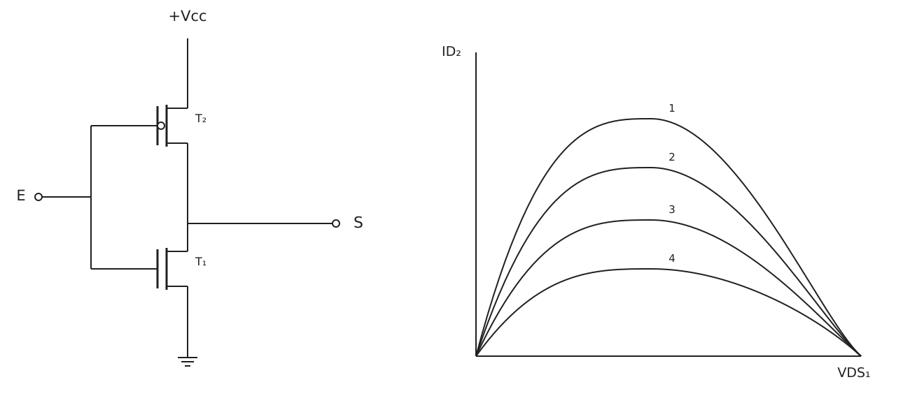

:::

Vamos admitir que, na entrada do circuito esquematizado na Fig. 1-12a, tenhamos
aplicado $V(0)$ aproximadamente igual a $0\,\mathrm{V}$. A tensão porta-fonte
do transistor $T_1$ é igual a zero, enquanto que a tensão porta-fonte do
transistor $T_2$ é igual a $-V_{cc}$. (Habitualmente procura-se fazer
$V_{cc}=+5\,\mathrm{V}$.) O circuito inversor estará, nessas condições,
operando com o transistor $T_1$ cortado e o transistor $T_2$ operando na região
do triodo, de forma que a tensão de saída é igual a praticamente
$+5\,\mathrm{V}$.

Admitamos agora que tenhamos aplicado à entrada E uma tensão de
$+5\,\mathrm{V}$. A tensão porta-fonte do transistor $T_2$ é igual a
$0\,\mathrm{V}$. O transistor $T_1$ vai estar conduzindo na região de triodo,
enquanto que o transistor $T_2$ estará cortado. A tensão de saída, nessas
condições, é praticamente igual a 0, pois os transistores estarão operando no
ponto B das curvas características Fig. 1-12b.

Já existem, no mercado consumidor, grande número de circuitos MOS
complementares, com funções lógicas equivalentes às dos circuitos LTT, com a
vantagem, como já dissemos, de termos a potência consumida muitíssimo menor (em
regime permanente, cerca de $10^5$ vezes menor). Nas Figs. 1-13 e 1-14, temos
esquematizados blocos “NE” e blocos “Nou” fabricados dentro dessa tecnologia.

<!-- prettier-ignore -->
::: figure Bloco Nou de três entradas — Figura 1-13 {#fig-original-1-13}

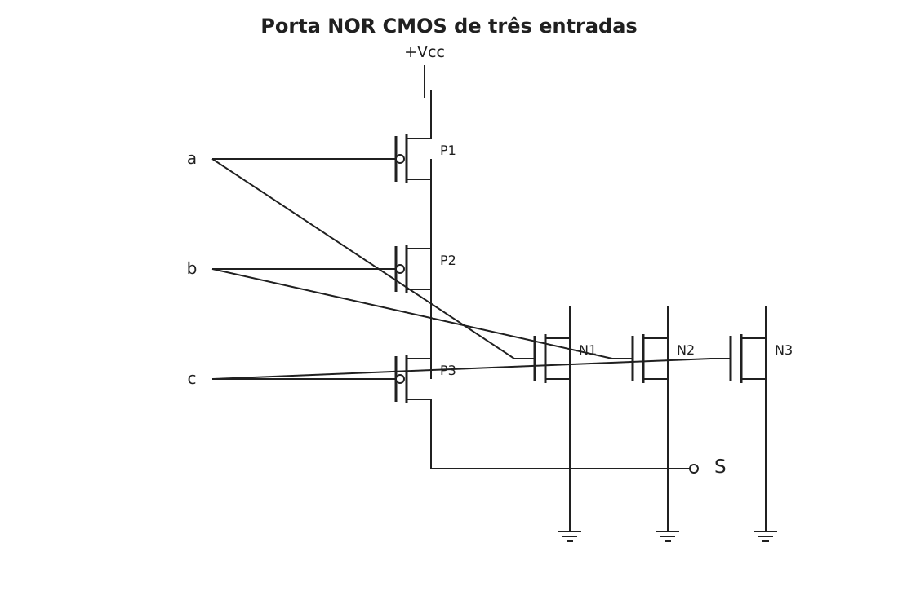

:::

<!-- prettier-ignore -->
::: figure Bloco NE de quatro entradas — Figura 1-14 {#fig-original-1-14}

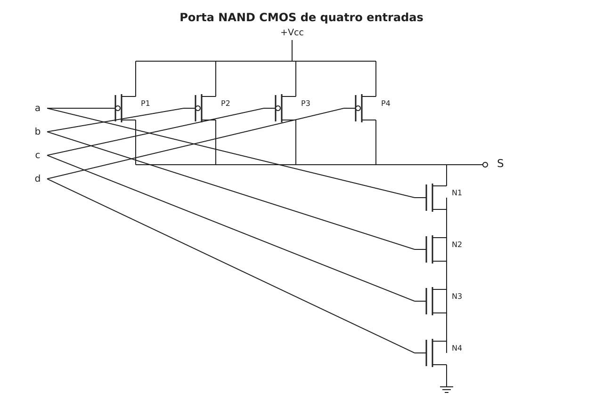

:::
