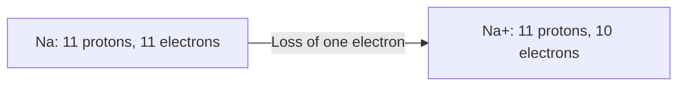

# Atoms and ions: charge and identity

**Objective:** distinguish atomic number, mass number and electric charge.
**Extensions:** Mermaid, MathJax.

## Key ideas

Atomic number $Z$ is the number of protons and determines the element. Mass
number $A$ is the sum of protons and neutrons: $A=Z+N$. Charge in units of
elementary charge is $q=Z-n_e$, where $n_e$ counts electrons.

A neutral sodium atom has 11 protons and 11 electrons. Losing one electron
forms $\ce{Na+}$, with 10 electrons. The nucleus has not changed; it is still
sodium.

Isotopes have the same $Z$ but different neutron counts. Ions differ in charge
because they have gained or lost electrons. These concepts should not be
confused. The diagram shows a change in electron count, not electron paths or a
complete reaction.

## Practice

1. An atom has $Z=6$ and $A=14$. How many neutrons does it have?
2. If it has 8 electrons, what is its charge?

## Answers with explanations

1. $N=14-6=8$.
2. $q=6-8=-2$, in units of elementary charge.

## Continue learning

[Collection index](README.md) · [Back to practice](#practice)

[Português brasileiro](../pt/atomos-e-ions.md) ·
[Español](../es/atomos-e-ions.md)
