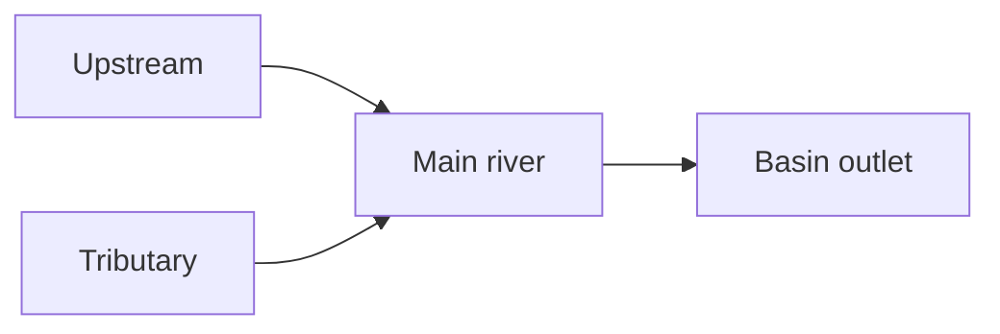

# Drainage basins: area and drainage network

**Objective:** distinguish a basin boundary, watercourse and flow direction.
**Extensions:** maps/GeoJSON, Mermaid.

## Key ideas

A drainage basin contains the area whose water drains to a common outlet.
Watershed divides separate basins; they need not match municipal boundaries.
The network includes the main river and its tributaries.

```geojson
{
    "type": "FeatureCollection",
    "features": [
        {
            "type": "Feature",
            "properties": {
                "name": "Fictional basin"
            },
            "geometry": {
                "type": "Polygon",
                "coordinates": [
                    [
                        [
                            -45,
                            -10
                        ],
                        [
                            -44,
                            -10
                        ],
                        [
                            -44,
                            -9
                        ],
                        [
                            -45,
                            -9
                        ],
                        [
                            -45,
                            -10
                        ]
                    ]
                ]
            }
        },
        {
            "type": "Feature",
            "properties": {
                "name": "Fictional watercourse"
            },
            "geometry": {
                "type": "LineString",
                "coordinates": [
                    [
                        -44.8,
                        -9.2
                    ],
                    [
                        -44.5,
                        -9.5
                    ],
                    [
                        -44.2,
                        -9.8
                    ]
                ]
            }
        }
    ]
}
```



The polygon and line are fictional geographic coordinates for comparing an area
with a path. They represent no real basin and do not allow altitude to be
inferred from latitude. The polygon ring ends at the coordinate where it began.

Actual flow direction requires terrain information. The second diagram
specifies a teaching flow direction. Upstream land-use changes may affect water
and sediment downstream; studying only an isolated segment can therefore hide
important relationships.

## Practice

1. Which geometry represents the area: Polygon or LineString?
2. Does coordinate order reveal the actual current direction?

## Answers with explanations

1. Polygon.
2. No; terrain or additional hydrological information is needed.

## Continue learning

[Collection index](README.md) · [Back to practice](#practice)

[Português brasileiro](../pt/bacia-hidrografica.md) ·
[Español](../es/bacia-hidrografica.md)
