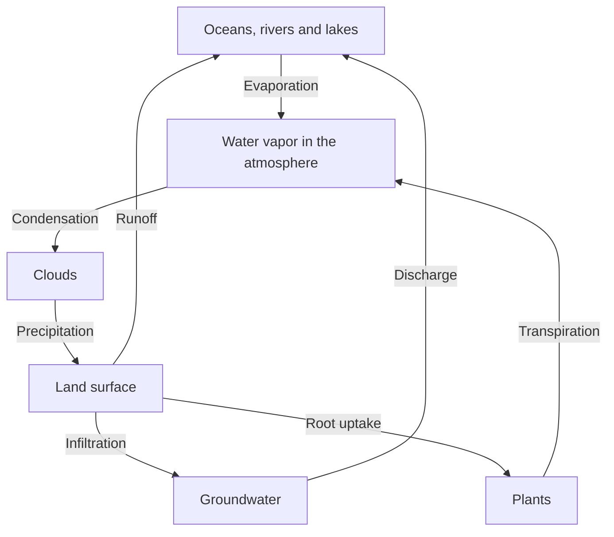

# The water cycle and conservation of matter

**Objective:** explain water transfers between reservoirs. **Extension:**
Mermaid.

## A cycle with several paths

Solar energy promotes evaporation. Vapor can condense into droplets and
crystals that form clouds; precipitation returns water to the surface. Some
water infiltrates the soil and some runs off. Plants also return water to the
atmosphere through transpiration.

The arrows represent processes, not equal time intervals. A water molecule may
stay in an aquifer much longer than in a cloud. Matter circulates, while energy
is transferred and dissipated.

## An urban problem

Paving land tends to reduce infiltration and increase surface runoff. Rain
gardens and permeable areas can promote local retention, but their
effectiveness depends on soil, maintenance and rainfall intensity.

## Practice

1. Which arrow in the diagram corresponds to cloud formation?
2. Why should the cycle not be drawn as a single linear sequence?
3. What may happen to runoff after the soil is covered by impermeable surfaces?

## Answers with explanations

1. The condensation of vapor.
2. There are alternative paths and reservoirs with different residence times.
3. It tends to increase because less water can infiltrate.
