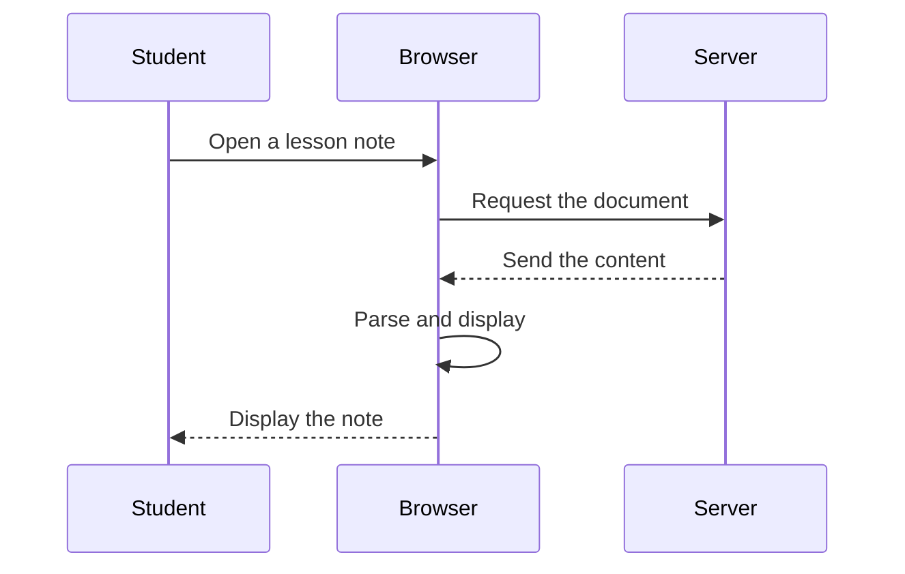

# Digital communication: request and response

**Objective:** distinguish client, server and message exchange. **Extension:**
Mermaid.

## The sequence of a query

A browser can request a document from a server. The server receives the
request, locates the resource and returns a response. The diagram represents a
simplified situation in which the resource exists and the connection works.

## Content and presentation

Receiving Markdown text and displaying it are different steps. A browser can
use an engine to transform headings, tables and extensions into visual
elements. Diagrams and models require their own renderers. A loading failure
does not necessarily mean that the source text is wrong: the resource may be
unavailable.

## Practice

1. Who initiates the document request?
2. Which step transforms content into presentation?
3. Where would you add a “resource not found” response in the diagram?

## Answers with explanations

1. The browser, following the student's action.
2. The browser's parsing and display step.
3. In the message from the server to the browser, as an alternative to the
   response containing content.
