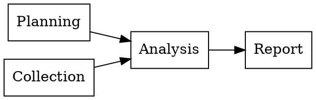

# Project dependencies

**Extensions:** `graphviz`.

## Key ideas

An arrow A→B means B waits for A. Planning and collection can start together;
analysis needs both. This acyclic graph describes prerequisites, not durations.

## Practice

Can reporting begin before analysis? Is there a dependency between planning and
collection?

## Answer with explanation

No, according to the graph. There is no edge between planning and collection;
both can proceed independently.

[Collection index](README.md)

[Português brasileiro](../pt/dependencias-de-projeto.md) ·
[Español](../es/dependencias-de-projeto.md)
