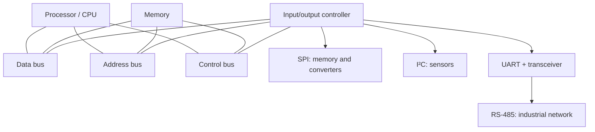
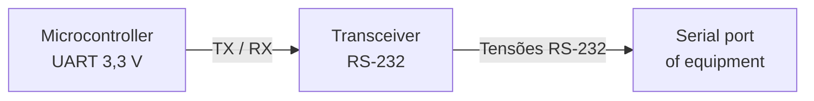
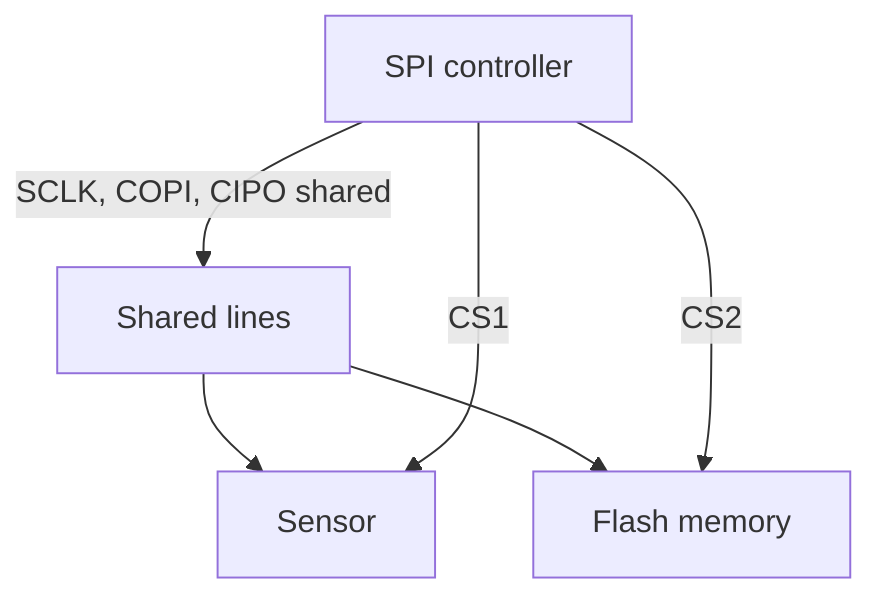
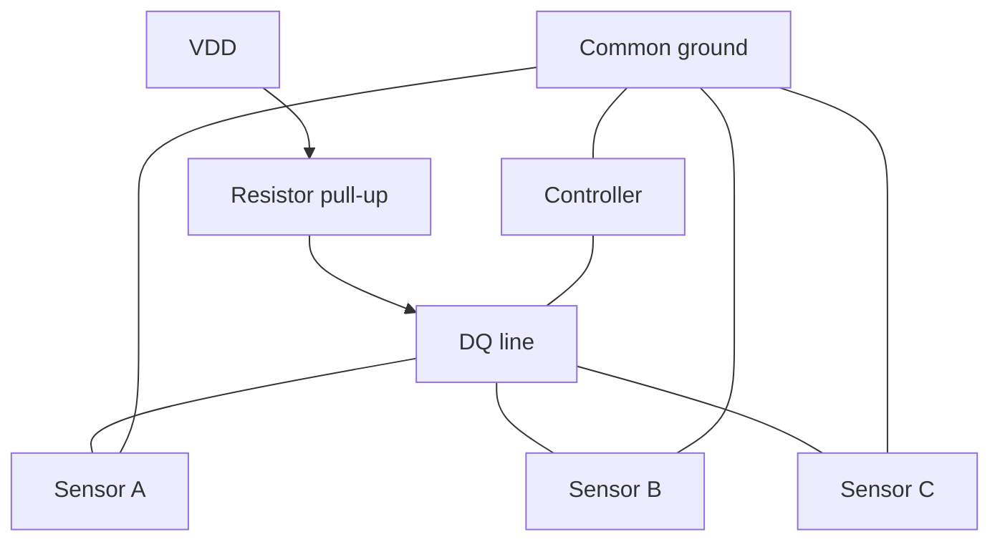
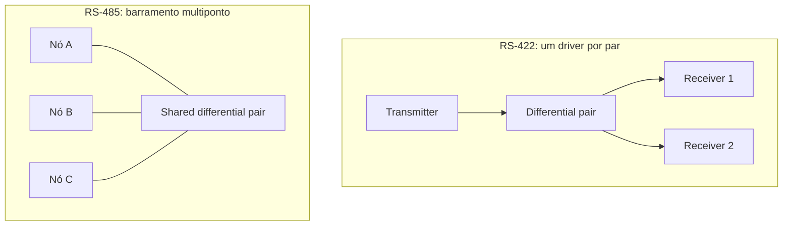
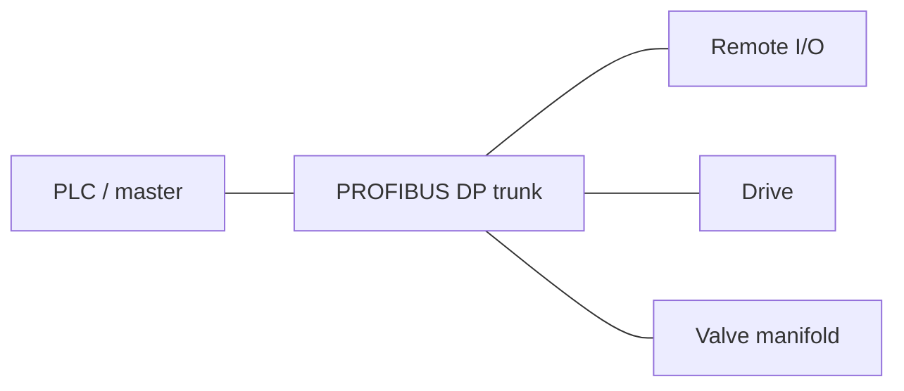
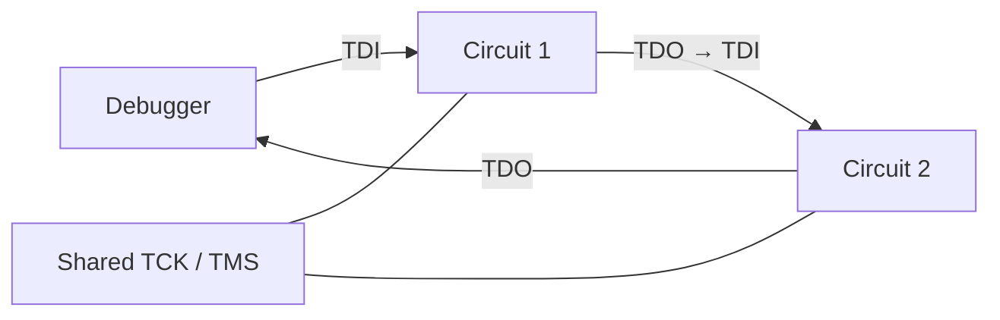
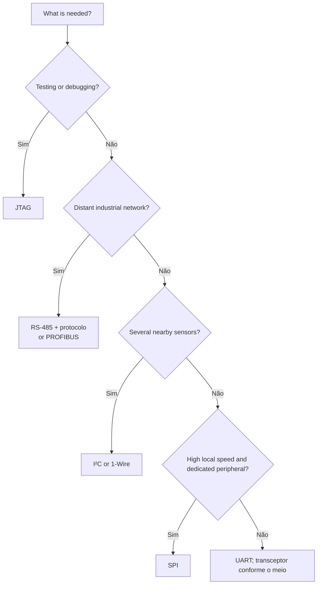

# Digital communication buses: from bits to distributed systems

> **Physics, electronics, and computing.** A didactic journey through data
> buses, serial transmission, and the SPI, UART, I²C, 1-Wire, RS-232, RS-422,
> RS-485, PROFIBUS, and JTAG interfaces.

**Extensions explored:** `mermaid`, `wavedrom`, `circuitikz`, `tikz`,
`vega-lite`, `didactic`, `cross-references`, and mathematical expressions.

## 1. Introduction: how do circuits communicate?

A microcontroller measures temperature, stores the results in memory, updates a
display, and sends information to a computer. To accomplish these tasks, it
must exchange **bits** with other components. The connection between them is
more than a wire: it includes electrical signals, timing conventions, rules for
starting and ending transactions, and often mechanisms for detecting errors.

The term **bus** refers to a shared set of communication paths and rules. In
its classical form, a computer bus is divided into **data**, **address**, and
**control** lines. In embedded systems, a serial bus can carry data and
addresses at successive times using only a few conductors.

<!-- prettier-ignore -->
::: definition Bus, interface, and protocol {#def-barramento}

- **Bus:** an interconnection medium, often shared by several devices.
- **Physical interface:** voltage levels, currents, impedances, and connectors,
  where specified.
- **Protocol:** organization of messages, addressing, arbitration, timing, and
  error handling.
- **Peripheral controller:** circuitry implementing transmission and reception,
  such as a UART or SPI controller.

These concepts overlap in some technologies, but they are not synonymous.

:::

<!-- prettier-ignore -->
::: figure Simplified architecture of a computer system {#fig-system-bus}



:::

<!-- prettier-ignore -->
{@ref fig-system-bus} is a conceptual Mermaid adaptation of the classical system-bus diagram. In actual architectures, bridges, hierarchies, and point-to-point interconnects make the structure more complex.

## 2. Bits, signals, and time

A bit is a binary piece of information, but its physical representation
requires measurable quantities. In an electrical connection, two voltage ranges
may represent `0` and `1`; in other interfaces, the bit is determined by the
**difference** between the voltages on two conductors.

The **bit rate** is

$$R_b=\frac{N_{\mathrm{bits}}}{\Delta t}, \qquad T_b=\frac{1}{R_b}.$$

At 115,200 bit/s, the nominal duration of one bit is approximately
$8.68\,\mu\mathrm{s}$. The symbol rate (_baud_) equals the bit rate only when
each symbol carries one bit.

<!-- prettier-ignore -->
::: figure A digital signal and its bit period {#fig-bits}

```wavedrom
{
  signal: [
    {name: 'bit', wave: '==.==.==.==.==.==.==.==', data: ['1','0','1','1','0','0','1','0']},
    {name: 'level', wave: '10110010'}
  ],
  head: {text: 'Eight bit intervals'},
  config: {hscale: 2}
}
```

:::

**Parallel communication** uses multiple lines to carry bits simultaneously.
**Serial communication** carries bits successively. Serial links can operate at
high frequencies because they avoid, among other problems, timing differences
(_skew_) between numerous parallel lines.

| Criterion            | Parallel                        | Serial                                 |
| -------------------- | ------------------------------- | -------------------------------------- |
| Data conductors      | Several                         | One or a few                           |
| Synchronization      | Across multiple lines           | Between symbols or through a clock     |
| Typical use          | Specific internal interconnects | Sensors, peripherals, and networks     |
| Important limitation | Skew and pin count              | Encoding, timing, and signal integrity |

## 3. Synchronous and asynchronous communication

In **synchronous** transmission, the transmitter and receiver share an explicit
timing reference or recover one from the signal. SPI, for example, provides a
clock line. In typical **asynchronous** UART transmission, no clock line is
shared: each frame begins with a start bit, allowing the receiver to locate
sampling instants.

<!-- prettier-ignore -->
::: figure UART 8N1 frame: start, eight data bits, and stop {#fig-uart-wave}

```wavedrom
{
  signal: [
    {name: 'TX', wave: '10101001011', data: []},
    {name: 'fase', wave: '=========', data: ['idle','start','b0','b1','b2','b3','b4','b5','b6']},
    {name: 'remaining', wave: '====', data: ['b7','stop','idle','idle']}
  ],
  head: {text: 'Frame phases: constant bit duration'},
  config: {hscale: 2}
}
```

:::

<!-- prettier-ignore -->
{@ref fig-uart-wave} is **schematic**: the annotation rows indicate phases rather than a second synchronized transmission; in a complete frame, each bit must occupy exactly one bit period $T_b$.

## 4. UART and RS-232: different roles

A **UART** (_Universal Asynchronous Receiver/Transmitter_) converts parallel
bytes into serial frames and performs the reverse operation. The **8N1** format
contains one start bit, eight data bits, no parity bit, and one stop bit: ten
transmitted bits for each useful byte.

The framing efficiency is

$$\eta=\frac{8}{1+8+0+1}=0.8.$$

Thus, a 115,200 bit/s connection with 8N1 frames ideally transports up to
11,520 data bytes per second, excluding higher-layer protocol overhead.

**RS-232** is not synonymous with UART: it specifies electrical characteristics
and interface signals. In traditional RS-232 signaling, the logical polarity is
inverted relative to TTL/CMOS-level UART, and voltages may be positive and
negative. Never directly connect a conventional RS-232 output to a 3.3 V UART
pin without a suitable transceiver.

<!-- prettier-ignore -->
::: figure Conversion between logic-level UART and RS-232 {#fig-uart-rs232}



:::

## 5. SPI: clocked serial communication

**SPI** (_Serial Peripheral Interface_) typically uses four signals: `SCLK`
(clock), `MOSI` or `COPI` (controller-to-peripheral data), `MISO` or `CIPO`
(the reverse direction), and `CS` (peripheral select, often active low). In its
usual form, it transmits and receives bits simultaneously, in _full duplex_.

<!-- prettier-ignore -->
::: figure SPI with two peripherals and individual selection {#fig-spi-topology}



:::

<!-- prettier-ignore -->
::: figure Schematic SPI transaction {#fig-spi-wave}

```wavedrom
{
  signal: [
    {name: 'CS_n', wave: '10......1'},
    {name: 'SCLK', wave: '0p......0'},
    {name: 'COPI', wave: 'x========x', data: ['7','6','5','4','3','2','1','0']},
    {name: 'CIPO', wave: 'x========x', data: ['7','6','5','4','3','2','1','0']}
  ],
  head: {text: 'SPI: eight bit positions (conceptual illustration)'},
  config: {hscale: 2}
}
```

:::

The sampling instant depends on the **CPOL** and **CPHA** settings. Devices
using incompatible SPI modes cannot exchange data correctly. Having a clock
does not eliminate the need to respect setup and hold times.

## 6. I²C: two lines and multiple devices

**I²C** (_Inter-Integrated Circuit_) uses two lines: `SDA` (data) and `SCL`
(clock). Outputs are usually open-drain or open-collector: devices pull the
lines low, while _pull-up_ resistors bring them to the logic-high level.

This structure allows wires to be shared and supports acknowledgment (`ACK`),
addressing, and, under certain conditions, arbitration among controllers.

<!-- prettier-ignore -->
::: figure I²C bus with pull-up resistors {#fig-i2c-circuit}

```circuitikz
\begin{circuitikz}[american]
\draw (0,0) node[ground]{} to[V,l=$V_{DD}$] (0,3);
\draw (0,3) -- (2,3) to[R,l=$R_{P1}$] (2,1) -- (6,1);
\draw (0,3) -- (4,3) to[R,l=$R_{P2}$] (4,0) -- (6,0);
\node[right] at (6,1) {SDA};
\node[right] at (6,0) {SCL};
\end{circuitikz}
```

:::

<!-- prettier-ignore -->
The two resistors in {@ref fig-i2c-circuit} represent the *pull-ups*; connected devices switch output transistors between each line and ground. The bus's distributed capacitance affects rise time.

For a first-order RC approximation, the rise time from 30% to 70% of the final
voltage is

$$t_r \approx 0.8473 R_P C_B.$$

If $R_P=4.7\,\mathrm{k\Omega}$ and $C_B=100\,\mathrm{pF}$, then
$t_r\approx398\,\mathrm{ns}$. The suitable $R_P$ also depends on the current
the devices can sink and the limits of the I²C mode in use.

<!-- prettier-ignore -->
::: figure Beginning and end of an I²C transaction {#fig-i2c-wave}

```wavedrom
{
  signal: [
    {name: 'SCL', wave: '1.0p....1'},
    {name: 'SDA', wave: '10.======1', data: ['address','R/W','ACK','data','ACK','end']}
  ],
  head: {text: 'START: SDA falls while SCL is high; STOP: SDA rises while SCL is high'},
  config: {hscale: 2}
}
```

:::

<!-- prettier-ignore -->
The drawing in {@ref fig-i2c-wave} emphasizes **logical events**; it does not attempt to reproduce every pulse duration in a complete frame.

## 7. 1-Wire: a single data conductor

The **1-Wire** bus, historically associated with Dallas Semiconductor/Maxim,
uses one data line and a ground reference. The data line uses a _pull-up_; the
controller initiates specific time slots to write and read bits.

Devices may have 64-bit ROM identifiers, useful for distinguishing several
sensors on the same wire. Some can operate with **parasitic power**, harvesting
energy from the data line itself, but this imposes current, timing, and _strong
pull-up_ requirements.

<!-- prettier-ignore -->
::: figure Simplified 1-Wire bus topology {#fig-onewire}



:::

## 8. RS-422 and RS-485: differential signaling

In differential signaling, information depends on

$$V_D=V_A-V_B.$$

Noise that affects both wires by approximately the same amount tends to be
rejected by the receiver, provided the common-mode voltage remains within its
allowed range. Twisted pairs help make interference coupling similar on both
conductors.

**RS-422** describes a differential interface with one transmitter per pair and
potentially multiple receivers. **RS-485** allows different transmitters to
share a pair, provided that only the authorized transmitter drives it at any
given time. RS-485 defines electrical characteristics, **not** the message
format.

<!-- prettier-ignore -->
::: figure Difference between RS-422 and RS-485 {#fig-rs-topology}



:::

The `A` and `B` labels on commercial modules do not always follow the same
polarity convention across manufacturers. Consult the transceiver documentation
before connecting equipment.

### Termination and reflections

A long wire must be treated as a **transmission line** when propagation time
becomes significant compared with the signal rise time. A termination
resistance approximately equal to the characteristic impedance reduces
reflections:

$$\Gamma=\frac{Z_L-Z_0}{Z_L+Z_0}.$$

When $Z_L=Z_0$, the ideal reflection coefficient is zero. On RS-485 buses using
cable with approximately $120\,\Omega$ characteristic impedance, a
$120\,\Omega$ resistor is commonly installed at **each physical end** of the
trunk, not at every node.

<!-- prettier-ignore -->
::: figure Resistive termination at one end of the pair {#fig-rs485-termination}

```circuitikz
\begin{circuitikz}[american]
\draw (0,2) -- (5,2) node[right]{A};
\draw (0,0) -- (5,0) node[right]{B};
\draw (4,2) to[R,l=$120\,\Omega$] (4,0);
\node[left] at (0,2) {Pair A};
\node[left] at (0,0) {Pair B};
\end{circuitikz}
```

:::

## 9. PROFIBUS: industrial communication

**PROFIBUS** is a family of industrial networks. The **PROFIBUS DP** variant
often uses the **RS-485** physical layer, with a linear bus topology, suitable
connectors, and appropriate terminations. PROFIBUS PA uses another physical
layer designed for process applications.

In RS-485 PROFIBUS DP segments, a typical **active** termination network
combines biasing resistors with a resistor between the lines: often
$390\,\Omega$ to VP (5 V), $220\,\Omega$ between the lines, and $390\,\Omega$
to DGND. This network must **not** be confused with the simple $120\,\Omega$
termination used on many generic RS-485 buses. Values, supply, and wiring must
follow the applicable standard and device documentation.

<!-- prettier-ignore -->
::: figure Didactic example of active PROFIBUS DP termination {#fig-profibus-termination}

```circuitikz
\begin{circuitikz}[american]
\draw (0,4) node[left]{VP (+5 V)} to[R,l=$390\,\Omega$] (0,2.6) -- (3,2.6) node[right]{B};
\draw (0,2.6) to[R,l=$220\,\Omega$] (0,1.3) -- (3,1.3) node[right]{A};
\draw (0,1.3) to[R,l=$390\,\Omega$] (0,0) node[ground]{};
\node[left] at (0,0) {DGND};
\end{circuitikz}
```

:::

<!-- prettier-ignore -->
{@ref fig-profibus-termination} represents only the **termination and biasing network**; it omits protection, the transceiver, shielding, and cable continuity. The circuit must remain powered for active biasing to operate as designed. Do not arbitrarily add capacitors between the wires: RC filters change the waveform and require specific design calculations.

<!-- prettier-ignore -->
::: figure Industrial network with controller and remote stations {#fig-profibus-network}



:::

## 10. JTAG: testing, debugging, and programming

**JTAG** refers to the boundary-scan test architecture standardized primarily
by IEEE 1149.1. Its usual lines are `TCK`, `TMS`, `TDI`, and `TDO`; `TRST` may
be optional. The interface makes it possible to test interconnections and,
depending on the device, provides access to debugging and programming
functions.

A JTAG component contains a **TAP** (_Test Access Port_) state controller and
instruction and data registers. Several integrated circuits can be chained: the
`TDO` of one feeds the `TDI` of the next.

<!-- prettier-ignore -->
::: figure JTAG scan chain {#fig-jtag}



:::

JTAG should not be treated as a general replacement for SPI or I²C: its purpose
and organization are different.

## 11. Signal integrity: capacitance, noise, and speed

Conductors have distributed resistance, inductance, and capacitance. On a short
link, an RC model may be enough to understand voltage rise. On long connections
or with fast edges, **transmission-line** behavior is essential.

<!-- prettier-ignore -->
::: figure Normalized RC step response {#fig-rc-chart}

```vega-lite
{
  "$schema": "https://vega.github.io/schema/vega-lite/v5.json",
  "description": "Normalized RC circuit response",
  "width": 550,
  "height": 230,
  "data": {
    "values": [
      {"t":0,"v":0},{"t":0.25,"v":0.2212},{"t":0.5,"v":0.3935},
      {"t":0.75,"v":0.5276},{"t":1,"v":0.6321},{"t":1.5,"v":0.7769},
      {"t":2,"v":0.8647},{"t":2.5,"v":0.9179},{"t":3,"v":0.9502},
      {"t":4,"v":0.9817},{"t":5,"v":0.9933}
    ]
  },
  "mark": {"type":"line","point":true},
  "encoding": {
    "x":{"field":"t","type":"quantitative","title":"Time t / RC"},
    "y":{"field":"v","type":"quantitative","title":"Voltage V / Vfinal","scale":{"domain":[0,1]}}
  }
}
```

:::

<!-- prettier-ignore -->
::: figure RC model of a line with a pull-up resistor {#fig-rc-circuit}

```circuitikz
\begin{circuitikz}[american]
\draw (0,0) node[ground]{} to[V,l=$V_{DD}$] (0,3)
      to[R,l=$R_P$] (3,3) -- (5,3)
      to[C,l=$C_B$] (5,0) -- (0,0);
\node[above] at (5,3) {Data line};
\end{circuitikz}
```

:::

<!-- prettier-ignore -->
In {@ref fig-rc-circuit}, $C_B$ represents the equivalent capacitance of the conductor and connected inputs. This simplified model concentrates that capacitance into one component; its actual distribution is more complex.

<!-- prettier-ignore -->
The curve in {@ref fig-rc-chart} follows

$$V(t)=V_\infty\left(1-e^{-t/(RC)}\right).$$

A smaller _pull-up_ resistance speeds up the rising edge but increases current
when the line is low. The choice balances speed, power consumption, and drive
capability.

## 12. Comparing technologies

| Technology  | Separate clock   | Typical physical medium | Sharing                      | Application                    |
| ----------- | ---------------- | ----------------------- | ---------------------------- | ------------------------------ |
| UART        | No               | Local logic levels      | Usually point-to-point       | Controller-to-controller links |
| RS-232      | Not specified    | Unbalanced signaling    | Point-to-point               | Serial ports                   |
| SPI         | Yes              | Logic-level lines       | Chip select (CS)             | Memories and converters        |
| I²C         | Yes, SCL         | Two pull-up lines       | Multiple devices             | Sensors and peripherals        |
| 1-Wire      | No               | Data + reference        | Multiple devices             | Sensors and identification     |
| RS-422      | Not specified    | Differential pair       | One driver per pair          | Robust links                   |
| RS-485      | Not specified    | Differential pair       | Coordinated multiple drivers | Automation                     |
| PROFIBUS DP | Depends on layer | Often RS-485            | Industrial network           | PLCs and field devices         |
| JTAG        | Yes, TCK         | Logic-level signals     | Test chain                   | Debugging and testing          |

It is incorrect to compare all these entries as if they were protocols at the
same layer: some specify electrical signaling, others transaction formats, and
others more complete communication systems.

## 13. Choosing an interface

<!-- prettier-ignore -->
::: figure Simplified decision tree {#fig-decision}



:::

<!-- prettier-ignore -->
The decision tree in {@ref fig-decision} is an initial guide, not a normative procedure. Distance, data rate, electromagnetic immunity, power consumption, pin count, galvanic isolation, functional safety, and component availability must be evaluated for each project.

## 14. Activities and worked problems

<!-- prettier-ignore -->
:::: exercise Exercise 1 — Effective UART throughput {#ex-uart}

A UART sends 8N1 frames at 9,600 bit/s. How many useful bytes per second can
ideally be transmitted?

<!-- prettier-ignore -->
::: hint A hint

Count every bit in the frame, not just the eight data bits.

:::

<!-- prettier-ignore -->
::: solution Solution

Each frame contains 10 bits. Thus, $9600/10=960$ useful bytes per second,
before pauses and protocol overhead.

:::

::::

<!-- prettier-ignore -->
:::: exercise Exercise 2 — I²C rise time {#ex-i2c}

Given $R_P=2.2\,\mathrm{k\Omega}$ and $C_B=150\,\mathrm{pF}$, estimate the
30%-to-70% rise time.

<!-- prettier-ignore -->
::: solution Solution

$$t_r\approx0.8473(2200)(150\times10^{-12})\approx280\,\mathrm{ns}.$$

Compare this result with the limit for the applicable I²C mode and verify the
low-level sink current.

:::

::::

<!-- prettier-ignore -->
:::: exercise Exercise 3 — Transmission-line reflection {#ex-reflection}

A line with $Z_0=120\,\Omega$ is terminated by $Z_L=240\,\Omega$. Calculate
$\Gamma$.

<!-- prettier-ignore -->
::: solution Solution

$$\Gamma=\frac{240-120}{240+120}=\frac13.$$

The ideal reflected wave has one-third the amplitude of the incident wave, with
the same polarity.

:::

::::

<!-- prettier-ignore -->
:::: exercise Exercise 4 — Network design {#ex-network}

A controller must read nearby sensors, log data in flash memory, and send
commands to modules distributed throughout an industrial installation. Propose
three interfaces.

<!-- prettier-ignore -->
::: hint A hint

Consider the distances and electrical requirements of each link.

:::

<!-- prettier-ignore -->
::: solution Worked solution

One possible design uses **I²C** for local sensors, **SPI** for flash memory,
and **RS-485 with a defined protocol** for remote modules. PROFIBUS DP may
replace the third option when the installation requires interoperability with
that industrial network. In every case, verify the specific device
requirements.

:::

::::

## 15. Conclusion

Studying buses brings together **digital logic, electricity, electromagnetism,
timing, and systems organization**. A bit is an abstraction; transmitting it
requires control over voltages, currents, sampling instants, and interactions
between conductors.

SPI, I²C, and 1-Wire provide different ways to connect nearby components. UART
defines asynchronous frame organization; RS-232, RS-422, and RS-485 concern
electrical characteristics. PROFIBUS organizes industrial communication over
suitable physical layers. JTAG, in turn, makes interconnections and registers
observable for testing and debugging.

Choosing the right technology begins with a simple question: **what must be
communicated, between which components, over what distance, at what speed, and
under which electrical conditions?**

## 16. References and further reading

Wikipedia pages in Portuguese and English provide an introduction and links to
other languages. For actual electrical design, consult normative specifications
and manufacturers' manuals.

- [Computer bus](<https://en.wikipedia.org/wiki/Bus_(computing)>)
- [Serial communication](https://en.wikipedia.org/wiki/Serial_communication)
- [Serial Peripheral Interface](https://en.wikipedia.org/wiki/Serial_Peripheral_Interface)
- [UART](https://en.wikipedia.org/wiki/Universal_asynchronous_receiver-transmitter)
- [I²C](https://en.wikipedia.org/wiki/I%C2%B2C)
- [1-Wire](https://en.wikipedia.org/wiki/1-Wire)
- [RS-232](https://en.wikipedia.org/wiki/RS-232)
- [RS-422](https://en.wikipedia.org/wiki/RS-422)
- [RS-485](https://en.wikipedia.org/wiki/RS-485)
- [PROFIBUS](https://en.wikipedia.org/wiki/Profibus)
- [JTAG](https://en.wikipedia.org/wiki/JTAG)
- [mathjslab-markdown documentation](https://github.com/MathJSLab/mathjslab-markdown)
