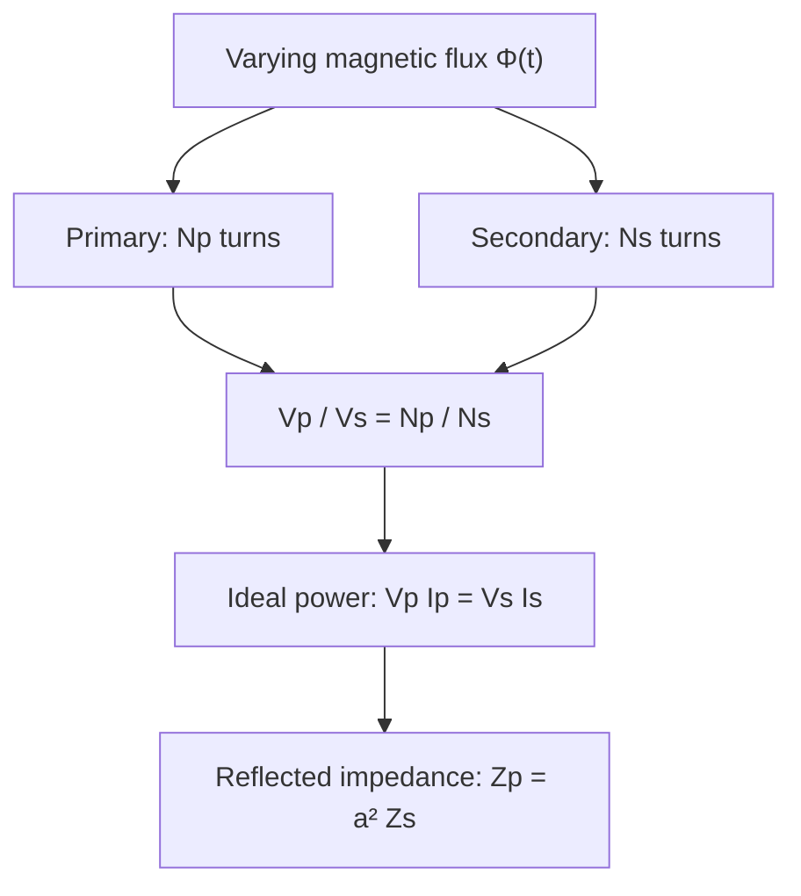
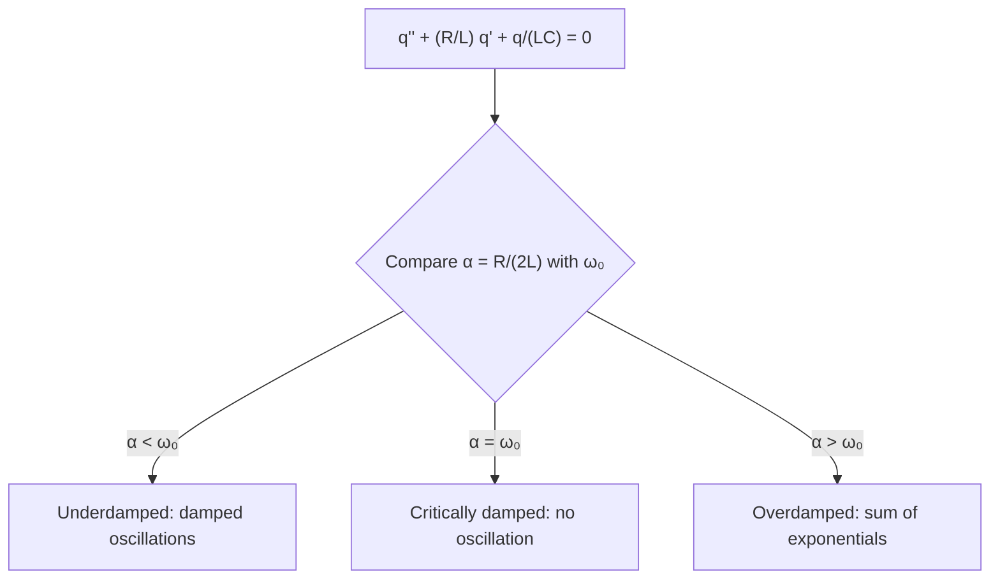

# Electrical Circuits

## Introduction

The most common practical application of electromagnetism is electrical
circuits. An electrical circuit is an arrangement of electrical elements, such
as resistors, inductors, capacitors, voltage sources, current sources, and
switches, forming at least one closed path for electric current.

## 1. Circuit elements

In theoretical circuit modeling, it is convenient to represent the constituent
elements in an idealized form. The conductors connecting circuit elements do
not have zero resistance; however, because they are made of low-resistivity
metals, their resistance can be considered negligible when they are relatively
short. A real coil has resistance and capacitance between its terminals in
addition to its self-inductance. It is convenient to separate these effects and
represent them using ideal resistances, capacitances, and inductances.

Circuit elements may be active or passive. Under the passive sign convention,
current enters the higher-potential terminal of an energy-consuming element.
Generators can supply energy to the circuit, with current leaving their
higher-potential terminal.

### 1.1. Resistor

<!-- prettier-ignore -->
A resistor is represented by the symbol in {@ref fig-resistor}.

<!-- prettier-ignore -->
::: figure Ideal resistor with terminals 1 and 2 {#fig-resistor}

```circuitikz
\begin{circuitikz}[american,scale=3,transform shape]
\draw (0,0) node[left]{1} to[short,o-] (1,0) to[R,l=$R$,i>^=$I$] (4,0) to[short,-o] (5,0) node[right]{2};
\end{circuitikz}
```

:::

When a current $I$ flows through a resistor, a voltage drop $V_R=V_1-V_2$
occurs in the direction of the current, according to Ohm's law:

$$\boxed{V_R=RI.}\tag{1}$$

In a resistor, electrical energy is converted into thermal energy through the
Joule effect. The dissipated power is:

$$\boxed{P=I^2R=\frac{V_R^2}{R}.}\tag{2}$$

### 1.2. Capacitor

<!-- prettier-ignore -->
::: figure Ideal capacitor {#fig-capacitor}

```circuitikz
\begin{circuitikz}[american,scale=3,transform shape]
\draw (0,0) node[left]{1} to[short,o-] (1,0) to[C,l=$C$] (4,0) to[short,-o] (5,0) node[right]{2};
\end{circuitikz}
```

:::

The potential difference between the capacitor plates is

$$V_1-V_2=V_C=\frac{q}{C},\tag{3}$$

where $C$ is the capacitance. Although the plates are separated by an
insulator, current flows at the capacitor terminals during charging and
discharging, defined by

$$I(t)=\frac{dq}{dt}.\tag{4}$$

Energy is stored in the electric field of a capacitor:

$$\boxed{U=\frac{CV_C^2}{2}=\frac{q^2}{2C}.}\tag{5}$$

### 1.3. Inductor

<!-- prettier-ignore -->
::: figure Ideal inductor {#fig-indutor}

```circuitikz
\begin{circuitikz}[american,scale=3,transform shape]
\draw (0,0) node[left]{1} to[short,o-] (1,0) to[L,l=$L$,i>^=$I$] (4,0) to[short,-o] (5,0) node[right]{2};
\end{circuitikz}
```

:::

The voltage drop across the inductor terminals is

$$V_1-V_2=V_L=L\frac{dI}{dt},\tag{6}$$

where $L$ is the self-inductance. The energy stored in the magnetic field is

$$\boxed{U=\frac{LI^2}{2}.}\tag{7}$$

### 1.4. Generator

An ideal DC voltage source maintains a potential difference between its
terminals regardless of the current flowing through it.

<!-- prettier-ignore -->
::: figure Ideal DC voltage source {#fig-dc-source}

```circuitikz
\begin{circuitikz}[american,scale=3,transform shape]
\draw (0,0) node[below]{2} to[V,l=$V_0$] (0,3) node[above]{1};
\end{circuitikz}
```

:::

$$V_1-V_2=V_0.\tag{8}$$

Some generators have a potential difference that varies harmonically with time.

<!-- prettier-ignore -->
::: figure Ideal AC voltage source {#fig-ac-source}

```circuitikz
\begin{circuitikz}[american,scale=3,transform shape]
\draw (0,0) node[below]{2} to[sV,l=$V(t)$] (0,3) node[above]{1};
\end{circuitikz}
```

:::

$$V_1-V_2=V_0\cos(\omega t+\varphi).\tag{9}$$

## 2. Kirchhoff's laws

Connecting circuit elements forms nodes and loops. A **node** is a junction of
conductors; a **loop** is a closed path through the circuit.

### 2.1. Kirchhoff's first law — current law

<!-- prettier-ignore -->
At a node where no charge accumulates, the sum of incoming currents equals the sum of outgoing currents. In the example in {@ref fig-node}:

$$I_1+I_2=I_3.\tag{10}$$

<!-- prettier-ignore -->
::: figure Currents at a node {#fig-node}

```circuitikz
\begin{circuitikz}[american,scale=3,transform shape]
\draw (0,2) to[short,i>^=$I_1$] (2,1);
\draw (0,0) to[short,i>^=$I_2$] (2,1);
\draw (2,1) node[circ]{} to[short,i>^=$I_3$] (4,1);
\end{circuitikz}
```

:::

Taking incoming currents as positive and outgoing currents as negative:

$$\boxed{\sum_{k=1}^{n} I_k=0.}\tag{11}$$

This law expresses the **conservation of electric charge**.

### 2.2. Kirchhoff's second law — voltage law

<!-- prettier-ignore -->
Along a closed path, the algebraic sum of potential differences is zero. In the circuit in {@ref fig-loop}, a source supplies three resistors:

$$V_0=V_1+V_2+V_3.$$

<!-- prettier-ignore -->
::: figure Simple loop with three resistors {#fig-loop}

```circuitikz
\begin{circuitikz}[american,scale=3,transform shape]
\draw (0,0) to[V,l=$V_0$] (0,3) to[R,l=$R_1$] (4,3) to[R,l=$R_2$] (4,0) to[R,l=$R_3$] (0,0);
\end{circuitikz}
```

:::

In general,

$$\boxed{\sum_{k=1}^{n}V_k=0.}$$

This law follows from the **conservation of energy** in the lumped-circuit
approximation.

## 3. Transients

### 3.1. RC circuit

<!-- prettier-ignore -->
Consider the RC circuit in {@ref fig-rc}. The switch is closed at $t=0$.

<!-- prettier-ignore -->
::: figure Series RC circuit powered by a DC source {#fig-rc}

```circuitikz
\begin{circuitikz}[american,scale=3,transform shape]
\draw (0,0) to[V,l=$V_0$] (0,4) to[closing switch] (2,4) to[short] (4,4) to[R,l=$R$] (4,2) to[C,l=$C$] (4,0) -- (0,0);
\node[above] at (2,4.35) {$t=0$};
\end{circuitikz}
```

:::

By Kirchhoff's second law,

$$V_0=V_R+V_C.\tag{12}$$

Substituting equations (1), (3), and (4):

$$V_0=R\frac{dq}{dt}+\frac{q(t)}{C}.\tag{13}$$

Multiplying by $C$ and defining the time constant

$$\boxed{\tau_C=RC},\tag{14}$$

we obtain

$$V_0C=\tau_C\frac{dq}{dt}+q(t).\tag{15}$$

With initial condition $q(0)=q_0$,

$$\boxed{q(t)=(q_0-V_0C)e^{-t/\tau_C}+V_0C.}\tag{16}$$

Differentiating, we find the current:

$$I(t)=\frac{V_0-V_{C0}}{R}e^{-t/\tau_C},\tag{17}$$

where $V_{C0}=q_0/C$. Defining $I_0=(V_0-V_{C0})/R$:

$$\boxed{I(t)=I_0e^{-t/\tau_C}.}\tag{18}$$

<!-- prettier-ignore -->
::: figure Current decay in the RC circuit {#fig-rc-curve}

```vega-lite
{
  "$schema":"https://vega.github.io/schema/vega-lite/v5.json",
  "description":"Normalized current during RC circuit charging",
  "width":560,"height":260,
  "data":{"sequence":{"start":0,"stop":5.01,"step":0.1,"as":"x"}},
  "transform":[{"calculate":"exp(-datum.x)","as":"y"}],
  "mark":{"type":"line"},
  "encoding":{"x":{"field":"x","type":"quantitative","title":"Time t / τC"},"y":{"field":"y","type":"quantitative","title":"Current I / I₀","scale":{"domain":[0,1]}}}
}
```

:::

At $t=\tau_C$, the current is $I_0/e$, approximately 36.8% of its initial
value.

### 3.2. RL circuit

<!-- prettier-ignore -->
Consider the RL circuit in {@ref fig-rl}. The switch is closed at $t=0$.

<!-- prettier-ignore -->
::: figure Series RL circuit powered by a DC source {#fig-rl}

```circuitikz
\begin{circuitikz}[american,scale=3,transform shape]
\draw (0,0) to[V,l=$V_0$] (0,4) to[closing switch] (2,4) -- (4,4) to[R,l=$R$] (4,2) to[L,l=$L$] (4,0) -- (0,0);
\node[above] at (2,4.35) {$t=0$};
\end{circuitikz}
```

:::

By Kirchhoff's second law,

$$V_0=V_R+V_L.\tag{19}$$

Substituting (1) and (6):

$$V_0=RI(t)+L\frac{dI}{dt}.\tag{20}$$

Defining

$$\boxed{\tau_L=\frac{L}{R}},\tag{21}$$

we obtain

$$\frac{V_0}{R}=I(t)+\tau_L\frac{dI}{dt}.\tag{22}$$

With $I(0)=0$,

$$I(t)=\frac{V_0}{R}\left(1-e^{-t/\tau_L}\right).\tag{23}$$

If $I_\infty=V_0/R$:

$$\boxed{I(t)=I_\infty\left(1-e^{-t/\tau_L}\right).}\tag{24}$$

<!-- prettier-ignore -->
::: figure Current growth in the RL circuit {#fig-rl-curve}

```vega-lite
{
  "$schema":"https://vega.github.io/schema/vega-lite/v5.json",
  "description":"Normalized current after closing the switch in an RL circuit",
  "width":560,"height":260,
  "data":{"sequence":{"start":0,"stop":5.01,"step":0.1,"as":"x"}},
  "transform":[{"calculate":"1-exp(-datum.x)","as":"y"}],
  "mark":{"type":"line"},
  "encoding":{"x":{"field":"x","type":"quantitative","title":"Time t / τL"},"y":{"field":"y","type":"quantitative","title":"Current I / I∞","scale":{"domain":[0,1]}}}
}
```

:::

## 4. Free oscillations in an LC circuit

<!-- prettier-ignore -->
Consider the LC circuit in {@ref fig-lc}.

<!-- prettier-ignore -->
::: figure Ideal LC circuit {#fig-lc}

```circuitikz
\begin{circuitikz}[american,scale=3,transform shape]
\draw (0,0) to[C,l=$C$] (0,3) -- (4,3) to[L,l=$L$] (4,0) -- (0,0);
\end{circuitikz}
```

:::

By Kirchhoff's second law,

$$V_C+V_L=0.\tag{25}$$

Substituting (3) and (6),

$$\frac{q(t)}{C}+L\frac{dI}{dt}=0.\tag{26}$$

Defining the natural angular frequency

$$\boxed{\omega_0=\frac{1}{\sqrt{LC}}},\tag{27}$$

we obtain the differential equation of the free harmonic oscillator:

$$\boxed{\frac{d^2q}{dt^2}+\omega_0^2q(t)=0.}\tag{28}$$

With $q(0)=q_0$ and $I(0)=I_0$, the solution is

$$q(t)=q_0\cos(\omega_0t)+\frac{I_0}{\omega_0}\sin(\omega_0t).\tag{29}$$

Differentiating:

$$I(t)=I_0\cos(\omega_0t)-q_0\omega_0\sin(\omega_0t).\tag{30}$$

The current can be written as

$$I(t)=A\cos(\omega_0t+\varphi).\tag{31}$$

Using the trigonometric identity,

$$\cos(\omega_0t+\varphi)=\cos(\omega_0t)\cos\varphi-\sin(\omega_0t)\sin\varphi,\tag{32}$$

we identify

$$I_0=A\cos\varphi,\qquad q_0\omega_0=A\sin\varphi.\tag{33}$$

Therefore,

$$\boxed{A=\sqrt{I_0^2+q_0^2\omega_0^2}},\tag{34}$$

$$\varphi=\operatorname{atan2}(q_0\omega_0,I_0).\tag{35}$$

Integrating (31), without adding a constant independent of the initial
conditions,

$$q(t)=\frac{A}{\omega_0}\sin(\omega_0t+\varphi).\tag{36}$$

## 5. Damped oscillations in an RLC circuit

<!-- prettier-ignore -->
Consider the source-free series RLC circuit in {@ref fig-rlc}.

<!-- prettier-ignore -->
::: figure Series RLC circuit {#fig-rlc}

```circuitikz
\begin{circuitikz}[american,scale=3,transform shape]
\draw (0,0) to[C,l=$C$] (0,3) to[R,l=$R$] (4,3) to[L,l=$L$] (4,0) -- (0,0);
\end{circuitikz}
```

:::

By Kirchhoff's second law,

$$V_R+V_C+V_L=0.\tag{37}$$

Therefore,

$$RI(t)+\frac{q(t)}{C}+L\frac{dI}{dt}=0.\tag{38}$$

Using $I=dq/dt$, $\tau_L=L/R$, and $\omega_0=1/\sqrt{LC}$:

$$\boxed{\frac{d^2q}{dt^2}+\frac{1}{\tau_L}\frac{dq}{dt}+\omega_0^2q(t)=0.}\tag{39}$$

For **underdamping**, $1/(2\tau_L)<\omega_0$, we define

$$\alpha=\frac{1}{2\tau_L},\qquad \omega_1=\sqrt{\omega_0^2-\alpha^2}.$$

The solution with $q(0)=q_0$ and $I(0)=I_0$ is

$$\boxed{q(t)=e^{-\alpha t}\left[q_0\cos(\omega_1t)+\frac{I_0+\alpha q_0}{\omega_1}\sin(\omega_1t)\right].}\tag{40}$$

The current obtained by differentiation is

$$I(t)=e^{-\alpha t}\left[I_0\cos(\omega_1t)-\frac{\alpha I_0+\omega_0^2q_0}{\omega_1}\sin(\omega_1t)\right].\tag{41}$$

Writing it in damped-oscillation form,

$$\boxed{I(t)=Ae^{-\alpha t}\cos(\omega_1t+\varphi).}\tag{42}$$

The identity used is

$$\cos(\omega_1t+\varphi)=\cos(\omega_1t)\cos\varphi-\sin(\omega_1t)\sin\varphi.\tag{43}$$

Comparing coefficients,

$$I_0=A\cos\varphi,\qquad \frac{\alpha I_0+\omega_0^2q_0}{\omega_1}=A\sin\varphi.\tag{44}$$

Consequently,

$$A=\sqrt{I_0^2+\left(\frac{\alpha I_0+\omega_0^2q_0}{\omega_1}\right)^2},\tag{45}$$

$$\varphi=\operatorname{atan2}\left(\frac{\alpha I_0+\omega_0^2q_0}{\omega_1},I_0\right).\tag{46}$$

<!-- prettier-ignore -->
::: figure Damped oscillation and exponential envelopes {#fig-rlc-curve}

```vega-lite
{
  "$schema":"https://vega.github.io/schema/vega-lite/v5.json",
  "description":"Illustrative example: damped oscillating current and envelopes",
  "width":580,"height":280,
  "data":{"sequence":{"start":0,"stop":18.05,"step":0.05,"as":"t"}},
  "transform":[{"calculate":"exp(-0.15*datum.t)*cos(2.5*datum.t)","as":"i"},{"calculate":"exp(-0.15*datum.t)","as":"upper"},{"calculate":"-exp(-0.15*datum.t)","as":"lower"}],
  "layer":[
    {"mark":{"type":"line"},"encoding":{"x":{"field":"t","type":"quantitative","title":"Time (arbitrary units)"},"y":{"field":"i","type":"quantitative","title":"Normalized current"}}},
    {"mark":{"type":"line","strokeDash":[5,5],"opacity":0.65},"encoding":{"x":{"field":"t","type":"quantitative"},"y":{"field":"upper","type":"quantitative"}}},
    {"mark":{"type":"line","strokeDash":[5,5],"opacity":0.65},"encoding":{"x":{"field":"t","type":"quantitative"},"y":{"field":"lower","type":"quantitative"}}}
  ]
}
```

:::

<!-- prettier-ignore -->
{@ref fig-rlc-curve} illustrates the qualitative shape of the original graph; numerical parameters were chosen only for visualization.

## 6. AC circuits

Electrical energy for industrial and residential use is often transmitted as
alternating current, at frequencies of 60 Hz or 50 Hz depending on the country.
Transformers allow the voltage to be increased and the current reduced during
transmission, decreasing resistive losses due to the Joule effect, and then
allow the voltage to be lowered at the point of use.

### 6.1. Reactance and impedance

For a resistor connected to an AC source, Ohm's law gives

$$V(t)=RI(t).\tag{47}$$

Thus, voltage and current are in phase. In inductors and capacitors, current
and voltage may be phase-shifted. To study them, we introduce the complex
(phasor) representation:

$$V(t)=\operatorname{Re}[\widehat V(t)]=\operatorname{Re}[\overline V e^{i\omega t}]=V_0\cos(\omega t),\tag{48}$$

$$I(t)=\operatorname{Re}[\widehat I(t)]=\operatorname{Re}[\overline I e^{i\omega t}].\tag{49}$$

#### Capacitor under alternating current

<!-- prettier-ignore -->
::: figure Capacitor supplied by an AC source {#fig-ac-cap}

```circuitikz
\begin{circuitikz}[american,scale=3,transform shape]
\draw (0,0) to[sV,l=$V(t)$] (0,3) -- (3,3) to[C,l=$C$] (3,0) -- (0,0);
\end{circuitikz}
```

:::

Charge is related to voltage by

$$q(t)=CV(t).\tag{50}$$

Thus,

$$I(t)=\frac{dq}{dt}=C\frac{dV}{dt}.\tag{51}$$

In complex notation,

$$\widehat I(t)=C\frac{d\widehat V}{dt}.\tag{52}$$

Differentiating,

$$\overline I e^{i\omega t}=C\frac{d}{dt}\left(\overline V e^{i\omega t}\right)=i\omega C\overline V e^{i\omega t}.\tag{53}$$

Hence,

$$\overline I=i\omega C\overline V.\tag{54}$$

The capacitive impedance and its reactance are

$$\boxed{Z_C=\frac{\overline V}{\overline I}=\frac{1}{i\omega C}=-\frac{i}{\omega C}},\tag{55}$$

$$\boxed{X_C=|Z_C|=\frac{1}{\omega C}}.\tag{56}$$

Since $i=e^{i\pi/2}$,

$$\overline I=i\omega C\overline V=\omega CV_0e^{i\pi/2}.\tag{57}$$

Therefore,

$$I(t)=\omega CV_0\cos\left(\omega t+\frac{\pi}{2}\right).\tag{58}$$

**In a capacitor, current leads voltage by $\pi/2$.**

#### Inductor under alternating current

<!-- prettier-ignore -->
::: figure Inductor supplied by an AC source {#fig-ac-ind}

```circuitikz
\begin{circuitikz}[american,scale=3,transform shape]
\draw (0,0) to[sV,l=$V(t)$] (0,3) -- (3,3) to[L,l=$L$] (3,0) -- (0,0);
\end{circuitikz}
```

:::

The relationship between voltage and current is

$$V_0\cos(\omega t)=L\frac{dI}{dt}.\tag{59}$$

In phasor notation, $\widehat V(t)=L\,d\widehat I/dt$. Therefore,

$$\overline V e^{i\omega t}=L\frac{d}{dt}\left(\overline I e^{i\omega t}\right)=i\omega L\overline I e^{i\omega t}.\tag{60}$$

Hence,

$$\overline V=i\omega L\overline I.\tag{61}$$

The inductive impedance and its reactance are

$$\boxed{Z_L=\frac{\overline V}{\overline I}=i\omega L},\tag{62}$$

$$\boxed{X_L=|Z_L|=\omega L}.\tag{63}$$

The complex current is

$$\overline I=\frac{\overline V}{i\omega L}=\frac{V_0}{\omega L}e^{-i\pi/2}.\tag{64}$$

Therefore,

$$I(t)=\frac{V_0}{\omega L}\cos\left(\omega t-\frac{\pi}{2}\right).\tag{65}$$

**In an inductor, current lags voltage by $\pi/2$.**

#### RC circuit under alternating current

<!-- prettier-ignore -->
::: figure Series RC circuit under alternating current {#fig-ac-rc}

```circuitikz
\begin{circuitikz}[american,scale=3,transform shape]
\draw (0,0) to[sV,l=$V(t)$] (0,4) -- (3,4) to[R,l=$R$] (3,2) to[C,l=$C$] (3,0) -- (0,0);
\end{circuitikz}
```

:::

By Kirchhoff's second law,

$$V(t)=V_R(t)+V_C(t).\tag{66}$$

Substituting the constitutive relations,

$$V(t)=RI(t)+\frac{q(t)}{C}.\tag{67}$$

Differentiating,

$$\frac{dV}{dt}=R\frac{dI}{dt}+\frac{I(t)}{C}.\tag{68}$$

In the complex representation,

$$\frac{d\widehat V}{dt}=R\frac{d\widehat I}{dt}+\frac{\widehat I(t)}{C},\tag{69}$$

$$i\omega\widehat V(t)=i\omega R\widehat I(t)+\frac{\widehat I(t)}{C}.\tag{70}$$

The total impedance is

$$\boxed{Z=\frac{\overline V}{\overline I}=R-\frac{i}{\omega C}=R-iX_C}.\tag{71}$$

The phasor relationship is

$$\overline V=Z\overline I.\tag{72}$$

Writing the impedance in polar form, with $\varphi_{RC}>0$ indicating the
**magnitude** of the capacitive phase shift:

$$Z=|Z|e^{-i\varphi_{RC}},\tag{73}$$

$$|Z|=\sqrt{R^2+\frac{1}{(\omega C)^2}}=\sqrt{R^2+X_C^2},\tag{74}$$

$$\varphi_{RC}=\arctan\left(\frac{1}{\omega RC}\right)=\arctan\left(\frac{X_C}{R}\right).\tag{75}$$

The current is

$$I(t)=\frac{V_0}{|Z|}\cos(\omega t+\varphi_{RC}).\tag{76}$$

#### RL circuit under alternating current

<!-- prettier-ignore -->
::: figure Series RL circuit under alternating current {#fig-ac-rl}

```circuitikz
\begin{circuitikz}[american,scale=3,transform shape]
\draw (0,0) to[sV,l=$V(t)$] (0,4) -- (3,4) to[R,l=$R$] (3,2) to[L,l=$L$] (3,0) -- (0,0);
\end{circuitikz}
```

:::

By Kirchhoff's second law,

$$V(t)=V_R(t)+V_L(t).\tag{77}$$

Substituting the constitutive relations,

$$V(t)=RI(t)+L\frac{dI}{dt}.\tag{78}$$

In complex notation,

$$\widehat V(t)=R\widehat I(t)+L\frac{d\widehat I}{dt},\tag{79}$$

$$\widehat V(t)=R\widehat I(t)+i\omega L\widehat I(t).\tag{80}$$

The total impedance is

$$\boxed{Z=\frac{\overline V}{\overline I}=R+i\omega L=R+iX_L}.\tag{81}$$

In polar form,

$$Z=|Z|e^{i\varphi_{RL}},\tag{82}$$

$$|Z|=\sqrt{R^2+(\omega L)^2}=\sqrt{R^2+X_L^2},\tag{83}$$

$$\varphi_{RL}=\arctan\left(\frac{\omega L}{R}\right)=\arctan\left(\frac{X_L}{R}\right).\tag{84}$$

The current is

$$I(t)=\frac{V_0}{|Z|}\cos(\omega t-\varphi_{RL}).\tag{85}$$

### 6.2. RMS value and average power

Under steady-state sinusoidal conditions, alternating current is described by

$$v(t)=V_m\cos(\omega t+\varphi_v),\qquad i(t)=I_m\cos(\omega t+\varphi_i).$$

Instantaneous values change sign, but the heating of a resistor depends on the
square of the current. The **root mean square** (RMS) value is defined as the
DC current that would dissipate the same average power in a resistance:

$$I_{\mathrm{ef}}=\sqrt{\frac{1}{T}\int_0^T i^2(t)\,dt}.$$

Since the average of $\cos^2$ over one period is $1/2$, for a sinusoid,

$$\boxed{I_{\mathrm{ef}}=\frac{I_m}{\sqrt 2},\qquad V_{\mathrm{ef}}=\frac{V_m}{\sqrt 2}.}$$

The instantaneous power received by a two-terminal element is $p(t)=v(t)i(t)$.
Applying the identity $\cos a\cos b=\tfrac12[\cos(a-b)+\cos(a+b)]$:

$$p(t)=\frac{V_mI_m}{2}\left[\cos(\varphi_v-\varphi_i)+\cos(2\omega t+\varphi_v+\varphi_i)\right].$$

The second term has zero average over a period. Thus,

$$\boxed{P_{\mathrm{média}}=V_{\mathrm{ef}}I_{\mathrm{ef}}\cos\varphi=I_{\mathrm{ef}}^2R},\qquad \varphi=\varphi_v-\varphi_i.$$

In a series RLC circuit, $R$ represents the total resistance responsible for
dissipation in the model. An **ideal** inductor or capacitor stores and returns
energy to the circuit but does not dissipate average active power.

<!-- prettier-ignore -->
::: figure Phase-shifted voltage and current under sinusoidal conditions {#fig-ac-phase}

```vega-lite
{
  "$schema":"https://vega.github.io/schema/vega-lite/v5.json",
  "description":"Normalized voltage and current with a 45-degree phase shift",
  "width":600,"height":250,
  "data":{"sequence":{"start":0,"stop":12.61,"step":0.08,"as":"t"}},
  "transform":[
    {"calculate":"sin(datum.t)","as":"v"},
    {"calculate":"sin(datum.t-PI/4)","as":"i"},
    {"fold":["v","i"],"as":["quantity","amplitude"]}
  ],
  "mark":{"type":"line"},
  "encoding":{
    "x":{"field":"t","type":"quantitative","title":"Time (ωt, rad)"},
    "y":{"field":"amplitude","type":"quantitative","title":"Normalized amplitude"},
    "color":{"field":"quantity","type":"nominal","title":"Signal"}
  }
}
```

:::

<!-- prettier-ignore -->
The graph in {@ref fig-ac-phase} uses normalized values and an illustrative phase shift of $\pi/4$; it does not represent a circuit with numerically specified components.

**Apparent power** and **reactive power**, under sinusoidal conditions, are
defined by

$$S=V_{\mathrm{ef}}I_{\mathrm{ef}},\qquad Q=V_{\mathrm{ef}}I_{\mathrm{ef}}\sin\varphi,$$

with units VA and var, respectively. The power factor is $\cos\varphi$. For a
purely resistive load, $\varphi=0$ and $P=S$.

<!-- prettier-ignore -->
:::: exercise Application — average power in an RL load {#ex-potencia}

A series RL load has $R=30\,\Omega$ and $X_L=40\,\Omega$ and receives
$V_{\mathrm{ef}}=100\,\mathrm V$. Calculate the RMS current, power factor, and
active power.

<!-- prettier-ignore -->
::: hint

First calculate the magnitude of the impedance: $|Z|=\sqrt{R^2+X_L^2}$.

:::

<!-- prettier-ignore -->
::: solution Solution

$|Z|=50\,\Omega$, $I_{\mathrm{ef}}=100/50=2\,\mathrm A$, and
$\cos\varphi=R/|Z|=0.6$. Therefore, $P=I_{\mathrm{ef}}^2R=120\,\mathrm W$.

:::

::::

## 7. Resonance in an RLC circuit

When a series RLC circuit is supplied by a sinusoidal source, its impedance is

$$\boxed{Z(\omega)=R+i\left(\omega L-\frac{1}{\omega C}\right).}$$

The reactances $X_L=\omega L$ and $X_C=1/(\omega C)$ depend on frequency in
opposite ways. At the **series resonance** frequency, their reactive effects
cancel:

$$X_L=X_C\quad\Longrightarrow\quad\boxed{\omega_0=\frac{1}{\sqrt{LC}},\qquad f_0=\frac{1}{2\pi\sqrt{LC}}.}$$

At resonance, $Z(\omega_0)=R$: the RMS current is maximum for a source with
constant RMS voltage, and input voltage and current are in phase. The
individual voltages across the inductor and capacitor may exceed the source
voltage, although they oppose each other as phasors.

<!-- prettier-ignore -->
::: figure Series RLC circuit with a sinusoidal source {#fig-resonant-rlc}

```circuitikz
\begin{circuitikz}[american,scale=3,transform shape]
\draw (0,0) to[sV,l=$v(t)$] (0,3)
      to[R,l=$R$] (2,3)
      to[L,l=$L$] (4,3)
      to[C,l=$C$] (4,0) -- (0,0);
\end{circuitikz}
```

:::

The magnitude of the current is

$$I_{\mathrm{ef}}(\omega)=\frac{V_{\mathrm{ef}}}{\sqrt{R^2+(\omega L-1/(\omega C))^2}}.$$

Defining the **quality factor** of the series RLC circuit,

$$\boxed{Q_f=\frac{\omega_0L}{R}=\frac{1}{\omega_0RC}=\frac1R\sqrt{\frac LC},}$$

we obtain a measure of its selectivity. The larger $Q_f$ is, the narrower the
current peak around resonance.

<!-- prettier-ignore -->
::: figure Resonance curves for different quality factors {#fig-resonance-curves}

```vega-lite
{
  "$schema":"https://vega.github.io/schema/vega-lite/v5.json",
  "description":"Normalized current response of a series RLC circuit for different Q values",
  "width":610,"height":275,
  "data":{"sequence":{"start":0.2,"stop":2.81,"step":0.015,"as":"x"}},
  "transform":[
    {"calculate":"1/sqrt(1+pow(2*(datum.x-1/datum.x),2))","as":"Q2"},
    {"calculate":"1/sqrt(1+pow(5*(datum.x-1/datum.x),2))","as":"Q5"},
    {"calculate":"1/sqrt(1+pow(10*(datum.x-1/datum.x),2))","as":"Q10"},
    {"fold":["Q2","Q5","Q10"],"as":["curve","I"]}
  ],
  "mark":{"type":"line"},
  "encoding":{
    "x":{"field":"x","type":"quantitative","title":"Normalized frequency ω/ω₀"},
    "y":{"field":"I","type":"quantitative","title":"I(ω) / I(ω₀)","scale":{"domain":[0,1]}},
    "color":{"field":"curve","type":"nominal","title":"Quality factor"}
  }
}
```

:::

The **half-power** points satisfy $I=I_{\max}/\sqrt 2$. For the idealized
series RLC circuit, the angular bandwidth between them is

$$\Delta\omega=\omega_2-\omega_1=\frac RL,\qquad Q_f=\frac{\omega_0}{\Delta\omega}.$$

It is important to distinguish the **forced** resonance frequency, $\omega_0$,
from the frequency of **free damped oscillations**,
$\omega_1=\sqrt{\omega_0^2-(R/2L)^2}$, found in Section 5. They are not
identical when resistance is present.

<!-- prettier-ignore -->
:::: exercise Application — resonance frequency {#ex-ressonancia}

A series RLC circuit has $L=10\,\mathrm{mH}$, $C=100\,\mathrm{nF}$, and
$R=20\,\Omega$. Calculate $f_0$ and $Q_f$.

<!-- prettier-ignore -->
::: solution Solution

$\omega_0=1/\sqrt{0.01\cdot10^{-7}}\approx31623\,\mathrm{rad/s}$ and
$f_0\approx5033\,\mathrm{Hz}$. The quality factor is
$Q_f=\omega_0L/R\approx15.81$.

:::

::::

## 8. Transformers

A **transformer** transfers electrical energy between windings through a
shared, varying magnetic flux. In its basic form, it consists of two
magnetically coupled coils: the **primary**, which receives energy, and the
**secondary**, which supplies the load.

Faraday's law states that the electromotive force induced in a coil with $N$
turns is proportional to the rate of change of the linked magnetic flux:

$$e(t)=-N\frac{d\Phi(t)}{dt}.$$

The negative sign expresses Lenz's law. For an **ideal** transformer, with all
flux shared and negligible losses, the ratio of voltage magnitudes equals the
ratio of turn counts:

$$\boxed{\frac{V_p}{V_s}=\frac{N_p}{N_s}=a.}$$

By conservation of power, $V_pI_p=V_sI_s$, for RMS values in the ideal regime:

$$\boxed{\frac{I_p}{I_s}=\frac{N_s}{N_p}=\frac1a.}$$

The load connected to the secondary appears at the primary as a reflected
impedance:

$$\boxed{Z_{\mathrm{entrada}}=a^2Z_{\mathrm{carga}}.}$$

<!-- prettier-ignore -->
::: figure Ideal transformer with two windings {#fig-transformer}

```circuitikz
\begin{circuitikz}[american,scale=3,transform shape]
\draw (0,0) to[sV,l=$v_p(t)$] (0,3) -- (1.5,3)
      to[L,l=$N_p$] (1.5,0) -- (0,0);
\draw (4,0) to[L,l=$N_s$] (4,3)
      -- (5.5,3) to[R,l=$R_L$] (5.5,0) -- (4,0);
\draw[dashed] (2.55,-0.2) -- (2.55,3.2);
\draw[dashed] (2.85,-0.2) -- (2.85,3.2);
\node at (2.7,3.55) {núcleo};
\end{circuitikz}
```

:::

<!-- prettier-ignore -->
{@ref fig-transformer} is a schematic representation of two coils coupled through a core; the drawing does not specify dot polarity or coupling parameters. A real equivalent circuit would include winding resistances, leakage inductances, core magnetization, and magnetic losses.

For approximately sinusoidal flux $\Phi(t)=\Phi_m\sin(\omega t)$, the RMS
voltage induced in each winding is

$$E_{\mathrm{ef}}=\frac{N\omega\Phi_m}{\sqrt2}\approx4{,}44\,fN\Phi_m.$$

Thus, for a specified voltage and frequency, the number of turns and the core
cross-sectional area affect flux density and the risk of saturation.

<!-- prettier-ignore -->
::: figure Fundamental relationships of an ideal transformer {#fig-transformer-flow}



:::

A conventional transformer does not maintain a DC secondary voltage when
supplied by a constant DC voltage: after the transient, $d\Phi/dt$ no longer
sustains the required induction. Applying DC voltage to a winding designed for
AC may cause excessive currents and heating.

<!-- prettier-ignore -->
:::: exercise Application — turns ratio {#ex-transformador}

An ideal transformer has $N_p=1000$ turns and $N_s=100$. The primary receives
$220\,\mathrm{V}$ RMS and the secondary supplies $2\,\mathrm{A}$ RMS. Determine
$V_s$ and $I_p$.

<!-- prettier-ignore -->
::: solution Solution

The ratio is $a=10$. Therefore, $V_s=220/10=22\,\mathrm{V}$ and
$I_p=2/10=0.2\,\mathrm{A}$. The power is $44\,\mathrm W$ on both sides in the
ideal model.

:::

::::

## 9. Filters

An **electrical filter** changes the amplitude and phase of different frequency
components of a signal. Its response is described by the **transfer function**:

$$\boxed{H(i\omega)=\frac{\overline V_{\mathrm{saída}}}{\overline V_{\mathrm{entrada}}}.}$$

The notation is phasor-based and assumes a linear circuit in sinusoidal steady
state. The cutoff frequency of a first-order filter is usually defined as the
point where the amplitude falls to $1/\sqrt2$ of its passband value,
corresponding to approximately $-3\,\mathrm{dB}$ in amplitude.

### 9.1. RC low-pass filter

A resistor in series with the input and a capacitor connected between the
output and the return form an RC low-pass filter, **provided the output is
measured across the capacitor**.

<!-- prettier-ignore -->
::: figure RC low-pass filter {#fig-rc-lowpass}

```circuitikz
\begin{circuitikz}[american,scale=3,transform shape]
\draw (0,2) node[ocirc]{} to[R,l=$R$] (3,2) -- (5,2)
      to[C,l=$C$] (5,0) -- (0,0) -- (0,0) node[ocirc]{};
\draw (5,2) -- (6,2) node[ocirc]{};
\draw (5,0) -- (6,0) node[ocirc]{};
\node[left] at (0,2) {$V_{\mathrm{in}}^{+}$};
\node[left] at (0,0) {$V_{\mathrm{in}}^{-}$};
\node[right] at (6,2) {$V_{\mathrm{out}}^{+}$};
\node[right] at (6,0) {$V_{\mathrm{out}}^{-}$};
\end{circuitikz}
```

:::

Using the voltage divider with $Z_C=1/(i\omega C)$,

$$H_{\mathrm{PB}}(i\omega)=\frac{Z_C}{R+Z_C}=\frac{1}{1+i\omega RC}.$$

Its magnitude and cutoff frequency are

$$|H_{\mathrm{PB}}|=\frac{1}{\sqrt{1+(\omega RC)^2}},\qquad \boxed{f_c=\frac{1}{2\pi RC}.}$$

### 9.2. RC high-pass filter

If we exchange the positions of $R$ and $C$ and measure the output across the
resistor, we obtain a high-pass filter.

<!-- prettier-ignore -->
::: figure RC high-pass filter {#fig-rc-highpass}

```circuitikz
\begin{circuitikz}[american,scale=3,transform shape]
\draw (0,2) node[ocirc]{} to[C,l=$C$] (3,2) -- (5,2)
      to[R,l=$R$] (5,0) -- (0,0) node[ocirc]{};
\draw (5,2) -- (6,2) node[ocirc]{};
\draw (5,0) -- (6,0) node[ocirc]{};
\node[left] at (0,2) {$V_{\mathrm{in}}^{+}$};
\node[left] at (0,0) {$V_{\mathrm{in}}^{-}$};
\node[right] at (6,2) {$V_{\mathrm{out}}^{+}$};
\node[right] at (6,0) {$V_{\mathrm{out}}^{-}$};
\end{circuitikz}
```

:::

The transfer function is

$$H_{\mathrm{PA}}(i\omega)=\frac{R}{R+1/(i\omega C)}=\frac{i\omega RC}{1+i\omega RC},$$

and its magnitude is

$$|H_{\mathrm{PA}}|=\frac{\omega RC}{\sqrt{1+(\omega RC)^2}}.$$

<!-- prettier-ignore -->
::: figure Comparison of RC filter responses {#fig-filter-response}

```vega-lite
{
  "$schema":"https://vega.github.io/schema/vega-lite/v5.json",
  "description":"Magnitudes of RC low-pass and high-pass filters",
  "width":610,"height":275,
  "data":{"sequence":{"start":0.05,"stop":10.05,"step":0.05,"as":"x"}},
  "transform":[
    {"calculate":"1/sqrt(1+pow(datum.x,2))","as":"low-pass"},
    {"calculate":"datum.x/sqrt(1+pow(datum.x,2))","as":"high-pass"},
    {"fold":["low-pass","high-pass"],"as":["tipo","gain"]}
  ],
  "mark":{"type":"line"},
  "encoding":{
    "x":{"field":"x","type":"quantitative","title":"Normalized frequency ωRC"},
    "y":{"field":"gain","type":"quantitative","title":"|H(iω)|","scale":{"domain":[0,1]}},
    "color":{"field":"tipo","type":"nominal","title":"Filter"}
  }
}
```

:::

<!-- prettier-ignore -->
{@ref fig-filter-response} compares gain magnitudes **on a linear scale**. A representation in decibels uses

$$G_{\mathrm{dB}}=20\log_{10}|H(i\omega)|.$$

### 9.3. RL and RLC filters

The series RL circuit can also operate as a first-order filter. Measuring the
output across the resistor yields a low-pass response with

$$H_{RL,\mathrm{PB}}(i\omega)=\frac{R}{R+i\omega L},\qquad \omega_c=\frac RL.$$

Measuring the output across the inductor yields a high-pass response:

$$H_{RL,\mathrm{PA}}(i\omega)=\frac{i\omega L}{R+i\omega L}.$$

In a **series RLC** circuit, the voltage across the resistor corresponds to a
**band-pass** response:

$$\boxed{H_{\mathrm{PF}}(i\omega)=\frac{R}{R+i(\omega L-1/(\omega C))}.}$$

Its magnitude is maximum at resonance. If the output is taken across the series
combination of $L$ and $C$, an ideal **band-stop** response is obtained.

<!-- prettier-ignore -->
::: figure Series RLC filter with output across the resistor {#fig-rlc-bandpass}

```circuitikz
\begin{circuitikz}[american,scale=3,transform shape]
\draw (0,2) node[ocirc]{} to[L,l=$L$] (2,2)
      to[C,l=$C$] (4,2)
      to[R,l=$R$] (4,0) -- (0,0) node[ocirc]{};
\draw (4,2) -- (5.5,2) node[ocirc]{};
\draw (4,0) -- (5.5,0) node[ocirc]{};
\node[left] at (0,2) {$V_{\mathrm{in}}^{+}$};
\node[left] at (0,0) {$V_{\mathrm{in}}^{-}$};
\node[right] at (5.5,2) {$V_{\mathrm{out}}^{+}$};
\node[right] at (5.5,0) {$V_{\mathrm{out}}^{-}$};
\end{circuitikz}
```

:::

Real passive filters are affected by source internal impedance, load impedance,
component tolerances, and losses. The preceding formulas assume an ideal source
and output measurement with sufficiently high impedance.

<!-- prettier-ignore -->
:::: exercise Application — RC filter {#ex-filtro}

An RC low-pass filter has $R=10\,\mathrm{k\Omega}$ and $C=10\,\mathrm{nF}$.
Calculate its cutoff frequency.

<!-- prettier-ignore -->
::: hint

Use $f_c=1/(2\pi RC)$ and convert the prefixes to SI units.

:::

<!-- prettier-ignore -->
::: solution Solution

$RC=10^4\cdot10^{-8}=10^{-4}\,\mathrm s$. Therefore,
$f_c=1/(2\pi\cdot10^{-4})\approx1592\,\mathrm{Hz}$.

:::

::::

## Appendix A. General solution of differential equations

### A.1. First-order linear equations

The linear differential equation

$$\frac{dy}{dt}+ay=b$$

has, for $a\neq0$ and constants $a$ and $b$, the solution

$$\boxed{y(t)=\frac ba+\left[y(0)-\frac ba\right]e^{-at}.}$$

It can be obtained using the **integrating factor** $e^{at}$:

$$\frac{d}{dt}\left(e^{at}y\right)=be^{at}.$$

Integrating and applying the initial condition, we recover the preceding
solution.

This structure explains RC and RL transients: in both cases, the deviation from
equilibrium decays exponentially. For RC, $a=1/(RC)$; for RL, $a=R/L$.

### A.2. Second-order linear equations

For a homogeneous equation with constant coefficients,

$$y''+ay'+by=0,$$

we seek solutions of the form $y=e^{rt}$. Substitution yields the
**characteristic equation**:

$$r^2+ar+b=0,\qquad r_{\pm}=\frac{-a\pm\sqrt{a^2-4b}}{2}.$$

The nature of the roots determines the circuit behavior.

| Discriminant | Roots               | Behavior           |
| ------------ | ------------------- | ------------------ |
| $a^2-4b<0$   | Complex conjugates  | Damped oscillation |
| $a^2-4b=0$   | Repeated real root  | Critical damping   |
| $a^2-4b>0$   | Distinct real roots | Overdamping        |

For distinct real roots,

$$y(t)=A e^{r_+t}+B e^{r_-t}.$$

For a repeated root $r$,

$$y(t)=(A+Bt)e^{rt}.$$

For roots $-\alpha\pm i\omega_1$,

$$y(t)=e^{-\alpha t}\left[A\cos(\omega_1t)+B\sin(\omega_1t)\right].$$

In the series RLC circuit, $a=R/L$ and $b=1/(LC)$. Thus, underdamping occurs
when

$$\frac{R}{2L}<\frac1{\sqrt{LC}}.$$

<!-- prettier-ignore -->
::: figure Damping classification in an RLC circuit {#fig-damping-classification}



:::

### A.3. Sinusoidal excitation and steady state

A nonhomogeneous equation, such as that of an RLC circuit supplied by a
sinusoidal source,

$$Lq''+Rq'+\frac qC=V_m\cos(\omega t),$$

has a general solution composed of two terms:

$$q(t)=q_{\mathrm{transient}}(t)+q_{\mathrm{steady}}(t).$$

The transient term depends on the initial conditions and tends to vanish if the
circuit is stable and dissipative. The steady-state term oscillates at the
source frequency. Phasor analysis determines precisely this term directly.

## Appendix B. Phasor

A phasor is a two-dimensional vector representing a harmonic oscillation.
Harmonic oscillations are described by expressions of the form

$$x(t)=x_0\cos(\omega t+\varphi),\tag{86}$$

where $t$ is time, $x_0$ is the amplitude, $\omega$ is the angular frequency,
and $\varphi$ is the initial phase.

The associated phasor can be represented by

$$\vec x(t)=x_0\left[\cos(\omega t+\varphi)\,\vec\imath+\sin(\omega t+\varphi)\,\vec\jmath\right],\tag{87}$$

where $\vec\imath$ and $\vec\jmath$ are unit vectors. Thus, it is a vector of
magnitude $x_0$ rotating at constant angular velocity.

In the complex plane, by Euler's formula,

$$\widehat x(t)=x_0[\cos(\omega t+\varphi)+i\sin(\omega t+\varphi)]=x_0e^{i(\omega t+\varphi)}.\tag{88}$$

<!-- prettier-ignore -->
::: figure Schematic representation of a phasor in the complex plane {#fig-phasor}


:::

<!-- prettier-ignore -->
{@ref fig-phasor} shows the algebraic correspondence; the original PDF diagram represents the rotating vector geometrically.

Taking the complex amplitude $\overline x=x_0e^{i\varphi}$, we have

$$\boxed{\begin{aligned}x(t)&=\operatorname{Re}[\widehat x(t)],\\\widehat x(t)&=\overline x e^{i\omega t},\\\overline x&=x_0e^{i\varphi}.\end{aligned}}\tag{89}$$

The complex representation simplifies differentiation: differentiating with
respect to time is equivalent to multiplying by $i\omega$,

$$\boxed{\frac{d\widehat x}{dt}=i\omega\widehat x(t).}\tag{90}$$
