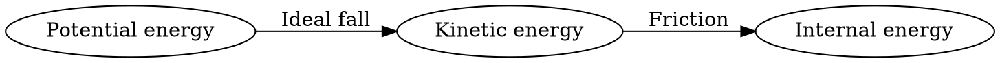

# Mechanical energy and transformations

**Objective:** distinguish conservation of total energy from conservation of
mechanical energy. **Extensions:** Graphviz, MathJax.

## Key ideas

Kinetic energy is $K=mv^2/2$. Near Earth's surface, gravitational potential
energy can be written as $U=mgh$, using a reference height. Mechanical energy
is $E=K+U$.

A 1 kg sphere released from 5 m without air resistance initially has 50 J of
potential energy if $g=10$ m/s². At height zero, these 50 J become kinetic
energy: its speed is 10 m/s.

The diagram distinguishes the ideal case from one with resistance. With
friction, mechanical energy can decrease while the internal energy of the
bodies and surroundings increases. Total energy has not disappeared. The value
of $U$ depends on the reference, but potential-energy differences between two
heights do not depend on that choice.

## Practice

1. Calculate the kinetic energy of 2 kg moving at 3 m/s.
2. Does doubling speed double kinetic energy?

## Answers with explanations

1. $K=9$ J.
2. No: it is multiplied by four.

## Continue learning

[Collection index](README.md) · [Back to practice](#practice)

[Português brasileiro](../pt/energia-mecanica.md) ·
[Español](../es/energia-mecanica.md)
