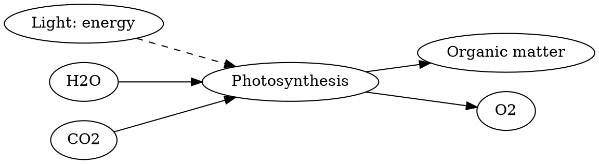

# Photosynthesis: matter and energy

**Objective:** separate energy flow from substance transformation.
**Extensions:** Graphviz, MathJax.

## Key ideas

In oxygenic photosynthesis, light energy is used in processes that allow
organic matter to be synthesized from inorganic carbon. A simplified overall
equation is:

$$
\ce{6 CO2 + 6 H2O -> C6H12O6 + 6 O2}.
$$

The equation summarizes a set of reactions, not one step. Oxygen released in
oxygenic photosynthesis comes from water; the simplified equation alone does
not reveal that atom pathway. Light supplies energy but does not replace water
and carbon dioxide as sources of matter.

Plants also respire, consuming organic compounds in processes that make energy
available to cells. Photosynthesis and respiration are not simply activities
confined respectively to day and night.

## Practice

1. Count the carbon atoms in the equation.
2. Is light a source of carbon atoms?

## Answers with explanations

1. There are six on each side.
2. No; the indicated source is CO₂.

## Continue learning

[Collection index](README.md) · [Back to practice](#practice)

[Português brasileiro](../pt/fotossintese.md) ·
[Español](../es/fotossintese.md)
