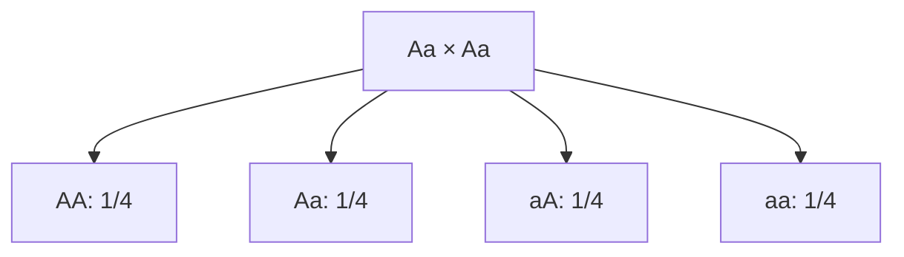

# Genetics: a monohybrid cross

**Objective:** interpret probabilities in a simple inheritance model.
**Extensions:** Mermaid, MathJax.

## Key ideas

Consider a model with two alleles, $A$ and $a$, regular segregation and
complete dominance of $A$. An $Aa$ individual produces gametes carrying $A$ or
$a$, each with probability $1/2$. In an $Aa\times Aa$ cross, with equally
likely combinations, we obtain:

Expected genotype proportions are $1/4$ AA, $1/2$ Aa and $1/4$ aa. With
complete dominance, AA and Aa have the same phenotype in the model: the
expected phenotypic ratio is 3:1. This does not require each group of four
offspring to contain exactly three and one.

Many real traits involve multiple genes, environment or other relationships
between alleles. The diagram is a probability model, not a universal rule for
every biological characteristic.

## Practice

1. What is the probability of a heterozygous offspring?
2. What is the probability of two aa offspring in independent events?

## Answers with explanations

1. $1/2$.
2. $(1/4)(1/4)=1/16$, under the assumptions.

## Continue learning

[Collection index](README.md) · [Back to practice](#practice)

[Português brasileiro](../pt/genetica-mendeliana.md) ·
[Español](../es/genetica-mendeliana.md)
