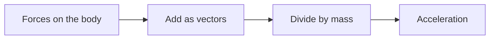

# Forces and Newton’s second law

**Objective:** connect net force and acceleration in an inertial frame.
**Extensions:** Mermaid, MathJax.

## Key ideas

For constant mass in an inertial frame, $\vec F_{\mathrm{res}}=m\vec a$. Net
force is the vector sum of all forces on the body. A single force does not
determine acceleration when other forces also act.

A 2 kg block experiences a horizontal force of 10 N and opposing friction of 4
N. The horizontal net force is 6 N and acceleration is $a=6/2=3$ m/s² in the
direction of the larger force. The diagram organizes the calculation; it does
not show vector lengths to scale.

Zero net force means zero acceleration: the body may be at rest or moving in a
straight line at constant velocity. Action–reaction pairs have equal magnitudes
and opposite directions but act on different bodies; they do not cancel in the
force sum for a single body.

## Practice

1. What acceleration results from 8 N acting on 4 kg?
2. Does a moving body always require a nonzero net force?

## Answers with explanations

1. 2 m/s².
2. No: constant velocity is compatible with zero net force.

## Continue learning

[Collection index](README.md) · [Back to practice](#practice)

[Português brasileiro](../pt/leis-de-newton.md) ·
[Español](../es/leis-de-newton.md)
