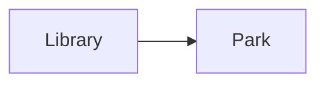

# Local routes: coordinates and connections

**Extensions:** `maps`, `mermaid`.

## Key ideas

These points and the route are fictional, near São Paulo. GeoJSON uses
longitude before latitude. The flowchart shows stop order; the map line is not
a street-routing calculation.

```geojson
{
    "type": "FeatureCollection",
    "features": [
        {
            "type": "Feature",
            "properties": {
                "name": "Library"
            },
            "geometry": {
                "type": "Point",
                "coordinates": [
                    -46.64,
                    -23.55
                ]
            }
        },
        {
            "type": "Feature",
            "properties": {
                "name": "Park"
            },
            "geometry": {
                "type": "Point",
                "coordinates": [
                    -46.63,
                    -23.54
                ]
            }
        },
        {
            "type": "Feature",
            "properties": {
                "name": "Illustrative route"
            },
            "geometry": {
                "type": "LineString",
                "coordinates": [
                    [
                        -46.64,
                        -23.55
                    ],
                    [
                        -46.63,
                        -23.54
                    ]
                ]
            }
        }
    ]
}
```



## Practice

Why does reversing latitude and longitude change location? Does the line
provide travel time?

## Answer with explanation

Each position in the pair has a defined meaning. The line joins coordinates but
does not estimate traffic or time.

[Collection index](README.md)

[Português brasileiro](../pt/mapa-de-rotas.md) ·
[Español](../es/mapa-de-rotas.md)
