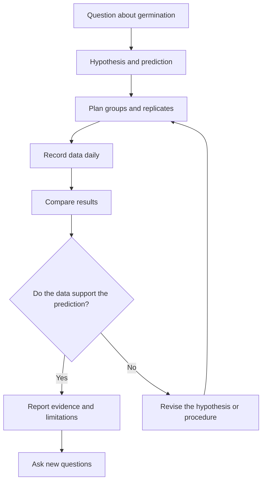

# Investigating seed germination

**Objective:** distinguish hypotheses, controls, observations and conclusions.
**Extension:** Mermaid.

## A testable question

“Does water availability affect germination?” provides a question for an
investigation. Compare seeds of the same species and batch, keeping
temperature, lighting and containers similar. Vary water availability
systematically and record how many seeds germinate in each group. Use more than
one seed per condition.

## Evidence is not absolute certainty

If fewer seeds germinate in one group, also consider measurement errors,
differences between seeds and the number of replicates. An association observed
in a poorly controlled experiment may not reflect the effect of the variable
being studied. Do not discard data merely because they contradict the
hypothesis.

## Practice

1. Identify the manipulated variable and the observed variable.
2. Why repeat the experiment?
3. Write a conclusion if 8 out of 10 seeds germinate with moderate watering and
   2 out of 10 germinate without watering, under the chosen conditions.

## Answers with explanations

1. Manipulated: water availability; observed: germination.
2. Replicates help assess variability and consistency of results.
3. In this trial, moderate watering produced more germinations; this result
   alone does not establish a rule for every species and environment.
