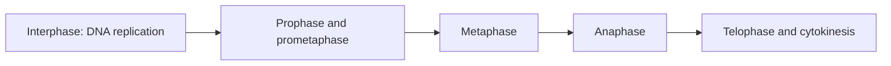

# Mitosis and the cell cycle

**Objective:** order stages and distinguish DNA replication from cell division.
**Extensions:** Mermaid.

## Key ideas

Before mitosis, DNA is replicated during the S phase of interphase. During
mitosis, duplicated chromosomes are distributed to daughter nuclei. Cytokinesis
divides the cytoplasm and usually accompanies the final part of the process.

Chromosomes condense in prophase; prometaphase includes nuclear-envelope
reorganization. Chromosomes align at metaphase, and sister chromatids separate
at anaphase. New nuclei form during telophase. The diagram groups stages for an
introductory reading.

In the usual model of somatic division, daughter cells retain the chromosome
number. DNA replication does not immediately double the number of chromosomes
counted by centromeres. Distinguish this from meiosis, which involves two
divisions and a reduction in chromosome number.

## Practice

1. At what stage does DNA replication occur?
2. What event characterizes anaphase?

## Answers with explanations

1. In the S phase of interphase, before mitosis.
2. Separation of sister chromatids.

## Continue learning

[Collection index](README.md) · [Back to practice](#practice)

[Português brasileiro](../pt/mitose.md) · [Español](../es/mitose.md)
