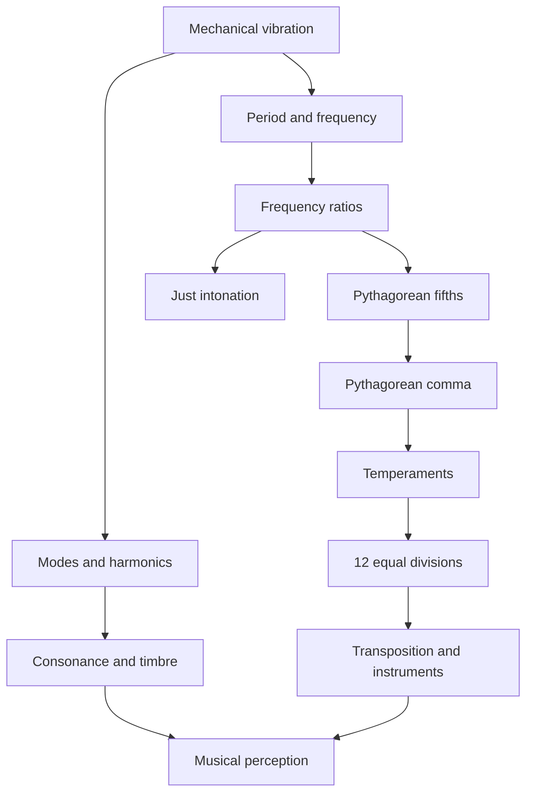

# The Mathematics and Physics of Music: From Pythagoras to Equal Temperament

> **Objective:** Understand how vibrations produce sound, how numerical ratios
> describe musical intervals, and why different tuning systems coexist. This
> chapter combines history, physics, mathematics, and musical notation.
>
> **Extensions used:** `mathjax`, `abc`, `verovio`, `maps`, `vega-lite`,
> `mermaid`, `didactic`, `cross-references`, `heading-ids`, and
> `relative-urls`. Enable the extensions in the rendering application; some
> require optional libraries and host capabilities.

## 1. A question across the centuries

Why do some simultaneous notes sound stable and consonant while others create
tension? What distinguishes one pitch from another? And why can a modern piano
play in different keys without retuning?

Music predates the physical theory of sound by millennia. Yet properties of
instruments and vibrations can be measured, allowing mathematical models of
pitch, intervals, timbre, scales, and chords. These models do not determine
aesthetic experience: consonance and dissonance also depend on history,
repertoire, listening experience, and timbre.

## 2. Pythagoras, Samos, and the tradition of numerical harmony

Pythagoras lived around the sixth century BCE and is traditionally associated
with **Samos**, an island in the Aegean Sea. He later settled in **Croton**
(modern Crotone), in southern Italy, where a Pythagorean community developed.
This tradition linked numerical relationships to natural phenomena, including
musical intervals.

We must distinguish **traditional attribution** from **historical evidence**.
No authentic writings by Pythagoras survive. Accounts involving blacksmiths'
hammers, strings, and acoustic experiments were recorded and embellished by
later authors. Mathematical thinking about music also existed earlier in
Mesopotamia. The enduring historical importance of Pythagoreanism lies
especially in its numerical interpretation of harmony.

<!-- prettier-ignore -->
::: figure Samos and ancient Mediterranean centers associated with the circulation of knowledge {#mapa-antigo}

```geojson
{
  "type": "FeatureCollection",
  "features": [
    {"type":"Feature","properties":{"name":"Samos","label":"Samos","title":"Samos"},"geometry":{"type":"Point","coordinates":[26.98.37.75]}},
    {"type":"Feature","properties":{"name":"Crotona","label":"Crotona","title":"Crotona"},"geometry":{"type":"Point","coordinates":[17.13.39.08]}},
    {"type":"Feature","properties":{"name":"Miletus (Ionia)"},"geometry":{"type":"Point","coordinates":[27.28.37.53]}},
    {"type":"Feature","properties":{"name":"Athens"},"geometry":{"type":"Point","coordinates":[23.73.37.98]}},
    {"type":"Feature","properties":{"name":"Syracuse"},"geometry":{"type":"Point","coordinates":[15.29.37.08]}},
    {"type":"Feature","properties":{"name":"Alexandria (founded later)"},"geometry":{"type":"Point","coordinates":[29.92.31.20]}}
  ]
}
```

:::

**Reading the historical map:** Coordinates are modern approximations. The
points do not represent ancient borders or prove Pythagoras's personal
itinerary. Alexandria is shown as a later center of knowledge transmission, not
as a city contemporary with Pythagoras.

The **music of the spheres** is an ancient philosophical idea connecting cosmic
order and harmonic proportions. It does not imply that planets generate audible
sound in empty space: mechanical sound requires a material medium.

## 3. What is a musical sound?

A sound source sets its surrounding medium in motion. In a simple model,
acoustic pressure at a point varies approximately as

$$p(t)=p_0+A\sin(2\pi ft+\varphi),$$

where $A$ is amplitude, $f$ frequency (hertz), $t$ time, and $\varphi$ initial
phase. Frequency is strongly associated with perceived **pitch**. Amplitude
relates to physical intensity, although perceived loudness also depends on
frequency, duration, and hearing.

<!-- prettier-ignore -->
::: definition Frequency and period {#frequencia-periodo}

For a periodic oscillation, the period $T$ is the duration of one cycle:

$$\boxed{f=\frac{1}{T}}.$$

An A at $440\,\mathrm{Hz}$ completes 440 cycles per second and has a period of
approximately $2.27\,\mathrm{ms}$.

:::

<!-- prettier-ignore -->
::: figure A sinusoidal oscillation sampled over time {#grafico-onda}

```vega-lite
{
  "$schema":"https://vega.github.io/schema/vega-lite/v5.json",
  "description":"440 Hz wave sampled over 10 ms.",
  "data":{"sequence":{"start":0,"stop":10.05,"step":0.05,"as":"t"}},
  "transform":[{"calculate":"sin(2*PI*440*datum.t/1000)","as":"p"}],
  "mark":{"type":"line","strokeWidth":2},
  "encoding":{
    "x":{"field":"t","type":"quantitative","title":"Time (ms)"},
    "y":{"field":"p","type":"quantitative","title":"Relative pressure (arbitrary units)","scale":{"domain":[-1.1.1.1]}}
  },
  "width":"container","height":220
}
```

:::

Real sounds are generally not pure sine waves. A vibrating string, air column,
or membrane may produce multiple frequency components. This spectrum, together
with the onset and time evolution of a sound, contributes to its **timbre**.

## 4. The monochord: length, tension, and frequency

A **monochord** is a teaching instrument with a stretched string and a movable
bridge that changes the vibrating length. For an ideal uniform string of length
$L$, tension $F$, and linear mass density $\mu$, the fundamental frequency is

$$\boxed{f_1=\frac{1}{2L}\sqrt{\frac{F}{\mu}}}.$$

Keeping tension and linear density constant gives

$$f_1\propto\frac{1}{L}\quad\Longrightarrow\quad\frac{f_2}{f_1}=\frac{L_1}{L_2}.$$

Halving the string length doubles the frequency. Shortening it to two-thirds
produces a frequency ratio of $3/2$.

<!-- prettier-ignore -->
::: table Vibrating length and interval relative to the full string {#tabela-monocordio}

| Length $L'/L$ | Frequency ratio $f'/f$ | Interval         |
| ------------: | ---------------------: | ---------------- |
|           $1$ |                  $1:1$ | Unison           |
|         $4/5$ |                  $5:4$ | Pure major third |
|         $3/4$ |                  $4:3$ | Pure fourth      |
|         $2/3$ |                  $3:2$ | Pure fifth       |
|         $1/2$ |                  $2:1$ | Octave           |

:::

Notice that **length and frequency are inversely proportional**: a length ratio
of $2:3$ gives a frequency ratio of $3:2$. Frequency also depends on tension:
doubling tension multiplies frequency by $\sqrt{2}$, not by 2.

<!-- prettier-ignore -->
::: exercise Monochord experiment {#exercicio-monocordio}

A string $80\,\mathrm{cm}$ long has a fundamental frequency of
$220\,\mathrm{Hz}$. Keeping tension constant, what length produces
$330\,\mathrm{Hz}$?

<!-- prettier-ignore -->
::: hint

Use $f_2/f_1=L_1/L_2$.

:::

<!-- prettier-ignore -->
::: solution Worked solution

$$L_2=80\frac{220}{330}=\frac{160}{3}\,\mathrm{cm}\approx53.33\,\mathrm{cm}.$$

The new length is $2/3$ of the original: a pure fifth higher.

:::

:::

## 5. The harmonic series and consonance

A string fixed at both ends supports standing-wave modes with ideal frequencies

$$\boxed{f_n=nf_1\qquad(n=1,2,3,\ldots)}.$$

For a $220\,\mathrm{Hz}$ fundamental, the first harmonics are $220$, $440$,
$660$, $880$, $1100$, and $1320\,\mathrm{Hz}$. The second is the octave; the
third, lowered by an octave, is a pure fifth; and the fifth, lowered by two
octaves, is a pure major third.

<!-- prettier-ignore -->
::: figure Frequencies of the first eight harmonics of a 220 Hz fundamental {#grafico-harmonicos}

```vega-lite
{
  "$schema":"https://vega.github.io/schema/vega-lite/v5.json",
  "data":{"values":[{"n":"1","f":220},{"n":"2","f":440},{"n":"3","f":660},{"n":"4","f":880},{"n":"5","f":1100},{"n":"6","f":1320},{"n":"7","f":1540},{"n":"8","f":1760}]},
  "mark":"bar",
  "encoding":{"x":{"field":"n","type":"ordinal","title":"Harmonic number"},"y":{"field":"f","type":"quantitative","title":"Frequency (Hz)"},"tooltip":[{"field":"n"},{"field":"f"}]},
  "width":"container","height":220
}
```

:::

When fundamentals have simple frequency ratios, some harmonics may coincide.
For $440\,\mathrm{Hz}$ and $660\,\mathrm{Hz}$:

$$3(440)=2(660)=1320\,\mathrm{Hz}.$$

Such coincidences contribute to the consonance of a pure fifth, but **do not
universally explain musical preferences**. Inharmonic timbres, such as bells,
and diverse musical traditions reveal the limits of a purely numerical
explanation.

## 6. Musical intervals: ratios rather than differences

An **interval** between $f_a$ and $f_b$ can be expressed as $r=f_b/f_a$. Moving
up an octave multiplies frequency by 2; two octaves multiply it by 4; a pure
fifth multiplies it by $3/2$.

<!-- prettier-ignore -->
::: definition Octave {#def-oitava}

Two notes an octave apart have a frequency ratio of $2:1$, regardless of the
starting frequency: $220\to440$, $440\to880$, and $880\to1760\,\mathrm{Hz}$ are
octaves.

:::

Because interval composition corresponds to multiplying frequency ratios,
scales are naturally described **multiplicatively**. This leads to logarithmic
measurement.

## 7. Building the Pythagorean scale

In **Pythagorean tuning**, notes are generated by pure fifths of ratio $3/2$
and moved into one octave by powers of 2. Starting from C, the fifths C – G – D
– A – E – B, together with a descending fifth to F, produce a diatonic scale.

<!-- prettier-ignore -->
::: equation Fifth brought into the reference octave {#eq-quintas}

$$r_k=\left(\frac32\right)^k 2^{-m_k},\qquad 1\leq r_k<2,$$

where the integer $m_k$ places the note within the reference octave.

:::

<!-- prettier-ignore -->
::: table Pythagorean C-major scale: frequency ratios relative to the initial C {#tabela-pitagorica}

| Note | Degree | Ratio $f/f_{\mathrm{C}}$ | Approximation |
| ---- | ------ | -----------------------: | ------------: |
| C    | I      |                    $1/1$ |      1.000000 |
| D    | II     |                    $9/8$ |      1.125000 |
| E    | III    |                  $81/64$ |      1.265625 |
| F    | IV     |                    $4/3$ |      1.333333 |
| G    | V      |                    $3/2$ |      1.500000 |
| A    | VI     |                  $27/16$ |      1.687500 |
| B    | VII    |                $243/128$ |      1.898438 |
| C    | VIII   |                    $2/1$ |      2.000000 |

:::

<!-- prettier-ignore -->
The following score uses longer note values and an extended staff width to space the fraction labels. Actual width also depends on the ABC renderer's CSS. It displays **notated pitches**; the ratios in {@ref tabela-pitagorica} specify the physical tuning. Conventional staff notation alone does not determine these ratios.

<!-- prettier-ignore -->
::: figure C-major score annotated with Pythagorean ratios {#partitura-pitagorica}

```abc
X:1
T:C major scale - Pythagorean degrees
C:Educational example
M:4/4
L:1/2
%%stretchlast 1
%%staffwidth 1000
K:C
C2 D2 E2 F2 | G2 A2 B2 c2 |]
w: 1/1 9/8 81/64 4/3 3/2 27/16 243/128 2/1
```

:::

**Playback note:** ABC encodes the notes and fraction labels, but a renderer's
playback may use equal temperament. A configurable tuning synthesizer is needed
to hear Pythagorean frequencies.

The Pythagorean scale has two step sizes: the whole tone $9/8$ and the diatonic
semitone $256/243$, or _limma_. Its ascending pattern is
tone–tone–semitone–tone–tone–tone–semitone. Its major third is $81/64$, unlike
the pure major third $5/4$.

## 8. Just intonation: another untempered system

**Untempered** does not mean a single scale. Pythagorean tuning prioritizes
pure fifths; **five-limit just intonation** also uses the prime factor 5 to
obtain intervals such as the major third $5/4$.

<!-- prettier-ignore -->
::: table Two ways to tune a C-major scale {#tabela-justa}

| Note | Pythagorean | Five-limit just (one possible realization) |
| ---- | ----------: | -----------------------------------------: |
| C    |       $1/1$ |                                      $1/1$ |
| D    |       $9/8$ |                                      $9/8$ |
| E    |     $81/64$ |                                      $5/4$ |
| F    |       $4/3$ |                                      $4/3$ |
| G    |       $3/2$ |                                      $3/2$ |
| A    |     $27/16$ |                                      $5/3$ |
| B    |   $243/128$ |                                     $15/8$ |
| C    |       $2/1$ |                                      $2/1$ |

:::

The just major third $5/4$ is narrower than the Pythagorean major third
$81/64$. Their ratio is

$$\frac{81/64}{5/4}=\frac{81}{80},$$

called the **syntonic comma**. In practice, just intonation can depend on
harmonic context: a note name need not have one fixed frequency throughout
every chord progression.

## 9. The problem of the circle of fifths

Starting at C and moving through fifths gives C – G – D – A – E – B – F♯ – C♯ –
G♯ – D♯ – A♯ – E♯ – B♯. On an equal-tempered keyboard, B♯ and C use the same
key. But **twelve pure fifths do not equal seven octaves exactly**.


<!-- prettier-ignore -->
::: equation The Pythagorean comma {#eq-coma}

$$\boxed{\frac{(3/2)^{12}}{2^7}=\frac{531441}{524288}\approx1.0136433.}$$

:::

The difference is about **23.46 cents**, slightly less than a quarter of an
equal-tempered semitone. Thus a closed twelve-note system cannot preserve both
all fifths at $3/2$ and all octaves at $2/1$. The discrepancy must be
concentrated in one interval or distributed among several.

Some historical tunings produce a particularly discordant interval known as the
**wolf fifth**.

## 10. What does it mean to temper a scale?

To **temper** a scale is to adjust intervals away from pure ratios to obtain
other musical advantages. Systems include unequal temperaments, such as
meantone and various historical well temperaments, and equal temperaments.

In **twelve-tone equal temperament** (12-TET), every semitone has the same
frequency ratio:

<!-- prettier-ignore -->
::: equation Note frequency in equal temperament {#eq-12tet}

$$\boxed{f_n=f_0\,2^{n/12}},\qquad n\in\mathbb{Z}.$$

:::

Two notes seven semitones apart have ratio $2^{7/12}\approx1.498307$, slightly
narrower than the pure fifth $3/2=1.5$. Octaves remain exactly $2/1$.

<!-- prettier-ignore -->
::: table Frequencies from A 440 Hz in 12-TET {#tabela-frequencias}

| Note | Semitones above A | Frequency (Hz) |
| ---- | ----------------: | -------------: |
| A    |                 0 |         440.00 |
| A♯   |                 1 |         466.16 |
| B    |                 2 |         493.88 |
| C    |                 3 |         523.25 |
| C♯   |                 4 |         554.37 |
| D    |                 5 |         587.33 |
| D♯   |                 6 |         622.25 |
| E    |                 7 |         659.26 |
| F    |                 8 |         698.46 |
| F♯   |                 9 |         739.99 |
| G    |                10 |         783.99 |
| G♯   |                11 |         830.61 |
| A    |                12 |         880.00 |

:::

The practical advantage is **transposition**: the same interval pattern can be
moved to another key without retuning a fixed-pitch instrument. The compromise
is that most intervals differ slightly from simple just-intonation ratios.

## 11. Measuring small differences: the cent

The **cent** is a logarithmic unit: an octave spans 1.200 cents and each 12-TET
semitone spans 100 cents.

<!-- prettier-ignore -->
::: equation Logarithmic measurement of an interval {#eq-cent}

$$\boxed{c=1200\log_2\left(\frac{f_2}{f_1}\right)}.$$

:::

Logarithms turn multiplication of ratios into addition of intervals: a fifth
plus a fourth makes an octave, since $(3/2)(4/3)=2$.

<!-- prettier-ignore -->
::: table Just, Pythagorean, and tempered intervals {#tabela-comparacao}

| Interval                | Razão pura selecionada | Cents da razão pura | Cents no 12-TET |
| ----------------------- | ---------------------: | ------------------: | --------------: |
| Pure major third        |                  $5/4$ |              386.31 |          400.00 |
| Pythagorean major third |                $81/64$ |              407.82 |          400.00 |
| Pure fourth             |                  $4/3$ |              498.04 |          500.00 |
| Pure fifth              |                  $3/2$ |              701.96 |          700.00 |
| Octave                  |                  $2/1$ |             1200.00 |         1200.00 |

:::

<!-- prettier-ignore -->
::: figure Tuning deviation from 12-TET, measured in cents {#grafico-deviations}

```vega-lite
{
  "$schema":"https://vega.github.io/schema/vega-lite/v5.json",
  "data":{"values":[
    {"interval":"Pure major third","deviation":-13.686},
    {"interval":"Pythagorean major third","deviation":7.820},
    {"interval":"Pure fourth","deviation":-1.955},
    {"interval":"Pure fifth","deviation":1.955},
    {"interval":"Octave","deviation":0}
  ]},
  "mark":"bar",
  "encoding":{
    "y":{"field":"interval","type":"nominal","sort":null,"title":null},
    "x":{"field":"deviation","type":"quantitative","title":"Deviation from equal temperament (cents)","scale":{"domain":[-16.10]}},
    "tooltip":[{"field":"interval"},{"field":"deviation","format":".2f"}]
  },
  "width":"container","height":220
}
```

:::

## 12. Why exactly twelve notes per octave?

Twelve divisions are not dictated by nature. They represent a historical choice
supported by the organization of notes in fifths and by a useful mathematical
approximation:

$$\left(\frac32\right)^{12}\approx2^7.$$

A pure fifth occupies $\log_2(3/2)\approx0.5849625$ octaves. The rational
approximation

$$\frac7{12}\approx0.5833333$$

means a fifth can be approximated by **seven of twelve equal steps**. The error
is only $1.955$ cents per fifth.

In an equal division of $N$ steps, a fifth can be approximated by $k$ steps
when

$$\boxed{\frac{k}{N}\approx\log_2(3/2).}$$

<!-- prettier-ignore -->
::: table Other possible equal divisions {#tabela-edos}

| Divisions $N$ | Steps $k$ for a fifth | Approximate fifth (cents) | Error relative to 701.955 cents |
| ------------: | --------------------: | ------------------------: | ------------------------------: |
|            10 |                     6 |                    720.00 |                          +18.05 |
|            12 |                     7 |                    700.00 |                           −1.96 |
|            19 |                    11 |                    694.74 |                           −7.22 |
|            24 |                    14 |                    700.00 |                           −1.96 |
|            31 |                    18 |                    696.77 |                           −5.18 |
|            53 |                    31 |                    701.89 |                           −0.07 |

:::

A **24-step** octave retains the 12-TET fifth but adds intermediate 50-cent
notes. **19 steps** offer different interval relationships and expressive
possibilities. **53 steps** approximate the pure fifth remarkably closely but
require more pitches per octave. No system is universally best: each balances
pitch count, pure-ratio accuracy, and cultural practice.

The Western use of twelve notes reflects instrument history, notation,
repertoire, counterpoint, harmony, and performance conventions—not a
calculation alone. **Twelve-tone equal temperament** spread gradually and
should not be confused with the historical emergence of twelve chromatic pitch
classes.

## 13. Beats: when frequencies almost coincide

Adding two nearby sine waves yields

$$\sin(2\pi f_1t)+\sin(2\pi f_2t)=2\cos\!\left(\pi(f_1-f_2)t\right)\sin\!\left(\pi(f_1+f_2)t\right).$$

The fast oscillation is modulated by a slow envelope. Under suitable
conditions, the beat frequency is $|f_1-f_2|$.

A pure fifth above A $440\,\mathrm{Hz}$ is $660\,\mathrm{Hz}$; the
equal-tempered fifth is approximately $659.255\,\mathrm{Hz}$. Compare the third
harmonic of the lower note with the second harmonic of the upper:

- Pure fifth: $3(440)=2(660)=1320\,\mathrm{Hz}$ — exact coincidence.
- Equal-tempered fifth: $3(440)=1320\,\mathrm{Hz}$ and
  $2(659.255)\approx1318.51\,\mathrm{Hz}$ — a difference of about
  $1.49\,\mathrm{Hz}$.

Slow modulation may occur if both components are sufficiently strong.
Perception depends on level, timbre, room acoustics, and hearing.

## 14. Score, tuning, and performance: three distinct layers

A **score** represents notes, durations, measures, and articulations. A
**tuning** assigns actual frequencies to notes. A **performance** realizes
those sounds through particular instruments and performers.

<!-- prettier-ignore -->
::: figure The same scale in MEI: tuning must be specified separately {#partitura-mei}

```mei
<?xml version="1.0" encoding="UTF-8"?>
<mei xmlns="http://www.music-encoding.org/ns/mei" meiversion="5.0">
  <meiHead><fileDesc><titleStmt><title>C major scale</title></titleStmt><pubStmt/></fileDesc></meiHead>
  <music><body><mdiv><score>
    <scoreDef meter.count="4" meter.unit="4"><staffGrp><staffDef n="1" lines="5" clef.shape="G" clef.line="2"/></staffGrp></scoreDef>
    <section>
      <measure n="1"><staff n="1"><layer n="1"><note pname="c" oct="4" dur="4"/><note pname="d" oct="4" dur="4"/><note pname="e" oct="4" dur="4"/><note pname="f" oct="4" dur="4"/></layer></staff></measure>
      <measure n="2"><staff n="1"><layer n="1"><note pname="g" oct="4" dur="4"/><note pname="a" oct="4" dur="4"/><note pname="b" oct="4" dur="4"/><note pname="c" oct="5" dur="4"/></layer></staff></measure>
    </section>
  </score></mdiv></body></music>
</mei>
```

:::

The same written passage may be played in Pythagorean, just, or equal
temperament. This distinction matters especially for flexible-pitch
instruments, such as the voice and fretless strings.

## 15. Synthesis: a network of relationships



Musical experience combines physical regularities, mathematical models, and
cultural decisions. Pythagoras became a symbol of this relationship because the
Pythagorean tradition linked consonance and proportion. The monochord reveals
why string length matters; harmonics show related frequencies; scales select
certain pitches; and the Pythagorean comma shows why twelve pure fifths cannot
close exactly against seven octaves.

Equal temperament did not replace a single universally natural tuning. It is a
particularly useful solution for music involving transposition and multiple
keys. Other tuning systems remain musically meaningful.

## 16. Investigation activities

<!-- prettier-ignore -->
::: exercise Activity 1 — Calculate frequency {#atividade-frequencia}

With C at $f_0=256\,\mathrm{Hz}$, calculate the Pythagorean E ($81/64$), just E
($5/4$), and equal-tempered E ($2^{4/12}$). Compare.

<!-- prettier-ignore -->
::: solution Explained answer

Pythagorean E: $256(81/64)=324\,\mathrm{Hz}$. Just E:
$256(5/4)=320\,\mathrm{Hz}$. Equal-tempered E:
$256\,2^{1/3}\approx322.54\,\mathrm{Hz}$. The same note name can represent
different frequencies in different tuning systems.

:::

:::

<!-- prettier-ignore -->
::: exercise Activity 2 — Verify the comma {#atividade-coma}

Calculate $(3/2)^{12}/2^7$ and explain why twelve pure fifths cannot form an
exact closed cycle.

<!-- prettier-ignore -->
::: solution Explained answer

The result is $531441/524288\approx1.0136433$, greater than 1. The final
frequencies do not coincide: this is the Pythagorean comma.

:::

:::

<!-- prettier-ignore -->
::: exercise Activity 3 — Design another temperament {#atividade-edo}

In a 19-step equal division of the octave, what is the ratio between adjacent
steps? What frequency lies seven steps above $440\,\mathrm{Hz}$?

<!-- prettier-ignore -->
::: solution Explained answer

The ratio is $2^{1/19}$. Seven steps above 440 Hz gives
$440\,2^{7/19}\approx568.0\,\mathrm{Hz}$. In 19-TET a fifth is approximated by
eleven steps, not seven.

:::

:::

<!-- prettier-ignore -->
::: exercise Activity 4 — Interpret a score {#atividade-partitura}

<!-- prettier-ignore -->
Does the score in {@ref partitura-pitagorica} determine each exact frequency? Explain notation versus tuning.

<!-- prettier-ignore -->
::: solution Explained answer

No. A score specifies note names and durations but not a complete frequency
system. A reference pitch and tuning system are required; the ratios in the
text supply the Pythagorean specification.

:::

:::

## References and further reading

These links provide starting points for further research and fact-checking.
Wikipedia articles are secondary reference resources, not substitutes for
specialist historical scholarship.

1. [Pythagoras — Portuguese Wikipedia](https://pt.wikipedia.org/wiki/Pit%C3%A1goras).
2. [Pythagoras — English Wikipedia](https://en.wikipedia.org/wiki/Pythagoras).
3. [Pythagore — French Wikipedia](https://fr.wikipedia.org/wiki/Pythagore).
4. [Pitágoras — Spanish Wikipedia](https://es.wikipedia.org/wiki/Pit%C3%A1goras).
5. [Pythagoreanism](https://en.wikipedia.org/wiki/Pythagoreanism).
6. [Pythagorean tuning](https://en.wikipedia.org/wiki/Pythagorean_tuning).
7. [Just intonation](https://en.wikipedia.org/wiki/Just_intonation).
8. [Musical temperament](https://en.wikipedia.org/wiki/Musical_temperament).
9. [Pythagorean comma](https://en.wikipedia.org/wiki/Pythagorean_comma).
10. [MathJSLab Markdown — documentation](https://github.com/MathJSLab/mathjslab-markdown).
