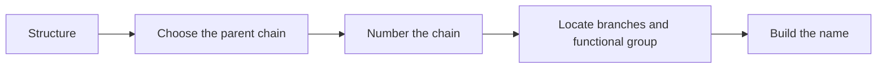

# Organic nomenclature: from chain to name

**Objective:** name simple examples of alkanes, alkenes and alcohols.
**Extensions:** SMILES and Mermaid.

## A procedure for this lesson

Choose a suitable parent chain, number it to locate the relevant groups, and
combine chain length, unsaturation and functional group. Priority rules become
more complex when several functional groups are present; this lesson uses one
principal functional group per molecule.



## Three worked examples

`CCCC` represents an unbranched chain with four carbons and single bonds:
**butane**. The prefix `but-` indicates four carbons.

```smiles
CCCC
```

In `CC=CC`, the double bond is between carbons 2 and 3: **but-2-ene**. This
notation does not specify the spatial configuration of the double bond.

```smiles
CC=CC
```

In `CC(O)C`, the parent chain has three carbons and the OH is on carbon 2:
**propan-2-ol**. Parentheses record a branch in SMILES notation.

```smiles
CC(O)C
```

## Branches

```smiles
CC(C)CC
```

The parent chain has four carbons and a methyl group on carbon 2:
**2-methylbutane**. Numbering from the other end would give 3; we choose 2.

## Practice

1. Name `CCC`.
2. Name `CCCO`, with its terminal OH.
3. Why is counting all the carbons insufficient to choose the parent-chain
   prefix?

## Answers with explanations

1. Propane.
2. Propan-1-ol.
3. Carbons in branches do not necessarily belong to the parent chain.
