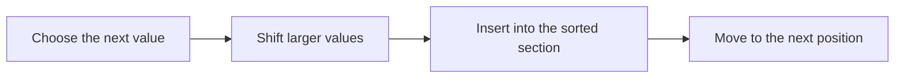

# Insertion sort: building a sorted section

**Objective:** trace comparisons and shifts in an algorithm. **Extensions:**
Mermaid, syntax-highlight.

## Key ideas

Insertion sort keeps an initial part of the array in order. Each step takes the
next value, shifts larger values to the right and inserts it in the correct
place. The process resembles arranging cards in a hand.



```javascript
function insertionSort(values) {
    for (let i = 1; i < values.length; i += 1) {
        const key = values[i];
        let j = i - 1;
        while (j >= 0 && values[j] > key) {
            values[j + 1] = values[j];
            j -= 1;
        }
        values[j + 1] = key;
    }
    return values;
}
console.log(insertionSort([5, 2, 4, 1]));
```

In $[5,2,4,1]$, inserting 2 gives the sorted section $[2,5]$; inserting 4 gives
$[2,4,5]$; inserting 1 finishes with $[1,2,4,5]$. The code modifies the
original array. The block is for reading and does not execute JavaScript in the
document.

Using strict comparison `>` preserves the relative order of equal values in
this implementation. In the worst case, many comparisons and shifts are needed:
work grows proportionally to $n^2$. An already sorted array needs fewer shifts,
showing that input affects cost.

## Practice

1. Manually sort $[3,1,2]$.
2. Is the array returned by the algorithm an independent copy?

## Answers with explanations

1. After inserting 1: $[1,3,2]$; after inserting 2: $[1,2,3]$.
2. No; the algorithm changes the array it receives.

## Continue learning

[Collection index](README.md) · [Back to practice](#practice)

[Português brasileiro](../pt/ordenacao-insercao.md) ·
[Español](../es/ordenacao-insercao.md)
