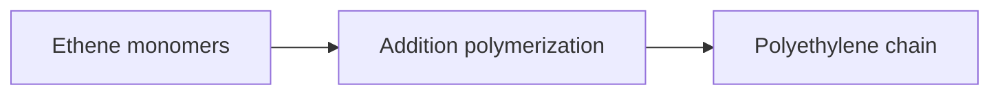

# Polymers: from unit to chain

**Objective:** distinguish monomer, repeating unit and macromolecule.
**Extensions:** SMILES, Mermaid, MathJax.

## Key ideas

A polymer is a substance made of macromolecules with many repeating units. In
addition polymerization of ethene, the double bond participates in forming a
chain with repeating unit $\ce{-CH2-CH2-}$.

```smiles
C=C
```



The SMILES represents the ethene monomer, not an entire polyethylene chain. The
diagram summarizes conceptual steps, not a reaction mechanism or a
manufacturing recipe. The symbol $n$ in $\ce{[-CH2-CH2-]_{n}}$ indicates
repetition; molecules in a sample may have different chain lengths.

Material properties depend on chain length, branching, organization and
additives. Sharing a repeating unit does not guarantee identical properties.
Compare the molecular scale of the structure with the macroscopic scale of a
plastic object.

## Practice

1. How many carbons are in the indicated repeating unit?
2. Does ethene’s SMILES show the number of units in the final chain?

## Answers with explanations

1. Two.
2. No; it describes only one monomer molecule.

## Continue learning

[Collection index](README.md) · [Back to practice](#practice)

[Português brasileiro](../pt/polimeros.md) · [Español](../es/polimeros.md)
