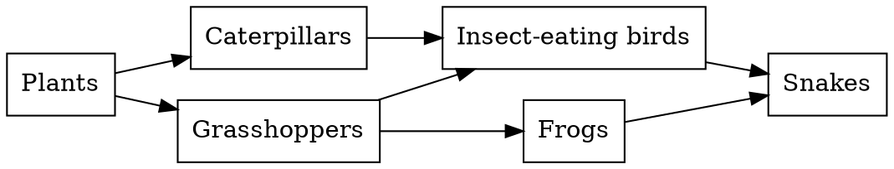

# Biology: a simplified food web

**Objective:** interpret feeding relationships and energy flow. **Extension:**
Graphviz.

## The meaning of the arrows

In this fictional web, arrows point from the organism being eaten to the
consumer: they indicate the direction of matter and energy transfer. The
organisms are generic groups, and the diagram does not describe a particular
ecosystem.

## Web and chain

A chain is a path, such as plants → grasshoppers → frogs → snakes. A web
combines several connected chains. A change in one population may affect
different paths, but the diagram does not quantify the strength of these
relationships. Decomposers and other organisms were omitted to make reading
easier; they are not dispensable in the ecosystem.

## Practice

1. Identify the producers in the web.
2. Which consumers receive energy directly from grasshoppers?
3. Why can we not predict the snake population merely by counting arrows?

## Answers with explanations

1. Plants.
2. Insect-eating birds and frogs.
3. Quantities, rates, other resources and environmental interactions are
   missing.
