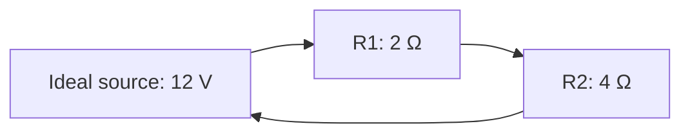

# Series resistors: current and voltage

**Objective:** calculate equivalent resistance and voltage division in an ideal
model. **Extensions:** Mermaid, MathJax.

## Key ideas

A series connection has a single path for current. For ideal ohmic resistors,
$R_{\mathrm{eq}}=R_1+R_2$. The same current passes through both, but their
voltage drops may differ: $V_i=IR_i$.

The drawing shows the connectivity of a closed circuit, not conventional
electrical symbols. With an ideal 12 V source and resistors of 2 Ω and 4 Ω,
$R_{\mathrm{eq}}=6$ Ω and $I=12/6=2$ A. The drops are 4 V and 8 V, whose sum
equals the source voltage.

The model ignores wire resistance and temperature effects. Voltage is a
potential difference; current is charge flow. They are different quantities
with different units. This is a paper-based analysis activity.

## Practice

1. If the source becomes 6 V, what is the current?
2. Which resistor has the larger voltage drop?

## Answers with explanations

1. 1 A, with the same resistances.
2. The 4 Ω resistor: at equal current, the drop is proportional to resistance.

## Continue learning

[Collection index](README.md) · [Back to practice](#practice)

[Português brasileiro](../pt/resistores-em-serie.md) ·
[Español](../es/resistores-em-serie.md)
