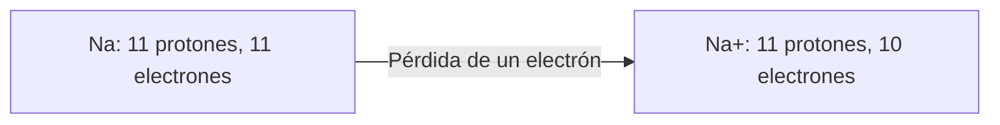

# Átomos e iones: carga e identidad

**Objetivo:** distinguir número atómico, número másico y carga eléctrica.
**Extensiones:** Mermaid, MathJax.

## Ideas clave

El número atómico $Z$ es el número de protones y determina el elemento. El
número másico $A$ suma protones y neutrones: $A=Z+N$. La carga, en unidades de
carga elemental, es $q=Z-n_e$, donde $n_e$ cuenta los electrones.

Un átomo neutro de sodio tiene 11 protones y 11 electrones. Al perder un
electrón forma $\ce{Na+}$, con 10 electrones. El núcleo no cambió; sigue siendo
sodio.

Los isótopos tienen el mismo $Z$ y distinto número de neutrones. Los iones
difieren en la carga por haber ganado o perdido electrones. No deben
confundirse estos conceptos. El diagrama muestra un cambio en el número de
electrones, no sus trayectorias ni una reacción completa.

## Practica

1. Un átomo tiene $Z=6$ y $A=14$. ¿Cuántos neutrones posee?
2. Si tiene 8 electrones, ¿cuál es su carga?

## Respuestas comentadas

1. $N=14-6=8$.
2. $q=6-8=-2$, en unidades de carga elemental.

## Sigue aprendiendo

[Índice de la colección](README.md) · [Volver a los ejercicios](#practica)

[Português brasileiro](../pt/atomos-e-ions.md) ·
[English](../en/atomos-e-ions.md)
