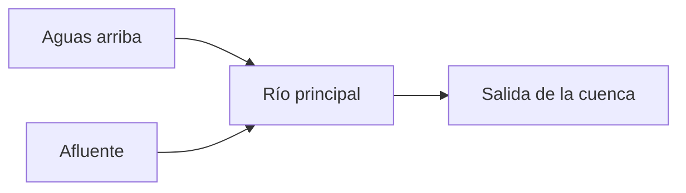

# Cuencas hidrográficas: área y red de drenaje

**Objetivo:** distinguir el límite de una cuenca, el curso de agua y el sentido
del flujo. **Extensiones:** maps/GeoJSON, Mermaid.

## Ideas clave

Una cuenca hidrográfica reúne el área cuyas aguas drenan hacia una salida
común. Las divisorias de aguas separan cuencas y no tienen que coincidir con
límites municipales. La red incluye el río principal y sus afluentes.

```geojson
{
    "type": "FeatureCollection",
    "features": [
        {
            "type": "Feature",
            "properties": {
                "name": "Cuenca ficticia"
            },
            "geometry": {
                "type": "Polygon",
                "coordinates": [
                    [
                        [
                            -45,
                            -10
                        ],
                        [
                            -44,
                            -10
                        ],
                        [
                            -44,
                            -9
                        ],
                        [
                            -45,
                            -9
                        ],
                        [
                            -45,
                            -10
                        ]
                    ]
                ]
            }
        },
        {
            "type": "Feature",
            "properties": {
                "name": "Curso ficticio"
            },
            "geometry": {
                "type": "LineString",
                "coordinates": [
                    [
                        -44.8,
                        -9.2
                    ],
                    [
                        -44.5,
                        -9.5
                    ],
                    [
                        -44.2,
                        -9.8
                    ]
                ]
            }
        }
    ]
}
```



El polígono y la línea son ficticios, en coordenadas geográficas, para comparar
un área y un recorrido. No representan una cuenca real ni permiten deducir la
altitud a partir de la latitud. El anillo del polígono termina en la misma
coordenada en la que empezó.

El sentido real del flujo requiere información del relieve. El segundo diagrama
especifica un sentido didáctico. Los cambios de uso del suelo aguas arriba
pueden afectar el agua y los sedimentos aguas abajo; estudiar solo un tramo
aislado puede ocultar relaciones importantes.

## Practica

1. ¿Qué geometría representa el área: Polygon o LineString?
2. ¿El orden de las coordenadas revela el sentido real de la corriente?

## Respuestas comentadas

1. Polygon.
2. No; se necesita relieve o información hidrológica adicional.

## Sigue aprendiendo

[Índice de la colección](README.md) · [Volver a los ejercicios](#practica)

[Português brasileiro](../pt/bacia-hidrografica.md) ·
[English](../en/bacia-hidrografica.md)
