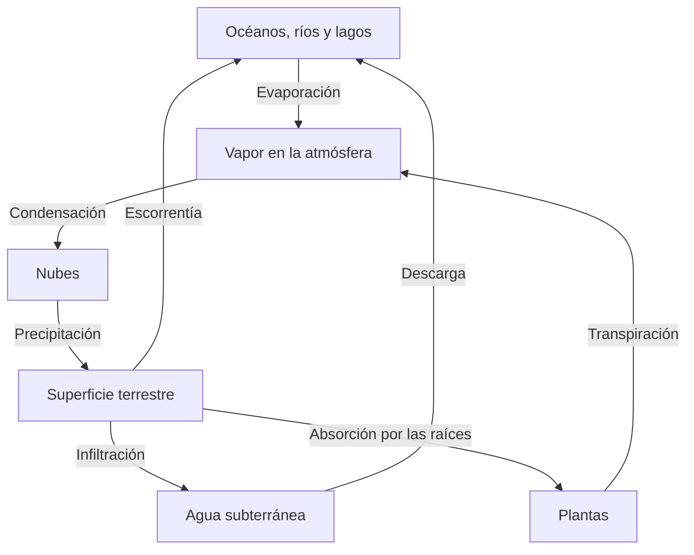

# El ciclo del agua y la conservación de la materia

**Objetivo:** explicar las transferencias de agua entre reservorios.
**Extensión:** Mermaid.

## Un ciclo con varios caminos

La energía solar favorece la evaporación. El vapor puede condensarse en gotas y
cristales que forman nubes; la precipitación devuelve agua a la superficie. Una
parte se infiltra en el suelo y otra fluye por la superficie. Las plantas
también devuelven agua a la atmósfera mediante la transpiración.

Las flechas representan procesos, no tiempos iguales. Una molécula de agua
puede permanecer mucho más tiempo en un acuífero que en una nube. La materia
circula, mientras que la energía se transfiere y se disipa.

## Un problema urbano

Pavimentar un terreno tiende a reducir la infiltración y a aumentar la
escorrentía superficial. Los jardines de lluvia y las áreas permeables pueden
favorecer la retención local, pero su eficacia depende del suelo, del
mantenimiento y de la intensidad de la lluvia.

## Practica

1. ¿Qué flecha del diagrama corresponde a la formación de nubes?
2. ¿Por qué no debe dibujarse el ciclo como una única secuencia lineal?
3. ¿Qué puede ocurrir con la escorrentía después de impermeabilizar el suelo?

## Respuestas comentadas

1. La condensación del vapor.
2. Existen caminos alternativos y reservorios con distintos tiempos de
   permanencia.
3. Tiende a aumentar porque menos agua puede infiltrarse.
