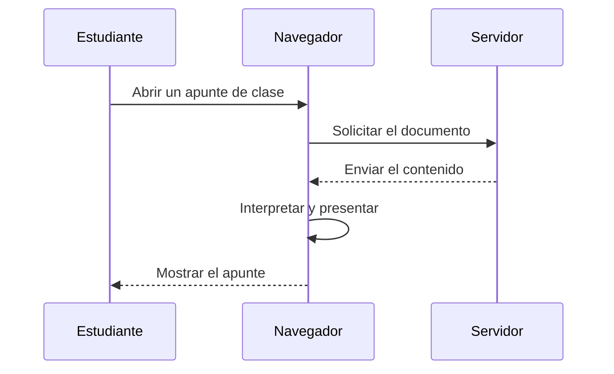

# Comunicación digital: solicitud y respuesta

**Objetivo:** distinguir el cliente, el servidor y el intercambio de mensajes.
**Extensión:** Mermaid.

## La secuencia de una consulta

Un navegador puede solicitar un documento a un servidor. El servidor recibe la
solicitud, localiza el recurso y devuelve una respuesta. El diagrama representa
una situación simplificada en la que el recurso existe y la conexión funciona.

## Contenido y presentación

Recibir un texto Markdown y presentarlo son etapas diferentes. El navegador
puede utilizar un motor para transformar títulos, tablas y extensiones en
elementos visuales. Los diagramas y los modelos requieren sus propios
renderizadores. Un fallo de carga no significa necesariamente que el texto de
origen sea incorrecto: el recurso puede no estar disponible.

## Practica

1. ¿Quién inicia la solicitud del documento?
2. ¿Qué etapa transforma el contenido en presentación?
3. ¿Dónde incluirías una respuesta «recurso no encontrado» en el diagrama?

## Respuestas comentadas

1. El navegador, a partir de la acción del estudiante.
2. La etapa de interpretación y presentación en el navegador.
3. En el mensaje del servidor al navegador, como alternativa a la respuesta con
   contenido.
