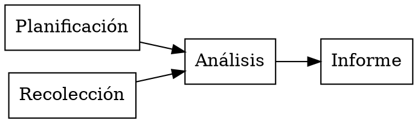

# Dependencias de un proyecto

**Extensiones:** `graphviz`.

## Ideas principales

Una flecha A→B significa que B espera a A. La planificación y la recolección
pueden comenzar juntas; el análisis necesita ambas. Este grafo acíclico
describe precedencias, no duraciones.

## Práctica

¿Puede comenzar el informe antes del análisis? ¿Hay una dependencia entre
planificación y recolección?

## Respuesta comentada

No, según el grafo. No hay arista entre planificación y recolección; ambas
pueden avanzar de forma independiente.

[Índice de la colección](README.md)

[Português brasileiro](../pt/dependencias-de-projeto.md) ·
[English](../en/dependencias-de-projeto.md)
