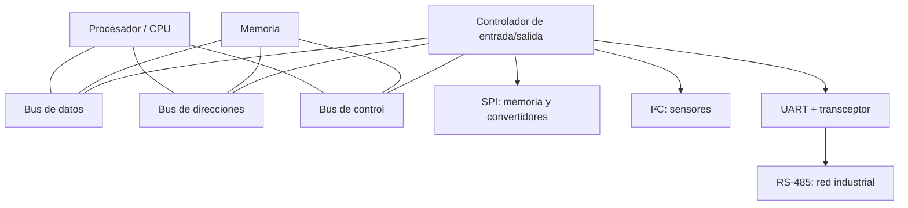
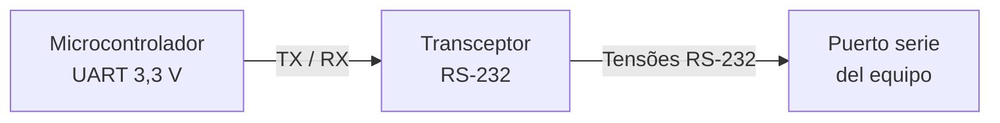
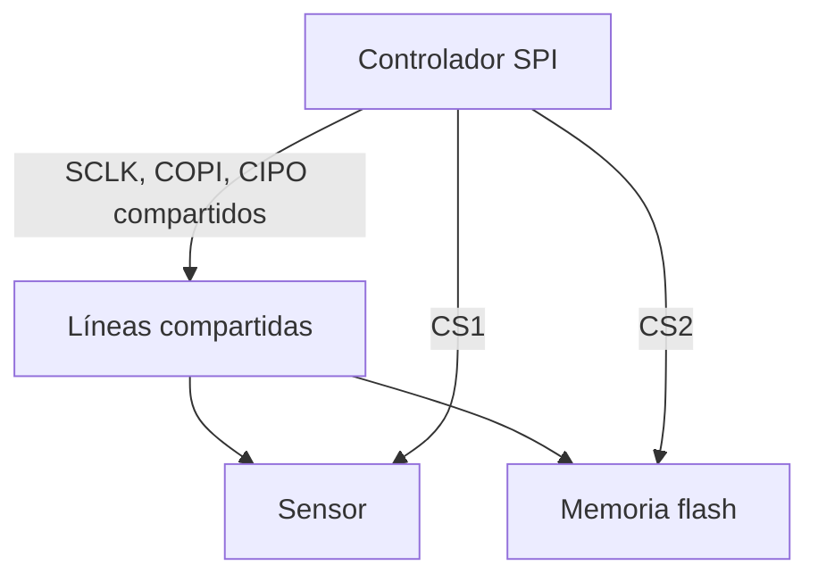
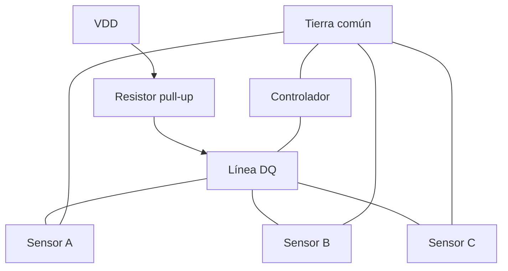
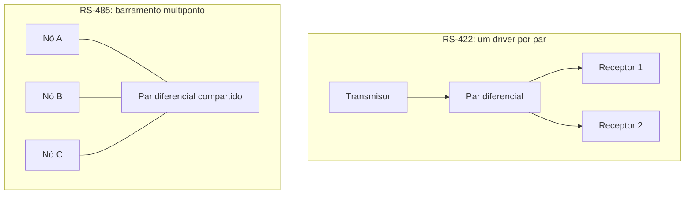
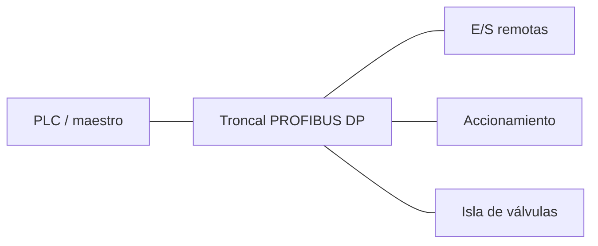
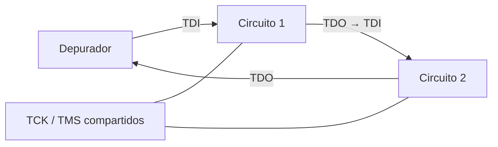
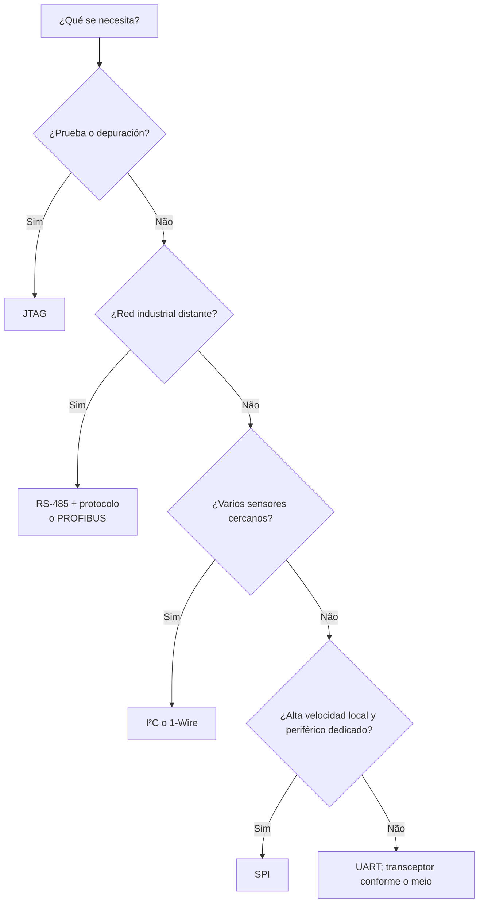

# Buses de comunicación digital: de los bits a los sistemas distribuidos

> **Física, electrónica e informática.** Un recorrido didáctico por los buses
> de datos, la transmisión serie y las interfaces SPI, UART, I²C, 1-Wire,
> RS-232, RS-422, RS-485, PROFIBUS y JTAG.

**Extensiones exploradas:** `mermaid`, `wavedrom`, `circuitikz`, `tikz`,
`vega-lite`, `didactic`, `cross-references` y expresiones matemáticas.

## 1. Introducción: ¿cómo se comunican los circuitos?

Un microcontrolador mide la temperatura, almacena los resultados en memoria,
actualiza una pantalla y transmite información a un ordenador. Para realizar
estas tareas, necesita intercambiar **bits** con otros componentes. La conexión
entre ellos es más que un cable: incluye señales eléctricas, convenciones
temporales, reglas para iniciar y finalizar transacciones y, con frecuencia,
mecanismos para detectar errores.

El término **bus** designa un conjunto compartido de vías y reglas de
comunicación. En su forma clásica, los buses de los ordenadores se dividen en
líneas de **datos**, **direcciones** y **control**. En los sistemas embebidos,
un bus serie puede transportar datos y direcciones en instantes sucesivos
utilizando pocos conductores.

<!-- prettier-ignore -->
::: definition Bus, interfaz y protocolo {#def-barramento}

- **Bus:** medio de interconexión, a menudo compartido por varios dispositivos.
- **Interfaz física:** niveles de tensión, corrientes, impedancias y
  conectores, cuando están especificados.
- **Protocolo:** organización de mensajes, direccionamiento, arbitraje,
  temporización y tratamiento de errores.
- **Controlador de periféricos:** circuito que implementa la transmisión y la
  recepción, como un UART o un controlador SPI.

Estos conceptos se solapan en algunas tecnologías, pero no son sinónimos.

:::

<!-- prettier-ignore -->
::: figure Arquitectura simplificada de un sistema informático {#fig-system-bus}



:::

<!-- prettier-ignore -->
La {@ref fig-system-bus} es una adaptación conceptual en Mermaid del esquema clásico de un bus de sistema. En arquitecturas reales, los puentes, las jerarquías y las interconexiones punto a punto hacen que la estructura sea más compleja.

## 2. Bits, señales y tiempo

Un bit es una unidad de información binaria, pero su representación física
requiere magnitudes medibles. En una conexión eléctrica, dos intervalos de
tensión pueden representar `0` y `1`; en otras interfaces, el bit se determina
por la **diferencia** entre las tensiones de dos conductores.

La **tasa de bits** se expresa como

$$R_b=\frac{N_{\mathrm{bits}}}{\Delta t}, \qquad T_b=\frac{1}{R_b}.$$

A 115 200 bit/s, la duración nominal de un bit es aproximadamente
$8,68\,\mu\mathrm{s}$. La tasa de símbolos (_baudios_) coincide con la tasa de
bits solamente cuando cada símbolo transporta un bit.

<!-- prettier-ignore -->
::: figure Una señal digital y su período de bit {#fig-bits}

```wavedrom
{
  signal: [
    {name: 'bit', wave: '==.==.==.==.==.==.==.==', data: ['1','0','1','1','0','0','1','0']},
    {name: 'nivel', wave: '10110010'}
  ],
  head: {text: 'Ocho intervalos de bit'},
  config: {hscale: 2}
}
```

:::

La **comunicación paralela** utiliza varias líneas para transportar bits
simultáneamente. La **comunicación serie** transmite los bits sucesivamente.
Los enlaces serie pueden funcionar a frecuencias elevadas porque evitan, entre
otros problemas, el desfase temporal (_skew_) entre numerosas líneas paralelas.

| Criterio              | Paralela                             | Serie                                             |
| --------------------- | ------------------------------------ | ------------------------------------------------- |
| Conductores de datos  | Varios                               | Uno o pocos                                       |
| Sincronización        | Entre varias líneas                  | Entre símbolos o mediante reloj                   |
| Uso habitual          | Interconexiones internas específicas | Sensores, periféricos y redes                     |
| Limitación importante | Desfase y cantidad de pines          | Codificación, temporización e integridad de señal |

## 3. Comunicación síncrona y asíncrona

En la transmisión **síncrona**, el emisor y el receptor comparten una
referencia temporal explícita o recuperada de la señal. SPI, por ejemplo,
dispone de una línea de reloj. En la transmisión **asíncrona** típica de UART
no se comparte una línea de reloj: cada trama comienza con un bit de inicio que
permite al receptor localizar los instantes de muestreo.

<!-- prettier-ignore -->
::: figure Trama UART 8N1: inicio, ocho bits de datos y parada {#fig-uart-wave}

```wavedrom
{
  signal: [
    {name: 'TX', wave: '10101001011', data: []},
    {name: 'fase', wave: '=========', data: ['idle','start','b0','b1','b2','b3','b4','b5','b6']},
    {name: 'restante', wave: '====', data: ['b7','stop','idle','idle']}
  ],
  head: {text: 'Fases de trama: duración de bit constante'},
  config: {hscale: 2}
}
```

:::

<!-- prettier-ignore -->
La {@ref fig-uart-wave} es **esquemática**: las líneas de anotación indican fases, no una segunda transmisión sincronizada; en una trama completa, cada bit debe ocupar exactamente un período $T_b$.

## 4. UART y RS-232: funciones diferentes

Un **UART** (_Universal Asynchronous Receiver/Transmitter_) convierte bytes
paralelos en tramas serie y realiza la operación inversa. El formato **8N1**
contiene un bit de inicio, ocho bits de datos, ningún bit de paridad y un bit
de parada: diez bits transmitidos por cada byte útil.

La eficiencia de la trama es

$$\eta=\frac{8}{1+8+0+1}=0,8.$$

Por tanto, una conexión de 115 200 bit/s con tramas 8N1 transporta idealmente
hasta 11 520 bytes útiles por segundo, sin contar la sobrecarga de protocolos
superiores.

**RS-232** no es sinónimo de UART: especifica características eléctricas y
señales de interfaz. En la señalización RS-232 tradicional, la polaridad lógica
está invertida respecto a un UART de nivel TTL/CMOS, y las tensiones pueden ser
positivas y negativas. Nunca conecte directamente una salida RS-232
convencional a un pin UART de 3,3 V sin un transceptor adecuado.

<!-- prettier-ignore -->
::: figure Conversión entre UART lógico y RS-232 {#fig-uart-rs232}



:::

## 5. SPI: comunicación serie con reloj

**SPI** (_Serial Peripheral Interface_) utiliza normalmente cuatro señales:
`SCLK` (reloj), `MOSI` o `COPI` (datos del controlador al periférico), `MISO` o
`CIPO` (sentido inverso) y `CS` (selección del periférico, generalmente activa
en nivel bajo). En su forma habitual, transmite y recibe bits simultáneamente,
en _dúplex completo_ (_full duplex_).

<!-- prettier-ignore -->
::: figure SPI con dos periféricos y selección individual {#fig-spi-topology}



:::

<!-- prettier-ignore -->
::: figure Transacción SPI esquemática {#fig-spi-wave}

```wavedrom
{
  signal: [
    {name: 'CS_n', wave: '10......1'},
    {name: 'SCLK', wave: '0p......0'},
    {name: 'COPI', wave: 'x========x', data: ['7','6','5','4','3','2','1','0']},
    {name: 'CIPO', wave: 'x========x', data: ['7','6','5','4','3','2','1','0']}
  ],
  head: {text: 'SPI: ocho posiciones de bit (ilustración conceptual)'},
  config: {hscale: 2}
}
```

:::

El instante de muestreo depende de la configuración de **CPOL** y **CPHA**. Los
dispositivos que emplean modos SPI incompatibles no intercambian datos
correctamente. La existencia de un reloj no elimina la necesidad de respetar
los tiempos de establecimiento (_setup_) y retención (_hold_).

## 6. I²C: dos líneas y múltiples dispositivos

**I²C** (_Inter-Integrated Circuit_) utiliza dos líneas: `SDA` (datos) y `SCL`
(reloj). Las salidas suelen ser de drenador abierto o colector abierto: los
dispositivos llevan las líneas al nivel bajo, mientras que las resistencias de
_pull-up_ las elevan al nivel lógico alto.

Esta estructura permite compartir los cables e implementar confirmaciones
(`ACK`), direccionamiento y, en determinadas condiciones, arbitraje entre
controladores.

<!-- prettier-ignore -->
::: figure Bus I²C con resistencias de pull-up {#fig-i2c-circuit}

```circuitikz
\begin{circuitikz}[american]
\draw (0,0) node[ground]{} to[V,l=$V_{DD}$] (0,3);
\draw (0,3) -- (2,3) to[R,l=$R_{P1}$] (2,1) -- (6,1);
\draw (0,3) -- (4,3) to[R,l=$R_{P2}$] (4,0) -- (6,0);
\node[right] at (6,1) {SDA};
\node[right] at (6,0) {SCL};
\end{circuitikz}
```

:::

<!-- prettier-ignore -->
Las dos resistencias de la {@ref fig-i2c-circuit} representan los *pull-ups*; los dispositivos conectados conmutan sus transistores de salida entre cada línea y tierra. La capacitancia distribuida del bus influye en el tiempo de subida.

Para una aproximación RC de primer orden, el tiempo de subida entre el 30 % y
el 70 % de la tensión final es

$$t_r \approx 0,8473 R_P C_B.$$

Si $R_P=4,7\,\mathrm{k\Omega}$ y $C_B=100\,\mathrm{pF}$, se obtiene
$t_r\approx398\,\mathrm{ns}$. El valor adecuado de $R_P$ también depende de la
corriente que los dispositivos pueden absorber y de los límites del modo I²C
utilizado.

<!-- prettier-ignore -->
::: figure Inicio y final de una transacción I²C {#fig-i2c-wave}

```wavedrom
{
  signal: [
    {name: 'SCL', wave: '1.0p....1'},
    {name: 'SDA', wave: '10.======1', data: ['dirección','R/W','ACK','datos','ACK','fin']}
  ],
  head: {text: 'START: SDA baja con SCL alto; STOP: SDA sube con SCL alto'},
  config: {hscale: 2}
}
```

:::

<!-- prettier-ignore -->
El dibujo de la {@ref fig-i2c-wave} destaca **eventos lógicos** y no pretende reproducir la duración de cada pulso de una trama completa.

## 7. 1-Wire: un conductor de datos

El bus **1-Wire**, asociado históricamente con Dallas Semiconductor/Maxim,
utiliza una línea de datos y una referencia de tierra. La línea de datos
dispone de un _pull-up_; el controlador inicia ventanas temporales específicas
para escribir y leer bits.

Los dispositivos pueden tener identificadores ROM de 64 bits, útiles para
distinguir varios sensores conectados al mismo cable. Algunos funcionan con
**alimentación parásita**, aprovechando la energía suministrada por la propia
línea, pero esta posibilidad exige precauciones de corriente, temporización y
_strong pull-up_.

<!-- prettier-ignore -->
::: figure Topología simplificada de un bus 1-Wire {#fig-onewire}



:::

## 8. RS-422 y RS-485: señalización diferencial

En la señalización diferencial, la información depende de

$$V_D=V_A-V_B.$$

El ruido que afecta aproximadamente por igual a ambos conductores tiende a ser
rechazado por el receptor, siempre que la tensión de modo común permanezca
dentro del intervalo permitido. El par trenzado contribuye a que el
acoplamiento de interferencias sea semejante en los dos conductores.

**RS-422** describe una interfaz diferencial con un transmisor por par y
posibilidad de múltiples receptores. **RS-485** permite que diferentes
transmisores compartan un par, siempre que solo el transmisor autorizado lo
active en cada instante. RS-485 define características eléctricas, **no** el
formato de los mensajes.

<!-- prettier-ignore -->
::: figure Diferencia entre RS-422 y RS-485 {#fig-rs-topology}



:::

Las letras `A` y `B` de los terminales de módulos comerciales no siempre siguen
la misma convención de polaridad entre fabricantes. Consulte la documentación
del transceptor antes de conectar los equipos.

### Terminación y reflexiones

Un cable largo debe tratarse como una **línea de transmisión** cuando el tiempo
de propagación resulta significativo respecto al tiempo de subida de la señal.
Una resistencia de terminación aproximadamente igual a la impedancia
característica reduce las reflexiones:

$$\Gamma=\frac{Z_L-Z_0}{Z_L+Z_0}.$$

Para $Z_L=Z_0$, el coeficiente de reflexión ideal es cero. En buses RS-485 con
cable de aproximadamente $120\,\Omega$, es habitual instalar una resistencia de
$120\,\Omega$ en **cada extremo físico** del troncal, y no en todos los nodos.

<!-- prettier-ignore -->
::: figure Terminación resistiva en un extremo del par {#fig-rs485-termination}

```circuitikz
\begin{circuitikz}[american]
\draw (0,2) -- (5,2) node[right]{A};
\draw (0,0) -- (5,0) node[right]{B};
\draw (4,2) to[R,l=$120\,\Omega$] (4,0);
\node[left] at (0,2) {Par A};
\node[left] at (0,0) {Par B};
\end{circuitikz}
```

:::

## 9. PROFIBUS: comunicación industrial

**PROFIBUS** es una familia de redes industriales. La variante **PROFIBUS DP**
utiliza frecuentemente la capa física **RS-485**, con topología de bus lineal,
conectores y terminaciones apropiados. PROFIBUS PA utiliza otra capa física,
adecuada para aplicaciones de procesos.

En segmentos RS-485 de PROFIBUS DP, una red de terminación **activa** típica
combina resistencias de polarización y una resistencia entre las líneas:
frecuentemente $390\,\Omega$ hacia VP (5 V), $220\,\Omega$ entre las líneas y
$390\,\Omega$ hacia DGND. Esta red **no** debe confundirse con la terminación
sencilla de $120\,\Omega$ utilizada en muchos buses RS-485 genéricos. Los
valores, la alimentación y el cableado deben ajustarse al equipo y a la norma
aplicable.

<!-- prettier-ignore -->
::: figure Ejemplo didáctico de terminación activa PROFIBUS DP {#fig-profibus-termination}

```circuitikz
\begin{circuitikz}[american]
\draw (0,4) node[left]{VP (+5 V)} to[R,l=$390\,\Omega$] (0,2.6) -- (3,2.6) node[right]{B};
\draw (0,2.6) to[R,l=$220\,\Omega$] (0,1.3) -- (3,1.3) node[right]{A};
\draw (0,1.3) to[R,l=$390\,\Omega$] (0,0) node[ground]{};
\node[left] at (0,0) {DGND};
\end{circuitikz}
```

:::

<!-- prettier-ignore -->
La {@ref fig-profibus-termination} representa únicamente la **red de terminación y polarización**; no muestra la protección, el transceptor, el blindaje ni la continuidad del cable. El circuito debe permanecer alimentado para que la polarización activa funcione según lo previsto. No añada condensadores arbitrariamente entre los conductores: los filtros RC modifican la forma de onda y requieren un dimensionamiento específico.

<!-- prettier-ignore -->
::: figure Red industrial con controlador y estaciones remotas {#fig-profibus-network}



:::

## 10. JTAG: prueba, depuración y programación

**JTAG** se refiere a la arquitectura de prueba de exploración de contorno
(_boundary scan_), normalizada principalmente por IEEE 1149.1. Sus líneas
habituales son `TCK`, `TMS`, `TDI` y `TDO`; `TRST` puede ser opcional. La
interfaz permite probar interconexiones y, según el dispositivo, acceder a
funciones de depuración y programación.

Un componente JTAG contiene un controlador de estados **TAP** (_Test Access
Port_) y registros de instrucciones y datos. Varios circuitos integrados pueden
conectarse en cadena: el `TDO` de uno alimenta el `TDI` del siguiente.

<!-- prettier-ignore -->
::: figure Cadena de exploración JTAG {#fig-jtag}



:::

JTAG no debe considerarse un sustituto genérico de SPI o I²C: su propósito y
organización son distintos.

## 11. Integridad de la señal: capacitancia, ruido y velocidad

Los conductores presentan resistencia, inductancia y capacitancia distribuidas.
En un enlace corto, un modelo RC puede ser suficiente para comprender la subida
de tensión. En conexiones largas o con flancos rápidos, es esencial el
comportamiento de **línea de transmisión**.

<!-- prettier-ignore -->
::: figure Respuesta al escalón RC normalizada {#fig-rc-chart}

```vega-lite
{
  "$schema": "https://vega.github.io/schema/vega-lite/v5.json",
  "description": "Respuesta normalizada de un circuito RC",
  "width": 550,
  "height": 230,
  "data": {
    "values": [
      {"t":0,"v":0},{"t":0.25,"v":0.2212},{"t":0.5,"v":0.3935},
      {"t":0.75,"v":0.5276},{"t":1,"v":0.6321},{"t":1.5,"v":0.7769},
      {"t":2,"v":0.8647},{"t":2.5,"v":0.9179},{"t":3,"v":0.9502},
      {"t":4,"v":0.9817},{"t":5,"v":0.9933}
    ]
  },
  "mark": {"type":"line","point":true},
  "encoding": {
    "x":{"field":"t","type":"quantitative","title":"Tiempo t / RC"},
    "y":{"field":"v","type":"quantitative","title":"Tensión V / Vfinal","scale":{"domain":[0,1]}}
  }
}
```

:::

<!-- prettier-ignore -->
::: figure Modelo RC de una línea con resistencia de pull-up {#fig-rc-circuit}

```circuitikz
\begin{circuitikz}[american]
\draw (0,0) node[ground]{} to[V,l=$V_{DD}$] (0,3)
      to[R,l=$R_P$] (3,3) -- (5,3)
      to[C,l=$C_B$] (5,0) -- (0,0);
\node[above] at (5,3) {Línea de datos};
\end{circuitikz}
```

:::

<!-- prettier-ignore -->
En la {@ref fig-rc-circuit}, $C_B$ representa la capacitancia equivalente del conductor y de las entradas conectadas. El modelo concentra esa capacitancia en un único componente para facilitar el análisis; su distribución real es más compleja.

<!-- prettier-ignore -->
La curva de la {@ref fig-rc-chart} obedece a la ecuación

$$V(t)=V_\infty\left(1-e^{-t/(RC)}\right).$$

Una resistencia de _pull-up_ menor acelera la subida, pero aumenta la corriente
cuando la línea está en nivel bajo. La elección exige equilibrar velocidad,
consumo y capacidad de accionamiento.

## 12. Comparación de tecnologías

| Tecnología  | Reloj separado     | Medio físico habitual      | Compartición                    | Aplicación                       |
| ----------- | ------------------ | -------------------------- | ------------------------------- | -------------------------------- |
| UART        | No                 | Niveles lógicos locales    | Generalmente punto a punto      | Comunicación entre controladores |
| RS-232      | No especifica      | Señalización no balanceada | Punto a punto                   | Puertos serie                    |
| SPI         | Sí                 | Líneas lógicas             | Selección mediante CS           | Memorias y convertidores         |
| I²C         | Sí, SCL            | Dos líneas con pull-up     | Múltiples dispositivos          | Sensores y periféricos           |
| 1-Wire      | No                 | Datos + referencia         | Múltiples dispositivos          | Sensores e identificación        |
| RS-422      | No especifica      | Par diferencial            | Un transmisor por par           | Enlaces robustos                 |
| RS-485      | No especifica      | Par diferencial            | Varios transmisores coordinados | Automatización                   |
| PROFIBUS DP | Depende de la capa | Frecuentemente RS-485      | Red industrial                  | PLC y dispositivos de campo      |
| JTAG        | Sí, TCK            | Señales lógicas            | Cadena de prueba                | Depuración y pruebas             |

No es correcto comparar todos estos elementos como si fueran protocolos de una
misma capa: algunos especifican señalización eléctrica, otros formatos de
transacción y otros sistemas de comunicación más completos.

## 13. Elección de una interfaz

<!-- prettier-ignore -->
::: figure Árbol de decisión simplificado {#fig-decision}



:::

<!-- prettier-ignore -->
El árbol de decisión de la {@ref fig-decision} es una orientación inicial, no un procedimiento normativo. En cada proyecto deben evaluarse la distancia, la tasa de datos, la inmunidad electromagnética, el consumo, la cantidad de pines, el aislamiento galvánico, la seguridad funcional y la disponibilidad de componentes.

## 14. Actividades y problemas resueltos

<!-- prettier-ignore -->
:::: exercise Ejercicio 1 — Rendimiento efectivo de UART {#ex-uart}

Un UART transmite tramas 8N1 a 9 600 bit/s. ¿Cuántos bytes útiles por segundo
pueden transmitirse idealmente?

<!-- prettier-ignore -->
::: hint Una pista

Cuente todos los bits de la trama, no solo los ocho bits de datos.

:::

<!-- prettier-ignore -->
::: solution Solución

Cada trama contiene 10 bits. Por tanto, $9600/10=960$ bytes útiles por segundo,
antes de las pausas y la sobrecarga del protocolo.

:::

::::

<!-- prettier-ignore -->
:::: exercise Ejercicio 2 — Tiempo de subida de I²C {#ex-i2c}

Considere $R_P=2,2\,\mathrm{k\Omega}$ y $C_B=150\,\mathrm{pF}$. Estime el
tiempo de subida entre el 30 % y el 70 %.

<!-- prettier-ignore -->
::: solution Solución

$$t_r\approx0,8473(2200)(150\times10^{-12})\approx280\,\mathrm{ns}.$$

Es necesario comparar este resultado con el límite del modo I²C correspondiente
y verificar la corriente absorbida en nivel bajo.

:::

::::

<!-- prettier-ignore -->
:::: exercise Ejercicio 3 — Reflexión en una línea {#ex-reflection}

Una línea con $Z_0=120\,\Omega$ termina en $Z_L=240\,\Omega$. Calcule $\Gamma$.

<!-- prettier-ignore -->
::: solution Solución

$$\Gamma=\frac{240-120}{240+120}=\frac13.$$

La onda reflejada ideal tiene una amplitud igual a un tercio de la onda
incidente, con la misma polaridad.

:::

::::

<!-- prettier-ignore -->
:::: exercise Ejercicio 4 — Diseño de una red {#ex-network}

Un controlador debe leer sensores cercanos, registrar datos en memoria flash y
enviar órdenes a módulos distribuidos por una instalación industrial. Proponga
tres interfaces.

<!-- prettier-ignore -->
::: hint Una pista

Distinga las distancias y los requisitos eléctricos de cada enlace.

:::

<!-- prettier-ignore -->
::: solution Solución comentada

Una solución posible utiliza **I²C** para sensores locales, **SPI** para
memoria flash y **RS-485 con un protocolo definido** para los módulos remotos.
PROFIBUS DP puede sustituir la tercera opción cuando la instalación requiere
interoperabilidad con esa red industrial. En todos los casos, deben verificarse
los requisitos concretos de los dispositivos.

:::

::::

## 15. Conclusión

El estudio de los buses reúne **lógica digital, electricidad,
electromagnetismo, temporización y organización de sistemas**. El bit es una
abstracción; transmitirlo exige controlar tensiones, corrientes, instantes de
muestreo e interacciones entre conductores.

SPI, I²C y 1-Wire ofrecen distintas formas de conectar componentes cercanos.
UART define una organización asíncrona de tramas; RS-232, RS-422 y RS-485
describen características eléctricas. PROFIBUS organiza la comunicación
industrial sobre capas físicas adecuadas. JTAG, por su parte, convierte
interconexiones y registros en recursos observables para pruebas y depuración.

La elección correcta comienza con una pregunta sencilla: **¿qué debe
comunicarse, entre qué componentes, a qué distancia, a qué velocidad y bajo qué
condiciones eléctricas?**

## 16. Referencias y lecturas complementarias

Las páginas de Wikipedia en español, portugués e inglés ofrecen una
introducción y enlaces a otros idiomas. Para diseñar circuitos reales, consulte
las especificaciones normativas y los manuales de los fabricantes.

- [Bus (informática)](<https://es.wikipedia.org/wiki/Bus_(inform%C3%A1tica)>)
- [Comunicación serie](https://es.wikipedia.org/wiki/Comunicaci%C3%B3n_serie)
- [Serial Peripheral Interface](https://es.wikipedia.org/wiki/Serial_Peripheral_Interface)
- [UART](https://es.wikipedia.org/wiki/Universal_Asynchronous_Receiver-Transmitter)
- [I²C](https://es.wikipedia.org/wiki/I%C2%B2C)
- [1-Wire](https://en.wikipedia.org/wiki/1-Wire)
- [RS-232](https://es.wikipedia.org/wiki/RS-232)
- [RS-422](https://en.wikipedia.org/wiki/RS-422)
- [RS-485](https://es.wikipedia.org/wiki/RS-485)
- [PROFIBUS](https://es.wikipedia.org/wiki/Profibus)
- [JTAG](https://es.wikipedia.org/wiki/JTAG)
- [Documentación de mathjslab-markdown](https://github.com/MathJSLab/mathjslab-markdown)
