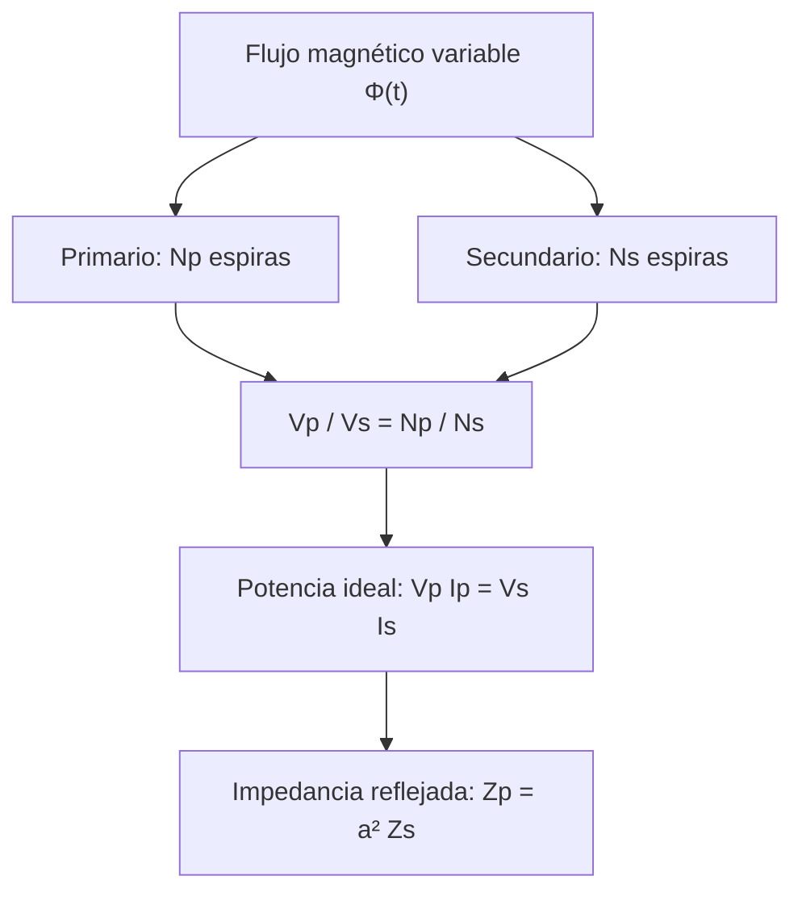
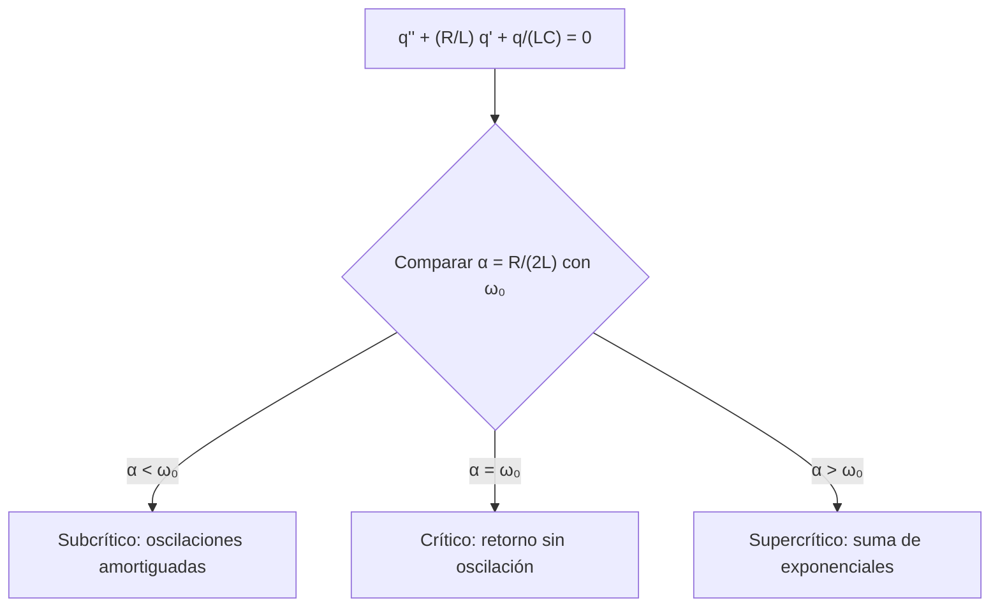
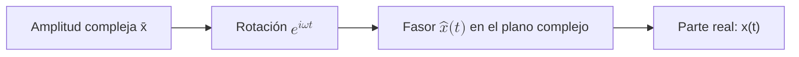

# Circuitos eléctricos

## Introducción

La aplicación práctica más común del electromagnetismo son los circuitos
eléctricos. Un circuito eléctrico es la conexión de elementos eléctricos, como
resistencias, inductores, condensadores, fuentes de tensión, fuentes de
corriente e interruptores, de manera que formen al menos un camino cerrado para
la corriente eléctrica.

## 1. Elementos de circuito

En el modelado teórico de circuitos conviene representar sus elementos de forma
idealizada. Los conductores que conectan los elementos no tienen resistencia
nula; sin embargo, al estar hechos de metales de baja resistividad, cuando son
relativamente cortos su resistencia puede considerarse despreciable. Una bobina
real, además de su autoinductancia, también tiene resistencia y capacitancia
entre sus terminales. Conviene separar estos efectos y representarlos mediante
resistencias, capacitancias e inductancias ideales.

Los elementos de circuito pueden ser activos o pasivos. Según la convención
pasiva, la corriente entra por el terminal de mayor potencial del elemento que
consume energía. Los generadores pueden suministrar energía al circuito,
haciendo que la corriente salga por su terminal de mayor potencial.

### 1.1. Resistencia

<!-- prettier-ignore -->
Una resistencia se representa mediante el símbolo de {@ref fig-resistor}.

<!-- prettier-ignore -->
::: figure Resistencia ideal con terminales 1 y 2 {#fig-resistor}

```circuitikz
\begin{circuitikz}[american,scale=3,transform shape]
\draw (0,0) node[left]{1} to[short,o-] (1,0) to[R,l=$R$,i>^=$I$] (4,0) to[short,-o] (5,0) node[right]{2};
\end{circuitikz}
```

:::

Cuando una corriente $I$ atraviesa una resistencia, se produce una caída de
tensión $V_R=V_1-V_2$ en el sentido de la corriente, dada por la ley de Ohm:

$$\boxed{V_R=RI.}\tag{1}$$

En una resistencia, la energía eléctrica se transforma en energía térmica por
efecto Joule. La potencia disipada es:

$$\boxed{P=I^2R=\frac{V_R^2}{R}.}\tag{2}$$

### 1.2. Condensador

<!-- prettier-ignore -->
::: figure Condensador ideal {#fig-capacitor}

```circuitikz
\begin{circuitikz}[american,scale=3,transform shape]
\draw (0,0) node[left]{1} to[short,o-] (1,0) to[C,l=$C$] (4,0) to[short,-o] (5,0) node[right]{2};
\end{circuitikz}
```

:::

La diferencia de potencial entre las placas del condensador es

$$V_1-V_2=V_C=\frac{q}{C},\tag{3}$$

donde $C$ es la capacitancia. Aunque las placas están separadas por un
aislante, durante la carga y la descarga circula corriente por los terminales
del condensador, definida por

$$I(t)=\frac{dq}{dt}.\tag{4}$$

En el condensador se almacena energía en el campo eléctrico:

$$\boxed{U=\frac{CV_C^2}{2}=\frac{q^2}{2C}.}\tag{5}$$

### 1.3. Inductor

<!-- prettier-ignore -->
::: figure Inductor ideal {#fig-indutor}

```circuitikz
\begin{circuitikz}[american,scale=3,transform shape]
\draw (0,0) node[left]{1} to[short,o-] (1,0) to[L,l=$L$,i>^=$I$] (4,0) to[short,-o] (5,0) node[right]{2};
\end{circuitikz}
```

:::

La caída de tensión entre los terminales del inductor es

$$V_1-V_2=V_L=L\frac{dI}{dt},\tag{6}$$

donde $L$ es la autoinductancia. La energía almacenada en el campo magnético es

$$\boxed{U=\frac{LI^2}{2}.}\tag{7}$$

### 1.4. Generador

Un generador ideal de tensión continua mantiene una diferencia de potencial
entre sus terminales independientemente de la corriente que lo atraviese.

<!-- prettier-ignore -->
::: figure Fuente ideal de tensión continua {#fig-dc-source}

```circuitikz
\begin{circuitikz}[american,scale=3,transform shape]
\draw (0,0) node[below]{2} to[V,l=$V_0$] (0,3) node[above]{1};
\end{circuitikz}
```

:::

$$V_1-V_2=V_0.\tag{8}$$

Existen generadores cuya diferencia de potencial varía armónicamente con el
tiempo.

<!-- prettier-ignore -->
::: figure Fuente ideal de tensión alterna {#fig-ac-source}

```circuitikz
\begin{circuitikz}[american,scale=3,transform shape]
\draw (0,0) node[below]{2} to[sV,l=$V(t)$] (0,3) node[above]{1};
\end{circuitikz}
```

:::

$$V_1-V_2=V_0\cos(\omega t+\varphi).\tag{9}$$

## 2. Leyes de Kirchhoff

La conexión de elementos de circuito forma nodos y mallas. Un **nodo** es una
unión de conductores; una **malla** es un recorrido cerrado del circuito.

### 2.1. Primera ley de Kirchhoff — ley de corrientes

<!-- prettier-ignore -->
En un nodo sin acumulación de carga, la suma de las corrientes entrantes es igual a la suma de las salientes. En el ejemplo de {@ref fig-node}:

$$I_1+I_2=I_3.\tag{10}$$

<!-- prettier-ignore -->
::: figure Corrientes en un nodo {#fig-node}

```circuitikz
\begin{circuitikz}[american,scale=3,transform shape]
\draw (0,2) to[short,i>^=$I_1$] (2,1);
\draw (0,0) to[short,i>^=$I_2$] (2,1);
\draw (2,1) node[circ]{} to[short,i>^=$I_3$] (4,1);
\end{circuitikz}
```

:::

Tomando como positivas las corrientes entrantes y como negativas las salientes:

$$\boxed{\sum_{k=1}^{n} I_k=0.}\tag{11}$$

Esta ley expresa la **conservación de la carga eléctrica**.

### 2.2. Segunda ley de Kirchhoff — ley de tensiones

<!-- prettier-ignore -->
En un recorrido cerrado, la suma algebraica de las diferencias de potencial es nula. En el circuito de {@ref fig-loop}, una fuente alimenta tres resistencias:

$$V_0=V_1+V_2+V_3.$$

<!-- prettier-ignore -->
::: figure Malla simple con tres resistencias {#fig-loop}

```circuitikz
\begin{circuitikz}[american,scale=3,transform shape]
\draw (0,0) to[V,l=$V_0$] (0,3) to[R,l=$R_1$] (4,3) to[R,l=$R_2$] (4,0) to[R,l=$R_3$] (0,0);
\end{circuitikz}
```

:::

En general,

$$\boxed{\sum_{k=1}^{n}V_k=0.}$$

Esta ley se deduce de la **conservación de la energía** en la aproximación de
circuitos de parámetros concentrados.

## 3. Transitorios

### 3.1. Circuito RC

<!-- prettier-ignore -->
Considere el circuito RC de {@ref fig-rc}. En el instante $t=0$ se cierra el interruptor.

<!-- prettier-ignore -->
::: figure Circuito RC en serie alimentado por una fuente continua {#fig-rc}

```circuitikz
\begin{circuitikz}[american,scale=3,transform shape]
\draw (0,0) to[V,l=$V_0$] (0,4) to[closing switch] (2,4) to[short] (4,4) to[R,l=$R$] (4,2) to[C,l=$C$] (4,0) -- (0,0);
\node[above] at (2,4.35) {$t=0$};
\end{circuitikz}
```

:::

Por la segunda ley de Kirchhoff,

$$V_0=V_R+V_C.\tag{12}$$

Sustituyendo las ecuaciones (1), (3) y (4):

$$V_0=R\frac{dq}{dt}+\frac{q(t)}{C}.\tag{13}$$

Multiplicando por $C$ y definiendo la constante de tiempo

$$\boxed{\tau_C=RC},\tag{14}$$

obtenemos

$$V_0C=\tau_C\frac{dq}{dt}+q(t).\tag{15}$$

Con la condición inicial $q(0)=q_0$,

$$\boxed{q(t)=(q_0-V_0C)e^{-t/\tau_C}+V_0C.}\tag{16}$$

Derivando, obtenemos la corriente:

$$I(t)=\frac{V_0-V_{C0}}{R}e^{-t/\tau_C},\tag{17}$$

donde $V_{C0}=q_0/C$. Definiendo $I_0=(V_0-V_{C0})/R$:

$$\boxed{I(t)=I_0e^{-t/\tau_C}.}\tag{18}$$

<!-- prettier-ignore -->
::: figure Decaimiento de la corriente en el circuito RC {#fig-rc-curve}

```vega-lite
{
  "$schema":"https://vega.github.io/schema/vega-lite/v5.json",
  "description":"Corriente normalizada durante la carga de un circuito RC",
  "width":560,"height":260,
  "data":{"sequence":{"start":0,"stop":5.01,"step":0.1,"as":"x"}},
  "transform":[{"calculate":"exp(-datum.x)","as":"y"}],
  "mark":{"type":"line"},
  "encoding":{"x":{"field":"x","type":"quantitative","title":"Tiempo t / τC"},"y":{"field":"y","type":"quantitative","title":"Corriente I / I₀","scale":{"domain":[0,1]}}}
}
```

:::

En $t=\tau_C$, la corriente es $I_0/e$, aproximadamente el 36,8 % de su valor
inicial.

### 3.2. Circuito RL

<!-- prettier-ignore -->
Considere el circuito RL de {@ref fig-rl}. El interruptor se cierra en $t=0$.

<!-- prettier-ignore -->
::: figure Circuito RL en serie alimentado por una fuente continua {#fig-rl}

```circuitikz
\begin{circuitikz}[american,scale=3,transform shape]
\draw (0,0) to[V,l=$V_0$] (0,4) to[closing switch] (2,4) -- (4,4) to[R,l=$R$] (4,2) to[L,l=$L$] (4,0) -- (0,0);
\node[above] at (2,4.35) {$t=0$};
\end{circuitikz}
```

:::

Por la segunda ley de Kirchhoff,

$$V_0=V_R+V_L.\tag{19}$$

Sustituyendo (1) y (6):

$$V_0=RI(t)+L\frac{dI}{dt}.\tag{20}$$

Definiendo

$$\boxed{\tau_L=\frac{L}{R}},\tag{21}$$

obtenemos

$$\frac{V_0}{R}=I(t)+\tau_L\frac{dI}{dt}.\tag{22}$$

Con $I(0)=0$,

$$I(t)=\frac{V_0}{R}\left(1-e^{-t/\tau_L}\right).\tag{23}$$

Si $I_\infty=V_0/R$:

$$\boxed{I(t)=I_\infty\left(1-e^{-t/\tau_L}\right).}\tag{24}$$

<!-- prettier-ignore -->
::: figure Crecimiento de la corriente en el circuito RL {#fig-rl-curve}

```vega-lite
{
  "$schema":"https://vega.github.io/schema/vega-lite/v5.json",
  "description":"Corriente normalizada tras cerrar el interruptor en un circuito RL",
  "width":560,"height":260,
  "data":{"sequence":{"start":0,"stop":5.01,"step":0.1,"as":"x"}},
  "transform":[{"calculate":"1-exp(-datum.x)","as":"y"}],
  "mark":{"type":"line"},
  "encoding":{"x":{"field":"x","type":"quantitative","title":"Tiempo t / τL"},"y":{"field":"y","type":"quantitative","title":"Corriente I / I∞","scale":{"domain":[0,1]}}}
}
```

:::

## 4. Oscilaciones libres en el circuito LC

<!-- prettier-ignore -->
Considere el circuito LC de {@ref fig-lc}.

<!-- prettier-ignore -->
::: figure Circuito LC ideal {#fig-lc}

```circuitikz
\begin{circuitikz}[american,scale=3,transform shape]
\draw (0,0) to[C,l=$C$] (0,3) -- (4,3) to[L,l=$L$] (4,0) -- (0,0);
\end{circuitikz}
```

:::

Por la segunda ley de Kirchhoff,

$$V_C+V_L=0.\tag{25}$$

Sustituyendo (3) y (6),

$$\frac{q(t)}{C}+L\frac{dI}{dt}=0.\tag{26}$$

Definiendo la frecuencia angular natural

$$\boxed{\omega_0=\frac{1}{\sqrt{LC}}},\tag{27}$$

obtenemos la ecuación diferencial del oscilador armónico libre:

$$\boxed{\frac{d^2q}{dt^2}+\omega_0^2q(t)=0.}\tag{28}$$

Con $q(0)=q_0$ e $I(0)=I_0$, la solución es

$$q(t)=q_0\cos(\omega_0t)+\frac{I_0}{\omega_0}\sin(\omega_0t).\tag{29}$$

Derivando:

$$I(t)=I_0\cos(\omega_0t)-q_0\omega_0\sin(\omega_0t).\tag{30}$$

La corriente puede escribirse como

$$I(t)=A\cos(\omega_0t+\varphi).\tag{31}$$

Por la identidad trigonométrica,

$$\cos(\omega_0t+\varphi)=\cos(\omega_0t)\cos\varphi-\sin(\omega_0t)\sin\varphi,\tag{32}$$

identificamos

$$I_0=A\cos\varphi,\qquad q_0\omega_0=A\sin\varphi.\tag{33}$$

Por tanto,

$$\boxed{A=\sqrt{I_0^2+q_0^2\omega_0^2}},\tag{34}$$

$$\varphi=\operatorname{atan2}(q_0\omega_0,I_0).\tag{35}$$

Integrando (31), sin añadir una constante independiente de las condiciones
iniciales,

$$q(t)=\frac{A}{\omega_0}\sin(\omega_0t+\varphi).\tag{36}$$

## 5. Oscilaciones amortiguadas en el circuito RLC

<!-- prettier-ignore -->
Considere el circuito RLC en serie sin generador de {@ref fig-rlc}.

<!-- prettier-ignore -->
::: figure Circuito RLC en serie {#fig-rlc}

```circuitikz
\begin{circuitikz}[american,scale=3,transform shape]
\draw (0,0) to[C,l=$C$] (0,3) to[R,l=$R$] (4,3) to[L,l=$L$] (4,0) -- (0,0);
\end{circuitikz}
```

:::

Por la segunda ley de Kirchhoff,

$$V_R+V_C+V_L=0.\tag{37}$$

Por tanto,

$$RI(t)+\frac{q(t)}{C}+L\frac{dI}{dt}=0.\tag{38}$$

Utilizando $I=dq/dt$, $\tau_L=L/R$ y $\omega_0=1/\sqrt{LC}$:

$$\boxed{\frac{d^2q}{dt^2}+\frac{1}{\tau_L}\frac{dq}{dt}+\omega_0^2q(t)=0.}\tag{39}$$

Para **amortiguamiento subcrítico**, $1/(2\tau_L)<\omega_0$, definimos

$$\alpha=\frac{1}{2\tau_L},\qquad \omega_1=\sqrt{\omega_0^2-\alpha^2}.$$

La solución con $q(0)=q_0$ e $I(0)=I_0$ es

$$\boxed{q(t)=e^{-\alpha t}\left[q_0\cos(\omega_1t)+\frac{I_0+\alpha q_0}{\omega_1}\sin(\omega_1t)\right].}\tag{40}$$

La corriente obtenida por derivación es

$$I(t)=e^{-\alpha t}\left[I_0\cos(\omega_1t)-\frac{\alpha I_0+\omega_0^2q_0}{\omega_1}\sin(\omega_1t)\right].\tag{41}$$

Escribiéndola como una oscilación amortiguada,

$$\boxed{I(t)=Ae^{-\alpha t}\cos(\omega_1t+\varphi).}\tag{42}$$

La identidad utilizada es

$$\cos(\omega_1t+\varphi)=\cos(\omega_1t)\cos\varphi-\sin(\omega_1t)\sin\varphi.\tag{43}$$

Comparando los coeficientes,

$$I_0=A\cos\varphi,\qquad \frac{\alpha I_0+\omega_0^2q_0}{\omega_1}=A\sin\varphi.\tag{44}$$

En consecuencia,

$$A=\sqrt{I_0^2+\left(\frac{\alpha I_0+\omega_0^2q_0}{\omega_1}\right)^2},\tag{45}$$

$$\varphi=\operatorname{atan2}\left(\frac{\alpha I_0+\omega_0^2q_0}{\omega_1},I_0\right).\tag{46}$$

<!-- prettier-ignore -->
::: figure Oscilación amortiguada y envolventes exponenciales {#fig-rlc-curve}

```vega-lite
{
  "$schema":"https://vega.github.io/schema/vega-lite/v5.json",
  "description":"Ejemplo ilustrativo: corriente oscilatoria amortiguada y envolventes",
  "width":580,"height":280,
  "data":{"sequence":{"start":0,"stop":18.05,"step":0.05,"as":"t"}},
  "transform":[{"calculate":"exp(-0.15*datum.t)*cos(2.5*datum.t)","as":"i"},{"calculate":"exp(-0.15*datum.t)","as":"upper"},{"calculate":"-exp(-0.15*datum.t)","as":"lower"}],
  "layer":[
    {"mark":{"type":"line"},"encoding":{"x":{"field":"t","type":"quantitative","title":"Tiempo (unidades arbitrarias)"},"y":{"field":"i","type":"quantitative","title":"Corriente normalizada"}}},
    {"mark":{"type":"line","strokeDash":[5,5],"opacity":0.65},"encoding":{"x":{"field":"t","type":"quantitative"},"y":{"field":"upper","type":"quantitative"}}},
    {"mark":{"type":"line","strokeDash":[5,5],"opacity":0.65},"encoding":{"x":{"field":"t","type":"quantitative"},"y":{"field":"lower","type":"quantitative"}}}
  ]
}
```

:::

<!-- prettier-ignore -->
{@ref fig-rlc-curve} ilustra la forma cualitativa del gráfico original; los parámetros numéricos se eligieron únicamente para la visualización.

## 6. Circuitos de corriente alterna

La energía eléctrica para uso industrial y residencial se transmite
frecuentemente mediante corriente alterna, a frecuencias de 60 Hz o 50 Hz,
según el país. El uso de transformadores permite elevar la tensión y reducir la
corriente durante la transmisión, disminuyendo las pérdidas resistivas por
efecto Joule, y después reducir la tensión en el punto de utilización.

### 6.1. Reactancias e impedancia

En una resistencia conectada a una fuente alterna, la ley de Ohm establece

$$V(t)=RI(t).\tag{47}$$

Por tanto, la tensión y la corriente están en fase. En los inductores y
condensadores, la corriente y la tensión pueden presentar un desfase. Para
estudiarlo, introducimos la representación compleja (fasorial):

$$V(t)=\operatorname{Re}[\widehat V(t)]=\operatorname{Re}[\overline V e^{i\omega t}]=V_0\cos(\omega t),\tag{48}$$

$$I(t)=\operatorname{Re}[\widehat I(t)]=\operatorname{Re}[\overline I e^{i\omega t}].\tag{49}$$

#### Condensador en corriente alterna

<!-- prettier-ignore -->
::: figure Condensador alimentado por una fuente de CA {#fig-ac-cap}

```circuitikz
\begin{circuitikz}[american,scale=3,transform shape]
\draw (0,0) to[sV,l=$V(t)$] (0,3) -- (3,3) to[C,l=$C$] (3,0) -- (0,0);
\end{circuitikz}
```

:::

La carga está relacionada con la tensión mediante

$$q(t)=CV(t).\tag{50}$$

Así,

$$I(t)=\frac{dq}{dt}=C\frac{dV}{dt}.\tag{51}$$

En notación compleja,

$$\widehat I(t)=C\frac{d\widehat V}{dt}.\tag{52}$$

Derivando,

$$\overline I e^{i\omega t}=C\frac{d}{dt}\left(\overline V e^{i\omega t}\right)=i\omega C\overline V e^{i\omega t}.\tag{53}$$

Por tanto,

$$\overline I=i\omega C\overline V.\tag{54}$$

La impedancia capacitiva y su reactancia son

$$\boxed{Z_C=\frac{\overline V}{\overline I}=\frac{1}{i\omega C}=-\frac{i}{\omega C}},\tag{55}$$

$$\boxed{X_C=|Z_C|=\frac{1}{\omega C}}.\tag{56}$$

Como $i=e^{i\pi/2}$,

$$\overline I=i\omega C\overline V=\omega CV_0e^{i\pi/2}.\tag{57}$$

Por tanto,

$$I(t)=\omega CV_0\cos\left(\omega t+\frac{\pi}{2}\right).\tag{58}$$

**En un condensador, la corriente adelanta a la tensión en $\pi/2$.**

#### Inductor en corriente alterna

<!-- prettier-ignore -->
::: figure Inductor alimentado por una fuente de CA {#fig-ac-ind}

```circuitikz
\begin{circuitikz}[american,scale=3,transform shape]
\draw (0,0) to[sV,l=$V(t)$] (0,3) -- (3,3) to[L,l=$L$] (3,0) -- (0,0);
\end{circuitikz}
```

:::

La relación entre tensión y corriente es

$$V_0\cos(\omega t)=L\frac{dI}{dt}.\tag{59}$$

En notación fasorial, $\widehat V(t)=L\,d\widehat I/dt$. Entonces,

$$\overline V e^{i\omega t}=L\frac{d}{dt}\left(\overline I e^{i\omega t}\right)=i\omega L\overline I e^{i\omega t}.\tag{60}$$

Por tanto,

$$\overline V=i\omega L\overline I.\tag{61}$$

La impedancia inductiva y su reactancia son

$$\boxed{Z_L=\frac{\overline V}{\overline I}=i\omega L},\tag{62}$$

$$\boxed{X_L=|Z_L|=\omega L}.\tag{63}$$

La corriente compleja es

$$\overline I=\frac{\overline V}{i\omega L}=\frac{V_0}{\omega L}e^{-i\pi/2}.\tag{64}$$

Por tanto,

$$I(t)=\frac{V_0}{\omega L}\cos\left(\omega t-\frac{\pi}{2}\right).\tag{65}$$

**En un inductor, la corriente se retrasa respecto de la tensión en $\pi/2$.**

#### Circuito RC en corriente alterna

<!-- prettier-ignore -->
::: figure Circuito RC en serie con corriente alterna {#fig-ac-rc}

```circuitikz
\begin{circuitikz}[american,scale=3,transform shape]
\draw (0,0) to[sV,l=$V(t)$] (0,4) -- (3,4) to[R,l=$R$] (3,2) to[C,l=$C$] (3,0) -- (0,0);
\end{circuitikz}
```

:::

Por la segunda ley de Kirchhoff,

$$V(t)=V_R(t)+V_C(t).\tag{66}$$

Sustituyendo las relaciones constitutivas,

$$V(t)=RI(t)+\frac{q(t)}{C}.\tag{67}$$

Derivando,

$$\frac{dV}{dt}=R\frac{dI}{dt}+\frac{I(t)}{C}.\tag{68}$$

En la representación compleja,

$$\frac{d\widehat V}{dt}=R\frac{d\widehat I}{dt}+\frac{\widehat I(t)}{C},\tag{69}$$

$$i\omega\widehat V(t)=i\omega R\widehat I(t)+\frac{\widehat I(t)}{C}.\tag{70}$$

La impedancia total es

$$\boxed{Z=\frac{\overline V}{\overline I}=R-\frac{i}{\omega C}=R-iX_C}.\tag{71}$$

La relación fasorial es

$$\overline V=Z\overline I.\tag{72}$$

Escribiendo la impedancia en forma polar, con $\varphi_{RC}>0$ indicando el
**módulo** del desfase capacitivo:

$$Z=|Z|e^{-i\varphi_{RC}},\tag{73}$$

$$|Z|=\sqrt{R^2+\frac{1}{(\omega C)^2}}=\sqrt{R^2+X_C^2},\tag{74}$$

$$\varphi_{RC}=\arctan\left(\frac{1}{\omega RC}\right)=\arctan\left(\frac{X_C}{R}\right).\tag{75}$$

La corriente es

$$I(t)=\frac{V_0}{|Z|}\cos(\omega t+\varphi_{RC}).\tag{76}$$

#### Circuito RL en corriente alterna

<!-- prettier-ignore -->
::: figure Circuito RL en serie con corriente alterna {#fig-ac-rl}

```circuitikz
\begin{circuitikz}[american,scale=3,transform shape]
\draw (0,0) to[sV,l=$V(t)$] (0,4) -- (3,4) to[R,l=$R$] (3,2) to[L,l=$L$] (3,0) -- (0,0);
\end{circuitikz}
```

:::

Por la segunda ley de Kirchhoff,

$$V(t)=V_R(t)+V_L(t).\tag{77}$$

Sustituyendo las relaciones constitutivas,

$$V(t)=RI(t)+L\frac{dI}{dt}.\tag{78}$$

En notación compleja,

$$\widehat V(t)=R\widehat I(t)+L\frac{d\widehat I}{dt},\tag{79}$$

$$\widehat V(t)=R\widehat I(t)+i\omega L\widehat I(t).\tag{80}$$

La impedancia total es

$$\boxed{Z=\frac{\overline V}{\overline I}=R+i\omega L=R+iX_L}.\tag{81}$$

En forma polar,

$$Z=|Z|e^{i\varphi_{RL}},\tag{82}$$

$$|Z|=\sqrt{R^2+(\omega L)^2}=\sqrt{R^2+X_L^2},\tag{83}$$

$$\varphi_{RL}=\arctan\left(\frac{\omega L}{R}\right)=\arctan\left(\frac{X_L}{R}\right).\tag{84}$$

La corriente es

$$I(t)=\frac{V_0}{|Z|}\cos(\omega t-\varphi_{RL}).\tag{85}$$

### 6.2. Valor eficaz y potencia media

En régimen sinusoidal estacionario, la corriente alterna se describe mediante

$$v(t)=V_m\cos(\omega t+\varphi_v),\qquad i(t)=I_m\cos(\omega t+\varphi_i).$$

Los valores instantáneos cambian de signo, pero el calentamiento de una
resistencia depende del cuadrado de la corriente. El **valor eficaz** (_root
mean square_, RMS) se define como la corriente continua que disiparía la misma
potencia media en una resistencia:

$$I_{\mathrm{ef}}=\sqrt{\frac{1}{T}\int_0^T i^2(t)\,dt}.$$

Como el promedio de $\cos^2$ durante un período es $1/2$, para una sinusoide,

$$\boxed{I_{\mathrm{ef}}=\frac{I_m}{\sqrt 2},\qquad V_{\mathrm{ef}}=\frac{V_m}{\sqrt 2}.}$$

La potencia instantánea recibida por un elemento de dos terminales es
$p(t)=v(t)i(t)$. Aplicando la identidad $\cos a\cos
b=\tfrac12[\cos(a-b)+\cos(a+b)]$:

$$p(t)=\frac{V_mI_m}{2}\left[\cos(\varphi_v-\varphi_i)+\cos(2\omega t+\varphi_v+\varphi_i)\right].$$

El segundo término tiene promedio nulo durante un período. Así,

$$\boxed{P_{\mathrm{média}}=V_{\mathrm{ef}}I_{\mathrm{ef}}\cos\varphi=I_{\mathrm{ef}}^2R},\qquad \varphi=\varphi_v-\varphi_i.$$

En un circuito RLC en serie, $R$ representa la resistencia total responsable de
la disipación en el modelo. Un inductor o condensador **ideal** almacena y
devuelve energía al circuito, pero no disipa potencia activa media.

<!-- prettier-ignore -->
::: figure Tensión y corriente desfasadas en régimen sinusoidal {#fig-ac-phase}

```vega-lite
{
  "$schema":"https://vega.github.io/schema/vega-lite/v5.json",
  "description":"Tensión y corriente normalizadas, con desfase de 45 grados",
  "width":600,"height":250,
  "data":{"sequence":{"start":0,"stop":12.61,"step":0.08,"as":"t"}},
  "transform":[
    {"calculate":"sin(datum.t)","as":"v"},
    {"calculate":"sin(datum.t-PI/4)","as":"i"},
    {"fold":["v","i"],"as":["magnitud","amplitude"]}
  ],
  "mark":{"type":"line"},
  "encoding":{
    "x":{"field":"t","type":"quantitative","title":"Tiempo (ωt, rad)"},
    "y":{"field":"amplitude","type":"quantitative","title":"Amplitud normalizada"},
    "color":{"field":"magnitud","type":"nominal","title":"Señal"}
  }
}
```

:::

<!-- prettier-ignore -->
El gráfico de {@ref fig-ac-phase} utiliza valores normalizados y un desfase ilustrativo de $\pi/4$; no representa un circuito con componentes numéricamente especificados.

La **potencia aparente** y la **potencia reactiva**, en régimen sinusoidal, se
definen mediante

$$S=V_{\mathrm{ef}}I_{\mathrm{ef}},\qquad Q=V_{\mathrm{ef}}I_{\mathrm{ef}}\sin\varphi,$$

con unidades VA y var, respectivamente. El factor de potencia es $\cos\varphi$.
Para una carga puramente resistiva, $\varphi=0$ y $P=S$.

<!-- prettier-ignore -->
:::: exercise Aplicación — potencia media en una carga RL {#ex-potencia}

Una carga RL en serie tiene $R=30\,\Omega$ y $X_L=40\,\Omega$ y recibe
$V_{\mathrm{ef}}=100\,\mathrm V$. Calcule la corriente eficaz, el factor de
potencia y la potencia activa.

<!-- prettier-ignore -->
::: hint

Calcule primero el módulo de la impedancia: $|Z|=\sqrt{R^2+X_L^2}$.

:::

<!-- prettier-ignore -->
::: solution Solución

$|Z|=50\,\Omega$, $I_{\mathrm{ef}}=100/50=2\,\mathrm A$ y
$\cos\varphi=R/|Z|=0{,}6$. Por tanto, $P=I_{\mathrm{ef}}^2R=120\,\mathrm W$.

:::

::::

## 7. Resonancia en el circuito RLC

Cuando un circuito RLC en serie es alimentado por una fuente sinusoidal, su
impedancia es

$$\boxed{Z(\omega)=R+i\left(\omega L-\frac{1}{\omega C}\right).}$$

Las reactancias $X_L=\omega L$ y $X_C=1/(\omega C)$ dependen de la frecuencia
de manera opuesta. En la frecuencia de **resonancia en serie**, sus efectos
reactivos se cancelan:

$$X_L=X_C\quad\Longrightarrow\quad\boxed{\omega_0=\frac{1}{\sqrt{LC}},\qquad f_0=\frac{1}{2\pi\sqrt{LC}}.}$$

En resonancia, $Z(\omega_0)=R$: la corriente eficaz es máxima para una fuente
de tensión eficaz constante, y la tensión y la corriente de entrada están en
fase. Las tensiones individuales sobre el inductor y el condensador pueden
superar la tensión de la fuente, aunque se oponen fasorialmente.

<!-- prettier-ignore -->
::: figure Circuito RLC en serie con fuente sinusoidal {#fig-resonant-rlc}

```circuitikz
\begin{circuitikz}[american,scale=3,transform shape]
\draw (0,0) to[sV,l=$v(t)$] (0,3)
      to[R,l=$R$] (2,3)
      to[L,l=$L$] (4,3)
      to[C,l=$C$] (4,0) -- (0,0);
\end{circuitikz}
```

:::

El módulo de la corriente es

$$I_{\mathrm{ef}}(\omega)=\frac{V_{\mathrm{ef}}}{\sqrt{R^2+(\omega L-1/(\omega C))^2}}.$$

Definiendo el **factor de calidad** del RLC en serie,

$$\boxed{Q_f=\frac{\omega_0L}{R}=\frac{1}{\omega_0RC}=\frac1R\sqrt{\frac LC},}$$

obtenemos una medida de su selectividad. Cuanto mayor es $Q_f$, más estrecho es
el pico de corriente alrededor de la resonancia.

<!-- prettier-ignore -->
::: figure Curvas de resonancia para distintos factores de calidad {#fig-resonance-curves}

```vega-lite
{
  "$schema":"https://vega.github.io/schema/vega-lite/v5.json",
  "description":"Respuesta de corriente normalizada de un RLC en serie para distintos Q",
  "width":610,"height":275,
  "data":{"sequence":{"start":0.2,"stop":2.81,"step":0.015,"as":"x"}},
  "transform":[
    {"calculate":"1/sqrt(1+pow(2*(datum.x-1/datum.x),2))","as":"Q2"},
    {"calculate":"1/sqrt(1+pow(5*(datum.x-1/datum.x),2))","as":"Q5"},
    {"calculate":"1/sqrt(1+pow(10*(datum.x-1/datum.x),2))","as":"Q10"},
    {"fold":["Q2","Q5","Q10"],"as":["curva","I"]}
  ],
  "mark":{"type":"line"},
  "encoding":{
    "x":{"field":"x","type":"quantitative","title":"Frecuencia normalizada ω/ω₀"},
    "y":{"field":"I","type":"quantitative","title":"I(ω) / I(ω₀)","scale":{"domain":[0,1]}},
    "color":{"field":"curva","type":"nominal","title":"Factor de calidad"}
  }
}
```

:::

Los puntos de **media potencia** satisfacen $I=I_{\max}/\sqrt 2$. Para el RLC
en serie idealizado, el ancho de banda angular entre ellos es

$$\Delta\omega=\omega_2-\omega_1=\frac RL,\qquad Q_f=\frac{\omega_0}{\Delta\omega}.$$

Es importante distinguir la frecuencia de resonancia **forzada**, $\omega_0$,
de la frecuencia de las **oscilaciones libres amortiguadas**,
$\omega_1=\sqrt{\omega_0^2-(R/2L)^2}$, obtenida en la sección 5. No son
idénticas cuando existe resistencia.

<!-- prettier-ignore -->
:::: exercise Aplicación — frecuencia de resonancia {#ex-ressonancia}

Un circuito RLC en serie tiene $L=10\,\mathrm{mH}$, $C=100\,\mathrm{nF}$ y
$R=20\,\Omega$. Calcule $f_0$ y $Q_f$.

<!-- prettier-ignore -->
::: solution Solución

$\omega_0=1/\sqrt{0{,}01\cdot10^{-7}}\approx31623\,\mathrm{rad/s}$ y
$f_0\approx5033\,\mathrm{Hz}$. El factor de calidad es
$Q_f=\omega_0L/R\approx15{,}81$.

:::

::::

## 8. Transformadores

Un **transformador** transfiere energía eléctrica entre devanados mediante un
flujo magnético variable común. En su forma básica, consta de dos bobinas
acopladas magnéticamente: el **primario**, que recibe energía, y el
**secundario**, que alimenta la carga.

La ley de Faraday establece que la fuerza electromotriz inducida en una bobina
de $N$ espiras es proporcional a la tasa de variación del flujo magnético
enlazado:

$$e(t)=-N\frac{d\Phi(t)}{dt}.$$

El signo negativo expresa la ley de Lenz. Para un transformador **ideal**, con
flujo completamente compartido y pérdidas despreciables, la relación entre los
módulos de las tensiones es igual a la relación entre los números de espiras:

$$\boxed{\frac{V_p}{V_s}=\frac{N_p}{N_s}=a.}$$

Por conservación de la potencia, $V_pI_p=V_sI_s$, para valores eficaces en
régimen ideal:

$$\boxed{\frac{I_p}{I_s}=\frac{N_s}{N_p}=\frac1a.}$$

La carga conectada al secundario aparece en el primario como una impedancia
reflejada:

$$\boxed{Z_{\mathrm{entrada}}=a^2Z_{\mathrm{carga}}.}$$

<!-- prettier-ignore -->
::: figure Transformador ideal con dos devanados {#fig-transformer}

```circuitikz
\begin{circuitikz}[american,scale=3,transform shape]
\draw (0,0) to[sV,l=$v_p(t)$] (0,3) -- (1.5,3)
      to[L,l=$N_p$] (1.5,0) -- (0,0);
\draw (4,0) to[L,l=$N_s$] (4,3)
      -- (5.5,3) to[R,l=$R_L$] (5.5,0) -- (4,0);
\draw[dashed] (2.55,-0.2) -- (2.55,3.2);
\draw[dashed] (2.85,-0.2) -- (2.85,3.2);
\node at (2.7,3.55) {núcleo};
\end{circuitikz}
```

:::

<!-- prettier-ignore -->
{@ref fig-transformer} es una representación esquemática de dos bobinas acopladas mediante un núcleo; el dibujo no especifica polaridad por puntos ni parámetros de acoplamiento. Un circuito equivalente real incluiría resistencias de los devanados, inductancias de dispersión, magnetización del núcleo y pérdidas magnéticas.

Para un flujo aproximadamente sinusoidal $\Phi(t)=\Phi_m\sin(\omega t)$, la
tensión eficaz inducida en cada devanado es

$$E_{\mathrm{ef}}=\frac{N\omega\Phi_m}{\sqrt2}\approx4{,}44\,fN\Phi_m.$$

Así, para una tensión y frecuencia especificadas, el número de espiras y la
sección transversal del núcleo influyen en la densidad de flujo y en el riesgo
de saturación.

<!-- prettier-ignore -->
::: figure Relaciones fundamentales del transformador ideal {#fig-transformer-flow}



:::

Un transformador convencional no mantiene una tensión secundaria continua
cuando se alimenta con una tensión continua constante: después del transitorio,
$d\Phi/dt$ deja de sostener la inducción necesaria. Aplicar tensión continua a
un devanado diseñado para corriente alterna puede causar corrientes excesivas y
calentamiento.

<!-- prettier-ignore -->
:::: exercise Aplicación — relación de transformación {#ex-transformador}

Un transformador ideal tiene $N_p=1000$ espiras y $N_s=100$. El primario recibe
$220\,\mathrm{V}$ eficaces y el secundario suministra $2\,\mathrm{A}$ eficaces.
Determine $V_s$ e $I_p$.

<!-- prettier-ignore -->
::: solution Solución

La relación es $a=10$. Por tanto, $V_s=220/10=22\,\mathrm{V}$ e
$I_p=2/10=0{,}2\,\mathrm{A}$. La potencia es $44\,\mathrm W$ en ambos lados, en
el modelo ideal.

:::

::::

## 9. Filtros

Un **filtro eléctrico** modifica la amplitud y la fase de distintas componentes
de frecuencia de una señal. Su respuesta se describe mediante la **función de
transferencia**:

$$\boxed{H(i\omega)=\frac{\overline V_{\mathrm{saída}}}{\overline V_{\mathrm{entrada}}}.}$$

La notación es fasorial y supone un circuito lineal en régimen sinusoidal
permanente. La frecuencia de corte de un filtro de primer orden suele definirse
como el punto en el que la amplitud cae a $1/\sqrt2$ de su valor en la banda de
paso, equivalente aproximadamente a $-3\,\mathrm{dB}$ en amplitud.

### 9.1. Filtro RC paso bajo

Una resistencia en serie con la entrada y un condensador conectado entre la
salida y el retorno forman un filtro RC paso bajo, **siempre que la salida se
mida sobre el condensador**.

<!-- prettier-ignore -->
::: figure Filtro RC paso bajo {#fig-rc-lowpass}

```circuitikz
\begin{circuitikz}[american,scale=3,transform shape]
\draw (0,2) node[ocirc]{} to[R,l=$R$] (3,2) -- (5,2)
      to[C,l=$C$] (5,0) -- (0,0) -- (0,0) node[ocirc]{};
\draw (5,2) -- (6,2) node[ocirc]{};
\draw (5,0) -- (6,0) node[ocirc]{};
\node[left] at (0,2) {$V_{\mathrm{in}}^{+}$};
\node[left] at (0,0) {$V_{\mathrm{in}}^{-}$};
\node[right] at (6,2) {$V_{\mathrm{out}}^{+}$};
\node[right] at (6,0) {$V_{\mathrm{out}}^{-}$};
\end{circuitikz}
```

:::

Por el divisor de tensión con $Z_C=1/(i\omega C)$,

$$H_{\mathrm{PB}}(i\omega)=\frac{Z_C}{R+Z_C}=\frac{1}{1+i\omega RC}.$$

Su módulo y su frecuencia de corte son

$$|H_{\mathrm{PB}}|=\frac{1}{\sqrt{1+(\omega RC)^2}},\qquad \boxed{f_c=\frac{1}{2\pi RC}.}$$

### 9.2. Filtro RC paso alto

Si intercambiamos las posiciones de $R$ y $C$ y medimos la salida sobre la
resistencia, obtenemos un filtro paso alto.

<!-- prettier-ignore -->
::: figure Filtro RC paso alto {#fig-rc-highpass}

```circuitikz
\begin{circuitikz}[american,scale=3,transform shape]
\draw (0,2) node[ocirc]{} to[C,l=$C$] (3,2) -- (5,2)
      to[R,l=$R$] (5,0) -- (0,0) node[ocirc]{};
\draw (5,2) -- (6,2) node[ocirc]{};
\draw (5,0) -- (6,0) node[ocirc]{};
\node[left] at (0,2) {$V_{\mathrm{in}}^{+}$};
\node[left] at (0,0) {$V_{\mathrm{in}}^{-}$};
\node[right] at (6,2) {$V_{\mathrm{out}}^{+}$};
\node[right] at (6,0) {$V_{\mathrm{out}}^{-}$};
\end{circuitikz}
```

:::

La función de transferencia es

$$H_{\mathrm{PA}}(i\omega)=\frac{R}{R+1/(i\omega C)}=\frac{i\omega RC}{1+i\omega RC},$$

y su módulo es

$$|H_{\mathrm{PA}}|=\frac{\omega RC}{\sqrt{1+(\omega RC)^2}}.$$

<!-- prettier-ignore -->
::: figure Comparación de las respuestas de filtros RC {#fig-filter-response}

```vega-lite
{
  "$schema":"https://vega.github.io/schema/vega-lite/v5.json",
  "description":"Módulos de filtros RC paso bajo y paso alto",
  "width":610,"height":275,
  "data":{"sequence":{"start":0.05,"stop":10.05,"step":0.05,"as":"x"}},
  "transform":[
    {"calculate":"1/sqrt(1+pow(datum.x,2))","as":"paso-bajo"},
    {"calculate":"datum.x/sqrt(1+pow(datum.x,2))","as":"paso-alto"},
    {"fold":["paso-bajo","paso-alto"],"as":["tipo","ganancia"]}
  ],
  "mark":{"type":"line"},
  "encoding":{
    "x":{"field":"x","type":"quantitative","title":"Frecuencia normalizada ωRC"},
    "y":{"field":"ganancia","type":"quantitative","title":"|H(iω)|","scale":{"domain":[0,1]}},
    "color":{"field":"tipo","type":"nominal","title":"Filtro"}
  }
}
```

:::

<!-- prettier-ignore -->
{@ref fig-filter-response} compara los módulos de ganancia **en escala lineal**. Una representación en decibelios utiliza

$$G_{\mathrm{dB}}=20\log_{10}|H(i\omega)|.$$

### 9.3. Filtros RL y RLC

El circuito RL en serie también puede funcionar como filtro de primer orden.
Midiendo la salida sobre la resistencia, se obtiene un paso bajo con

$$H_{RL,\mathrm{PB}}(i\omega)=\frac{R}{R+i\omega L},\qquad \omega_c=\frac RL.$$

Midiendo la salida sobre el inductor, se obtiene un paso alto:

$$H_{RL,\mathrm{PA}}(i\omega)=\frac{i\omega L}{R+i\omega L}.$$

En el **RLC en serie**, la tensión sobre la resistencia corresponde a una
respuesta **paso banda**:

$$\boxed{H_{\mathrm{PF}}(i\omega)=\frac{R}{R+i(\omega L-1/(\omega C))}.}$$

Su módulo es máximo en resonancia. Si la salida se toma sobre la combinación en
serie de $L$ y $C$, se obtiene, en el modelo ideal, una respuesta de **rechazo
de banda**.

<!-- prettier-ignore -->
::: figure Filtro RLC en serie con salida sobre la resistencia {#fig-rlc-bandpass}

```circuitikz
\begin{circuitikz}[american,scale=3,transform shape]
\draw (0,2) node[ocirc]{} to[L,l=$L$] (2,2)
      to[C,l=$C$] (4,2)
      to[R,l=$R$] (4,0) -- (0,0) node[ocirc]{};
\draw (4,2) -- (5.5,2) node[ocirc]{};
\draw (4,0) -- (5.5,0) node[ocirc]{};
\node[left] at (0,2) {$V_{\mathrm{in}}^{+}$};
\node[left] at (0,0) {$V_{\mathrm{in}}^{-}$};
\node[right] at (5.5,2) {$V_{\mathrm{out}}^{+}$};
\node[right] at (5.5,0) {$V_{\mathrm{out}}^{-}$};
\end{circuitikz}
```

:::

Los filtros pasivos reales se ven afectados por la impedancia interna de la
fuente, la impedancia de la carga, las tolerancias de los componentes y sus
pérdidas. Las fórmulas anteriores suponen una fuente ideal y una medición de
salida con impedancia suficientemente alta.

<!-- prettier-ignore -->
:::: exercise Aplicación — filtro RC {#ex-filtro}

Un filtro RC paso bajo tiene $R=10\,\mathrm{k\Omega}$ y $C=10\,\mathrm{nF}$.
Calcule su frecuencia de corte.

<!-- prettier-ignore -->
::: hint

Utilice $f_c=1/(2\pi RC)$ y convierta los prefijos a unidades del SI.

:::

<!-- prettier-ignore -->
::: solution Solución

$RC=10^4\cdot10^{-8}=10^{-4}\,\mathrm s$. Por tanto,
$f_c=1/(2\pi\cdot10^{-4})\approx1592\,\mathrm{Hz}$.

:::

::::

## Apéndice A. Solución general de ecuaciones diferenciales

### A.1. Ecuaciones lineales de primer orden

La ecuación diferencial lineal

$$\frac{dy}{dt}+ay=b$$

tiene, para $a\neq0$ y constantes $a$ y $b$, la solución

$$\boxed{y(t)=\frac ba+\left[y(0)-\frac ba\right]e^{-at}.}$$

Puede obtenerse mediante el **factor integrante** $e^{at}$:

$$\frac{d}{dt}\left(e^{at}y\right)=be^{at}.$$

Integrando y aplicando la condición inicial, recuperamos la solución anterior.

Esta estructura explica los transitorios RC y RL: en ambos casos, la desviación
respecto del equilibrio decae exponencialmente. Para RC, $a=1/(RC)$; para RL,
$a=R/L$.

### A.2. Ecuaciones lineales de segundo orden

Para una ecuación homogénea con coeficientes constantes,

$$y''+ay'+by=0,$$

buscamos soluciones $y=e^{rt}$. Al sustituir, surge la **ecuación
característica**:

$$r^2+ar+b=0,\qquad r_{\pm}=\frac{-a\pm\sqrt{a^2-4b}}{2}.$$

La naturaleza de las raíces determina el comportamiento del circuito.

| Discriminante | Raíces               | Comportamiento               |
| ------------- | -------------------- | ---------------------------- |
| $a^2-4b<0$    | Complejas conjugadas | Oscilación amortiguada       |
| $a^2-4b=0$    | Real doble           | Amortiguamiento crítico      |
| $a^2-4b>0$    | Reales distintas     | Amortiguamiento supercrítico |

Para raíces reales distintas,

$$y(t)=A e^{r_+t}+B e^{r_-t}.$$

Para una raíz doble $r$,

$$y(t)=(A+Bt)e^{rt}.$$

Para raíces $-\alpha\pm i\omega_1$,

$$y(t)=e^{-\alpha t}\left[A\cos(\omega_1t)+B\sin(\omega_1t)\right].$$

En el RLC en serie, $a=R/L$ y $b=1/(LC)$. Así, el amortiguamiento subcrítico
ocurre cuando

$$\frac{R}{2L}<\frac1{\sqrt{LC}}.$$

<!-- prettier-ignore -->
::: figure Clasificación del amortiguamiento en un RLC {#fig-damping-classification}



:::

### A.3. Excitación sinusoidal y régimen permanente

Una ecuación no homogénea, como la de un RLC alimentado por una fuente
sinusoidal,

$$Lq''+Rq'+\frac qC=V_m\cos(\omega t),$$

tiene una solución general compuesta por dos términos:

$$q(t)=q_{\mathrm{transitorio}}(t)+q_{\mathrm{permanente}}(t).$$

El término transitorio depende de las condiciones iniciales y tiende a
desaparecer si el circuito es estable y disipativo. El término permanente
oscila a la frecuencia de la fuente. El análisis fasorial permite determinar
directamente este último término.

## Apéndice B. Fasor

Un fasor es un vector bidimensional que representa una oscilación armónica. Las
oscilaciones armónicas se describen mediante expresiones de la forma

$$x(t)=x_0\cos(\omega t+\varphi),\tag{86}$$

donde $t$ es el tiempo, $x_0$ la amplitud, $\omega$ la frecuencia angular y
$\varphi$ la fase inicial.

El fasor asociado puede representarse mediante

$$\vec x(t)=x_0\left[\cos(\omega t+\varphi)\,\vec\imath+\sin(\omega t+\varphi)\,\vec\jmath\right],\tag{87}$$

donde $\vec\imath$ y $\vec\jmath$ son vectores unitarios. Así, se trata de un
vector de módulo $x_0$ que gira con velocidad angular constante.

En el plano complejo, por la fórmula de Euler,

$$\widehat x(t)=x_0[\cos(\omega t+\varphi)+i\sin(\omega t+\varphi)]=x_0e^{i(\omega t+\varphi)}.\tag{88}$$

<!-- prettier-ignore -->
::: figure Representación esquemática de un fasor en el plano complejo {#fig-phasor}



:::

<!-- prettier-ignore -->
{@ref fig-phasor} muestra la correspondencia algebraica; el diagrama original del PDF representa geométricamente el vector giratorio.

Tomando la amplitud compleja $\overline x=x_0e^{i\varphi}$, tenemos

$$\boxed{\begin{aligned}x(t)&=\operatorname{Re}[\widehat x(t)],\\\widehat x(t)&=\overline x e^{i\omega t},\\\overline x&=x_0e^{i\varphi}.\end{aligned}}\tag{89}$$

La representación compleja simplifica la derivación: derivar respecto del
tiempo equivale a multiplicar por $i\omega$,

$$\boxed{\frac{d\widehat x}{dt}=i\omega\widehat x(t).}\tag{90}$$
