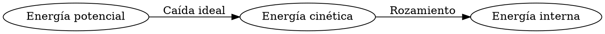

# Energía mecánica y transformaciones

**Objetivo:** distinguir la conservación de la energía total y de la energía
mecánica. **Extensiones:** Graphviz, MathJax.

## Ideas clave

La energía cinética es $K=mv^2/2$. Cerca de la superficie terrestre, la energía
potencial gravitatoria puede escribirse como $U=mgh$, tomando una altura de
referencia. La energía mecánica es $E=K+U$.

Una esfera de 1 kg que se suelta desde 5 m, sin resistencia del aire, tiene
inicialmente 50 J de energía potencial si adoptamos $g=10$ m/s². Al llegar a la
altura cero, esos 50 J se convierten en energía cinética: su rapidez es 10 m/s.

El diagrama distingue el caso ideal del caso con resistencia. Con rozamiento,
la energía mecánica puede disminuir mientras aumenta la energía interna de los
cuerpos y del entorno. Esto no significa que desaparezca la energía total. El
valor de $U$ depende de la referencia, pero las diferencias de energía
potencial entre dos alturas no dependen de esa elección.

## Practica

1. Calcula la energía cinética de 2 kg a 3 m/s.
2. ¿Duplicar la rapidez duplica la energía cinética?

## Respuestas comentadas

1. $K=9$ J.
2. No: se multiplica por cuatro.

## Sigue aprendiendo

[Índice de la colección](README.md) · [Volver a los ejercicios](#practica)

[Português brasileiro](../pt/energia-mecanica.md) ·
[English](../en/energia-mecanica.md)
