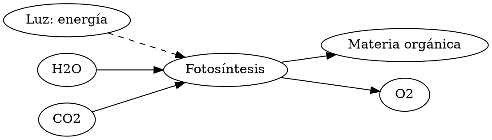

# Fotosíntesis: materia y energía

**Objetivo:** separar el flujo de energía de la transformación de sustancias.
**Extensiones:** Graphviz, MathJax.

## Ideas clave

En la fotosíntesis oxigénica, la energía luminosa se utiliza en procesos que
permiten sintetizar materia orgánica a partir de carbono inorgánico. Una
ecuación global simplificada es:

$$
\ce{6 CO2 + 6 H2O -> C6H12O6 + 6 O2}.
$$

La ecuación resume varias reacciones, no una única etapa. El oxígeno liberado
en la fotosíntesis oxigénica procede del agua; la ecuación simplificada por sí
sola no revela ese recorrido de los átomos. La luz aporta energía, pero no
sustituye al agua y al dióxido de carbono como fuentes de materia.

Las plantas también respiran, consumiendo compuestos orgánicos en procesos que
proporcionan energía a las células. La fotosíntesis y la respiración no son
simplemente actividades exclusivas del día y de la noche.

## Practica

1. Cuenta los átomos de carbono en la ecuación.
2. ¿La luz es una fuente de átomos de carbono?

## Respuestas comentadas

1. Hay seis a cada lado.
2. No; la fuente indicada es CO₂.

## Sigue aprendiendo

[Índice de la colección](README.md) · [Volver a los ejercicios](#practica)

[Português brasileiro](../pt/fotossintese.md) ·
[English](../en/fotossintese.md)
