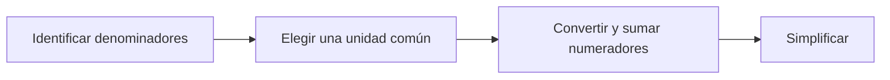

# Fracciones equivalentes y suma

**Objetivo:** sumar fracciones utilizando unidades del mismo tamaño.
**Extensiones:** MathJax, Mermaid.

## Ideas clave

La fracción $a/b$, con $b\ne0$, compara una cantidad con una división de la
unidad. Multiplicar numerador y denominador por el mismo número no nulo
conserva el valor: $1/2=3/6$. Cambian juntos la cantidad y el tamaño de las
partes.

Para sumar $1/2+1/3$, escribimos ambos sumandos en sextos. No podemos sumar
directamente los denominadores porque describen partes de tamaños diferentes.

$$
\frac12+\frac13=\frac36+\frac26=\frac56.
$$

El mínimo común múltiplo ofrece un denominador común pequeño, pero otros
múltiplos comunes también sirven. Simplificar el resultado reduce la escritura
sin cambiar la cantidad. El mismo razonamiento vale para medidas de longitud y
tiempo cuando se utiliza una unidad común.

## Practica

1. Calcula $1/4+1/6$.
2. Explica por qué $2/4$ y $1/2$ representan el mismo valor.

## Respuestas comentadas

1. $3/12+2/12=5/12$.
2. Dos partes de tamaño un cuarto forman la mitad de la unidad.

## Sigue aprendiendo

[Índice de la colección](README.md) · [Volver a los ejercicios](#practica)

[Português brasileiro](../pt/fracoes-equivalentes.md) ·
[English](../en/fracoes-equivalentes.md)
