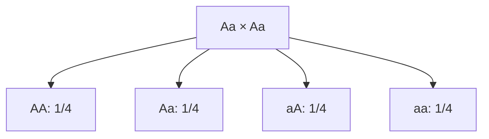

# Genética: un cruce monohíbrido

**Objetivo:** interpretar probabilidades en un modelo de herencia simple.
**Extensiones:** Mermaid, MathJax.

## Ideas clave

Considera un modelo con dos alelos, $A$ y $a$, segregación regular y dominancia
completa de $A$. Un individuo $Aa$ produce gametos con $A$ o $a$, cada uno con
probabilidad $1/2$. En el cruce $Aa\times Aa$, con combinaciones equiprobables,
obtenemos:

Las proporciones genotípicas esperadas son $1/4$ AA, $1/2$ Aa y $1/4$ aa. Con
dominancia completa, AA y Aa presentan el mismo fenotipo en el modelo: la razón
fenotípica esperada es 3:1. Esto no exige que cada grupo de cuatro
descendientes contenga exactamente tres y uno.

Muchos caracteres reales implican varios genes, ambiente u otras relaciones
entre alelos. El diagrama es un modelo de probabilidad, no una regla universal
para cualquier característica biológica.

## Practica

1. ¿Cuál es la probabilidad de un descendiente heterocigoto?
2. ¿Cuál es la probabilidad de dos descendientes aa en eventos independientes?

## Respuestas comentadas

1. $1/2$.
2. $(1/4)(1/4)=1/16$, dentro de las hipótesis.

## Sigue aprendiendo

[Índice de la colección](README.md) · [Volver a los ejercicios](#practica)

[Português brasileiro](../pt/genetica-mendeliana.md) ·
[English](../en/genetica-mendeliana.md)
