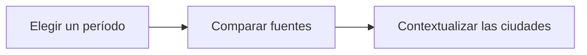

# Mediterráneo antiguo: ciudades y conexiones

**Objetivo:** utilizar la ubicación para comparar contextos históricos sin
confundir mapa y evidencia. **Extensiones:** maps/TopoJSON, Mermaid.

## Ideas clave

Atenas, Roma y Alejandría permiten comparar distintos contextos del mundo
mediterráneo antiguo. Las ciudades conectaban espacios de comercio,
administración, producción intelectual y circulación de personas. No tuvieron
la misma función o importancia en todos los períodos.

```topojson
{
    "type": "Topology",
    "objects": {
        "cities": {
            "type": "GeometryCollection",
            "geometries": [
                {
                    "type": "Point",
                    "properties": {
                        "name": "Atenas"
                    },
                    "coordinates": [
                        23.73,
                        37.98
                    ]
                },
                {
                    "type": "Point",
                    "properties": {
                        "name": "Roma"
                    },
                    "coordinates": [
                        12.5,
                        41.9
                    ]
                },
                {
                    "type": "Point",
                    "properties": {
                        "name": "Alejandría"
                    },
                    "coordinates": [
                        29.92,
                        31.2
                    ]
                }
            ]
        }
    },
    "arcs": []
}
```



El mapa utiliza posiciones actuales aproximadas. No representa fronteras
antiguas ni afirma que existieran rutas directas entre todos los puntos. El
diagrama organiza preguntas de investigación, no una cronología única.

Para comparar las ciudades, delimita el período y consulta fuentes adecuadas,
como textos, inscripciones y restos materiales. La ubicación ayuda a formular
hipótesis sobre acceso al mar y circulación, pero no demuestra por sí sola cómo
vivían los habitantes. Evita tratar la Antigüedad como una sociedad homogénea y
sin cambios.

## Practica

1. ¿Qué ciudad está más al norte en el mapa?
2. ¿Un punto del mapa demuestra la existencia de una ruta comercial?

## Respuestas comentadas

1. Roma, por su mayor latitud.
2. No; esa conclusión requiere otras fuentes.

## Sigue aprendiendo

[Índice de la colección](README.md) · [Volver a los ejercicios](#practica)

[Português brasileiro](../pt/mediterraneo-antigo.md) ·
[English](../en/mediterraneo-antigo.md)
