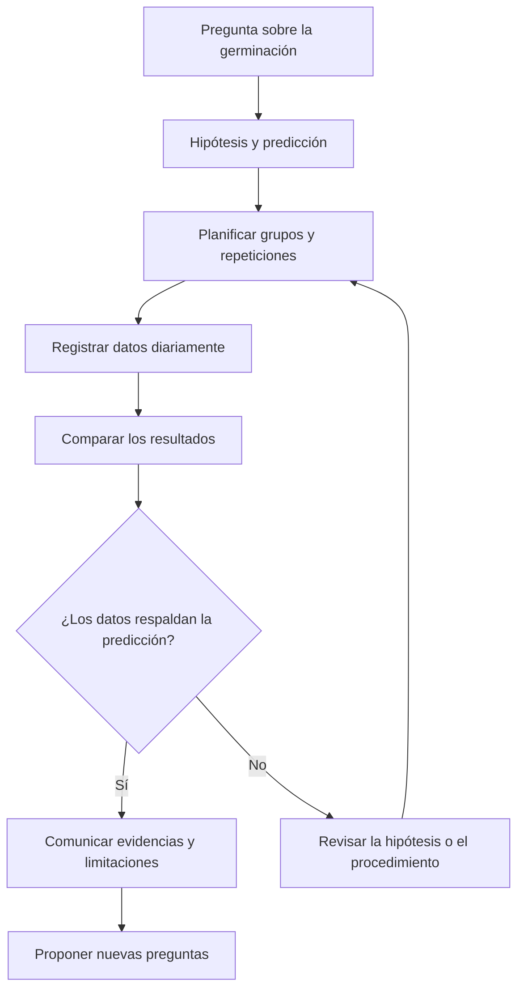

# Investigar la germinación de semillas

**Objetivo:** distinguir hipótesis, control, observación y conclusión.
**Extensión:** Mermaid.

## Una pregunta comprobable

«¿La disponibilidad de agua modifica la germinación?» permite plantear una
investigación. Compara semillas de la misma especie y lote, manteniendo
similares la temperatura, la iluminación y el recipiente. Varía el agua de
forma planificada y registra cuántas semillas germinan en cada grupo. Utiliza
más de una semilla por condición.

## La evidencia no es certeza absoluta

Si un grupo germina menos, considera también los errores de medición, las
diferencias entre semillas y el número de repeticiones. Una asociación
observada en un experimento mal controlado puede no reflejar el efecto de la
variable estudiada. No descartes datos solo porque contradicen la hipótesis.

## Practica

1. Identifica la variable manipulada y la variable observada.
2. ¿Por qué repetir el experimento?
3. Formula una conclusión si germinan 8 de 10 semillas con agua moderada y 2 de
   10 sin riego, en las condiciones adoptadas.

## Respuestas comentadas

1. Manipulada: disponibilidad de agua; observada: germinación.
2. Las repeticiones ayudan a evaluar la variabilidad y la consistencia de los
   resultados.
3. En este ensayo, la condición con agua moderada presentó más germinaciones;
   el resultado no establece por sí solo una regla para todas las especies y
   ambientes.
