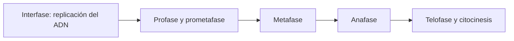

# Mitosis y organización del ciclo celular

**Objetivo:** ordenar etapas y distinguir la replicación del ADN de la división
celular. **Extensiones:** Mermaid.

## Ideas clave

Antes de la mitosis, el ADN se replica durante la fase S de la interfase.
Durante la mitosis, los cromosomas duplicados se distribuyen entre los núcleos
hijos. La citocinesis divide el citoplasma y suele acompañar el final del
proceso.

En la profase se condensan los cromosomas; la prometafase incluye la
reorganización de la envoltura nuclear. En la metafase se alinean los
cromosomas y en la anafase se separan las cromátidas hermanas. En la telofase
se forman nuevos núcleos. El diagrama agrupa etapas para una lectura inicial.

En el modelo habitual de división somática se conserva el número de cromosomas
en las células hijas. Replicar ADN no duplica inmediatamente el número de
cromosomas contado por centrómeros. Distingue este proceso de la meiosis, que
incluye dos divisiones y reducción del número cromosómico.

## Practica

1. ¿En qué etapa ocurre la replicación del ADN?
2. ¿Qué evento caracteriza la anafase?

## Respuestas comentadas

1. En la fase S de la interfase, antes de la mitosis.
2. La separación de las cromátidas hermanas.

## Sigue aprendiendo

[Índice de la colección](README.md) · [Volver a los ejercicios](#practica)

[Português brasileiro](../pt/mitose.md) · [English](../en/mitose.md)
