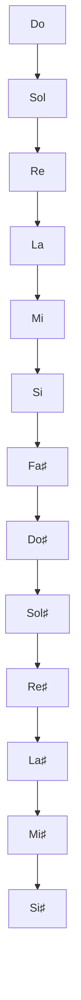
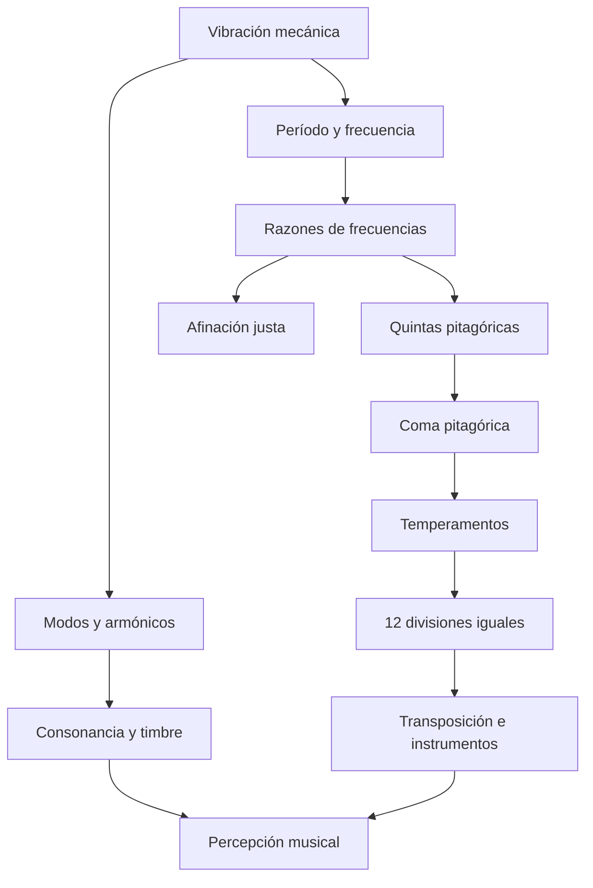

# Las matemáticas y la física de la música: de Pitágoras al temperamento igual

> **Objetivo:** comprender cómo las vibraciones producen sonidos, cómo las
> razones numéricas describen los intervalos musicales y por qué coexisten
> distintos sistemas de afinación. Este texto combina historia, física,
> matemáticas y notación musical.
>
> **Extensiones utilizadas:** `mathjax`, `abc`, `verovio`, `maps`, `vega-lite`,
> `mermaid`, `didactic`, `cross-references`, `heading-ids` y `relative-urls`.
> Deben habilitarse en la aplicación que renderiza el documento; algunas
> requieren bibliotecas opcionales y funciones del entorno.

## 1. Una pregunta que atraviesa los siglos

¿Por qué algunas notas simultáneas suenan estables y consonantes, mientras
otras generan tensión? ¿Qué distingue una altura de otra? ¿Y por qué un piano
moderno permite tocar en distintas tonalidades sin volver a afinarlo?

La música es anterior a la teoría física del sonido. Sin embargo, ciertas
propiedades de los instrumentos y las vibraciones pueden medirse y describirse
matemáticamente. Así estudiamos alturas, intervalos, timbres, escalas y
acordes. Estos modelos no determinan por sí solos la experiencia estética: la
consonancia y la disonancia también dependen de la historia, el repertorio, la
educación auditiva y el timbre.

## 2. Pitágoras, Samos y la tradición de la armonía numérica

Pitágoras vivió aproximadamente en el siglo VI a. C. y se lo relaciona
tradicionalmente con **Samos**, isla del mar Egeo. Más tarde se estableció en
**Crotona** (actual Crotone), en el sur de Italia, donde se desarrolló la
comunidad pitagórica. Esta tradición vinculó las relaciones numéricas con
fenómenos naturales, incluidos los intervalos musicales.

Conviene distinguir la **atribución tradicional** de la **evidencia
histórica**. No se conservan escritos auténticos de Pitágoras. Los relatos
sobre martillos de herreros, cuerdas y experimentos acústicos fueron
registrados y ampliados por autores posteriores. También existen antecedentes
de pensamiento matemático-musical en Mesopotamia. La importancia de la
tradición pitagórica reside especialmente en la influencia duradera de su
interpretación numérica de la armonía.

<!-- prettier-ignore -->
::: figure Samos y centros del Mediterráneo antiguo relacionados con la circulación del conocimiento {#mapa-antigo}

```geojson
{
    "type": "FeatureCollection",
    "features": [
        {
            "type": "Feature",
            "properties": {
                "name": "Samos",
                "label": "Samos",
                "title": "Samos"
            },
            "geometry": {
                "type": "Point",
                "coordinates": [
                    26.98,
                    37.75
                ]
            }
        },
        {
            "type": "Feature",
            "properties": {
                "name": "Crotona",
                "label": "Crotona",
                "title": "Crotona"
            },
            "geometry": {
                "type": "Point",
                "coordinates": [
                    17.13,
                    39.08
                ]
            }
        },
        {
            "type": "Feature",
            "properties": {
                "name": "Mileto (Jonia)"
            },
            "geometry": {
                "type": "Point",
                "coordinates": [
                    27.28,
                    37.53
                ]
            }
        },
        {
            "type": "Feature",
            "properties": {
                "name": "Atenas"
            },
            "geometry": {
                "type": "Point",
                "coordinates": [
                    23.73,
                    37.98
                ]
            }
        },
        {
            "type": "Feature",
            "properties": {
                "name": "Siracusa"
            },
            "geometry": {
                "type": "Point",
                "coordinates": [
                    15.29,
                    37.08
                ]
            }
        },
        {
            "type": "Feature",
            "properties": {
                "name": "Alejandría (fundada posteriormente)"
            },
            "geometry": {
                "type": "Point",
                "coordinates": [
                    29.92,
                    31.20
                ]
            }
        }
    ]
}
```

:::

**Lectura histórica del mapa:** las coordenadas son aproximaciones modernas.
Los puntos no representan fronteras antiguas ni prueban itinerarios personales
de Pitágoras. Alejandría figura como centro posterior de transmisión del
conocimiento, no como ciudad contemporánea de Pitágoras.

La **música de las esferas** es una idea filosófica antigua que relaciona el
orden cósmico con proporciones armónicas. No implica que los planetas produzcan
sonidos audibles en el vacío: el sonido mecánico necesita un medio material.

## 3. ¿Qué es un sonido musical?

Una fuente sonora hace vibrar el medio que la rodea. En un modelo sencillo, la
presión acústica varía aproximadamente según

$$p(t)=p_0+A\sin(2\pi ft+\varphi),$$

donde $A$ es la amplitud, $f$ la frecuencia (hercios), $t$ el tiempo y
$\varphi$ la fase inicial. La frecuencia se relaciona estrechamente con la
**altura** percibida; la amplitud, con la intensidad física, aunque la
sonoridad percibida también depende de la frecuencia, la duración y la
audición.

<!-- prettier-ignore -->
::: definition Frecuencia y período {#frequencia-periodo}

En una oscilación periódica, el período $T$ es el tiempo de un ciclo:

$$\boxed{f=\frac{1}{T}}.$$

Un La de $440\,\mathrm{Hz}$ completa 440 ciclos por segundo y tiene un período
de aproximadamente $2{,}27\,\mathrm{ms}$.

:::

<!-- prettier-ignore -->
::: figure Oscilación sinusoidal muestreada a lo largo del tiempo {#grafico-onda}

```vega-lite
{
  "$schema":"https://vega.github.io/schema/vega-lite/v5.json",
  "description":"Onda de 440 Hz muestreada durante 10 ms.",
  "data":{"sequence":{"start":0,"stop":10.05,"step":0.05,"as":"t"}},
  "transform":[{"calculate":"sin(2*PI*440*datum.t/1000)","as":"p"}],
  "mark":{"type":"line","strokeWidth":2},
  "encoding":{
    "x":{"field":"t","type":"quantitative","title":"Tiempo (ms)"},
    "y":{"field":"p","type":"quantitative","title":"Presión relativa (unidad arbitraria)","scale":{"domain":[-1.1,1.1]}}
  },
  "width":"container","height":220
}
```

:::

Los sonidos reales no suelen ser ondas sinusoidales puras. Una cuerda, una
columna de aire o una membrana pueden producir múltiples componentes de
frecuencia. Esa estructura espectral, junto con el ataque y la evolución
temporal, contribuye al **timbre**.

## 4. El monocordio: longitud, tensión y frecuencia

El **monocordio** es un instrumento didáctico con una cuerda tensada y un
puente móvil que modifica su longitud vibrante. Para una cuerda ideal y
uniforme de longitud $L$, tensión $F$ y densidad lineal $\mu$, la frecuencia
fundamental es

$$\boxed{f_1=\frac{1}{2L}\sqrt{\frac{F}{\mu}}}.$$

Si la tensión y la densidad lineal permanecen constantes,

$$f_1\propto\frac{1}{L}\quad\Longrightarrow\quad\frac{f_2}{f_1}=\frac{L_1}{L_2}.$$

Reducir la longitud a la mitad duplica la frecuencia; reducirla a dos tercios
produce una razón de frecuencias de $3/2$.

<!-- prettier-ignore -->
::: table Longitud vibrante e intervalo respecto a la cuerda completa {#tabela-monocordio}

| Longitud $L'/L$ | Razón de frecuencias $f'/f$ | Intervalo           |
| --------------: | --------------------------: | ------------------- |
|             $1$ |                       $1:1$ | Unísono             |
|           $4/5$ |                       $5:4$ | Tercera mayor justa |
|           $3/4$ |                       $4:3$ | Cuarta justa        |
|           $2/3$ |                       $3:2$ | Quinta justa        |
|           $1/2$ |                       $2:1$ | Octava              |

:::

**La longitud y la frecuencia son inversamente proporcionales**: una razón de
longitudes $2:3$ corresponde a una razón de frecuencias $3:2$. La tensión
también importa: duplicarla multiplica la frecuencia por $\sqrt{2}$, no por 2.

<!-- prettier-ignore -->
::: exercise Experimento con el monocordio {#exercicio-monocordio}

Una cuerda de $80\,\mathrm{cm}$ tiene una frecuencia fundamental de
$220\,\mathrm{Hz}$. Manteniendo la tensión, ¿qué longitud producirá
$330\,\mathrm{Hz}$?

<!-- prettier-ignore -->
::: hint

Use $f_2/f_1=L_1/L_2$.

:::

<!-- prettier-ignore -->
::: solution Resolución

$$L_2=80\frac{220}{330}=\frac{160}{3}\,\mathrm{cm}\approx53{,}33\,\mathrm{cm}.$$

La nueva longitud equivale a $2/3$ de la inicial: una quinta justa más alta.

:::

:::

## 5. La serie armónica y la consonancia

Una cuerda fija en ambos extremos admite ondas estacionarias con frecuencias
ideales

$$\boxed{f_n=nf_1\qquad(n=1,2,3,\ldots)}.$$

Si la fundamental es $220\,\mathrm{Hz}$, los primeros armónicos son $220$,
$440$, $660$, $880$, $1100$ y $1320\,\mathrm{Hz}$. El segundo corresponde a la
octava; el tercero, reducido una octava, a la quinta justa; y el quinto,
reducido dos octavas, a la tercera mayor justa.

<!-- prettier-ignore -->
::: figure Frecuencias de los ocho primeros armónicos de una fundamental de 220 Hz {#grafico-harmonicos}

```vega-lite
{
  "$schema":"https://vega.github.io/schema/vega-lite/v5.json",
  "data":{"values":[{"n":"1","f":220},{"n":"2","f":440},{"n":"3","f":660},{"n":"4","f":880},{"n":"5","f":1100},{"n":"6","f":1320},{"n":"7","f":1540},{"n":"8","f":1760}]},
  "mark":"bar",
  "encoding":{"x":{"field":"n","type":"ordinal","title":"Orden del armónico"},"y":{"field":"f","type":"quantitative","title":"Frecuencia (Hz)"},"tooltip":[{"field":"n"},{"field":"f"}]},
  "width":"container","height":220
}
```

:::

Cuando dos fundamentales tienen razones sencillas, algunos de sus armónicos
pueden coincidir. Para $440\,\mathrm{Hz}$ y $660\,\mathrm{Hz}$:

$$3(440)=2(660)=1320\,\mathrm{Hz}.$$

La coincidencia contribuye a la consonancia de la quinta justa, pero **no
explica universalmente las preferencias musicales**. Los timbres inarmónicos,
como los de las campanas, y distintas tradiciones musicales muestran los
límites de una explicación exclusivamente numérica.

## 6. Intervalos musicales: razones, no diferencias

Un **intervalo** entre frecuencias $f_a$ y $f_b$ puede expresarse mediante
$r=f_b/f_a$. Subir una octava multiplica la frecuencia por 2; subir dos, por 4;
subir una quinta justa, por $3/2$.

<!-- prettier-ignore -->
::: definition Octava {#def-oitava}

Dos notas separadas por una octava tienen una razón de frecuencias $2:1$,
independientemente de la frecuencia inicial: $220\to440$, $440\to880$ y
$880\to1760\,\mathrm{Hz}$ son octavas.

:::

Como la composición de intervalos equivale a multiplicar razones, las escalas
se describen naturalmente de forma **multiplicativa**. Esto conduce a la
medición logarítmica.

## 7. Construcción de la escala pitagórica

En la **afinación pitagórica**, las notas se generan mediante quintas puras de
razón $3/2$ y se trasladan a una misma octava multiplicando por potencias de 2.
Desde Do, las quintas Do – Sol – Re – La – Mi – Si y una quinta descendente
hasta Fa producen una escala diatónica.

<!-- prettier-ignore -->
::: equation Quinta trasladada a la octava de referencia {#eq-quintas}

$$r_k=\left(\frac32\right)^k 2^{-m_k},\qquad 1\leq r_k<2,$$

donde el entero $m_k$ sitúa la nota en la octava de referencia.

:::

<!-- prettier-ignore -->
::: table Escala pitagórica de do mayor: razones respecto al do inicial {#tabela-pitagorica}

| Nota | Grado | Razón $f/f_{\mathrm{Do}}$ | Aproximación |
| ---- | ----- | ------------------------: | -----------: |
| Do   | I     |                     $1/1$ |     1,000000 |
| Re   | II    |                     $9/8$ |     1,125000 |
| Mi   | III   |                   $81/64$ |     1,265625 |
| Fa   | IV    |                     $4/3$ |     1,333333 |
| Sol  | V     |                     $3/2$ |     1,500000 |
| La   | VI    |                   $27/16$ |     1,687500 |
| Si   | VII   |                 $243/128$ |     1,898438 |
| Do   | VIII  |                     $2/1$ |     2,000000 |

:::

<!-- prettier-ignore -->
La siguiente partitura utiliza notas largas y una anchura de pentagrama ampliada para separar las fracciones. El ancho final también depende del CSS del renderizador ABC. Muestra las **alturas escritas**; las razones de {@ref tabela-pitagorica} especifican la afinación física. La notación convencional no determina por sí sola esas razones.

<!-- prettier-ignore -->
::: figure Partitura de do mayor con razones pitagóricas {#partitura-pitagorica}

```abc
X:1
T:Escala de do mayor - grados pitagoricos
C:Ejemplo didactico
M:4/4
L:1/2
%%stretchlast 1
%%staffwidth 1000
K:C
C2 D2 E2 F2 | G2 A2 B2 c2 |]
w: 1/1 9/8 81/64 4/3 3/2 27/16 243/128 2/1
```

:::

**Nota sobre la reproducción:** ABC codifica las notas y las fracciones, pero
el reproductor puede usar temperamento igual. Para escuchar las frecuencias
pitagóricas se necesita un sintetizador con afinación configurable.

La escala pitagórica presenta dos tamaños de paso: el tono $9/8$ y el semitono
diatónico $256/243$, llamado _limma_. Su patrón ascendente es
tono–tono–semitono–tono–tono–tono–semitono. La tercera mayor pitagórica es
$81/64$, diferente de la tercera mayor justa $5/4$.

## 8. Afinación justa: otro sistema no temperado

**No temperada** no designa una escala única. La afinación pitagórica
privilegia las quintas puras; la **afinación justa de límite cinco** también
emplea el factor primo 5 para obtener intervalos como la tercera mayor $5/4$.

<!-- prettier-ignore -->
::: table Dos maneras de afinar una escala de do mayor {#tabela-justa}

| Nota | Pitagórica | Justa de límite cinco (una realización posible) |
| ---- | ---------: | ----------------------------------------------: |
| Do   |      $1/1$ |                                           $1/1$ |
| Re   |      $9/8$ |                                           $9/8$ |
| Mi   |    $81/64$ |                                           $5/4$ |
| Fa   |      $4/3$ |                                           $4/3$ |
| Sol  |      $3/2$ |                                           $3/2$ |
| La   |    $27/16$ |                                           $5/3$ |
| Si   |  $243/128$ |                                          $15/8$ |
| Do   |      $2/1$ |                                           $2/1$ |

:::

La tercera mayor justa $5/4$ es más estrecha que la pitagórica $81/64$. La
razón entre ambas es

$$\frac{81/64}{5/4}=\frac{81}{80},$$

conocida como **coma sintónica**. La afinación justa puede depender del
contexto armónico: un nombre de nota no siempre corresponde a una única
frecuencia en todas las progresiones.

## 9. El problema del círculo de quintas

Partiendo de Do y avanzando por quintas se obtiene Do – Sol – Re – La – Mi – Si
– Fa♯ – Do♯ – Sol♯ – Re♯ – La♯ – Mi♯ – Si♯. En un teclado temperado, Si♯ y Do
corresponden a la misma tecla. Pero **doce quintas puras no equivalen
exactamente a siete octavas**.



<!-- prettier-ignore -->
::: equation La coma pitagórica {#eq-coma}

$$\boxed{\frac{(3/2)^{12}}{2^7}=\frac{531441}{524288}\approx1{,}0136433.}$$

:::

La diferencia es de unos **23,46 cents**, algo menos de un cuarto de semitono
temperado. Por eso, un sistema cerrado de doce notas no puede conservar todas
las quintas en $3/2$ y todas las octavas en $2/1$. Hay que concentrar la
discrepancia en un intervalo o distribuirla entre varios.

Algunas afinaciones históricas producen un intervalo especialmente desafinado,
la llamada **quinta del lobo**.

## 10. ¿Qué significa temperar una escala?

**Temperar** consiste en ajustar deliberadamente los intervalos respecto de sus
razones puras para obtener otras ventajas musicales. Existen temperamentos
desiguales, como los mesotónicos y diversos buenos temperamentos históricos, y
temperamentos iguales.

En el **temperamento igual de doce divisiones de la octava** (12-TET), cada
semitono tiene la misma razón de frecuencias:

<!-- prettier-ignore -->
::: equation Frecuencia de una nota en el temperamento igual {#eq-12tet}

$$\boxed{f_n=f_0\,2^{n/12}},\qquad n\in\mathbb{Z}.$$

:::

Dos notas separadas por siete semitonos tienen razón $2^{7/12}\approx1,498307$,
ligeramente menor que la quinta pura $3/2=1,5$. Las octavas permanecen
exactamente en $2/1$.

<!-- prettier-ignore -->
::: table Frecuencias desde La 440 Hz en 12-TET {#tabela-frequencias}

| Nota | Semitonos sobre La | Frecuencia (Hz) |
| ---- | -----------------: | --------------: |
| La   |                  0 |          440,00 |
| La♯  |                  1 |          466,16 |
| Si   |                  2 |          493,88 |
| Do   |                  3 |          523,25 |
| Do♯  |                  4 |          554,37 |
| Re   |                  5 |          587,33 |
| Re♯  |                  6 |          622,25 |
| Mi   |                  7 |          659,26 |
| Fa   |                  8 |          698,46 |
| Fa♯  |                  9 |          739,99 |
| Sol  |                 10 |          783,99 |
| Sol♯ |                 11 |          830,61 |
| La   |                 12 |          880,00 |

:::

La principal ventaja es la **transposición**: un mismo patrón de intervalos
puede desplazarse a otra tonalidad sin volver a afinar un instrumento de altura
fija. Como contrapartida, la mayoría de los intervalos difiere ligeramente de
las razones sencillas de la afinación justa.

## 11. ¿Cómo medir diferencias tan pequeñas? El cent

El **cent** es una unidad logarítmica: una octava equivale a 1200 cents y cada
semitono de 12-TET a 100 cents.

<!-- prettier-ignore -->
::: equation Medida logarítmica de un intervalo {#eq-cent}

$$\boxed{c=1200\log_2\left(\frac{f_2}{f_1}\right)}.$$

:::

Los logaritmos convierten la multiplicación de razones en suma de intervalos:
una quinta más una cuarta forman una octava, pues $(3/2)(4/3)=2$.

<!-- prettier-ignore -->
::: table Intervalos justos, pitagóricos y temperados {#tabela-comparacao}

| Intervalo                | Razón pura seleccionada | Cents de la razón pura | Cents en 12-TET |
| ------------------------ | ----------------------: | ---------------------: | --------------: |
| Tercera mayor justa      |                   $5/4$ |                 386,31 |          400,00 |
| Tercera mayor pitagórica |                 $81/64$ |                 407,82 |          400,00 |
| Cuarta justa             |                   $4/3$ |                 498,04 |          500,00 |
| Quinta justa             |                   $3/2$ |                 701,96 |          700,00 |
| Octava                   |                   $2/1$ |                1200,00 |         1200,00 |

:::

<!-- prettier-ignore -->
::: figure Desviación de afinación respecto a 12-TET, en cents {#grafico-desviacions}

```vega-lite
{
  "$schema":"https://vega.github.io/schema/vega-lite/v5.json",
  "data":{"values":[
    {"intervalo":"Tercera mayor justa","desviacion":-13.686},
    {"intervalo":"Tercera mayor pitagórica","desviacion":7.820},
    {"intervalo":"Cuarta justa","desviacion":-1.955},
    {"intervalo":"Quinta justa","desviacion":1.955},
    {"intervalo":"Octava","desviacion":0}
  ]},
  "mark":"bar",
  "encoding":{
    "y":{"field":"intervalo","type":"nominal","sort":null,"title":null},
    "x":{"field":"desviacion","type":"quantitative","title":"Desviación respecto al temperamento igual (cents)","scale":{"domain":[-16,10]}},
    "tooltip":[{"field":"intervalo"},{"field":"desviacion","format":".2f"}]
  },
  "width":"container","height":220
}
```

:::

## 12. ¿Por qué precisamente doce notas por octava?

Doce divisiones no son una imposición natural. Constituyen una elección
histórica favorecida por la organización de las notas en quintas y por una
aproximación matemática útil:

$$\left(\frac32\right)^{12}\approx2^7.$$

Una quinta pura ocupa $\log_2(3/2)\approx0,5849625$ octavas. La aproximación
racional

$$\frac7{12}\approx0,5833333$$

permite representar una quinta mediante **siete de doce pasos iguales**. El
error es de solo $1,955$ cents por quinta.

En una división igual de $N$ pasos, una quinta puede aproximarse mediante $k$
pasos si

$$\boxed{\frac{k}{N}\approx\log_2(3/2).}$$

<!-- prettier-ignore -->
::: table Otras divisiones iguales posibles {#tabela-edos}

| Divisiones $N$ | Pasos $k$ para la quinta | Quinta aproximada (cents) | Error respecto a 701,955 cents |
| -------------: | -----------------------: | ------------------------: | -----------------------------: |
|             10 |                        6 |                    720,00 |                         +18,05 |
|             12 |                        7 |                    700,00 |                          −1,96 |
|             19 |                       11 |                    694,74 |                          −7,22 |
|             24 |                       14 |                    700,00 |                          −1,96 |
|             31 |                       18 |                    696,77 |                          −5,18 |
|             53 |                       31 |                    701,89 |                          −0,07 |

:::

La división en **24 pasos** conserva la quinta aproximada de 12-TET y añade
notas intermedias de 50 cents. **19 pasos** ofrecen otras relaciones y
posibilidades expresivas. **53 pasos** aproximan extraordinariamente bien la
quinta pura, pero requieren más alturas por octava. Ningún sistema es
universalmente superior: cada uno equilibra cantidad de notas, precisión y
prácticas culturales.

El uso occidental de doce notas también responde a la historia de los
instrumentos, la notación, el repertorio, el contrapunto, la armonía y las
convenciones interpretativas. El **temperamento igual de doce notas** se
difundió gradualmente y no debe confundirse con el origen histórico de las doce
clases cromáticas de altura.

## 13. Batimientos: cuando dos frecuencias casi coinciden

La suma de dos ondas sinusoidales de frecuencias próximas cumple

$$\sin(2\pi f_1t)+\sin(2\pi f_2t)=2\cos\!\left(\pi(f_1-f_2)t\right)\sin\!\left(\pi(f_1+f_2)t\right).$$

Una oscilación rápida queda modulada por una envolvente lenta. En condiciones
apropiadas, la frecuencia de batimiento es $|f_1-f_2|$.

Una quinta justa sobre La $440\,\mathrm{Hz}$ corresponde a $660\,\mathrm{Hz}$;
la quinta temperada vale aproximadamente $659,255\,\mathrm{Hz}$. Comparemos el
tercer armónico de la nota inferior con el segundo de la superior:

- Quinta justa: $3(440)=2(660)=1320\,\mathrm{Hz}$ — coincidencia exacta.
- Quinta temperada: $3(440)=1320\,\mathrm{Hz}$ y
  $2(659,255)\approx1318,51\,\mathrm{Hz}$ — diferencia de unos
  $1,49\,\mathrm{Hz}$.

Puede producirse una modulación lenta si ambos componentes tienen suficiente
intensidad. La percepción depende del volumen, el timbre, el ambiente y el
oído.

## 14. Partitura, afinación e interpretación: tres niveles distintos

Una **partitura** representa notas, duraciones, compases y articulaciones. Una
**afinación** asigna frecuencias concretas a las notas. Una **interpretación**
realiza esos sonidos mediante instrumentos e intérpretes.

<!-- prettier-ignore -->
::: figure La misma escala en MEI: la afinación se especifica por separado {#partitura-mei}

```mei
<?xml version="1.0" encoding="UTF-8"?>
<mei xmlns="http://www.music-encoding.org/ns/mei" meiversion="5.0">
  <meiHead><fileDesc><titleStmt><title>Escala de do mayor</title></titleStmt><pubStmt/></fileDesc></meiHead>
  <music><body><mdiv><score>
    <scoreDef meter.count="4" meter.unit="4"><staffGrp><staffDef n="1" lines="5" clef.shape="G" clef.line="2"/></staffGrp></scoreDef>
    <section>
      <measure n="1"><staff n="1"><layer n="1"><note pname="c" oct="4" dur="4"/><note pname="d" oct="4" dur="4"/><note pname="e" oct="4" dur="4"/><note pname="f" oct="4" dur="4"/></layer></staff></measure>
      <measure n="2"><staff n="1"><layer n="1"><note pname="g" oct="4" dur="4"/><note pname="a" oct="4" dur="4"/><note pname="b" oct="4" dur="4"/><note pname="c" oct="5" dur="4"/></layer></staff></measure>
    </section>
  </score></mdiv></body></music>
</mei>
```

:::

El mismo fragmento escrito puede interpretarse con afinación pitagórica, justa
o temperada. La distinción es especialmente importante para instrumentos de
altura flexible, como la voz y las cuerdas sin trastes.

## 15. Síntesis: una red de relaciones



La experiencia musical combina regularidades físicas, modelos matemáticos y
decisiones culturales. Pitágoras se convirtió en símbolo de esta relación
porque la tradición pitagórica vinculó consonancia y proporción. El monocordio
explica la importancia de la longitud de la cuerda; los armónicos muestran
frecuencias relacionadas; las escalas seleccionan alturas; y la coma pitagórica
demuestra por qué doce quintas puras no cierran exactamente con siete octavas.

El temperamento igual no sustituyó una afinación natural universal. Es una
solución especialmente útil para prácticas que requieren transposición y
diversas tonalidades. Otras afinaciones siguen siendo válidas y expresivas.

## 16. Actividades de investigación

<!-- prettier-ignore -->
::: exercise Actividad 1 — Calcular la frecuencia {#atividade-frequencia}

Con do de referencia $f_0=256\,\mathrm{Hz}$, calcule las frecuencias del mi
pitagórico ($81/64$), mi justo ($5/4$) y mi temperado ($2^{4/12}$). Compare los
resultados.

<!-- prettier-ignore -->
::: solution Respuesta explicada

Mi pitagórico: $256(81/64)=324\,\mathrm{Hz}$. Mi justo:
$256(5/4)=320\,\mathrm{Hz}$. Mi temperado:
$256\,2^{1/3}\approx322{,}54\,\mathrm{Hz}$. El mismo nombre de nota puede
corresponder a distintas frecuencias según el sistema.

:::

:::

<!-- prettier-ignore -->
::: exercise Actividad 2 — Verificar la coma {#atividade-coma}

Calcule $(3/2)^{12}/2^7$ y explique por qué doce quintas puras no cierran
exactamente el ciclo.

<!-- prettier-ignore -->
::: solution Respuesta explicada

El resultado es $531441/524288\approx1{,}0136433$, mayor que 1. Las frecuencias
finales no coinciden: esta diferencia es la coma pitagórica.

:::

:::

<!-- prettier-ignore -->
::: exercise Actividad 3 — Diseñar otro temperamento {#atividade-edo}

En una octava dividida en 19 pasos iguales, ¿cuál es la razón entre pasos
consecutivos? ¿Qué frecuencia se obtiene siete pasos por encima de
$440\,\mathrm{Hz}$?

<!-- prettier-ignore -->
::: solution Respuesta explicada

La razón es $2^{1/19}$. Siete pasos sobre 440 Hz dan
$440\,2^{7/19}\approx568{,}0\,\mathrm{Hz}$. En 19-TET la quinta se aproxima con
once pasos, no siete.

:::

:::

<!-- prettier-ignore -->
::: exercise Actividad 4 — Interpretar una partitura {#atividade-partitura}

<!-- prettier-ignore -->
¿La partitura de {@ref partitura-pitagorica} determina la frecuencia exacta de cada nota? Explique la diferencia entre notación y afinación.

<!-- prettier-ignore -->
::: solution Respuesta explicada

No. La partitura indica nombres y duraciones, pero no un sistema completo de
frecuencias. Se necesitan una nota de referencia y un sistema de afinación; las
fracciones del texto completan la especificación pitagórica.

:::

:::

## Referencias y lecturas complementarias

Los siguientes enlaces son puntos de partida para ampliar y comprobar la
información. Los artículos de Wikipedia son fuentes secundarias y no sustituyen
la investigación historiográfica especializada.

1. [Pitágoras — Wikipedia en portugués](https://pt.wikipedia.org/wiki/Pit%C3%A1goras).
2. [Pythagoras — Wikipedia en inglés](https://en.wikipedia.org/wiki/Pythagoras).
3. [Pythagore — Wikipedia en francés](https://fr.wikipedia.org/wiki/Pythagore).
4. [Pitágoras — Wikipedia en español](https://es.wikipedia.org/wiki/Pit%C3%A1goras).
5. [Pythagoreanism — pitagorismo](https://en.wikipedia.org/wiki/Pythagoreanism).
6. [Pythagorean tuning — afinación pitagórica](https://en.wikipedia.org/wiki/Pythagorean_tuning).
7. [Just intonation — afinación justa](https://en.wikipedia.org/wiki/Just_intonation).
8. [Musical temperament — temperamento musical](https://en.wikipedia.org/wiki/Musical_temperament).
9. [Pythagorean comma — coma pitagórica](https://en.wikipedia.org/wiki/Pythagorean_comma).
10. [MathJSLab Markdown — documentación](https://github.com/MathJSLab/mathjslab-markdown).
